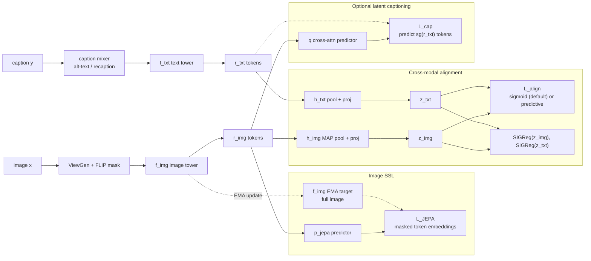
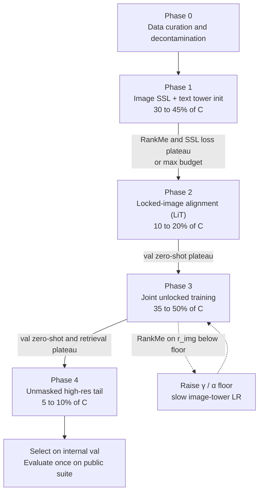

# SSL and Language Supervision Curriculum for CLIP-style Pretraining (v1, audited)

## 0. Problem Statement

Train an image-text dual encoder that maximizes zero-shot classification and retrieval **without losing the non-linguistic visual information that captions never describe**, given noisy web image-text pairs **D_it**, an optional image-only pool **D_i**, and a fixed compute budget **C**.

**Success criteria**

| # | Criterion | Measured on |
| --- | --- | --- |
| S1 | Zero-shot top-1 and robustness average beat compute-matched baselines B0 to B3 (Section 10) | ImageNet + IN-V2, -R, -A, -Sketch, ObjectNet |
| S2 | Retrieval recall@1/5 at or above best baseline | COCO, Flickr30k (5k test splits) |
| S3 | Vision-centric quality above best baseline | Frozen linear probe, dense probe (ADE20k, NYUv2), MMVP-style paired-image test |
| S4 | All transitions driven by internal val splits; public benchmarks touched once per final model | Training logs |

**Out of scope:** generative VLM training, video, multilingual coverage (extendable), safety fine-tuning.

---

## 1. Guiding Principles

| Principle | Source | Implication |
| --- | --- | --- |
| Captions are a lossy, low-bandwidth supervisor; most visual content is never described | LeCun 2022; Eyes Wide Shut (Tong, ..., LeCun, Xie) | Image tower needs a language-free SSL signal to retain details captions omit |
| Much of the CLIP vs SSL gap is data distribution, not language | Web-SSL (Fan, ..., LeCun, Xie) | Run image SSL on the same curated web images, not a separate dataset |
| Predict in latent space, not token or pixel space | I-JEPA, VL-JEPA | Image SSL via JEPA; optional captioning signal as latent prediction, not token decoding |
| Contrastive learning scales poorly with embedding dimension; prefer regularized objectives | LeCun 2022, VICReg, LeJEPA | Pairwise sigmoid loss (no global softmax) as default; non-contrastive alignment as a tested variant |
| A locked, well-pretrained image tower aligns cheaply and transfers well | LiT | Insert a locked-alignment phase before joint training |
| SSL and language losses are complementary when combined | SLIP, SILC, TIPS, SigLIP 2 | Keep SSL active during alignment; ordering is the open question |
| Projector outputs discard information | Guillotine Regularization | Alignment on heads; dense and probe evaluation on backbone tokens |

---

## 2. Epistemic Status

| Claim | Status | Source |
| --- | --- | --- |
| CLIP features miss fine visual distinctions that SSL features retain | Established | Eyes Wide Shut (MMVP) |
| Visual SSL on web data matches CLIP on VQA at scale | Established (single group, ICCV 2025) | Web-SSL |
| Sigmoid loss outperforms softmax InfoNCE at small/medium batch, batch saturates near 32k | Established | SigLIP |
| Locked pretrained image tower gives strong zero-shot at low cost | Established | LiT |
| Adding SSL losses to CLIP improves dense features | Established | SILC, TIPS, SigLIP 2 |
| SigLIP 2 adds SSL losses only in the final 20% of training | Established (their recipe) | SigLIP 2 |
| Image masking (50%+) speeds CLIP training with small accuracy cost | Established | FLIP |
| Latent embedding prediction beats token prediction for VL training at equal data | Reported, controlled study | VL-JEPA |
| Recaptioning improves alignment; full replacement hurts diversity | Established, mixture ratio task-dependent | VeCLIP, Recap-DataComp-1B |
| **SSL-first ordering beats language-first ordering (SigLIP 2 style)** | **Hypothesis**, core test of this plan | none |
| Non-contrastive alignment (predictive + SIGReg) reaches contrastive zero-shot accuracy | **Hypothesis** | none |
| SIGReg on both modalities reduces the modality gap | **Hypothesis** | none |
| Late hard-negative curriculum improves compositionality without hurting zero-shot | **Hypothesis**, mixed evidence | NegCLIP and follow-ups |

---

## 3. Audit: Standard CLIP Recipe vs This Plan

| # | Issue in standard CLIP recipe | Severity | Fix in this plan |
| --- | --- | --- | --- |
| 1 | Image tower learns only what captions mention; fine-grained and spatial detail lost | High | Image JEPA loss active in every phase, floored weight |
| 2 | Softmax InfoNCE couples all pairs in batch, needs huge batches and all-gathers | Medium | Pairwise sigmoid loss (default) |
| 3 | Uncurated head-heavy concept distribution | High | MetaCLIP-style concept balancing in Phase 0 |
| 4 | Eval contamination from web scraping | High | Near-duplicate removal against all eval sets before any training |
| 5 | Alt-text noise and brevity | Medium | Caption mixer: raw alt-text plus partial recaptions, ratio swept |
| 6 | Full-resolution, unmasked training is compute-heavy | Medium | FLIP masking reused as JEPA context, unmasked high-res tail phase |
| 7 | Modality gap: image and text embeddings occupy separate regions | Medium | Gap metric monitored; SIGReg on both modalities tested |
| 8 | Bag-of-words behavior on compositional queries | Medium | Optional late hard-negative curriculum, ablated |
| 9 | Dense features weak | Medium | JEPA token-level loss on backbone; dense probes in eval |
| 10 | Ordering of SSL vs language unexamined | High | Explicit ordering experiment: SSL-first (proposed) vs language-first (SigLIP 2) |

**Self-audit of this plan (open weaknesses):** SSL-first may spend compute that scaling laws would assign to alignment; joint unlocking may erase SSL structure; non-contrastive alignment is unproven for zero-shot. Each is covered by a baseline or ablation (Section 10) and a risk entry (Section 11).

---

## 4. Architecture



### Image SSL options

|  | **Option B: I-JEPA-style (default for ViT)** | **Option A: LeJEPA-style** |
| --- | --- | --- |
| Views | FLIP-masked image as context, full image to EMA target | Multi-crop |
| Anti-collapse | EMA target + stop-grad | SIGReg, no teacher |
| Why choose | Same mask serves FLIP speedup and JEPA context | Fewer heuristics, any tower architecture |
| Cost note | EMA target forward on full image (no backward) | Extra crops through student |

### Alignment options

|  | **Sigmoid (default)** | **Predictive non-contrastive (variant)** |
| --- | --- | --- |
| Loss | Pairwise logistic over all image-text pairs in batch | $\|q(z\_{img}) - z\_{txt}\|^2$ + SIGReg on both modalities |
| Negatives | Implicit, per pair | None |
| Zero-shot | Proven | Hypothesis |
| LeCun alignment | Partial (contrastive, but no global partition) | Full (regularized, latent prediction) |

---

## 5. Objective

$$ \\mathcal{L}(t) = \\alpha(t),\\hat{\\mathcal{L}}*{\\text{JEPA}} + \\beta(t),\\hat{\\mathcal{L}}*{\\text{align}} + \\gamma(t),\\hat{\\mathcal{R}} + \\kappa(t),\\hat{\\mathcal{L}}\_{\\text{cap}} $$

- $\\hat{\\mathcal{L}}\_k = \\mathcal{L}\_k / \\text{sg}(\\text{EMA}(\\mathcal{L}\_k))$: normalized so weights express relative importance.
- $\\mathcal{L}*{\\text{JEPA}} = | p(r*{\\text{ctx}}, \\text{pos}*{\\text{mask}}) - \\text{sg}(\\bar f*{img}(x)\_{\\text{mask}}) |^2$
- $\\mathcal{L}*{\\text{align}}$ (sigmoid): $-\\frac{1}{|B|}\\sum*{i,j} \\log \\sigma\\big(s\_{ij}(\\tau, z^{img}\_i \\cdot z^{txt}*j + b)\\big)$, $s*{ij}=+1$ if $i=j$ else $-1$
- $\\mathcal{R}$: SIGReg on $z\_{img}$ and $z\_{txt}$ (required for predictive alignment, optional for sigmoid)
- $\\mathcal{L}*{\\text{cap}}$: cross-attention predictor from $r*{img}$ to stop-grad text token embeddings (latent captioning, no token decoder)

---

## 6. Curriculum Axes

| Axis | Start | End | Status |
| --- | --- | --- | --- |
| Signal | Image-only latent prediction | Cross-modal alignment + SSL floor | Core design (ordering is hypothesis) |
| Image tower | Trainable (SSL) | Locked, then unlocked with layer-wise LR decay | LiT / LP-FT analog |
| Data | Curated images | Curated pairs, then recaption mixture, then hard negatives | Partly established |
| Masking | 50 to 75% (FLIP + JEPA) | 0% (unmasked tail) | FLIP |
| Resolution | 224 | 384+ or native aspect | Established |
| Caption length | Short alt-text, 64 tokens | Mixed with dense recaptions, longer context | Hypothesis |
| Negatives | In-batch random | Mined hard / compositional | Hypothesis |

---

## 7. Phases



### Phase 0: Data curation

| Step | Action |
| --- | --- |
| Concept balancing | MetaCLIP-style: match alt-text to concept list, cap per-concept counts to flatten head |
| Decontamination | Near-duplicate removal (perceptual + embedding hash) against all eval sets |
| Filtering | Safety, PII, broken images, language ID |
| Image-only pool | Images of D_it plus D_i; optional text-rich subset for OCR (Web-SSL finding) |
| Recaptions | Generate dense captions for a subset; store alongside alt-text |
| Internal splits | Held-out pairs for val retrieval; held-out class prompts for val zero-shot |

### Phase 1: Unimodal SSL

| Item | Setting |
| --- | --- |
| Image tower | JEPA on curated images: α=1, β=0, κ=0 |
| Text tower | Init from pretrained text encoder, or MLM on captions (ablate) |
| Monitoring | RankMe on r_img, kNN on small labeled val set, SSL loss |
| Exit | Smoothed RankMe and SSL loss plateau for P evals, or max budget |

### Phase 2: Locked-image alignment

| Item | Setting |
| --- | --- |
| Trainable | Text tower, h_img, h_txt; image tower frozen (optionally top 2 blocks unfrozen) |
| Loss | β=1, γ=γ₀ if predictive variant |
| Efficiency | With frozen tower and no masking, precompute r_img once |
| Exit | Val zero-shot plateau |

### Phase 3: Joint unlocked training

| Item | Setting |
| --- | --- |
| Trainable | All towers; image tower LLRD 0.65 to 0.8, short LR re-warmup |
| Weights | β=1; α cosine 1 to α_min > 0; γ floored at γ_min; κ ramped in if used |
| Masking | FLIP 50%, same mask feeds JEPA context |
| Data | Recaption mixture ramps in from 0 to target ratio |
| Guard | RankMe on r_img below floor triggers higher α/γ and lower image-tower LR |
| Exit | Val zero-shot and retrieval plateau |

### Phase 4: High-resolution tail

| Item | Setting |
| --- | --- |
| Masking | Off |
| Resolution | 384+ or native aspect (NaFlex-style) |
| Weights | β=1, α=α_min, γ=γ_min, κ off |
| Optional | Hard / compositional negatives at low ratio |
| Exit | Budget; checkpoint selected on internal val |

---

## 8. Transition Controller

```python
class Controller:
    PHASE_SIGNALS = {1: ("rank", "ssl"), 2: ("zs_val",), 3: ("zs_val", "ret_val"), 4: ()}

    def __init__(self, cfg):
        self.cfg, self.phase, self.t_phase, self.stall = cfg, 1, 0, 0
        self.ema = {k: EMA(cfg.smooth) for k in ("rank", "ssl", "zs_val", "ret_val")}

    def step(self, step, m):
        for k, v in m.items():
            if k in self.ema and v is not None:
                self.ema[k].update(v)
        c, span = self.cfg.phase[self.phase], step - self.t_phase
        keys = self.PHASE_SIGNALS[self.phase]
        cond = bool(keys) and all(self.ema[k].slope() < c.eps[k] for k in keys)
        self.stall = self.stall + 1 if (cond and span >= c.min_steps) else 0
        if self.phase == 3 and self.ema["rank"].value() < c.rank_floor:
            return "guard"
        if self.stall >= c.patience or span >= c.max_steps:
            self.phase, self.t_phase, self.stall = self.phase + 1, step, 0
            return "transition"
        return None

    def weights(self, step):
        cfg, s = self.cfg, step - self.t_phase
        if self.phase == 1:
            return dict(alpha=1.0, beta=0.0, gamma=0.0, kappa=0.0)
        if self.phase == 2:
            return dict(alpha=0.0, beta=1.0, gamma=cfg.g0, kappa=0.0)
        if self.phase == 3:
            alpha = cfg.a_min + (1 - cfg.a_min) * 0.5 * (1 + cos(pi * min(s / cfg.S, 1)))
            kappa = cfg.k_max * min(s / cfg.k_ramp, 1)
            return dict(alpha=alpha, beta=1.0, gamma=max(cfg.g0 * alpha, cfg.g_min), kappa=kappa)
        return dict(alpha=cfg.a_min, beta=1.0, gamma=cfg.g_min, kappa=0.0)
```

Signals tracked every N steps on internal splits: RankMe (r_img, z_img, z_txt), val zero-shot, val retrieval, modality gap (centroid distance), alignment and uniformity, learned τ and b.

---

## 9. Hyperparameters

| Parameter | Default | Range / sweep | Status |
| --- | --- | --- | --- |
| Sigmoid τ, b init | τ = 10 (log-param), b = -10 | fixed | SigLIP |
| Batch size | 32k | 8k to 32k | SigLIP |
| Text length | 64 tokens | 64 to 128 when recaptions dominate | SigLIP / hypothesis |
| FLIP mask ratio | 50% | 50 to 75% | FLIP |
| JEPA EMA momentum | 0.996 to 1.0 | fixed | I-JEPA |
| α_min | 0.1 | 0 (ablation) to 0.2 | Hypothesis |
| γ_min (SIGReg) | 0.5·γ₀ | 0.25 to 1.0·γ₀ | Hypothesis |
| Image-tower LLRD (Phase 3) | 0.75 | 0.65 to 0.8 | Established |
| Recaption ratio | 30% | 0, 15, 30, 50% | Hypothesis |
| κ_max (latent captioning) | 0.25 | 0 to 0.5 | Hypothesis |
| Phase budget split | 35 / 15 / 42 / 8 | see Section 7 | Hypothesis |
| Patience P | 5 evals | 3 to 10 | Engineering choice |

---

## 10. Evaluation Protocol

**Compute-matched baselines** (same curated data, same total FLOPs)

| ID | Method | Tests |
| --- | --- | --- |
| B0 | SigLIP from scratch | Value of SSL at all |
| B1 | SigLIP 2-style: language first, SSL losses in final 20% | **Ordering hypothesis** |
| B2 | Joint from step 0, constant weights (SLIP/SILC style) | Value of curriculum |
| B3 | Phase 1 + 2 only (LiT on SSL tower, never unlocked) | Value of joint unlocking |
| B4 | Proposed curriculum |  |
| B5 | B4 with predictive non-contrastive alignment | Non-contrastive hypothesis |

**Ablations on B4**

| Ablation | Tests |
| --- | --- |
| α_min = 0 | Persistent SSL needed after alignment |
| No shared FLIP/JEPA mask | Mask reuse benefit |
| Recaption ratio sweep | Caption curriculum |
| κ = 0 | Latent captioning value |
| SIGReg off (sigmoid variant) | Effect on modality gap |
| Hard negatives on/off | Compositionality vs zero-shot trade-off |
| Text tower pretrained vs MLM vs scratch | Text-side init |

**Scale grid:** at least two model sizes and two data scales to check whether ordering effects persist with scale; 3 seeds at the smallest scale.

**Metrics:** S1 to S3 suites, plus compositional benchmark (SugarCrepe-style), modality gap, GPU-hours.

---

## 11. Vulnerability Matrix

| Risk | Likelihood | Impact | Detection | Mitigation |
| --- | --- | --- | --- | --- |
| SSL-first loses to language-first at equal compute | Medium | High | B4 vs B1 | Adopt B1 ordering, keep SSL floor; report honestly |
| Joint unlocking erases SSL structure | Medium | High | RankMe on r_img, dense probe drop | Guard trigger, lower image LLRD, higher α_min |
| Non-contrastive alignment fails zero-shot | High | Medium | B5 vs B4 | Keep as research branch only |
| Eval contamination | Medium | High | Duplicate audit report | Phase 0 dedup, report overlap stats |
| Recaption hallucination teaches false grounding | Medium | Medium | Retrieval on human captions drops | Cap ratio, mix with alt-text |
| Hard negatives hurt zero-shot | Medium | Medium | Zero-shot drop in Phase 4 | Low ratio, ablate, drop if net negative |
| Concept balancing removes useful long tail | Low | Medium | Tail-class zero-shot | Tune per-concept cap |
| EMA target cost erodes FLIP savings | Medium | Low | GPU-hour accounting | Option A (multi-crop SIGReg) or sparse target updates |
| Ordering effect is scale-dependent | Medium | High | Scale grid | Report per scale; avoid extrapolation |

---

## 12. References

- LeCun, *A Path Towards Autonomous Machine Intelligence*, 2022.
- Radford et al., *CLIP: Learning Transferable Visual Models From Natural Language Supervision*, ICML 2021.
- Zhai et al., *LiT: Zero-Shot Transfer with Locked-image Text Tuning*, CVPR 2022.
- Zhai et al., *SigLIP: Sigmoid Loss for Language Image Pre-Training*, ICCV 2023.
- Tschannen et al., *SigLIP 2*, arXiv 2502.14786, 2025.
- Mu et al., *SLIP: Self-supervision meets Language-Image Pre-training*, ECCV 2022.
- Naeem et al., *SILC: Improving Vision Language Pretraining with Self-Distillation*, ECCV 2024.
- Maninis et al., *TIPS: Text-Image Pretraining with Spatial Awareness*, ICLR 2025.
- Li et al., *FLIP: Scaling Language-Image Pre-training via Masking*, CVPR 2023.
- Xu et al., *MetaCLIP: Demystifying CLIP Data*, ICLR 2024.
- Tong, Liu, Zhai, Ma, LeCun, Xie, *Eyes Wide Shut? Exploring the Visual Shortcomings of Multimodal LLMs*, CVPR 2024.
- Fan, Tong, ..., LeCun, Bar, Xie, *Scaling Language-Free Visual Representation Learning (Web-SSL)*, ICCV 2025, arXiv 2504.01017.
- Chen, Shukor, Moutakanni, Chung, ..., LeCun, Fung, *VL-JEPA*, ICLR 2026, arXiv 2512.10942.
- Assran et al., *I-JEPA*, CVPR 2023.
- Balestriero, LeCun, *LeJEPA*, arXiv 2025.
- Garrido, Balestriero, Najman, LeCun, *RankMe*, ICML 2023.
- Bordes et al., *Guillotine Regularization*, 2023.
- Liang et al., *Mind the Gap: Understanding the Modality Gap in Multi-modal Contrastive Representation Learning*, NeurIPS 2022.
- Wang, Isola, *Understanding Contrastive Representation Learning through Alignment and Uniformity*, ICML 2020.
- Yuksekgonul et al., *When and Why Vision-Language Models Behave like Bags-of-Words*, ICLR 2023.
- Lai et al., *VeCLIP*, ECCV 2024; Li et al., *What If We Recaption Billions of Web Images with LLaMA-3?*, 2024.