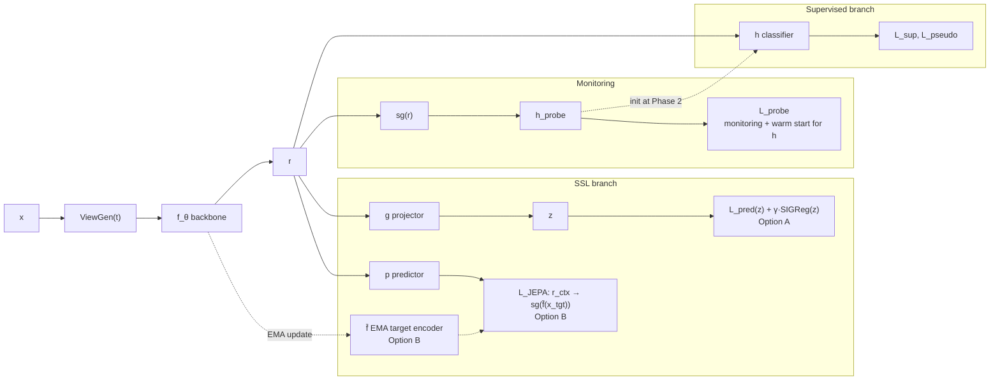

# SSL to Supervised Curriculum for Image Classification (v2, audited)

## 0. Problem Statement

Maximize top-1 accuracy on a target classification task, given a large unlabeled pool **U**, a small labeled set **L**, and a fixed compute budget **C**, by scheduling how a backbone learns from self-supervised and supervised signals.

**Success criteria**

| # | Criterion | Measured on |
| --- | --- | --- |
| S1 | Beats compute-matched baselines B0 to B2 (Section 9) at label fractions 1%, 10%, 100% | Test (touched once) |
| S2 | No regression on OOD accuracy and calibration (ECE) vs best baseline | OOD split, Test |
| S3 | All phase transitions triggered by label-free signals or L_val only | Training logs |

**Out of scope:** dense prediction transfer, pixel-generative objectives, multimodal pretraining.

---

## 1. Epistemic Status

| Claim used by the plan | Status | Source |
| --- | --- | --- |
| Latent-space prediction yields semantic features at lower compute than pixel reconstruction | Established (ViT, ImageNet) | I-JEPA |
| Variance/covariance regularization prevents collapse without negatives | Established | VICReg, Barlow Twins |
| SIGReg removes the need for EMA teacher and stop-grad, with one trade-off hyperparameter | Reported, recent, limited independent replication | LeJEPA |
| SSL training loss tracks downstream accuracy | Reported for LeJEPA only | LeJEPA |
| Effective rank of embeddings predicts downstream accuracy without labels | Established for joint-embedding methods | RankMe |
| Projector outputs transfer worse than backbone outputs | Established | Guillotine Regularization |
| Linear probe before fine-tuning reduces feature distortion | Established, strongest effect OOD | LP-FT |
| Easy-to-hard masking curriculum improves SSL | **Hypothesis**, ablate | none |
| Ramped joint training beats sequential pretrain then fine-tune | **Hypothesis**, mixed evidence in semi-supervised literature | S4L, related |
| Cyclic SSL/supervised alternation prevents representation drift | **Hypothesis**, ablate | none |

---

## 2. Audit Log (v1 to v2)

| # | Issue in v1 | Severity | Fix in v2 |
| --- | --- | --- | --- |
| 1 | Combined I-JEPA EMA teacher with VICReg/SIGReg and an expander: redundant anti-collapse heuristics, unclear which loss lives in which space | High | Two explicit SSL options (A: LeJEPA-style, B: I-JEPA-style), one anti-collapse mechanism each (Section 3) |
| 2 | Phase 2 froze the backbone for linear probing while the SSL loss kept updating it: contradictory | High | Online probe on stop-grad features from step 0; LP comes for free, Phase 2 starts directly at fine-tuning |
| 3 | Loss weights applied to unnormalized losses of different scales, so schedules were not meaningful | High | Each loss normalized by its stop-grad running mean before weighting; GradNorm optional |
| 4 | No baselines, no test protocol; validation used both for control and model selection without a sealed test | High | Section 9: split protocol, compute-matched baselines, ablations, seeds |
| 5 | Augmentation-strength curriculum conflicts with JEPA philosophy (I-JEPA avoids hand-crafted augmentations) | Medium | Option B: masking curriculum only; augmentations confined to supervised and pseudo-label branches |
| 6 | Rank drop in Phase 3 treated as overfitting, but supervised training naturally drives last-layer features toward rank C-1 (neural collapse) | Medium | Monitor rank of backbone features r against a floor relative to C and embedding dim, not any drop |
| 7 | Transition rules on raw slopes of noisy metrics | Medium | EMA-smoothed metrics, patience windows, min/max step budgets per phase |
| 8 | No LR / weight-decay handling at phase boundaries | Medium | Short LR re-warmup at Phase 2 entry, layer-wise LR decay, WD schedule |
| 9 | Pseudo-labels generated by the student head: confirmation bias | Medium | EMA teacher on weak view generates targets for strong view (FixMatch-style) |
| 10 | ConvNet masking with BatchNorm: statistics shift between masked and full inputs | Medium | Sparse conv with LayerNorm/GRN (ConvNeXt V2 style), or use Option A for ConvNets |
| 11 | Mask curriculum and cyclic regime presented as established | Medium | Labeled as hypotheses in Section 1, each has an ablation |
| 12 | Anti-collapse protection decayed with the SSL weight | Medium | Regularizer weight floored independently (γ_min) |
| 13 | Class-conditional invariance added without risk note (class collapse, early label overfit) | Low | Optional, Phase 3 only, low weight |
| 14 | VICReg coefficients misstated | Low | λ=25, μ=25, ν=1 |
| 15 | Guillotine Regularization attributed to LeCun | Low | Attribution corrected (Bordes et al.) |
| 16 | No compute allocation across phases | Low | Default budget split with ranges (Section 6) |
| 17 | No handling of domain gap between U and target distribution | Medium | Curate U by embedding similarity to L before Phase 1 |

---

## 3. Architecture



Rule (Guillotine): SSL losses act on z or predictor outputs; supervised losses act on pooled **r**, never on z.

### SSL options

|  | **Option A: LeJEPA-style (default)** | **Option B: I-JEPA-style** |
| --- | --- | --- |
| Views | Multi-crop (global + local) | Context and target blocks via masking, no hand-crafted augmentation |
| Predictive loss | Views predict global-view embeddings in z | Predictor maps context tokens to target-token embeddings |
| Anti-collapse | SIGReg (isotropic Gaussian constraint) on z | EMA target encoder f̄ + stop-grad |
| Hyperparameters | One trade-off λ | EMA momentum, mask scales, predictor depth |
| Backbone fit | Any: ViT, ConvNet, hybrid | Token-based backbones; ConvNets need sparse conv |
| Model selection signal | SSL loss (reported) + RankMe | RankMe + online probe |
| Why choose | Fewest heuristics, backbone-agnostic | Strongest evidence on ViTs, no augmentation bias |

### ViewGen per backbone

| Backbone | Option A | Option B |
| --- | --- | --- |
| ViT / token models | Multi-crop | Multi-block patch masking |
| ConvNet | Multi-crop | Sparse-conv masking with LayerNorm/GRN, no BatchNorm |
| Hybrid (Swin, MaxViT) | Multi-crop | Window-aligned block masking |

---

## 4. Objective

$$ \\mathcal{L}(t) = \\alpha(t),\\hat{\\mathcal{L}}*{\\text{pred}} + \\gamma(t),\\hat{\\mathcal{R}} + \\beta(t),\\hat{\\mathcal{L}}*{\\text{sup}} + \\delta(t),\\hat{\\mathcal{L}}*{\\text{pseudo}} + \\mathcal{L}*{\\text{probe}} $$

- $\\hat{\\mathcal{L}}\_k = \\mathcal{L}\_k / \\text{sg}(\\text{EMA}(\\mathcal{L}\_k))$: normalized so weights express relative importance.
- $\\mathcal{L}*{\\text{pred}}$: Option A view-prediction loss on z, or Option B $| p(r*{\\text{ctx}}, \\text{pos}*{\\text{tgt}}) - \\text{sg}(\\bar f(x*{\\text{tgt}})) |^2$.
- $\\mathcal{R}$: SIGReg on z (Option A). Option B: none in Phase 1; optional VICReg variance floor on r in Phases 2 and 3.
- $\\mathcal{L}\_{\\text{sup}}$: cross-entropy with label smoothing on L_train.
- $\\mathcal{L}\_{\\text{pseudo}}$: cross-entropy on strong view of U, targets from EMA teacher on weak view, masked by confidence threshold τ(t).
- $\\mathcal{L}\_{\\text{probe}}$: linear head on sg(r); never updates the backbone.

---

## 5. Curriculum Axes

| Axis | Start | End | Status |
| --- | --- | --- | --- |
| Task | Latent prediction | Class prediction | Core design |
| Data | Curated U | L_train, then hard examples (noise-capped) | Core design |
| Masks (Option B) | Target scale \~0.10, context \~1.0 | Target scale \~0.20, context \~0.85 | Hypothesis |
| Views (Option A) | Fewer local crops | Full multi-crop | Hypothesis |
| Granularity | Global invariance | Local invariance (VICRegL-style term) | Hypothesis |
| Label signal | None | Ground truth, then thresholded pseudo-labels | Established (semi-supervised) |
| Resolution | Low | Native | Established (progressive resizing) |

---

## 6. Phases

### Phase 0: Data preparation

- Curate U: retain images whose embedding (from a small pilot SSL run or off-the-shelf encoder) is near the L distribution; deduplicate against Test.
- Split L into L_train, L_val (control and selection), Test (sealed), plus OOD split if available.

### Phase 1: Representation formation (pure SSL)

| Item | Setting |
| --- | --- |
| Weights | α=1, γ=γ₀, β=0, δ=0 |
| Probe | Online probe on sg(r) trained on L_train every step |
| Curriculum | Mask/view schedule from Section 5 |
| Budget | 60 to 75% of C |
| Exit | Smoothed RankMe and SSL loss plateau for P evaluations, step ≥ min budget; forced exit at max budget |

### Phase 2: Coupled learning

| Item | Setting |
| --- | --- |
| Init | h ← h_probe (LP done), backbone unfrozen |
| LR | Short re-warmup, layer-wise LR decay 0.65 to 0.8 |
| β(t) | Sigmoid ramp 0 to 1 |
| α(t) | Cosine decay to α_min > 0 |
| γ(t) | Floored at γ_min (anti-collapse never decays with α) |
| δ(t) | Enabled once L_val accuracy > threshold; τ anneals 0.95 to 0.7 |
| Budget | 20 to 30% of C |
| Exit | Smoothed L_val accuracy plateau for P evaluations |

### Phase 3: Specialization

| Item | Setting |
| --- | --- |
| Weights | β=1, α=α_min, γ=γ_min, δ continues |
| Sampling | Hard-example weighting by margin, excluding top-k% loss (probable label noise) |
| Optional | Class-conditional invariance, low weight |
| Budget | 5 to 15% of C |
| Exit | L_val plateau or budget; select checkpoint on L_val |

---

## 7. Transition Controller

```python
class Controller:
    def __init__(self, cfg):
        self.cfg, self.phase, self.t_phase = cfg, 1, 0
        self.ema = {k: EMA(cfg.smooth) for k in ("rank", "ssl", "val_acc")}
        self.stall = 0

    def plateaued(self, key, eps):
        return self.ema[key].slope() < eps

    def step(self, step, m):
        for k in self.ema:
            if m.get(k) is not None:
                self.ema[k].update(m[k])
        span = step - self.t_phase
        c = self.cfg.phase[self.phase]
        cond = {
            1: self.plateaued("rank", c.eps_rank) and self.plateaued("ssl", c.eps_ssl),
            2: self.plateaued("val_acc", c.eps_acc),
            3: self.plateaued("val_acc", c.eps_acc),
        }[self.phase]
        self.stall = self.stall + 1 if (cond and span >= c.min_steps) else 0
        if self.stall >= c.patience or span >= c.max_steps:
            self.phase, self.t_phase, self.stall = min(self.phase + 1, 4), step, 0
            return "transition"
        return None

    def weights(self, step, val_acc):
        cfg, s = self.cfg, step - self.t_phase
        if self.phase == 1:
            return dict(alpha=1.0, gamma=cfg.g0, beta=0.0, delta=0.0)
        if self.phase == 2:
            beta = sigmoid((s - cfg.s_mid) / cfg.tau)
            alpha = cfg.a_min + (1 - cfg.a_min) * 0.5 * (1 + cos(pi * min(s / cfg.S, 1)))
            delta = beta * float(val_acc > cfg.acc_thr)
            return dict(alpha=alpha, gamma=max(cfg.g0 * alpha, cfg.g_min), beta=beta, delta=delta)
        return dict(alpha=cfg.a_min, gamma=cfg.g_min, beta=1.0, delta=1.0)
```

Metric cadence: RankMe on a fixed 10k-image subset every N steps; L_val accuracy every N steps; Test never.

---

## 8. Hyperparameters

| Parameter | Default | Range / sweep | Status |
| --- | --- | --- | --- |
| SIGReg λ (Option A) | LeJEPA default | {0.01, 0.05, 0.1} | Reported |
| EMA momentum (Option B) | 0.996 to 1.0 cosine | fixed | I-JEPA |
| Target blocks (Option B) | 4 blocks, scale 0.15 to 0.2, aspect 0.75 to 1.5 | curriculum per Section 5 | I-JEPA / hypothesis |
| Context block (Option B) | scale 0.85 to 1.0 | fixed | I-JEPA |
| Weight decay | 0.04 to 0.4 cosine | fixed | I-JEPA |
| VICReg floor (optional) | λ=25, μ=25, ν=1 | μ only as floor | VICReg |
| α_min | 0.1 | 0.05 to 0.2, and 0 as ablation | Hypothesis |
| γ_min | 0.5·γ₀ | 0.25 to 1.0·γ₀ | Hypothesis |
| Layer-wise LR decay | 0.75 | 0.65 to 0.8 | Established |
| Pseudo-label τ | 0.95 to 0.7 | fixed 0.95 as ablation | FixMatch / hypothesis |
| Label smoothing | 0.1 | 0 to 0.2 | Established |
| Phase budget split | 70 / 20 / 10 | see Section 6 | Hypothesis |
| Patience P | 5 evaluations | 3 to 10 | Engineering choice |

---

## 9. Evaluation Protocol

**Splits:** U (unlabeled), L_train, L_val (control + selection), Test (sealed, evaluated once per final model), OOD split.

**Compute-matched baselines**

| ID | Method |
| --- | --- |
| B0 | Supervised only on L_train |
| B1 | Sequential: SSL (same option) then LP-FT |
| B2 | Joint from step 0 with constant weights |
| B3 | Proposed curriculum |

**Ablations (each against B3)**

| Ablation | Tests claim |
| --- | --- |
| Mask/view curriculum off | Easy-to-hard SSL helps |
| α_min = 0 | Persistent SSL regularization helps |
| Raw vs normalized loss weights | Normalization matters |
| Pseudo-labels off | Unlabeled supervision adds value |
| Option A vs Option B | SSL objective choice per backbone |
| Fixed-epoch vs controller transitions | Signal-driven transitions help |
| Cyclic regime | Alternation prevents drift |

**Grid:** label fractions {1%, 10%, 100%} × ≥3 seeds; report mean ± std.

**Metrics:** top-1, ECE, OOD accuracy, GPU-hours, final backbone effective rank.

---

## 10. Vulnerability Matrix

| Risk | Likelihood | Impact | Detection | Mitigation |
| --- | --- | --- | --- | --- |
| Gains vanish under compute matching | High | High | B1/B2 vs B3 | Accept simpler regime if B3 does not win; report honestly |
| Dimensional collapse when supervision enters | Medium | High | RankMe on r drops below floor | Raise γ_min, slow β ramp |
| Pseudo-label confirmation bias | Medium | Medium | Pseudo-label accuracy on L_val | Delay δ, keep τ high, EMA teacher |
| Controller never triggers or oscillates | Medium | Medium | Phase timeline in logs | Max step budgets, patience, smoothing |
| U/target domain gap | Medium | High | Low probe accuracy despite healthy rank | Curate U (Phase 0) |
| Label noise amplified by hard mining | Medium | Medium | Loss distribution tail on L_train | Exclude top-k% loss, cap sample weights |
| ConvNet masking mismatch | Medium | Medium | Train/eval feature statistic gap | Sparse conv + LN/GRN, or Option A |
| Feature distortion OOD | Low | Medium | OOD gap vs B1 | Longer probe warm start, stronger LLRD |
| Overfitting L_val via controller | Low | Medium | Val/Test gap | Use separate small split for control if L allows |

---

## 11. References

- LeCun, *A Path Towards Autonomous Machine Intelligence*, 2022.
- Zbontar, Jing, Misra, LeCun, Deny, *Barlow Twins*, ICML 2021.
- Bardes, Ponce, LeCun, *VICReg*, ICLR 2022.
- Bardes, Ponce, LeCun, *VICRegL*, NeurIPS 2022.
- Assran et al. (incl. LeCun), *I-JEPA: Self-Supervised Learning from Images with a Joint-Embedding Predictive Architecture*, CVPR 2023.
- Balestriero, LeCun, *LeJEPA: Provable and Scalable Self-Supervised Learning Without the Heuristics*, arXiv 2025.
- Garrido, Balestriero, Najman, LeCun, *RankMe*, ICML 2023.
- Bordes et al., *Guillotine Regularization*, 2023.
- Kumar et al., *Fine-Tuning can Distort Pretrained Features and Underperform Out-of-Distribution*, ICLR 2022.
- Sohn et al., *FixMatch*, NeurIPS 2020.
- Woo et al., *ConvNeXt V2*, CVPR 2023.
- Zhai et al., *S4L: Self-Supervised Semi-Supervised Learning*, ICCV 2019.
- Papyan, Han, Donoho, *Prevalence of Neural Collapse*, PNAS 2020.