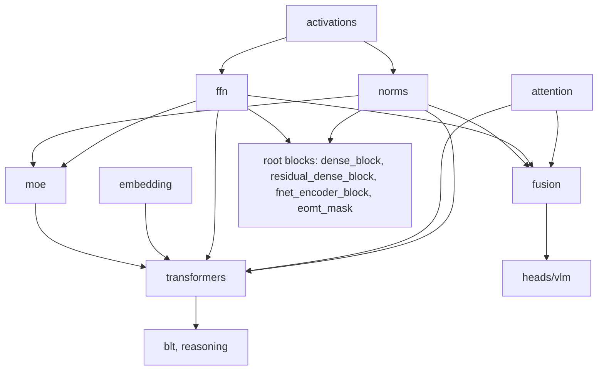

# layers

Path: `src/dl_techniques/layers`
Purpose: the custom Keras 3 layer library of `dl_techniques` (Keras >= 3.8 on TensorFlow 2.18): 35 domain subpackages plus 14 stand-alone layer modules, all serializable, most behind string-keyed factories.

## Scope

Lives here: layers (`keras.layers.Layer` subclasses), their factories and registries, and a few pure helper functions that belong to a layer (for example `coordinate_grid`, `interpolate_grid`, `filter_matches`).

Does not live here: whole models (`src/dl_techniques/models/`), losses, metrics, initializers and constraints (sibling packages `losses/`, `metrics/`, `initializers/`, `constraints/`), trainers (`src/train/`), tests (`tests/test_layers/`).

`layers/__init__.py` is empty. Every import goes through a subpackage or a module.

## Architecture

- Base domains (`norms`, `activations`, `ffn`, `attention`, `embedding`) each own a `factory.py`. `transformers`, `moe` and `fusion` build their sub-layers through those factories instead of hard-coding classes.
- `transformers.TransformerLayer` composes `create_attention_layer`, `create_ffn_from_config` (or `MixtureOfExperts` when `moe_config` is set) and the norm factory. `moe` builds experts through the FFN factory.
- `fusion.MultiModalFusion` builds attention, FFN and norm sub-layers through their factories and is consumed by `heads/vlm`.
- `blt` builds its stacks through `transformers/causal_stack.py`. `reasoning` pieces are reused by `blt/blt_core.py`.
- `sequence_pooling.ModePooling` imports the mean-shift functions from `mixtures/mean_shift_ops.py`, so importing `sequence_pooling` also imports `mixtures/__init__` (no cycle: `mixtures` imports only `utils` and `initializers`).
- Remaining families (`ssm`, `time_series`, `conv_blocks`, `geometric`, `graphs`, `memory`, `signal_processing`, and others) are mostly independent. Do not assume a cross-import between two of them without grepping.
- Concrete layers register through `register_dl_technique("dl_techniques.layers.<dotted module path>")` from `dl_techniques.utils.keras_registration`. The key embeds the defining module, so two same-named classes in different modules do not collide. Not registered: the abstract bases in `memory/ntm_interface.py`, `moe/experts.py` (`BaseExpert`) and `mixtures/base.py`, and the private `_LikelihoodHead` in `heads/time_series/likelihood_heads.py`.

## Key files

Subpackages. F = has `factory.py`. Counts were measured with the registry objects.

| Package | F | Role | Notes |
| --- | :-: | --- | --- |
| `activations/` | Y | 25 activation types, plus `common.py` argument helpers | `ACTIVATION_REGISTRY` has 25 keys. Curated `__init__` (38 names) |
| `adapters/` | Y | `LoRAAdapter`, `GatedAdapter` | One key, `lora`. Curated (13 names). `GatedAdapter` is exported but deliberately not a key. Gate half is `statistics/local_support_gate.py` |
| `attention/` | Y | 36 attention types | `ATTENTION_REGISTRY` 36 keys. Curated (45 names: 38 classes, 6 factory functions, `AttentionType`). `AttentionRoutingCapsule`, `CapsuleBlockV2`, `Ideogram4Attention`, `MMDiTJointAttention` are exported without a key. `assemble_attention_config` is not exported. Sphinx docstrings mandatory |
| `embedding/` | Y | Patch, positional, sinusoidal, RoPE, token, class-label, timestep embeddings | 24 layer classes, 16 keys. 8 classes have no key: `AxialRoPE2D` (exported by `__init__`), and `ClassTokenPrepend`, `MaskTokenApply`, `RegisterTokens`, `StateIndicatorEmbedding`, `HierarchicalCodebookEmbedding`, `PatchEmbed3D`, `VideoRoPE3D` (not exported, import from the module). `__init__` (11 names) exports only 3 layer classes (`AxialRoPE2D`, `ClassLabelEmbedding`, `TimestepEmbedding`), 4 NumPy sin-cos table builders and the factory names. Its docstring is stale (says 23 classes, 7 without a key) |
| `ffn/` | Y | Feed-forward variants | `FFN_REGISTRY` 22 keys over 20 classes (`glu`, `reglu`, `bilinear` are configurations of `GLUFFN`). Curated (27 names: the 20 classes plus the factory interface incl. `assemble_ffn_config`) |
| `heads/` | Y | 29 registered task-head classes (8 NLP, 10 vision, 6 VLM, 5 time series) in `nlp/`, `vision/`, `vlm/`, `time_series/` | Curated (47 names, from `heads.nlp`, `vision`, `vlm`, `time_series` plus `create_head`); `time_series/` (`QuantileHead`, `QuantileSequenceHead`, `GaussianLikelihoodHead`, `NegativeBinomialLikelihoodHead`, `TimestralQuantileHead`) has no factory and is not a `create_head` domain; the eight NLP in-model helpers (`TASK_HEAD_NAME`, `build_model_task_head`, ...) are not exported, import them from `heads.nlp`. `create_head(domain, *args, **kwargs)` forwards verbatim to a per-domain factory. Domain signatures differ on purpose. `validation.py`, `masking.py` hold shared checks |
| `logic/` | Y | Fuzzy logic and arithmetic operators, circuits | 4 keys: `logic`, `arithmetic`, `neural_circuit`, `circuit_depth`. Curated (10 names) |
| `memory/` | Y | NTM, SOM family, NeuroGrid | `create_mann` is the only MANN construction path (no standalone MANN class; the old `MannLayer` is deleted). `create_som_2d` for 2-D SOM. Curated (25 names), both factory functions exported |
| `mixtures/` | Y | `RBFLayer`, `KMeansLayer`, `GMMLayer`, `MeanShiftLayer` | 4 keys. Curated (11 names). Non-strict factory (see invariants) |
| `norms/` | Y | 16 normalization classes plus `PolarWeightNorm` | 19 factory keys: 2 stock Keras, 17 local keys over 16 classes (`dml_plus_focal`, `dml_plus_center` both build `DMLPlus`). `PolarWeightNorm` is exported (24 names in `__all__`) but not a key |
| `sequence_pooling/` | Y | `SequencePooling` (18 strategies), attention, weighted and mode pooling | 4 keys: `sequence`, `attention`, `weighted`, `mode`. Curated (14 names) |
| `ssm/` | Y | Mamba v1 and Mamba-2 layers, `ContextMambaLayer`, residual blocks | `SSM_REGISTRY` 4 keys: `selective_ssm`, `context_mamba`, `mamba`, `mamba2`. `MambaResidualBlock` and `Mamba2ResidualBlock` are exported (15 names in `__all__`) but are not registry keys |
| `transformers/` | Y | `TransformerLayer`, stacks, specialized blocks, `causal_stack.py` | `TRANSFORMER_BLOCK_REGISTRY` maps 12 keys to classes. Accepted and required keys are read from each class's `__init__`. `__all__` has 34 names. `Gemma3TransformerBlock`, `Ideogram4TransformerBlock`, `Ideogram4FinalLayer`, the `sd3_adaln` layers, `WeightedAdjacencyProjector` and the `causal_stack.py` helpers are not exported |
| `moe/` | | `MixtureOfExperts`, `config.py`, `experts.py`, `gating.py`, `layer.py` | Linear, cosine, soft gating. Curated (5 names: `MoEConfig`, `ExpertConfig`, `GatingConfig`, `MixtureOfExperts`, `create_ffn_moe`). Gating classes, `FFNExpert`, `create_gating`, `create_expert` are not exported. No other modules |
| `blt/` | | Byte Latent Transformer layers and `ByteLatentReasoningCore` | Not exported from `__init__` |
| `dynamic_chunking/` | | `RoutingModule`, `ChunkLayer`, `DeChunkLayer` | Curated (3). Route, chunk, inner network, dechunk is one unit. Consumer: `models/language/hnet/stage.py`. No factory |
| `reasoning/` | | HRM core, module, sparse puzzle embedding | Outer halting loop lives in `models/language/hrm/model.py` |
| `acc_unet/` | | `HANCBlock`, `HANCLayer`, `MLFCLayer` | Plus a batch-norm helper in `reference_batch_norm.py` |
| `yolo12/` | | `Bottleneck`, `C3k2Block`, `A2C2fBlock`, three heads | |
| `conv_blocks/` | | Conv building blocks | `__all__` is only `ConvStem`. Import every other class from its module |
| `pooling/` | | `BlurPool2D`, `PixelShuffle2D`, `PixelUnshuffle2D`, `PatchMerging`, `GlobalSumPooling`, `DownsampleAndSkip` | Mostly channels-last |
| `signal_processing/` | | `Canny`, `CLAHE`, `GaussianFilter`, `GaussianPyramid`, `LaplacianFilter`, `HaarWaveletDecomposition`, `ShearletTransform`, `FFTLayer`, `IFFTLayer`, `StrongAugmentation` | Mostly fixed formulas. `CLAHE` has one trainable gate |
| `complex/` | | `ComplexLayer` base, conv2d, dense, ReLU, two average poolings, dropout | One class per module. TensorFlow backend only |
| `structured_linear/` | | `BitLinear`, `MPSLayer`, `OrthoBlock`, `OrthogonalButterfly`, `RFFKernelLayer`, `KANvolution`, `HarmonicDense`, `HierarchicalHarmonicHead`, crystal family | `crystal_frames.py` is shared geometry. No factory |
| `regularization/` | | `LayerScale`, `ScheduledDropout`, `StochasticDepth`, `StochasticGradient`, `SelectiveGradientMask`, `RouterLayer`, `FiLMLayer`, `ConditionalOutputLayer`, `SpatialSmoothness`, `GaussianReadout` | Name is wider than the content |
| `statistics/` | | Kernel PCA, `MDNLayer`, normalizing flow, `UnifiedScaler`, `MovingStd`, `ResidualACFLayer`, `LocalSupportGate`, `ProbabilityLogits`, `conformal/` | `conformal/` has `ConformalLayer`, `ConformalInterval`, `ConformalQuantileHead`, `ConformalPredictionSet` |
| `generative/` | | `RestrictedBoltzmannMachine`, `SparseAutoencoder`, samplers (`Sampling`, `HypersphereSampling`, `VMFSampling`), vector quantizers, `TopographicProduct` | |
| `geometric/` | | `CliffordNetBlock`, `CausalCliffordNetBlock`, `CliffordRNN`, point-cloud layers, `RayPointCombinator`, `SparseDepthSplat` | |
| `graphs/` | | `GraphNeuralNetworkLayer`, `SHGCNLayer`, `FermiDiracDecoder`, RELGT blocks, `EntityGraphRefinement` | Seven classes |
| `time_series/` | | N-BEATS and N-BEATSx blocks, xLSTM, PRISM, DeepAR, TCN, lag attention, temporal fusion, EMA | Curated (29). The quantile and likelihood heads live in `heads/time_series/`. Consumed by `models/time_series/` |
| `tabular/` | | TabM pieces: `ScaleEnsemble`, `LinearEfficientEnsemble`, `NLinear`, `TabMMLPBlock`, `TabMBackbone` | Private `_ensemble_scaling.py` |
| `matching/` | | LightGlue: `LearnedFourierRotaryEncoding`, `LightGlueSelfBlock`, `LightGlueCrossBlock`, `MatchAssignment`, `MatchTokenConfidence` | Consumed by `models/vision/keypoints/lightglue/` |
| `physics/` | | `LagrangianNeuralNetworkLayer`, `ApproximatedLNNLayer` | Exact one is TensorFlow only |
| `tokenizers/` | | `BPETokenizer`, `TokenEmbedding`, `ASCIICharTokenizer`, `ASCIICharPreprocessor` | Curated (8) |
| `fusion/` | | `MultiModalFusion` in `multimodal_fusion.py`, `HierarchicalScaleFusion` in `hierarchical_fusion.py` | `__init__` is docstring only and binds no name. `HierarchicalScaleFusion(filters, num_levels, ...)` folds a fine-to-coarse pyramid top-down into one finest-level map; it is built from `ConvBlock` and `PixelShuffle2D`, has no factory and no consumer yet |

Top-level modules (14). Each holds one architecture or utility. Registry package string is `dl_techniques.layers.<module>`.

| File | Classes and functions | Notes |
| --- | --- | --- |
| `anchor_generator.py` | `AnchorGenerator(input_image_shape, strides_config=None)` | `None` (or an empty list) becomes `[8, 16, 32]`. Stores non-trainable `anchors` and `strides` weights built in `build`. `call` returns `(anchors (B,N,2), strides (B,N,1))` tiled to the input batch. Input is read only for batch size |
| `capsules.py` | `PrimaryCapsule`, `RoutingCapsule`, `CapsuleBlock`, `CapsuleRoll` | First three do dynamic routing and use `activations.squash.SquashLayer`. `CapsuleRoll(num_capsules, capsule_dim)` has no weights. Its `call` takes `shift` (default 1) and computes `out[..., c, j] = x[..., c, (j - shift) % D]` |
| `dense_block.py` | `DenseBlock` | Dense, optional norm (`normalization_type`, default `layer_norm`), activation (`activation_type`, default `relu`), optional dropout. Built via the norms and activations factories |
| `residual_dense_block.py` | `ResidualDenseBlock` | Same plus skip. `units=None` matches input width. `build` raises `ValueError` if `units` differs from the input width |
| `eomt_mask.py` | `EomtMask` | Input is `(query_tokens, pixel_features)` or a dict with those keys. Returns `(class_logits (B,Q,C), mask_logits (B,Q,H,W))` |
| `fnet_encoder_block.py` | `FNetEncoderBlock` | `FNetFourierTransform` plus FFN from `ffn` factory. `normalization_position` is `'post'` (default) or `'pre'`; anything else raises `ValueError`. Optional stochastic depth |
| `fractal_block.py` | `FractalBlock(block_config, depth=1, drop_path_rate=0.15)` | Base block is `ConvBlock.from_config(block_config)`. Its `strides` must be 1. Longest path is `2^(depth-1)` base blocks |
| `hierarchical_mlp_stem.py` | `HierarchicalMLPStem` | Non-overlapping strided convs. `patch_size` square, power of two, >= 4. `embed_dim` divisible by 4. Returns `(B, num_patches, embed_dim)` |
| `io_preparation.py` | `ClipLayer`, `NormalizationLayer`, `DenormalizationLayer`, `TensorPreprocessingLayer` | Normalization defaults map `[0, 255]` to `[-0.5, 0.5]`. Denormalization is the inverse. Both clip to the source range first |
| `modality_projection.py` | `ModalityProjection(input_dim, output_dim, scale_factor=2)` | `PixelShuffle` then `Dense`, optional GELU and LayerNorm. Input `(B, tokens, input_dim)` |
| `mothnet_blocks.py` | `AntennalLobeLayer`, `MushroomBodyLayer`, `HebbianReadoutLayer` | `HebbianReadoutLayer.hebbian_update()` applies `dW = alpha * x^T y / batch`. Optional `kernel_constraint` is applied after each update |
| `one_hot_encoding.py` | `OneHotEncoding(cardinalities)` | Input `(B, num_features)` integers. Output `(B, sum(cardinalities))`. Empty list gives zero width. Non-positive cardinality raises `ValueError` |
| `spatial_layer.py` | `SpatialLayer`, `coordinate_grid`, `interpolate_grid` | `SpatialLayer` is forced non-trainable and reads only the input shape. `interpolate_grid(coords, grid, order)` accepts `order` 0 or 1 only. It is a bare function so it can run inside a nested gradient tape |
| `thera_heat_field.py` | `ThermalActivation`, `HeatField` | `HeatField.call(rel_coords, phi_phase, phi_kernel, t)`. The constructor argument `c` is stored and serialized but read by nothing |

## Public interface

Factory entry points:

| Domain | Entry point | Registry |
| --- | --- | --- |
| Normalization | `create_normalization_layer(normalization_type, name=None, epsilon=1e-6, **kw)` in `norms/factory.py` | 19 keys |
| Attention | `create_attention_layer(attention_type, name=None, **kw)` in `attention/factory.py` | 36 |
| FFN | `create_ffn_layer(ffn_type, name=None, **kw)` in `ffn/factory.py` | 22 |
| Embedding | `create_embedding_layer(embedding_type, name=None, **kw)` in `embedding/factory.py` | 16 |
| Activation | `create_activation_layer(activation_type, name=None, **kw)` in `activations/factory.py` | 25 |
| Sequence pooling | `create_sequence_pooling_layer(pooling_type, name=None, **kw)` in `sequence_pooling/factory.py` | 4 |
| Logic | `create_logic_layer(layer_type, name=None, **kw)` in `logic/factory.py` | 4 |
| Mixtures | `create_mixture_layer(mixture_type, name=None, **kw)` in `mixtures/factory.py` | 4 |
| SSM | `create_ssm_layer(ssm_type, name=None, **kw)` in `ssm/factory.py` | 4 |
| Adapters | `create_adapter_layer(adapter_type, name=None, **kw)` in `adapters/factory.py` | 1 |
| Transformer blocks | `create_transformer_block(config, *, name=None)` in `transformers/factory.py`; `config["type"]` picks the block | 12 |
| Memory | `create_mann(...)`, `create_som_2d(...)` in `memory/factory.py` | n/a |
| Heads | `create_head(domain, ...)` in `heads/factory.py`, domains `nlp`, `vision`, `vlm` | n/a |

Most domain factories also have `create_<domain>_from_config(config)`. Higher-level `create_*_encoder` builders live in `transformers/vision_encoder.py` and `transformers/text_encoder.py`. Most model code imports `TransformerLayer` directly instead of the block factory.

Import shape, re-derived from each `__init__.py`:

| Shape | Packages |
| --- | --- |
| Curated re-export with `__all__` (18) | `activations` (38 names), `adapters` (13), `attention` (45), `conv_blocks` (1), `dynamic_chunking` (3), `embedding` (11), `ffn` (27), `heads` (47), `logic` (10), `memory` (25), `mixtures` (11), `moe` (5), `norms` (24), `sequence_pooling` (14), `ssm` (15), `time_series` (29), `tokenizers` (8), `transformers` (34) |
| Exports nothing (17) | `acc_unet`, `blt`, `complex`, `fusion`, `generative`, `geometric`, `graphs`, `matching`, `physics`, `pooling`, `reasoning`, `regularization`, `signal_processing`, `statistics`, `structured_linear`, `tabular`, `yolo12`, and the top-level modules |

Exported without a registry key: `AxialRoPE2D` (embedding), `MambaResidualBlock` and `Mamba2ResidualBlock` (ssm), `GatedAdapter` (adapters), `PolarWeightNorm` (norms), `AttentionRoutingCapsule`, `CapsuleBlockV2`, `Ideogram4Attention`, `MMDiTJointAttention` (attention). Not exported by their curated package, so import from the module or `factory`: 21 of the 24 embedding classes (14 reachable through the factory, 7 without a key), `embedding.factory.get_embedding_info`, `attention.factory.assemble_attention_config`, and the transformers and moe items in the Key files table.

For an exports-nothing package, import from the module: `from dl_techniques.layers.graphs.graph_neural_network import GraphNeuralNetworkLayer`. Submodule imports also work for curated packages, but prefer the package-level import there.

## Data shapes

- Factory registry entry: `{ 'class': ..., 'description': ..., 'required_params': [...], 'optional_params': {...} }` (shown for `ATTENTION_REGISTRY`; other registries are close to this shape). Key sets, `Literal` type aliases and `required_params` / `optional_params` are public API.
- `TRANSFORMER_BLOCK_REGISTRY` is the exception. It maps key to class only, and accepted and required keys come from the class `__init__`.
- Config dicts passed to a factory are plain Python dicts. Layer configs round-trip through `get_config()` / `from_config()`.
- `activations/common.py` exposes `activation_spec`, `resolve_activation`, `serialize_activation` for a layer's `activation` argument: canonicalize in, resolve to a callable in `call()`, serialize in `get_config()`. It rejects `keras.layers.Layer` instances. `"gelu"` and `"leaky_relu"` resolve to `exact_gelu` / `exact_leaky_relu` (the `EXACT_ACTIVATIONS` table in `exact_activations.py`), which build constants in the input dtype instead of float32.

## Invariants and constraints

1. Every registry-keyed factory (norms, attention, ffn, embedding, activations, sequence_pooling, logic, ssm, adapters, transformers) raises `ValueError` on a keyword the type does not declare. `mixtures` is the one exception (below). Never filter-and-drop. `create_mann`, `create_som_2d` and `create_head` have no registry; they forward `**kwargs` to a constructor or a per-domain factory. Silent drops hid real defects (a misspelled `dropout` left dropout dead, a misspelled `qkv_bias` built attention without bias). The one exception is `mixtures/factory.py`, which logs a warning naming the unknown key, drops it and builds; a test pins that.
2. A factory's key set, type aliases and per-entry required and optional parameters are public API, asserted by `tests/test_layers/test_factory_registry_drift.py`. Adding, renaming or removing a key is a breaking change.
3. An optional parameter that the layer derives is not safe to pass explicitly. Check `required_params` first. For example `hidden_dim` is required for most FFN types but derived for `swiglu`.
4. When auditing who calls a factory, also look for code that builds the argument dict without calling the factory (an `ffn_args=` dict passed to a wrapper, a `**kwargs` splat). Use `assemble_ffn_config()` (exported from `ffn`) and `assemble_attention_config()` (import from `attention.factory`) so those dicts go through the same validation.
5. Normalization epsilon: the norm factory defaults `epsilon` to `1e-6` for every type that takes one (`dynamic_tanh` has none). Keras `LayerNormalization` and `BatchNormalization` default to `1e-3`, a 1000x difference with no shape symptom. Route normalization through the factory. When constructing a Keras norm directly, pass `epsilon=` explicitly and cite the reference. Do not blanket-fix: some references (MobileNet batch norm) really use `1e-3`. `transformers/causal_stack.py` pins `LAYER_NORM_EPSILON = 1e-3` on purpose, because moving its norms to the factory default changed the BLT forward pass.
6. Layers build their sub-layers in `__init__`, call `sub_layer.build(shape)` explicitly in `build()` (so saved weights restore), and call `super().build(input_shape)` last.
7. A layer's `get_config()` must cover every constructor argument. Use `keras.ops`, not raw TensorFlow, except where a package states otherwise (`complex/`, the exact `physics/` layer).
8. Registration uses `register_dl_technique(...)` with the dotted module path. A bare `@keras.saving.register_keras_serializable()` mints `Custom>ClassName`, which collides across modules.
9. Initializers: when one layer instance creates several sub-layers or weights from one configured initializer, clone it with `dl_techniques.initializers.clone.clone_initializer` so each draws independently. Reusing one instance replays the same draw.
10. `complex/` layers cannot run on a non-TensorFlow backend. `positional_sine_2d` in `embedding/` takes channels-last and returns channels-first.
11. `SequencePooling` modes `cls` and `first` ignore the keep-mask on purpose (index 0). `last` and `middle` are mask-aware and index the kept positions, not the padded length.
12. `GatedAdapter` and `LoRAAdapter` return a delta. The caller adds it to its own output.

Naming traps (the serialization registry is keyed by class name, so bare names must stay unique):

| Name | Fact |
| --- | --- |
| `RepMixerBlock` | `conv_blocks/repmixer_block.py` (consumed by `models/vision_language/fastvlm/`). The FastViT one is `FastVitRepMixerBlock` in `models/vision/fastvit/components.py` |
| `MLPBlock` | Belongs to `ffn/mlp.py` (the `mlp` key). `tabular/tabm_mlp_block.py` is `TabMMLPBlock` |
| `Downsample` / `Upsample` | Belong to `models/vision_language/ideogram4/vae.py`. pw_fnet uses `PWFNetDownsample` / `PWFNetUpsample`. Not interchangeable |
| `resolve_activation` | Two functions. `activations/gelu_tanh.py` is what `activations/__init__` exports. `activations/common.py` rejects Layers. Use `from dl_techniques.layers.activations.common import resolve_activation` when you mean the second |

When two classes would collide, prefix the narrower consumer's class name. Do not add a second bare name.

## Dependencies

- Internal: `dl_techniques.utils.keras_registration` (`register_dl_technique`), `dl_techniques.utils.logger` (logging, no `print`), `dl_techniques.utils.activation_serialization`, `dl_techniques.initializers` (`clone_initializer`, `LinearUpInitializer`, and others).
- External: `keras` >= 3.8 and < 4, `tensorflow` 2.18, `numpy`. `keras.ops` is the compute API; the import style is `import keras`, then qualify at the call site. This covers the whole tree, not only the top level: 74 of the 368 non-`__init__` modules under `layers/` still use `from keras import ...` (70 of them import `ops`). At the top level these are `eomt_mask.py`, `io_preparation.py`, `anchor_generator.py`, `one_hot_encoding.py` and `thera_heat_field.py`; in subpackages, for example, `transformers/eomt_transformer.py`, `transformers/transformer_decoder.py`, `transformers/swin_conv_block.py`, `time_series/nbeats_blocks.py` and `pooling/blur_pool.py`. Match the file you edit. Find them with `grep -rlE "^from keras import" --include=*.py src/dl_techniques/layers`.
- Consumers: `src/dl_techniques/models/**`, `src/train/**`, `src/applications/**`, and `callbacks/` and `metrics/` for some layers (for example `metrics/keypoint_matching.py` imports `filter_matches` from `matching/`).

## Failure modes

- Unknown factory type, missing required parameter, undeclared keyword: `ValueError`, also logged by the factory. Mixtures drop unknown keywords with a logged warning.
- `ResidualDenseBlock.build`: `ValueError` when `units` differs from the input width.
- `FractalBlock`, `HierarchicalMLPStem`, `EomtMask`, `CapsuleRoll`, `OneHotEncoding`: constructor `ValueError` on invalid sizes.
- `interpolate_grid`: `ValueError` for `order` outside {0, 1}.
- Rare numeric traps: float64 GELU and leaky ReLU constants built in float32 by stock TensorFlow (fixed by the exact forms); epsilon mismatch (invariant 5); a shared initializer instance replaying one draw (invariant 9).

## Working here

Before writing a new layer, check in this order:

1. The domain factory. Pass a type string and config. Do not hand-roll what a factory builds.
2. An existing layer in a subpackage or in the top-level modules above.
3. Only then a new layer: put it in the matching domain subpackage, follow the `__init__` / `build` / `call` / `get_config` pattern, register it with `register_dl_technique("dl_techniques.layers.<subpackage>.<module>")`, and add it to the domain factory if one exists. Update the factory registry, its `Literal` alias and the registry drift test together.

Conventions:

- Docstrings are Sphinx/reST (`:param:`, `:type:`, `:raises:`) in most modules and mandatory in `attention/` (`attention/channel_attention.py` is the exemplar). Match the file you edit; never convert a file wholesale.
- One class per module is the pattern in `complex/`, `dynamic_chunking/` and `tabular/`. A single-file architecture with no siblings stays at the `layers/` root; do not create a one-file subpackage.
- Subpackages with a curated `__init__` must keep `__all__` in step with new public classes. Run the tree-wide collection gate after changing a public surface: `.venv/bin/python -m pytest tests/test_models/ -q --collect-only` (a curated `__init__` that shadows a submodule breaks only at collection).
- Keep class names unique repo-wide (see Naming traps).

Tests:

- Layer tests live in `tests/test_layers/`. Packages mirror as `tests/test_layers/test_<package>/` (for example `test_attention/`, `test_fusion/`). Top-level modules have loose files such as `test_capsules.py`, `test_dense_block.py`, `test_eomt_mask.py`, `test_spatial_layer.py`, `test_thera_heat_field.py`.
- Run only the package you changed: `.venv/bin/python -m pytest tests/test_layers/test_attention/ -q`. The full suite takes about 1.5 hours and cannot run in one process; do not use it as a routine check.
- After a factory change, run `tests/test_layers/test_factory_registry_drift.py`.
- Run CPU-only when the GPU is busy: `CUDA_VISIBLE_DEVICES='' .venv/bin/python -m pytest ...`. Do not run pytest jobs in parallel.
- Never write into the repo-root `results/` from a test or smoke script.
