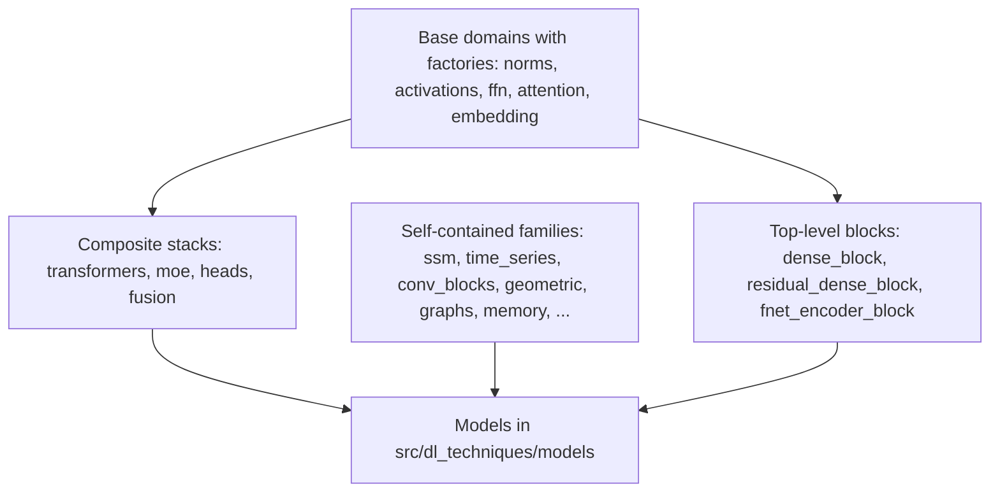

# layers

The custom Keras 3 layer library of `dl_techniques`: 35 subpackages of layers grouped by domain (attention, feed-forward, normalization, embeddings, transformers, and many more), plus 14 stand-alone layer modules at the top level. Path: `src/dl_techniques/layers/`. Import path: `dl_techniques.layers`.

## What it is for

`dl_techniques` is a deep learning research library for Keras 3 on TensorFlow 2.18. Its models, in `src/dl_techniques/models/`, are assembled from layers. Those layers live here, so a model does not carry a private copy of attention, a normalization, a positional encoding or a transformer block.

The concrete layers here are `keras.layers.Layer` subclasses with `get_config()` serialization, registered with Keras, so a model that uses them can be saved to a `.keras` file and loaded back. Most domains also have a factory: a function that takes a type string such as `"rms_norm"` or `"swiglu"` plus a keyword dictionary and returns a configured layer. That lets a config file choose the layer instead of hard-coding a class.

The package root `layers/__init__.py` is empty. You always import from a subpackage or from a module.

## How it works

Layers are organized in three tiers.



- Base domains hold the small interchangeable parts. Each has a factory with a registry of named types. `norms` builds 19 normalization types, `attention` 35, `ffn` 22, `embedding` 16 and `activations` 25.
- Composite stacks build on the base domains through those factories. `transformers.TransformerLayer` takes the attention, FFN and normalization types as strings. `moe.MixtureOfExperts` builds each expert with the FFN factory. `heads` holds task heads (classification, detection, captioning and so on) and uses `fusion.MultiModalFusion` for vision-language heads.
- Self-contained families (state space models, time series, graphs, memory, signal processing, and so on) are mostly independent of each other. They are listed by domain below.
- The top-level modules each hold one architecture or one small utility that had no sibling files to justify a subpackage.

Importing is not uniform. 18 subpackages re-export a curated public surface with `__all__` (for example `from dl_techniques.layers.attention import MultiHeadAttention, create_attention_layer`). The other 17 export nothing, and you import from the module (for example `from dl_techniques.layers.graphs.graph_neural_network import GraphNeuralNetworkLayer`).

Exported does not mean it has a factory key. For example `GatedAdapter`, `PolarWeightNorm`, `AxialRoPE2D`, `MambaResidualBlock` and `Mamba2ResidualBlock` are exported by their package but are not factory keys. In the other direction, a curated package can leave some classes out of `__all__` (`embedding/` exports only 3 of its 24 classes, `transformers/` leaves out `Gemma3TransformerBlock` and a few more), and then you import them from their module.

## Subpackages

Factory column: Y means the package has a `factory.py`.

| Package | Factory | What it holds |
|---|:-:|---|
| `activations/` | Y | GoLU, Mish, hard sigmoid and swish, ReLU-k, sparsemax, squash, thresh-max, adaptive softmax, differentiable step, monotonic and routing-probability outputs, exact-dtype GELU and leaky ReLU. 25 factory keys |
| `adapters/` | Y | `LoRAAdapter` (several independent low-rank pairs) and `GatedAdapter`. One factory key, `lora` |
| `attention/` | Y | 35 attention types: multi-head, cross, latent, differential, grouped-query, ring, Performer, Perceiver, Hopfield, window, linear, energy, channel and spatial gates, Fourier mixing, and more |
| `embedding/` | Y | Patch, positional, sinusoidal, rotary (RoPE family), BERT-style token embeddings, class-label and timestep embeddings, special tokens. 16 factory keys over 24 classes; 8 classes have no key |
| `ffn/` | Y | MLP, SwiGLU, GeGLU, GLU family, gated and Swin MLPs, power MLP, logic, counting and KAN variants. 22 factory keys over 20 classes |
| `heads/` | Y | 24 task-head classes in `nlp/`, `vision/`, `vlm/`, with `create_head(domain, ...)` |
| `logic/` | Y | Learnable fuzzy logic gates, arithmetic operators and circuits |
| `memory/` | Y | Neural Turing Machine, self-organizing maps, NeuroGrid |
| `mixtures/` | Y | `RBFLayer`, `KMeansLayer`, `GMMLayer` |
| `norms/` | Y | RMS family, logit norms, dynamic tanh, GRN, LRN, bias-free batch norm, energy layer norm, `PolarWeightNorm`. 19 factory keys |
| `sequence_pooling/` | Y | `(batch, seq, dim)` to `(batch, dim)` pooling with 18 strategies, plus attention and weighted pooling |
| `ssm/` | Y | Selective state space layers: Mamba v1, Mamba-2, a temporal context mixer, and residual wrappers (exported, but not factory keys). 4 factory keys |
| `transformers/` | Y | `TransformerLayer`, Swin, Perceiver, EoMT, energy and free transformers, text and vision encoders, a causal patch transformer. 12 block-factory keys |
| `moe/` | | `MixtureOfExperts` with linear, cosine and soft routers and load-balancing losses |
| `blt/` | | Byte Latent Transformer layers: byte tokenizer, entropy model, dynamic patcher, local encoder and decoder, reasoning core |
| `dynamic_chunking/` | | H-Net route, chunk, dechunk layers (`RoutingModule`, `ChunkLayer`, `DeChunkLayer`) |
| `reasoning/` | | Hierarchical Reasoning Model core, module and sparse puzzle embedding |
| `acc_unet/` | | ACC-UNet blocks: `HANCBlock`, `HANCLayer`, `MLFCLayer` |
| `yolo12/` | | YOLOv12 backbone blocks and detection, segmentation, classification heads |
| `conv_blocks/` | | ResNet, ConvNeXt, MobileOne, RepMixer, inverted bottleneck, bias-free blocks, squeeze-excitation, `ConvStem` |
| `pooling/` | | Blur pool, pixel shuffle and unshuffle, patch merging, global sum pool, downsample-and-skip |
| `signal_processing/` | | Canny, CLAHE, Gaussian filter and pyramid, Laplacian filters, Haar wavelets, shearlets, FFT, strong augmentation |
| `complex/` | | Complex-valued conv, dense, ReLU, pooling, dropout (TensorFlow backend only) |
| `structured_linear/` | | Alternatives to a dense matrix: BitLinear, tensor-train, orthogonal butterfly, random Fourier features, KANvolution, harmonic and crystal heads |
| `regularization/` | | Layer scale, scheduled dropout, stochastic depth and gradient, FiLM, router, spatial smoothness and Gaussian readout |
| `statistics/` | | Kernel PCA, mixture density network, normalizing flow, scaler, moving std, residual ACF, support gate, and `conformal/` interval and set layers |
| `generative/` | | RBM, sparse autoencoder, VAE samplers, vector quantizers, topographic prior |
| `geometric/` | | Clifford algebra block and RNN, point-cloud layers, ray combiner, sparse depth splat |
| `graphs/` | | Graph neural network, hyperbolic GCN, relational graph transformer, entity graph refinement, Fermi-Dirac decoder |
| `time_series/` | | N-BEATS and N-BEATSx blocks, xLSTM, PRISM, DeepAR heads, quantile heads, TCN, lag attention, temporal fusion, EMA filters |
| `tabular/` | | TabM batched-ensemble MLP pieces |
| `matching/` | | LightGlue keypoint-matching layers |
| `physics/` | | Lagrangian neural network layers (exact and approximate) |
| `tokenizers/` | | BPE tokenizer, ASCII character tokenizer, token embedding |
| `fusion/` | | `MultiModalFusion`: combines one tensor per modality with one of 8 strategies |

## Top-level modules

- `anchor_generator.py` - `AnchorGenerator`, a precomputed multi-scale grid of detection anchor centers and strides.
- `capsules.py` - `PrimaryCapsule`, `RoutingCapsule`, `CapsuleBlock` (dynamic routing), and `CapsuleRoll`, a weight-free cyclic shift inside each capsule.
- `dense_block.py` - `DenseBlock`: Dense, optional normalization, activation, optional dropout, with norm and activation chosen by name.
- `residual_dense_block.py` - `ResidualDenseBlock`: the same, with a skip connection.
- `eomt_mask.py` - `EomtMask`: class logits and mask logits from query tokens and pixel features, for the Encoder-only Mask Transformer.
- `fnet_encoder_block.py` - `FNetEncoderBlock`: Fourier token mixing plus a feed-forward network.
- `fractal_block.py` - `FractalBlock`: recursive FractalNet block built from `ConvBlock`.
- `hierarchical_mlp_stem.py` - `HierarchicalMLPStem`: ViT patch stem made of non-overlapping strided convolutions.
- `io_preparation.py` - `ClipLayer`, `NormalizationLayer`, `DenormalizationLayer`, `TensorPreprocessingLayer`: range clipping and rescaling.
- `modality_projection.py` - `ModalityProjection`: pixel shuffle then dense projection of vision tokens into a language embedding space.
- `mothnet_blocks.py` - `AntennalLobeLayer`, `MushroomBodyLayer`, `HebbianReadoutLayer`: an insect-olfaction few-shot feature cascade.
- `one_hot_encoding.py` - `OneHotEncoding`: in-graph one-hot encoding of several categorical columns.
- `spatial_layer.py` - `SpatialLayer`, `coordinate_grid`, `interpolate_grid`: coordinate grids (CoordConv style) and grid sampling at continuous coordinates.
- `thera_heat_field.py` - `ThermalActivation`, `HeatField`: neural heat field for anti-aliased arbitrary-scale super-resolution.

## How to use it

```python
import keras
from dl_techniques.layers.norms import create_normalization_layer
from dl_techniques.layers.ffn import create_ffn_layer
from dl_techniques.layers.attention import create_attention_layer

norm = create_normalization_layer("rms_norm")
ffn = create_ffn_layer("swiglu", output_dim=256)
attn = create_attention_layer("multi_head", dim=256, num_heads=8)
```

Run from the repo root with `.venv/bin/python`. Required arguments differ per type, so check the registry entry of the type you pick. A layer that is not behind a factory is imported directly:

```python
from dl_techniques.layers.dense_block import DenseBlock

block = DenseBlock(units=128, normalization_type="layer_norm", activation_type="relu")
```

To test layers, scope pytest to the package you changed, for example `.venv/bin/python -m pytest tests/test_layers/test_attention/`. The full suite takes about 1.5 hours.

## Things to know

- A factory raises `ValueError` for a keyword the chosen type does not declare. The one exception among the registry factories is `mixtures/factory.py`, which logs a warning, drops the unknown keyword and builds the layer anyway.
- Several class names exist in more than one package, so import by full path. `MLPBlock` is the FFN one (`ffn/mlp.py`), while `tabular/` calls its block `TabMMLPBlock`. `RepMixerBlock` in `conv_blocks/` is not the FastViT one, which lives in `models/vision/fastvit/components.py` as `FastVitRepMixerBlock`.
- Normalization epsilon differs by route. The norm factory defaults `epsilon` to `1e-6`, while Keras `LayerNormalization` and `BatchNormalization` default to `1e-3`. Swapping one for the other changes results without any error.
- `complex/` layers need the TensorFlow backend, because `keras.ops` in Keras 3.8 has no complex constructor.
- `fusion/` exports nothing. Use `from dl_techniques.layers.fusion.multimodal_fusion import MultiModalFusion`.
- `physics/` has an exact Lagrangian layer that works only on TensorFlow and an approximate one that works on any backend.
- `positional_sine_2d` in `embedding/` takes channels-last input and returns channels-first output.
- Docstrings use Sphinx/reST (`:param:`, `:type:`, `:raises:`) in most modules. Match the file you edit.
- Import style differs by file. New code uses `import keras` and qualifies names (`keras.ops.matmul`), but 74 of the 368 non-`__init__` modules in the tree, including `anchor_generator.py`, `eomt_mask.py`, `io_preparation.py`, `one_hot_encoding.py`, `thera_heat_field.py` and several in `transformers/`, `time_series/` and `pooling/`, use `from keras import ops` and similar.
- `AnchorGenerator(input_image_shape, strides_config=None)` builds anchors for strides `[8, 16, 32]` when `strides_config` is `None`.
