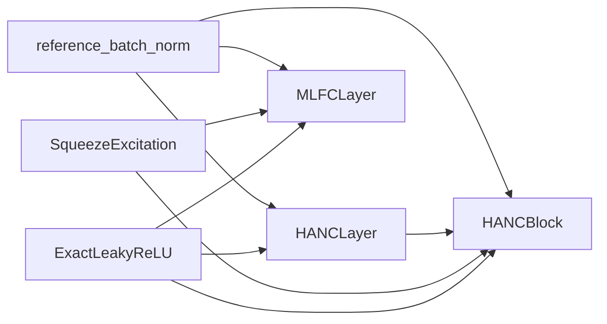

# acc_unet

Path: `src/dl_techniques/layers/acc_unet`
Purpose: Keras 3 layers from ACC-UNet: HANC context aggregation (layer and block), multi-level feature compilation (MLFC), and the shared reference batch-norm builder.

## Scope

In this directory:
- `HANCLayer`: multi-scale avg/max pooling, concat, 1x1 fusion.
- `HANCBlock`: inverted bottleneck around `HANCLayer` with SE.
- `MLFCLayer`: cross-level fusion of exactly 4 encoder feature maps.
- `reference_batch_norm()`: the one place batch norms for this cluster are built.

Not here:
- The full network `AccUNet` and its `create_acc_unet*` factories (`src/dl_techniques/models/vision/accunet/model.py`).
- The trainer (`src/train/accunet/train_accunet.py`).
- `ResPath` (`src/dl_techniques/layers/conv_blocks/res_path.py`); it only imports `reference_batch_norm` from here.
- `SqueezeExcitation` (`layers/conv_blocks/squeeze_excitation.py`) and `ExactLeakyReLU` (`layers/activations/exact_activations.py`); both are used, not defined, here.

The package has no `factory.py`. `__init__.py` is empty (zero bytes); import from submodules. There is no subdirectory other than `__pycache__`.

## Architecture



`HANCLayer.call`: for scale `s` in `1..k-1`, `AveragePooling2D` and `MaxPooling2D` with `pool_size=strides=2**s`, `padding='same'`; each result is resized to the input `(H, W)` with `keras.ops.image.resize(..., interpolation='nearest')`. Concatenation order: `[X, avg1, max1, avg2, max2, ...]`. Then `Conv2D(out_channels, 1, use_bias=False)`, BN, `ExactLeakyReLU(0.01)`. For `k == 1` the concat is skipped and the input goes straight to conv/BN/activation.

`HANCBlock.call` order: `expand_conv` (1x1 to `input_channels*inv_factor`) -> `expand_bn` -> act -> `depthwise_conv` (3x3) -> `depthwise_bn` -> act -> `hanc_layer` (expanded -> `input_channels`) -> if `use_residual`: `x + inputs`, then `residual_bn` -> `output_conv` (1x1 to `filters`) -> `output_bn` -> act -> `squeeze_excitation` (`reduction_ratio=0.25`). One `ExactLeakyReLU` instance is shared by the three activation sites.

`MLFCLayer.call`: per iteration, per level `i`: resize every other level to level `i`'s `(H, W)` with bilinear `keras.ops.image.resize` (level `i` itself is not resized), `keras.ops.concatenate` on the channel axis, `comp_conv` -> `comp_bn` -> act, concatenate with level `i`'s current map, `merge_conv` -> `merge_bn`, add level `i`'s current map, act. All four levels of an iteration read the previous iteration's outputs (`current_features` is fixed for the whole iteration). After the last iteration each level goes through its own `SqueezeExcitation` (called without `training`).

## Key files

| File | Role | Notes |
| --- | --- | --- |
| `hanc_layer.py` | `HANCLayer` | Registered `dl_techniques.layers.acc_unet.hanc_layer`. Sub-layer names `avg_pool_{p}x{p}`, `max_pool_{p}x{p}`, `concat_features`, `fusion_conv`, `fusion_bn`, `activation`. |
| `hanc_block.py` | `HANCBlock` | Registered `dl_techniques.layers.acc_unet.hanc_block`. Sub-layer names `expand_conv`, `expand_bn`, `depthwise_conv`, `depthwise_bn`, `hanc`, `residual_bn`, `output_conv`, `output_bn`, `se`, `activation`. |
| `multi_level_feature_compilation.py` | `MLFCLayer` | Registered `dl_techniques.layers.acc_unet.multi_level_feature_compilation`. Flat lists `compilation_convs`, `batch_norms`, `merge_convs`, `merge_batch_norms`, indexed `iter_idx*4 + level_idx`; `squeeze_excitations` indexed by level. Names `comp_conv_iter{i}_level{l}`, `comp_bn_...`, `merge_conv_...`, `merge_bn_...`, `se_level{l}`. |
| `reference_batch_norm.py` | `reference_batch_norm`, `REFERENCE_BN_MOMENTUM`, `BN_EPSILON` | Also imported by `layers/conv_blocks/res_path.py`. |
| `__init__.py` | empty | No re-exports, no `__all__`. |

## Public interface

```python
HANCLayer(in_channels: int, out_channels: int, k: int = 3,
          kernel_initializer='glorot_uniform', kernel_regularizer=None, **kwargs)

HANCBlock(filters: int, input_channels: int, k: int = 3, inv_factor: int = 3,
          kernel_initializer='glorot_uniform', bias_initializer='zeros',
          kernel_regularizer=None, bias_regularizer=None, **kwargs)

MLFCLayer(channels_list: List[int], num_iterations: int = 1,
          kernel_initializer='glorot_uniform', bias_initializer='zeros',
          kernel_regularizer=None, bias_regularizer=None, **kwargs)

reference_batch_norm(name: str) -> keras.layers.BatchNormalization
REFERENCE_BN_MOMENTUM = 0.9
BN_EPSILON = 1e-3
```

Call signatures:
- `HANCLayer.call(inputs, training=None)`: `(B, H, W, in_channels)` -> `(B, H, W, out_channels)`.
- `HANCBlock.call(inputs, training=None)`: `(B, H, W, input_channels)` -> `(B, H, W, filters)`.
- `MLFCLayer.call(inputs: List[Tensor], training=None)`: list of 4 -> list of 4, same shapes. `compute_output_shape` returns `input_shape` unchanged.

Public attributes: `HANCLayer.total_concat_channels = in_channels * (1 + 2*(k-1))`; `HANCBlock.expanded_channels`, `HANCBlock.use_residual`; `MLFCLayer.total_channels = sum(channels_list)`.

Raises (`ValueError`):
- `HANCLayer.__init__`: `in_channels <= 0`, `out_channels <= 0`, `k` outside 1..5. `build`/`compute_output_shape`: input not 4D; `build` also on last dim not `None` and `!= in_channels`.
- `HANCBlock.__init__`: `filters`, `input_channels`, `inv_factor` not positive; `k` outside 1..5. `build`: not 4D, or last dim `!= input_channels` (a `None` last dim also raises here, unlike `HANCLayer`). `compute_output_shape`: not 4D.
- `MLFCLayer.__init__`: `len(channels_list) != 4`, any channel `<= 0`, `num_iterations <= 0`. `build`: `input_shape` not a `list` of length 4 (a tuple of shapes is rejected). `call`: not 4 tensors.

## Data shapes

- Everything is channels-last, rank 4: `(batch, height, width, channels)`.
- `get_config` keys: `HANCLayer` -> `in_channels, out_channels, k, kernel_initializer, kernel_regularizer`. `HANCBlock` -> `filters, input_channels, k, inv_factor, kernel_initializer, bias_initializer, kernel_regularizer, bias_regularizer`. `MLFCLayer` -> `channels_list, num_iterations, kernel_initializer, bias_initializer, kernel_regularizer, bias_regularizer`. Each also includes the base `Layer` config.
- `HANCBlock` hands `kernel_initializer` and `kernel_regularizer` to every inner conv, the depthwise conv (as `depthwise_*`), `HANCLayer` and `SqueezeExcitation`. The same initializer instance is shared.

## Invariants and constraints

- Every batch norm here comes from `reference_batch_norm`. Do not replace it with bare `keras.layers.BatchNormalization()`: the Keras default momentum 0.99 left stale moving variance after a short run (0.99**176 = 17% of the initial value after 176 steps) and the trained model predicted background everywhere in inference mode. Momentum 0.9 matches PyTorch's default 0.1. The note is in the source as DECISION D-156.
- `BN_EPSILON` stays 1e-3, not the reference's 1e-5. The source records that 1e-5 overflowed the mixed_float16 backward pass at `encoder_l0_block1/output_conv/kernel` and that epsilon was not the cause of the inference collapse (D-160). Changing it needs a new measurement.
- All convolutions use `use_bias=False`. `bias_initializer` and `bias_regularizer` on `HANCBlock` and `MLFCLayer` are stored and serialized only; they feed nothing. Do not add a bias without changing that.
- `HANCBlock` skip: the add happens after `HANCLayer` and before `output_conv`, and only when `input_channels == filters`. `residual_bn` is `None` otherwise. `HANCLayer` must return `input_channels` for the add to line up.
- `HANCLayer` uses nearest-neighbor resize; `MLFCLayer` uses bilinear. A test in the model package (`tests/test_models/test_accunet/test_the_xla_opt_out_holds.py`) and a comment in `models/vision/accunet/model.py` relate the nearest resize's backward pass to XLA; do not change the interpolation without reading both.
- Sub-layers are created in `__init__` and built explicitly in `build` in computational order, so weights exist before load. Keep that when adding sub-layers.
- `MLFCLayer.build` does not check input channels against `channels_list`; `compilation_convs` are built with `sum(channels_list)` input channels and `merge_convs` with `2*channels_list[i]`. A mismatching input fails later, in the conv.
- `ExactLeakyReLU(negative_slope=0.01, dtype=self.dtype_policy)` is used instead of `keras.layers.LeakyReLU`. `tests/test_the_raw_gelu_and_leaky_relu_calls_cannot_grow.py` lists `hanc_block.py`, `hanc_layer.py` and `multi_level_feature_compilation.py`; do not add raw `leaky_relu` or `gelu` calls to them.
- `MLFCLayer` stores `channels_list` as passed (no copy to a tuple) and serializes it as is.

## Dependencies

Internal:
- `dl_techniques.layers.activations.exact_activations.ExactLeakyReLU`
- `dl_techniques.layers.conv_blocks.squeeze_excitation.SqueezeExcitation` (called with `reduction_ratio=0.25`, plus kernel initializer and regularizer)
- `dl_techniques.utils.keras_registration.register_dl_technique`
- `dl_techniques.layers.acc_unet.reference_batch_norm` (within the package)

Consumers:
- `src/dl_techniques/models/vision/accunet/model.py` imports `HANCBlock` and `MLFCLayer`.
- `src/dl_techniques/layers/conv_blocks/res_path.py` imports `reference_batch_norm`.
- `src/train/accunet/train_accunet.py` uses it only indirectly, through `create_acc_unet_binary` and `create_acc_unet_multiclass`.

External: `keras` (Keras 3; ops used are `keras.ops.shape`, `keras.ops.image.resize`, `keras.ops.concatenate`).

## Failure modes

- Wrong input rank or channel count in `HANCBlock`/`HANCLayer` raises `ValueError` at build time with the shapes in the message.
- Passing `MLFCLayer` a tuple instead of a list of shapes fails in `build` with `ValueError`.
- A `MLFCLayer` input whose channels differ from `channels_list` is not caught by this package's checks; expect a Keras conv shape error.
- `k` greater than log2 of the spatial size pools to a 1x1 map for the larger scales with `padding='same'`; it works but adds little context.
- Backward pass of the nearest resize has an XLA issue noted in the model package. See the Invariants entry.

## Working here

- Docstrings are Sphinx/reST (`:param:`, `:type:`, `:raises:`) with a `.. code-block:: text` architecture diagram. Match them.
- Import style is `import keras`, qualified at the call site.
- A new layer here: one class per module, `@register_dl_technique("dl_techniques.layers.acc_unet.<module>")`, `__init__` creates sub-layers, `build` builds them, `get_config` serializes initializers and regularizers with `keras.initializers.serialize` / `keras.regularizers.serialize`. Build batch norms through `reference_batch_norm`. Add the file to the list in `tests/test_the_raw_gelu_and_leaky_relu_calls_cannot_grow.py` only if the census requires it.
- Changing `BN_EPSILON`, momentum, or a layer's weight structure affects `AccUNet` and `ResPath` too. Run the model tests as well.
- Tests, from the repo root with `.venv`:
  - `.venv/bin/python -m pytest tests/test_layers/test_acc_unet -q` (`test_hanc_block.py`, `test_hanc_layer.py`, `test_mlfc_layers.py`)
  - `.venv/bin/python -m pytest tests/test_models/test_accunet -q` for the consuming model
  - `tests/test_models/test_the_norm_epsilon_provenance_is_stated.py` pins the norm epsilon provenance, including an `create_acc_unet` fixture.
- Do not run the full suite; scope to the paths above.
