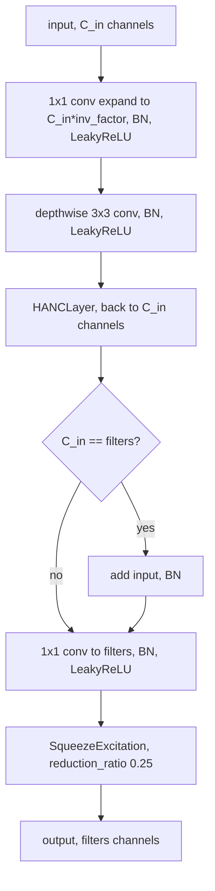

# acc_unet

Keras 3 layers from the ACC-UNet image segmentation network: a context-gathering block (`HANCBlock`, built on `HANCLayer`) and a cross-scale fusion layer (`MLFCLayer`). A small helper builds the batch norm they all share.

## What it is for

A U-Net is an encoder-decoder network for pixel-wise prediction. ACC-UNet changes two parts of it. First, it replaces the plain convolution blocks with blocks that gather context from a wider neighborhood without paying for self-attention. Self-attention compares every pixel with every other pixel, so its cost grows with the square of the pixel count. Pooling the feature map at a few scales and concatenating the results costs far less, and the number of scales is a small fixed number. Second, it replaces the plain skip connections, which pass one encoder level to its matching decoder level, with a layer that lets all encoder levels exchange information first.

This package holds those reusable pieces. The full network that assembles them lives elsewhere in the repo (`dl_techniques.models.vision.accunet`).

## How it works

`HANCLayer` takes a feature map `X` of shape `(batch, H, W, C)`. For each scale `s` from 1 to `k-1` it average-pools and max-pools `X` with window and stride `2**s` (`padding='same'`). It then resizes each pooled map back to `(H, W)` with nearest-neighbor interpolation. It concatenates `X` with all of these maps along the channel axis, which gives `C * (2k - 1)` channels. A 1x1 convolution, batch norm and LeakyReLU turn that into `out_channels`. With `k=1` there is no pooling, and the layer is just a 1x1 projection.

`HANCBlock` wraps a `HANCLayer` in an inverted bottleneck:



`MLFCLayer` takes a list of exactly 4 feature maps from 4 encoder levels. For each level it resizes all 4 maps (bilinear) to that level's height and width, concatenates them, and runs a 1x1 conv, BN and LeakyReLU to get back to that level's channel count. It then concatenates the result with the level's own map, runs a 1x1 conv and BN, adds the level's own map back as a residual, and applies LeakyReLU. This repeats `num_iterations` times, each round reading the previous round's outputs. After the last round each level goes through a `SqueezeExcitation` gate. The output list has the same shapes as the input list.

`reference_batch_norm(name)` builds every batch norm in this package with momentum 0.9 and epsilon 1e-3.

## Files

- `hanc_layer.py` - `HANCLayer`: multi-scale average/max pooling, concatenation and 1x1 fusion.
- `hanc_block.py` - `HANCBlock`: inverted bottleneck around `HANCLayer`, with optional residual and squeeze-excitation.
- `multi_level_feature_compilation.py` - `MLFCLayer`: cross-level fusion of 4 encoder feature maps.
- `reference_batch_norm.py` - `reference_batch_norm()`, `REFERENCE_BN_MOMENTUM` (0.9) and `BN_EPSILON` (1e-3).
- `__init__.py` - empty. Import from the submodules.

## How to use it

```python
import keras
from dl_techniques.layers.acc_unet.hanc_block import HANCBlock
from dl_techniques.layers.acc_unet.multi_level_feature_compilation import MLFCLayer

block = HANCBlock(filters=32, input_channels=16, k=3, inv_factor=3)
y = block(keras.random.normal((2, 64, 64, 16)))      # (2, 64, 64, 32)

mlfc = MLFCLayer(channels_list=[16, 32, 64, 128], num_iterations=1)
outs = mlfc([
    keras.random.normal((2, 64, 64, 16)),
    keras.random.normal((2, 32, 32, 32)),
    keras.random.normal((2, 16, 16, 64)),
    keras.random.normal((2, 8, 8, 128)),
])                                                    # same 4 shapes
```

Tests: `.venv/bin/python -m pytest tests/test_layers/test_acc_unet -q` from the repo root.

## Things to know

- Inputs are channels-last 4D tensors `(batch, height, width, channels)`.
- `HANCBlock` needs `input_channels` to match the input's last dimension and checks it at build time. It raises `ValueError` for a non-4D input or a mismatch.
- The residual path in `HANCBlock` exists only when `input_channels == filters`.
- `k` must be between 1 and 5 for both `HANCLayer` and `HANCBlock`. Pooling windows are `2**s`, so large `k` on a small map pools to very few pixels.
- Every convolution here has no bias term. `HANCBlock` and `MLFCLayer` accept `bias_initializer` and `bias_regularizer` and keep them in the config, but they have no effect.
- `MLFCLayer` requires `channels_list` to list the true channel counts of the 4 inputs, in order. Build does not check the input channels against it. It checks only that the input shape is a list of 4.
- `MLFCLayer.num_iterations` repeats the fusion inside one layer, with separate weights per iteration.
- `MLFCLayer` does not pass `training` to its `SqueezeExcitation` calls. The gate is made of convolutions only, with no batch norm or dropout, so this changes nothing today.
- Batch norm momentum is 0.9 on purpose. Keras' default 0.99 left the moving variance too stale after a short run, and the model predicted only background at inference. Epsilon stays at Keras' 1e-3 rather than the PyTorch reference's 1e-5, because 1e-5 overflowed in mixed float16 backward.
- All three layers are registered with `register_dl_technique` under `dl_techniques.layers.acc_unet.<module>`, so they save and load in `.keras` files.
- This package has no factory.
