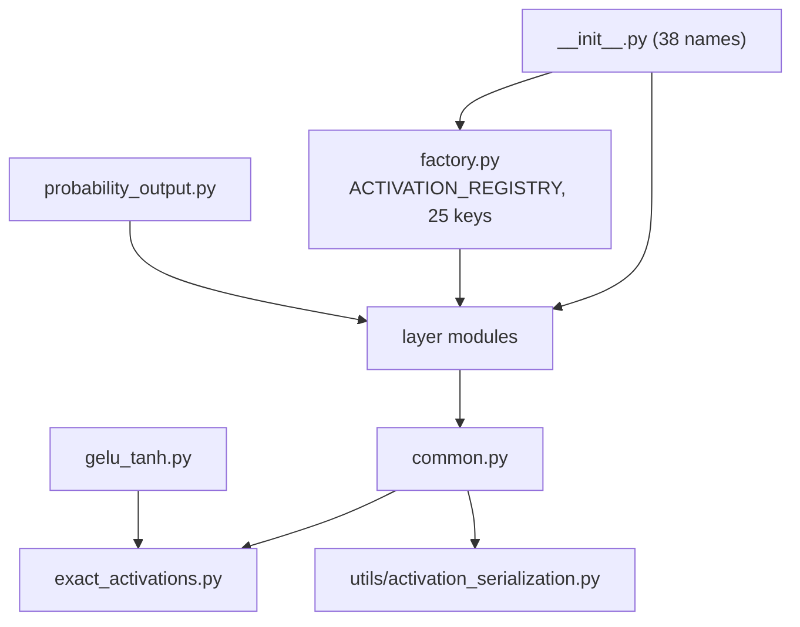

# activations

Path: `src/dl_techniques/layers/activations`
Purpose: Keras 3 activation and probability-output layers, registered activation functions, the string-keyed factory that builds them, and the shared `activation=` argument helpers used across `layers/`.

## Scope

In this package (23 `.py` files plus `GUIDE.md`, no subdirectories):

- Element-wise activations: `GoLU`, `Mish`, `SaturatedMish`, `HardSigmoid`, `HardSwish`, `BasisFunction`, `ReLUK`, `DifferentiableStep`, `GELU`, `SiLU`, `xGELU`, `xSiLU`, `xATLU`, `EluPlusOne`, `ExactLeakyReLU`, `SoftValueRange`.
- Normalizers and probability outputs: `Sparsemax`, `ThreshMax`, `SigSoftmax`, `AdaptiveTemperatureSoftmax`, `HarMax`, `SquashLayer`, `MonotonicityLayer`, `RoutingProbabilitiesLayer`, `ProbabilityOutput`.
- Registered plain functions: `exact_gelu`, `exact_leaky_relu`, `gelu_tanh`, `sigsoftmax`, `log_sigsoftmax`, `soft_value_range`.
- `factory.py` (registry and builders) and `common.py` (activation-argument trio, axis helpers).

Not here: models, normalization layers, FFN layers. Those call into this package (`layers/ffn`, `layers/attention` and others; 47 files under `src/` reference `layers.activations.common`). The `relu` factory key builds `keras.layers.ReLU`, not a class defined here.

## Architecture



Import direction: `exact_activations.py` imports nothing local. `common.py` and `gelu_tanh.py` import `exact_activations`. `harmax`, `sigsoftmax`, `sparsemax`, `routing_probabilities` import `.common` for `axis_is_in_range` / `normalize_axis`. `probability_output.py` imports `Sparsemax`, `ThreshMax`, `AdaptiveTemperatureSoftmax`, `HarMax`, `RoutingProbabilitiesLayer`. `factory.py` imports every registry class (not `ProbabilityOutput`, `ExactLeakyReLU`). `__init__.py` imports everything.

Factory control flow (`create_activation_layer`): registry lookup via `.get`; reject undeclared kwargs (before the `try`, so the marker survives); `validate_activation_config`; defaults then kwargs; keep declared names; apply `name=`; instantiate. Everything after the strict check is inside `try/except (TypeError, ValueError)` that re-raises one `ValueError("Failed to create <type> layer (<Class>). Provided keys: ... Error: ...")`.

`resolve_activation` (`common.py`) order: `None` to `keras.activations.linear`; `str` to `EXACT_ACTIVATIONS` else `keras.activations.get`; `dict` to `keras.activations.deserialize`; other must be callable else `ValueError`; then `_deserialize_activation(resolved, allow_layer=False)` rejects a `keras.layers.Layer` with `ValueError`.

## Key files

| File | Role | Notes |
| --- | --- | --- |
| `__init__.py` | Public surface, `__all__` of 38 | 6 factory names + 7 functions + 25 classes. Exports `gelu_tanh.resolve_activation`, not `common.resolve_activation`. Only 6 of the 7 "functions" are registered; `resolve_activation` is plain |
| `factory.py` | `ACTIVATION_REGISTRY`, `ActivationType`, 5 public functions, `STRICT_DROPPED_KEY_MARKER`, `_KERAS_BASE_PARAMS` | 25 keys. Marker and frozenset are deliberate copies of the ones in other factories, pinned by a test |
| `common.py` | `activation_spec`, `resolve_activation`, `serialize_activation`, `axis_is_in_range`, `normalize_axis` | Layer-rejecting wrapper over `utils/activation_serialization.py` |
| `exact_activations.py` | `exact_gelu`, `exact_leaky_relu`, `ExactLeakyReLU`, `EXACT_ACTIVATIONS`, `substitute_exact`, `exact_name` | Python-float constants follow input dtype. `EXACT_ACTIVATIONS` has exactly the keys `gelu`, `leaky_relu` |
| `gelu_tanh.py` | `gelu_tanh`, `resolve_activation` | `_EXTENDED_ACTIVATIONS` = `gelu_tanh`, `gelu_approximate`, `gelu_pytorch_tanh` plus `EXACT_ACTIVATIONS` |
| `expanded_activations.py` | `BaseActivation`, `GELU`, `SiLU`, `ExpandedActivation`, `xATLU`, `xGELU`, `xSiLU`, `EluPlusOne`, `elu_plus_one_plus_epsilon`, `get_activation` | `get_activation` is module-local, not exported from the package. All classes share one registry package string |
| `golu.py` | `GoLU` | No weights; alpha, beta, gamma are constants |
| `mish.py` | `Mish`, `SaturatedMish`, `mish`, `saturated_mish` | `mish`/`saturated_mish` functions are not registered; `mish_at_alpha` computed once in float64 numpy then stored as Python float |
| `hard_sigmoid.py`, `hard_swish.py` | `HardSigmoid`, `HardSwish` | Each owns a `keras.layers.ReLU(max_value=6.0, name="relu6", dtype=self.dtype_policy)` sublayer built in `build` |
| `basis_function.py` | `BasisFunction` | `x / (1 + exp(-x))`; used by `layers/ffn/power_mlp_layer.py` |
| `relu_k.py` | `ReLUK` | `k` must be `int` > 0 (`TypeError` / `ValueError`); `k == 1` skips the power |
| `differentiable_step.py` | `DifferentiableStep` | Hard-coded slope constraint `[1, 10]` and `L2_custom(-1e-3)`; not in config |
| `squash.py` | `SquashLayer` | `epsilon=None` resolves to `keras.config.epsilon()`, stored resolved |
| `sparsemax.py` | `Sparsemax` | Flatten to rank 2, one-hot select, no gather. XLA-driven; see Invariants |
| `thresh_max.py` | `ThreshMax`, `thresh_max`, `_threshmax` | `thresh_max` function builds no layer; `slope` weight always created |
| `sigsoftmax.py` | `SigSoftmax`, `sigsoftmax`, `log_sigsoftmax` | Log-space; float16/bfloat16 widened to float32 |
| `adaptive_softmax.py` | `AdaptiveTemperatureSoftmax` | Degree-4 polynomial temperature; needs rank >= 2 |
| `harmax.py` | `HarMax` | `softmax(-n * log(max(d, eps)))` |
| `soft_value_range.py` | `SoftValueRange`, `soft_value_range` | One shared validator `_validated_bounds`; no hard-clip option on purpose |
| `monotonicity_layer.py` | `MonotonicityLayer`, `MonotonicityMethod` | 6 methods; `axis_normalized` set in `build` |
| `routing_probabilities.py` | `RoutingProbabilitiesLayer` | Two modes; custom `compute_output_spec`, `get_build_config`, `build_from_config` |
| `probability_output.py` | `ProbabilityOutput`, `ProbabilityType` | Builds strategy in `__init__`; custom `from_config` |
| `GUIDE.md` | Authoring guide for new activation layers | Its code samples use `from keras import ops`; the code in this package uses `keras.ops` qualified at the call site. Follow the code |

## Public interface

Factory (`factory.py`, all re-exported):

```python
create_activation_layer(activation_type: ActivationType, name: Optional[str] = None, **kwargs) -> keras.layers.Layer
resolve_activation_layer(activation_type: str, name: Optional[str] = None, **kwargs) -> keras.layers.Layer
create_activation_from_config(config: Dict[str, Any]) -> keras.layers.Layer
validate_activation_config(activation_type: str, **kwargs) -> None
get_activation_info() -> Dict[str, Dict[str, Any]]
```

- `create_activation_layer`: raises only `ValueError`. Undeclared kwarg gives a message containing `STRICT_DROPPED_KEY_MARKER` (`"unsupported parameter(s)"`) and is not re-wrapped. Other failures start with `Failed to create`. `name=` wins over `kwargs['name']`.
- `resolve_activation_layer`: registry key goes to the factory, anything else to `keras.layers.Activation(activation_type, name=name)`; kwargs dropped on the fallback path.
- `create_activation_from_config`: `ValueError` if not a dict or no `'type'`. Copies the dict.
- `validate_activation_config`: called directly it raises `TypeError` for `axis` (`differentiable_step`) and `max_value` (`relu`); through the factory those become `ValueError`.
- `get_activation_info`: shallow copy; nested `optional_params` is the registry's own dict. Mutating it changes the factory.

Helpers (`common.py`, not in `__all__`):

```python
activation_spec(activation: Any) -> Any            # dict -> keras.activations.deserialize; else unchanged
resolve_activation(activation: Any) -> Callable    # raises ValueError for Layer or non-callable
serialize_activation(activation: Any) -> Any       # exact forms -> "gelu"/"leaky_relu"; else utils serializer
axis_is_in_range(axis: int, rank: int) -> bool     # -rank <= axis < rank
normalize_axis(axis: int, rank: int) -> int        # no range check
```

Exact forms (`exact_activations.py`): `exact_gelu(x)`, `exact_leaky_relu(x, negative_slope=0.2)`, `ExactLeakyReLU(negative_slope=0.3)`, `substitute_exact(identifier)` (swaps only the two stock strings, never raises), `exact_name(activation)` (identity lookup, returns the key or `None`).

Layer constructors (defaults): `GoLU(alpha=1.0, beta=1.0, gamma=1.0)`, `ReLUK(k=3)`, `SaturatedMish(alpha=3.0, beta=0.5)`, `DifferentiableStep(axis=-1, slope_initializer='ones', shift_initializer='zeros', shift_regularizer=None, shift_constraint=None)`, `ThreshMax(axis=-1, slope=10.0, epsilon=1e-12, trainable_slope=False, slope_initializer='ones', slope_regularizer=None, slope_constraint=None)`, `SquashLayer(axis=-1, epsilon=None)`, `Sparsemax(axis=-1)`, `SigSoftmax(axis=-1)`, `HarMax(n=1.0, epsilon=1e-8, axis=-1)`, `AdaptiveTemperatureSoftmax(min_temp=0.1, max_temp=1.0, entropy_threshold=0.5, eps=None, polynomial_coeffs=None)`, `SoftValueRange(min_value, max_value=None, sharpness=50.0, relative_sharpness=True)`, `MonotonicityLayer(method='cumulative_softplus', axis=-1, min_spacing=None, max_spacing=None, value_range=None, clip_inputs=None, input_clip_range=(-20.0, 20.0), epsilon=1e-7)`, `RoutingProbabilitiesLayer(output_dim=None, axis=-1, epsilon=1e-7, mode='deterministic', ..., use_bias=True, input_normalization=None, normalize=True)`, `ProbabilityOutput(probability_type='softmax', type_config=None)`, `xGELU/xSiLU/xATLU(alpha_initializer='zeros', alpha_regularizer=None, alpha_constraint=None)`.

## Data shapes

Registry entry (`ACTIVATION_REGISTRY[key]`): `{'class': type, 'description': str, 'required_params': List[str], 'optional_params': Dict[str, default], 'use_case': str}`. Only `soft_value_range` (`min_value`) and `hierarchical_routing` (`output_dim`) have required params. A `None` default in `optional_params` often means "the class resolves its own default" (for example `shift_regularizer`, `slope_constraint`), not "no value"; the entry exists so the strict check accepts the key.

Registered keys (25): `adaptive_softmax`, `basis_function`, `differentiable_step`, `elu_plus_one`, `gelu`, `golu`, `hard_sigmoid`, `hard_swish`, `harmax`, `hierarchical_routing`, `mish`, `monotonicity`, `relu`, `relu_k`, `routing_probabilities`, `saturated_mish`, `sigsoftmax`, `silu`, `soft_value_range`, `sparsemax`, `squash`, `thresh_max`, `xatlu`, `xgelu`, `xsilu`. `ActivationType` lists the same 25.

Shapes: every layer preserves input shape except `RoutingProbabilitiesLayer` (axis replaced by `output_dim`) and `ProbabilityOutput` with `routing` / `hierarchical` types. Weight shapes: `DifferentiableStep` `slope`/`shift` are `()` for `axis=None` else 1 everywhere except `axis`; `ThreshMax` `slope` `()`; `xGELU`/`xSiLU`/`xATLU` `alpha` `()`; routing `kernel` `(input_dim, num_decisions)` and `bias` `(num_decisions,)` (trainable only). `num_decisions = log2(next_pow2(output_dim))`.

## Invariants and constraints

- **`__all__` is a contract (38 names).** Every name needs a matching import in `__init__.py`. Add both in one change. The registry key set, `ActivationType`, and each entry's `required_params`/`optional_params` are public API checked by `tests/test_layers/test_factory_registry_drift.py`. `hierarchical_routing` deliberately sets `'mode': 'trainable'` against the class default; that test pins it.
- **Registration:** every layer and registered function uses `@register_dl_technique("dl_techniques.layers.activations.<module>")` from `dl_techniques.utils.keras_registration`, never a bare `@keras.saving.register_keras_serializable()`. The package string is the defining module's dotted path (note `expanded_activations.py` and `exact_activations.py` use their own module names). The helper also binds the legacy `Custom>ClassName` key.
- **Strict kwargs:** the factory must keep raising on undeclared keys. Do not add filter-and-drop. Do not drop the `_KERAS_BASE_PARAMS` exemption (`name`, `dtype`, `trainable`, `activity_regularizer`, `autocast`).
- **Do not rename `exact_gelu` / `exact_leaky_relu` to the stock names.** `keras.activations.serialize` returns the bare name for a function named like a built-in and the layer reloads as stock. Do not delegate them to `keras.ops.gelu` / `leaky_relu`, and do not write `maximum(x, a*x)` for leaky ReLU (gradient at 0 becomes 1, stock's is the slope). Keep `x / 1.4142135623730951` as a division.
- **`common.serialize_activation` must keep the `exact_name` step**, or about 40 layers that serialize a resolved callable write a function dict instead of `"gelu"`.
- **`common.resolve_activation` and `activation_spec` stay partial wrappers.** The `str` branch must return a callable (the shared serializer returns the string); the `dict` branch uses `keras.activations.deserialize` because the shared one raises for unregistered custom functions. The `callable()` check must run before `_deserialize_activation` so a Layer reaches the specific Layer-rejection message.
- **dtype rule for reductions:** widen only. float16/bfloat16 to float32, everything else unchanged, read from `inputs.dtype` via `getattr(d, "name", None) or str(d)`. Never hard-code `"float32"` (silently narrows float64). Used in `sparsemax.py`, `sigsoftmax.py`, `soft_value_range.py`, `routing_probabilities.py`. Do not replace the idiom with `keras.backend.standardize_dtype` (banned in `src/`) or bare `str(d)` (a `tf.DType` stringifies wrongly).
- **Python-float constants, not tensors:** `gelu_tanh` and `exact_gelu` write constants as Python floats so they take the input dtype. `GELU`/`xGELU` use `keras.ops.sqrt(keras.ops.cast(2.0, inputs.dtype))`; bare `keras.ops.sqrt(2.0)` is a float32 tensor and breaks float16 autocast.
- **Sub-layers take the owner's dtype policy:** `HardSigmoid`, `HardSwish` (ReLU6 with `dtype=self.dtype_policy`) and `ProbabilityOutput` (strategy with `{"dtype": self.dtype_policy, **type_config}`). Without it a float64 input is narrowed to float32.
- **Sparsemax XLA rules:** range-check `axis` via `common.axis_is_in_range` before any `pop`/`transpose` (shared predicate with `compute_output_shape`); flatten to `(N, K)`; select `cumsum[k_z]` with `one_hot` + `where`, not `take_along_axis` and not a `-inf * 0` product; reshape support vectors to `(1, K)`; subtract the row max; compute `tau` then cast only `tau` back.
- **Axis checks:** `call` and `compute_output_shape` of `HarMax`, `SigSoftmax`, `Sparsemax`, `RoutingProbabilitiesLayer` use the same `axis_is_in_range`. `__init__` rejects non-int and bool axis (HarMax, SigSoftmax, Sparsemax, routing). Keras does not rebuild a built layer, so rank/extent contracts enforced in `build` are repeated in `call` (`AdaptiveTemperatureSoftmax` rank >= 2, `MonotonicityLayer` extent >= 2).
- **Negative L2 on purpose:** `DifferentiableStep` slope `L2_custom(-1e-3)`, `ThreshMax` slope `L2_custom(-1e-4)`. Hard-coded constraints: `ValueRangeConstraint(1.0, 10.0)` and `ValueRangeConstraint(1.0, 50.0)`. `None` regularizer/constraint arguments are resolved in the body, never as signature defaults.
- **Routing fp16 fork:** `call` returns float32 for float16 inputs, and `compute_output_spec` declares float32 when `compute_dtype == "float16"`. Change both together. Masks `_mask_mul_np` / `_mask_add_np` are numpy arrays recomputed in `build`, not weights, and converted to tensors inside `call`. The cosine basis goes through `add_weight(trainable=False)`, not a plain tensor attribute. `get_build_config` / `build_from_config` must stay so a layer built only through a parent's `build` reloads with weights.
- **`ThreshMax.get_config` writes the config key `slope`**, taken from the constructor argument stored as the attribute `slope_initial_value`, not from the live weight. Trained values come from the weights file.
- **Registry classes need `**kwargs` forwarded to `Layer.__init__`**, since the strict check passes the five base params through.
- **Style:** `import keras`, then `keras.ops.*` qualified at the call site; never `from keras import ops`. Sphinx/reST docstrings (`:param:`/`:type:`/`:raises:`). Logging via `dl_techniques.utils.logger`, no `print`. Comments of the form `# DECISION plan-.../D-nnn` mark measured decisions whose longer record is outside this directory; do not delete or paraphrase them.

## Dependencies

Internal: `dl_techniques.utils.keras_registration.register_dl_technique` (all modules); `dl_techniques.utils.logger.logger`; `dl_techniques.utils.activation_serialization` (`serialize_activation`, `deserialize_activation`, used by `common.py`); `dl_techniques.regularizers.l2_custom.L2_custom` and `dl_techniques.constraints.value_range_constraint.ValueRangeConstraint` (`differentiable_step.py`, `thresh_max.py`).

External: `keras` (>= 3.8, `keras.ops` everywhere), `numpy` (`expanded_activations.py` uses `np.pi`; `mish.py` and `routing_probabilities.py` precompute constants), `functools.lru_cache` (routing basis and masks, maxsize 128 each).

Consumers outside this package: attention, FFN and many other `layers/` modules use `common`, `exact_name`, `substitute_exact`, `resolve_activation_layer`, `ExactLeakyReLU`, `gelu_tanh`; `layers/ffn/power_mlp_layer.py` uses `BasisFunction`; `layers/ffn/gated_mlp.py` imports `exact_gelu`.

## Failure modes

| Situation | Result |
| --- | --- |
| Unknown registry key | `ValueError` from `validate_activation_config`, re-wrapped as `Failed to create ...`; lists available types |
| Undeclared kwarg | `ValueError` with `unsupported parameter(s)` and the accepted names; not re-wrapped |
| Missing required param (`output_dim`, `min_value`) | `ValueError` |
| Wrong type, e.g. `relu` `max_value='big'` | `TypeError` inside validation, surfaces as `ValueError` via the factory |
| `resolve_activation(layer_instance)` | `ValueError` (weights would be created in `call`) |
| `resolve_activation(7)` | `ValueError: Could not interpret activation function identifier` |
| `axis` out of range for the rank | `ValueError` in `call` / `compute_output_shape` (`build` for `DifferentiableStep`, `MonotonicityLayer`, routing) |
| `MonotonicityLayer` `sigmoid` or `normalized_softmax` without `value_range` | `ValueError` in `__init__` |
| `MonotonicityLayer` `exponential` with `clip_inputs=False` | `UserWarning`, can overflow to `inf` |
| `ProbabilityOutput` unknown type, or hierarchical without `type_config['output_dim']` | `ValueError`; `routing` without `output_dim` does not raise and keeps the input width |
| `ProbabilityOutput` `mask` with non-softmax type | silently dropped |
| Routing deterministic with `input_dim < num_decisions` | `ValueError`; below `2 * num_decisions` only a warning |
| `get_activation_info()` result mutated | changes the live registry |
| `AdaptiveTemperatureSoftmax` with `polynomial_coeffs=[]` | silently replaced by defaults (`or`) |
| `ThreshMax(slope=s, slope_initializer=<non-Ones>)` | `slope` ignored for the initial weight, still written to config |

## Working here

Add a new activation layer:

1. New module `<name>.py` with a `keras.layers.Layer` subclass, `@register_dl_technique("dl_techniques.layers.activations.<name>")`, `get_config` covering every constructor argument, `compute_output_shape`, `keras.ops` only. Create weights in `build`, not `__init__`. Validate in `__init__`.
2. Factory: add the class import, the key to `ActivationType`, an `ACTIVATION_REGISTRY` entry (`class`, `description`, `required_params`, `optional_params` with the class's real defaults, `use_case`), and a branch in `validate_activation_config` if values need checks. An entry that is missing a constructor argument makes that argument unreachable through the factory.
3. `__init__.py`: add the import and the `__all__` entry together, and update the "38 names" figure in its docstring.
4. Tests in `tests/test_layers/test_activations/` (per-module files such as `test_golu.py`, `test_sparsemax.py`; `test_threshmax.py` has no underscore in the name; `test_hard_activations.py` covers `HardSigmoid` and `HardSwish` together; factory tests in `test_activation_factory.py`; `exact_activations.py` has no `test_exact_activations.py`; its exact forms are covered by `test_the_exact_gelu_and_leaky_relu_are_exact_at_float64_and_stock_at_float32.py`). Include the serialization round trip and a float64 check if the layer uses constants.
5. If a registry key is added or renamed, update the "Registered keys" list and the key counts in this file (25 in the diagram, Key files and Data shapes).

If you add a layer that takes an `activation=` argument anywhere in `layers/`, route it through `activation_spec` / `resolve_activation` / `serialize_activation`, and use `substitute_exact` when handing a spec to a stock Keras layer.

Tests (scope to this package; the full suite takes about 1.5 hours):

```bash
.venv/bin/python -m pytest tests/test_layers/test_activations/ -q
.venv/bin/python -m pytest tests/test_layers/test_factory_registry_drift.py -q
.venv/bin/python -m pytest tests/test_the_raw_gelu_and_leaky_relu_calls_cannot_grow.py -q
.venv/bin/python -m pytest tests/test_models/test_no_float64_forward_reaches_the_float32_gelu_constants.py -q
```

The last two guards hold the repo to the exact GELU/LeakyReLU: one is a per-file census of raw `gelu` / `leaky_relu` spellings, the other checks that no float64 forward of a registered model reaches `tf.nn.gelu` or `tf.nn.leaky_relu`. New code that spells GELU or LeakyReLU raw can trip the census. Dtype-specific tests in the test directory: `test_the_activation_constants_follow_the_input_dtype.py`, `test_the_dtype_floor_never_narrows.py`, `test_the_exact_gelu_and_leaky_relu_are_exact_at_float64_and_stock_at_float32.py`, `test_the_gelu_constant_follows_the_input_dtype.py`, `test_the_tables_survive_a_parent_build.py`.

Known doc drift in the code: the `validate_activation_config` docstring says eleven types get value checks, the code has twelve (it omits `soft_value_range`); the `__init__.py` docstring says "seven serializable activation functions" but `resolve_activation` is not registered, so six are.
