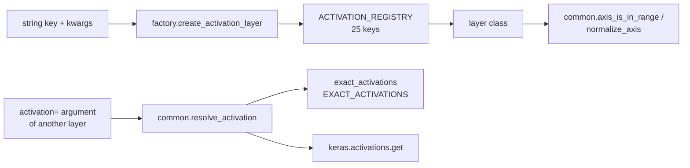

# activations

Keras 3 activation layers and activation functions for the `dl_techniques` library, plus a string-keyed factory that builds them. Import path: `dl_techniques.layers.activations`. Source path: `src/dl_techniques/layers/activations/`.

## What it is for

A neural network needs non-linearities and output normalizers (softmax and its relatives). Keras ships a few. This package adds the ones the library's models and layers need that Keras does not have, such as GoLU, Mish, hard swish, ReLU-k, sparsemax, thresh-max, a hierarchical routing tree and a monotonic-output layer. It also fixes two small numeric problems in Keras: at float64, TensorFlow builds the GELU constant `sqrt(2)` and the LeakyReLU slope in float32, which makes float64 results slightly wrong. The package carries exact versions that use the input's dtype.

Every layer here has full `get_config()` serialization and is registered with Keras, so a model that contains it can be saved to `.keras` and loaded again. Activations can be picked by a string key, which lets a config file choose the activation without hardcoding a class.

## How it works

Three groups of code:

- **Layers**, one module per family (`golu.py`, `mish.py`, `sparsemax.py`, ...). Most are stateless and element-wise. A few have weights (`DifferentiableStep`, `ThreshMax`, the `x*` variants, `RoutingProbabilitiesLayer` in trainable mode).
- **Registered functions**: `exact_gelu`, `exact_leaky_relu`, `gelu_tanh`, `sigsoftmax`, `log_sigsoftmax`, `soft_value_range`. Plain callables that survive a `.keras` round trip, which a lambda or `functools.partial` would not.
- **Helpers and factory**: `factory.py` builds layers from string keys; `common.py` handles a layer's `activation=` argument (string, `None`, callable or serialized dict) and axis arithmetic.



The factory rejects any keyword the key does not declare, checks values (for example `k` of `relu_k` must be a positive int), merges the registry defaults with your keywords, and builds the class. Every failure comes out as one `ValueError`.

## Files

- `__init__.py` - public surface. `__all__` has 38 names: 6 factory names, 7 functions, 25 layer classes.
- `factory.py` - `ACTIVATION_REGISTRY` (25 keys), `ActivationType`, `create_activation_layer`, `resolve_activation_layer`, `create_activation_from_config`, `validate_activation_config`, `get_activation_info`.
- `common.py` - `activation_spec`, `resolve_activation`, `serialize_activation` (a layer's `activation` argument), and `axis_is_in_range`, `normalize_axis`.
- `exact_activations.py` - `exact_gelu`, `exact_leaky_relu`, `ExactLeakyReLU`, the `EXACT_ACTIVATIONS` table, `substitute_exact`, `exact_name`.
- `gelu_tanh.py` - `gelu_tanh` (tanh-approximate GELU) and its own `resolve_activation`, which knows the extra names `gelu_tanh`, `gelu_approximate`, `gelu_pytorch_tanh`.
- `expanded_activations.py` - `GELU`, `SiLU`, `xGELU`, `xSiLU`, `xATLU`, `EluPlusOne`, bases `BaseActivation` and `ExpandedActivation`, and a module-local `get_activation(name)`.
- `golu.py` - `GoLU`, Gompertz gate `alpha * exp(-beta * exp(-gamma * x))`.
- `mish.py` - `Mish`, `SaturatedMish`, plus functions `mish` and `saturated_mish`.
- `hard_sigmoid.py`, `hard_swish.py` - `HardSigmoid`, `HardSwish` (MobileNetV3 style, built on ReLU6).
- `basis_function.py` - `BasisFunction`, `x / (1 + exp(-x))` (the Swish branch of PowerMLP).
- `relu_k.py` - `ReLUK`, `max(0, x)^k`.
- `differentiable_step.py` - `DifferentiableStep`, learnable `0.5 * (tanh(slope * (x - shift)) + 1)`.
- `squash.py` - `SquashLayer`, capsule-network vector squashing.
- `sparsemax.py` - `Sparsemax`, projection onto the probability simplex (exact zeros).
- `thresh_max.py` - `ThreshMax` and function `thresh_max`: softmax, smooth gate against `1/N`, renormalize.
- `sigsoftmax.py` - `SigSoftmax`, `sigsoftmax`, `log_sigsoftmax`: normalizes `exp(z) * sigmoid(z)` in log space.
- `adaptive_softmax.py` - `AdaptiveTemperatureSoftmax`, softmax with an entropy-driven temperature.
- `harmax.py` - `HarMax`, `d_i^-n / sum_j d_j^-n` for distances.
- `soft_value_range.py` - `SoftValueRange` and function `soft_value_range`, a smooth stand-in for `clip`.
- `monotonicity_layer.py` - `MonotonicityLayer`, turns raw scores into a non-decreasing sequence (6 methods).
- `routing_probabilities.py` - `RoutingProbabilitiesLayer`, hierarchical routing tree, deterministic or trainable.
- `probability_output.py` - `ProbabilityOutput`, one wrapper over 7 probability strategies chosen by string.
- `GUIDE.md` - authoring guide for new activation layers in this package.

## How to use it

Build by key:

```python
from dl_techniques.layers.activations import create_activation_layer

mish = create_activation_layer("mish")
relu_sq = create_activation_layer("relu_k", k=2, name="relu_squared")
sparse = create_activation_layer("thresh_max", slope=20.0, trainable_slope=True)
routing = create_activation_layer("hierarchical_routing", output_dim=50000)
```

Build from a config dict (`type` is the key, the rest are keyword arguments):

```python
from dl_techniques.layers.activations import create_activation_from_config

layer = create_activation_from_config({"type": "relu_k", "k": 2})
```

Accept either a registry key or a plain Keras name (`'sigmoid'`, `'tanh'`):

```python
from dl_techniques.layers.activations import resolve_activation_layer

resolve_activation_layer("mish")      # Mish layer
resolve_activation_layer("sigmoid")   # keras.layers.Activation
```

Inspect and validate:

```python
from dl_techniques.layers.activations import get_activation_info, validate_activation_config

get_activation_info()["differentiable_step"]["optional_params"]
validate_activation_config("monotonicity", method="sigmoid")  # ValueError: needs value_range
```

Use directly in a model:

```python
import keras
from dl_techniques.layers.activations import Mish, Sparsemax

model = keras.Sequential([
    keras.layers.Input(shape=(128,)),
    keras.layers.Dense(64),
    Mish(),
    keras.layers.Dense(10),
    Sparsemax(),
])
```

Handle an `activation=` argument in your own layer:

```python
from dl_techniques.layers.activations.common import (
    activation_spec, resolve_activation, serialize_activation,
)

# __init__:    self.activation = activation_spec(activation)
# call():      y = resolve_activation(self.activation)(x)
# get_config:  "activation": serialize_activation(self.activation)
```

Registry keys: `adaptive_softmax`, `basis_function`, `differentiable_step`, `elu_plus_one`, `gelu`, `golu`, `hard_sigmoid`, `hard_swish`, `harmax`, `hierarchical_routing`, `mish`, `monotonicity`, `relu`, `relu_k`, `routing_probabilities`, `saturated_mish`, `sigsoftmax`, `silu`, `soft_value_range`, `sparsemax`, `squash`, `thresh_max`, `xatlu`, `xgelu`, `xsilu`.

## Things to know

- **Two functions named `resolve_activation`.** The one exported from the package (`gelu_tanh.py`) extends `keras.activations.get` with the tanh-GELU names. The one in `common.py` returns a callable and rejects `keras.layers.Layer` instances. They are different on purpose. Import the second as `from dl_techniques.layers.activations.common import resolve_activation`.
- **Exact GELU and LeakyReLU.** Both resolvers map the strings `"gelu"` and `"leaky_relu"` to `exact_gelu` and `exact_leaky_relu`. At float32 these are bit-identical to Keras. At float64 they are exact where Keras is off by up to 5e-9 (GELU) or 2.2e-8 relative (LeakyReLU slope). `common.serialize_activation` writes the two names back, so configs stay strings. A stock Keras layer given the callable directly stores a function dict instead. Do not rename these functions to `gelu` or `leaky_relu`: Keras would serialize them as the bare string and reload stock behavior.
- **The factory is strict.** An unknown keyword raises `ValueError` and names the accepted ones. Only `name`, `dtype`, `trainable`, `activity_regularizer` and `autocast` are accepted on top of the key's own parameters. Callers only need to catch `ValueError`, even for type errors.
- **`'relu'` builds `keras.layers.ReLU`**, not a class from this package. `'gelu'` and `'silu'` build the `GELU` and `SiLU` layers from `expanded_activations.py`.
- **`'routing_probabilities'` and `'hierarchical_routing'` build the same class.** The first defaults to `mode='deterministic'` (cosine basis, no trainable weights), the second to `mode='trainable'` and requires `output_dim`.
- **`ProbabilityOutput` is not a factory key.** Import it directly. Its `mask` argument reaches only the `softmax` strategy.
- **`AdaptiveTemperatureSoftmax` is not monotonic in entropy** at its default polynomial, jumps at `entropy_threshold`, and needs at least 10 classes to reach `min_temp`. Passing `polynomial_coeffs=[]` silently gives the defaults.
- **`ThreshMax` suppresses, it does not zero.** Use `Sparsemax` for exact zeros. `slope` is ignored for the initial weight value if you pass a non-default `slope_initializer`.
- **`DifferentiableStep` and `ThreshMax` use a negative L2 coefficient on purpose** (`L2_custom(-1e-3)` and `L2_custom(-1e-4)`) so the slope drifts steeper. Slope is clipped to `[1, 10]` and `[1, 50]` respectively. Do not flip the sign.
- **`SaturatedMish` overshoots** its plateau (max about 3.1277 at the defaults) and the bare `saturated_mish` function defaults `mish_at_alpha=1.0`, which does not match the layer.
- **`MonotonicityLayer` methods differ in which arguments they honor.** `sigmoid` and `normalized_softmax` require `value_range`; `exponential` with `clip_inputs=False` warns and can overflow; prefer `cumulative_exp`.
- **`RoutingProbabilitiesLayer` under float16** returns float32 on purpose, because leaf masses underflow in float16. Deterministic mode needs `input_dim >= num_decisions` and warns below `2 * num_decisions`.
- Backend-agnostic: all math uses `keras.ops`. Tested on the TensorFlow backend (TensorFlow 2.18, Keras 3.8).
