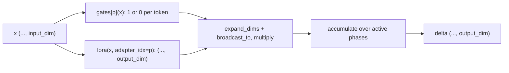

# adapters

Path: `src/dl_techniques/layers/adapters`
Purpose: Keras 3 layers that return an additive low-rank delta (`LoRAAdapter`) and a phase-gated version of it (`GatedAdapter`), plus a strict one-key factory.

## Scope

Lives here:
- `LoRAAdapter` in `lora.py`: a pure additive delta with `num_adapters` independent `A`/`B` pairs.
- `GatedAdapter` in `gated_adapter.py`: one `LoRAAdapter` with `num_phases` slots plus one `LocalSupportGate` per phase (Local Support Learning, LSL).
- `factory.py`: `ADAPTER_REGISTRY`, `AdapterType`, and the creation and validation functions.
- `__init__.py`: curated re-export, `__all__` has 13 names.

Not here:
- The base projection being augmented. Both layers return a delta; the caller adds it.
- `LocalSupportGate` and the EM fitting maths. They live in `src/dl_techniques/layers/statistics/local_support_gate.py`.
- Zamba2 model code. `src/dl_techniques/models/language/zamba2/` imports `LoRAAdapter` from here.

## Architecture

`LoRAAdapter.call`: resolve the slot to a Python int, then `matmul(inputs, a[idx])`, `matmul(.., b[idx])`, multiply by `scale = alpha / rank`.

`GatedAdapter.build` creates `self.lora` via `create_adapter_layer('lora', name='lora', ..., num_adapters=num_phases, kernel_initializer=clone_initializer(...))` and `self.gates` as `LocalSupportGate(input_dim, seed, name=f'gate_{phase}', **gate_args)`, then builds both. They are created in `build`, not `__init__`.

Import graph: `factory.py` imports `LoRAAdapter` from `lora.py`. `gated_adapter.py` imports `create_adapter_layer` from `factory.py`, `LoRAAdapter` from `lora.py`, and `LocalSupportGate` from `..statistics.local_support_gate`.

## Key files

| File | Role | Notes |
| --- | --- | --- |
| `lora.py` | `LoRAAdapter`, `LEGACY_NUM_OCCURRENCES_KEY` | Registered `dl_techniques.layers.adapters.lora` with `legacy_packages=("dl_techniques.models.zamba2.lora_adapter",)`. Weights `lora_a`, `lora_b`. |
| `gated_adapter.py` | `GatedAdapter`, `GatedAdapterType = Literal['local_support']` | Registered `dl_techniques.layers.adapters.gated_adapter`. Not a factory key. Uses `from keras import ops`. |
| `factory.py` | Registry and dispatch | One key `lora`. Import-time `_check_registry_literal_consistency()` raises `RuntimeError` if keys and `AdapterType` disagree. |
| `__init__.py` | Exports | Names: `ADAPTER_REGISTRY`, `AdapterType`, `STRICT_DROPPED_KEY_MARKER`, `assemble_adapter_config`, `create_adapter_from_config`, `create_adapter_layer`, `get_adapter_info`, `get_adapter_requirements`, `list_adapter_types`, `validate_adapter_config`, `LEGACY_NUM_OCCURRENCES_KEY`, `LoRAAdapter`, `GatedAdapter`. |

## Public interface

`LoRAAdapter(output_dim: int, rank: int, alpha: float, num_adapters: int, kernel_initializer="glorot_uniform", **kwargs)`
- `call(inputs, adapter_idx: Optional[int] = None, occurrence_idx: Optional[int] = None)` returns `(..., output_dim)`. Both indices `None` resolves to slot 0.
- `build(input_shape)` needs a static last axis, else `ValueError`.
- `compute_output_shape` reads `output_dim` from config, works unbuilt.
- `from_config` pops `num_occurrences`, warns, and substitutes `num_adapters`.
- Property `num_occurrences` (read only alias). Attributes `scale`, `a`, `b`.
- Raises `ValueError` when any of `output_dim`, `rank`, `alpha`, `num_adapters` is not positive.

`GatedAdapter(input_dim, output_dim, rank, alpha, num_phases=1, adapter_type='local_support', gate_args=None, kernel_initializer="glorot_uniform", active_phases=None, seed=None, name=None, **kwargs)`
- `call(inputs, training=None, phase_idx=None)`: casts to float32, sums `gate * delta` over `active_phases`, or only `phase_idx` when given. Returns zeros `(..., output_dim)` if the phase list is empty.
- `set_active_phases(phases: Optional[Sequence[int]])`: `None` restores all phases.
- `fit_gate(phase_activations, generic_activations, phase_idx=None, max_iter=100, tol=1e-4)`: calls `gates[p].fit(pos_samples=..., neg_samples=...)`; `phase_idx=None` fits all phases. Returns `{'phase_
': {'pos': n, 'neg': n}}`.
- `is_phase_fitted(phase_idx) -> bool`: `gate.is_fitted('pos') and gate.is_fitted('neg')`.
- `build` raises `ValueError` if the static last axis differs from `input_dim`.

Factory functions (`factory.py`):
- `create_adapter_layer(adapter_type, name=None, **kwargs)`: validates, merges registry `optional_params` under kwargs, sets `params['name'] = name`, constructs. `TypeError`/`ValueError` from construction are re-raised as `ValueError`.
- `create_adapter_from_config(config)`: copies the dict, pops `'type'`, delegates. Non-dict or missing `'type'` raises `ValueError`.
- `validate_adapter_config(adapter_type, **kwargs) -> None`: order is unknown type, undeclared key, missing required, then value checks (`positive_int` on `output_dim`, `rank`, `num_adapters`; `alpha` must be a non-bool int or float and positive).
- `assemble_adapter_config(adapter_type, wrapper_config, caller_args=None, *, passthrough=('name',))`: drops wrapper keys the type does not declare (debug log), forwards `caller_args` unfiltered.
- `get_adapter_info()` and `get_adapter_requirements(type)`: deep copies. `list_adapter_types()`: sorted keys.

## Data shapes

- `lora_a`: `(num_adapters, input_dim, rank)`, initialised slice by slice. `lora_b`: `(num_adapters, rank, output_dim)`, zeros.
- Registry entry keys: `class`, `description`, `required_params`, `optional_params`, `use_case`, `complexity`, `paper`. `lora` requires `output_dim`, `rank`, `alpha`, `num_adapters`; optional `kernel_initializer: 'glorot_uniform'`.
- Accepted extra kwargs: `name`, `dtype`, `trainable`, `activity_regularizer`, `autocast` (`_KERAS_BASE_PARAMS`).
- `LoRAAdapter.get_config` keys: Keras base keys plus `output_dim`, `rank`, `alpha`, `num_adapters`, `kernel_initializer`.
- `GatedAdapter.get_config` keys: Keras base keys plus `input_dim`, `output_dim`, `rank`, `alpha`, `num_phases`, `adapter_type`, `gate_args`, `kernel_initializer`, `active_phases`, `seed`. Gate fit state is not in the config.
- `STRICT_DROPPED_KEY_MARKER = "unsupported parameter(s)"`, a substring of the undeclared-key error message.

## Invariants and constraints

- The slot or phase index is a Python `int`, never a tensor.
- `LoRAAdapter` must not call the stored initializer instance directly per slice. `_a_initializer` in `build` clones with `clone_initializer(a_initializer_fn)` for every slice; a shared seedless instance replays one sample and made all slots bit-identical (decision D-007). `GatedAdapter` also passes `clone_initializer(self.kernel_initializer)` to the inner adapter.
- Do not initialise the stacked 3-D `A` in one initializer call; Keras reads a 3-D shape as a conv kernel and scales wrongly.
- `get_config` emits `num_adapters` only. The alias `num_occurrences` is read only in `from_config`; do not accept it in `__init__`.
- `_resolve_adapter_idx` order: conflict between `adapter_idx` and `occurrence_idx` first, then default to 0, then range check.
- Gate seeds are `seed + phase` when `seed` is set, so phases do not share a sketch.
- `gate_args` must not contain `input_dim` or `name`.
- Factory registry keys, the `AdapterType` literal, and each entry's `required_params` / `optional_params` are public API. Change keys and literal in the same commit (`tests/test_layers/test_adapters/test_adapter_factory.py` covers the registry surface).
- `GatedAdapter` is deliberately absent from the registry.
- The undeclared-key check is duplicated on purpose: `validate_adapter_config` has it, and `create_adapter_layer` reaches it through that call.
- `GatedAdapter.call` multiplies after `expand_dims(gate, -1)` plus `broadcast_to`. A bare multiply would broadcast the per-token score on the wrong axis.

## Dependencies

- `dl_techniques.initializers.clone_initializer`: per-slice independent initializers.
- `dl_techniques.utils.keras_registration.register_dl_technique`: serialization registration.
- `dl_techniques.utils.logger.logger`: logging (info on construction, warning on legacy key).
- `dl_techniques.utils.validation.positive_int`: factory value checks.
- `dl_techniques.layers.statistics.local_support_gate.LocalSupportGate`: gate; methods used are `build`, `__call__(x, training=)`, `fit`, `is_fitted`.
- External: `keras` (3.x), `copy`, `typing`.
- Consumer: `src/dl_techniques/models/language/zamba2/layers.py` (constructs `LoRAAdapter(... num_adapters=...)`) and `zamba2/__init__.py` (re-exports it).

## Failure modes

- Undeclared factory keyword: `ValueError` containing `STRICT_DROPPED_KEY_MARKER`.
- Unknown adapter type or missing required parameter: `ValueError`.
- `adapter_idx` outside `[0, num_adapters)`, or `adapter_idx` and `occurrence_idx` disagree: `ValueError`.
- `phase_idx` outside `[0, num_phases)`, or naming an inactive phase: `ValueError`.
- Unfitted gate: no error. The phase's contribution is zero. Check `is_phase_fitted`.
- `fit_gate` before the layer is built: `self.gates` is empty, so the per-phase lookup fails with `IndexError`. Build or call the layer first.
- Legacy config with both `num_occurrences` and a different `num_adapters`: `ValueError` from `from_config`.
- `adapter_type` on `GatedAdapter` is validated in `__init__` (only `'local_support'`, else `ValueError`), stored and serialized; `build` always creates `'lora'`, so the value cannot change what is built. Add a dispatch table if a second type is ever added.
- The `GatedAdapter` class docstring says sub-layers are created in `__init__` and `fit_gate` returns `{'pos','neg'}`; the code creates them in `build` and returns per-phase nested dicts. Trust the code.

## Working here

- Add an adapter type: add the class file, add its entry to `ADAPTER_REGISTRY`, add the name to `AdapterType`, export it in `__init__.py`, and update `__all__`. Import fails with `RuntimeError` if the literal and registry disagree. Add tests under `tests/test_layers/test_adapters/`.
- Docstring style in this package is Sphinx/reST (`:param:`, `:type:`, `:raises:`); match the file you edit. Other repo rules: `import keras` and qualify at the call site, use `keras.ops`, register with `register_dl_technique`, no print statements.
- Keep `get_config` complete and round-trippable; the `.keras` round trip is tested.
- Tests: `tests/test_layers/test_adapters/` holds `test_lora_adapter.py`, `test_adapter_factory.py`, `test_the_guards_actually_hold.py`, `test_the_red_proofs.py`. The red-proof file is marked `red_proof`, rewrites library source, and is run deliberately with `pytest tests/test_layers/test_adapters/test_the_red_proofs.py -v`.
- Run scoped tests: `.venv/bin/python -m pytest tests/test_layers/test_adapters/ -q` from the repo root, plus `tests/test_models/test_zamba2/` if `LoRAAdapter` changed. Do not run the full suite.
