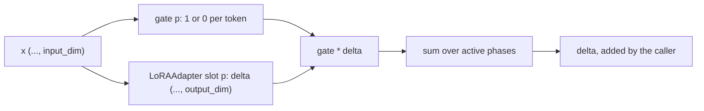

# adapters

Keras 3 layers that add a small, trainable correction on top of a projection someone else owns: a low-rank adapter (`LoRAAdapter`) and a version of it that only fires on inputs a learned gate recognises (`GatedAdapter`). The package is `dl_techniques.layers.adapters` in the `dl_techniques` deep learning library.

## What it is for

Fine-tuning a large weight matrix `W` directly changes every parameter and, applied everywhere, changes the output for every input. A low-rank adapter (LoRA) learns a small additive correction instead: two thin matrices `A` and `B` whose product is added to the output of `W`. The base layer stays untouched.

This package goes two steps further. A single `LoRAAdapter` holds several independent `A`/`B` pairs ("slots"), so one shared layer can behave differently at many call sites without growing its own parameter count. `GatedAdapter` uses those slots as learning "phases" and multiplies each phase's correction by a gate that is open only for inputs that look like that phase's training data. That is the mechanism of Local Support Learning (LSL), which limits forgetting because a later phase's update cannot reach inputs from an earlier phase.

Neither layer wraps the base projection. Both return a delta, and the caller adds it to its own output.

## How it works

`LoRAAdapter` computes, for a slot index `i`:

```
delta = (x @ A[i]) @ B[i] * (alpha / rank)
```

`A` has shape `(num_adapters, input_dim, rank)` and `B` has shape `(num_adapters, rank, output_dim)`. `B` starts at zero, so the delta is exactly zero until training moves it. The slot index is a plain Python `int` chosen when the model is built, not a tensor. It defaults to `0`, so the layer also works inside `keras.Sequential` or a functional model, where only the input is passed.

`GatedAdapter` owns one `LoRAAdapter` with `num_phases` slots and one `LocalSupportGate` per phase. The gate (from `dl_techniques.layers.statistics.local_support_gate`) scores each token's input against two fitted mixtures and returns 1 or 0. The output is the sum over active phases of gate times delta.



A gate must be fitted before it does anything. An unfitted gate routes every token closed, so its phase adds nothing, silently.

The factory in `factory.py` builds `LoRAAdapter` from a string key (`lora`). It is strict: a keyword the type does not declare raises `ValueError` instead of being dropped.

## Files

- `__init__.py` - package docstring and curated exports (13 names in `__all__`).
- `lora.py` - `LoRAAdapter`, the multi-slot additive low-rank delta, and the constant `LEGACY_NUM_OCCURRENCES_KEY`.
- `gated_adapter.py` - `GatedAdapter`, a `LoRAAdapter` plus one `LocalSupportGate` per phase.
- `factory.py` - `ADAPTER_REGISTRY` (one key, `lora`), the `AdapterType` literal, and the creation and validation functions.

## How to use it

Plain adapter:

```python
import keras
from dl_techniques.layers.adapters import LoRAAdapter

adapter = LoRAAdapter(output_dim=256, rank=8, alpha=16.0, num_adapters=4)
x = keras.random.normal((2, 10, 256))
base = keras.layers.Dense(256)(x)
out = base + adapter(x, adapter_idx=1)   # slot 1's delta
```

Through the factory:

```python
from dl_techniques.layers.adapters import create_adapter_layer

adapter = create_adapter_layer(
    "lora", name="up_lora", output_dim=256, rank=8, alpha=16.0, num_adapters=4
)
```

Gated, two phases:

```python
from dl_techniques.layers.adapters import GatedAdapter

adapter = GatedAdapter(input_dim=512, output_dim=512, rank=8,
                       alpha=16.0, num_phases=2, seed=3)
adapter.build((None, 512))
adapter.fit_gate(phase_activations=x0, generic_activations=g, phase_idx=0)
adapter.fit_gate(phase_activations=x1, generic_activations=g, phase_idx=1)
delta = adapter(hidden)                  # both phases, each gated
delta = adapter(hidden, phase_idx=0)     # phase 0 only
adapter.set_active_phases([1])           # stop applying phase 0
```

`x0`, `x1`, `g` are `(n, 512)` activation arrays. `fit_gate` needs the gates to exist, and they are created in `build`, so call the layer once or `build` it first.

## Things to know

- Registration: `LoRAAdapter` registers as `dl_techniques.layers.adapters.lora`, with a legacy alias for the old Zamba2 location (`dl_techniques.models.zamba2.lora_adapter`). `GatedAdapter` registers as `dl_techniques.layers.adapters.gated_adapter`.
- Old checkpoints: a saved config that uses the old `num_occurrences` key is accepted by `LoRAAdapter.from_config` (with a warning), which rewrites it to `num_adapters`. If both keys are present with different values it raises. `call` also still accepts the `occurrence_idx` keyword as an alias of `adapter_idx`, and the `num_occurrences` property reads `num_adapters`.
- Slot initialisation: each slot's `A` slice is drawn from its own clone of the initializer. Handing one initializer instance to every slice made all slots identical. `B` is zeros.
- `GatedAdapter` is not a factory key. Construct it by class name.
- `GatedAdapter.adapter_type` has one valid value, `'local_support'`, which builds a `lora` adapter per phase; any other value raises `ValueError`. It is stored and serialized.
- `GatedAdapter.call` casts inputs to float32 and returns float32.
- If every phase is inactive, `call` returns a zero tensor of the right shape.
- Selecting a single `phase_idx` that is not in `active_phases` raises `ValueError`.
- `fit_gate` with `phase_idx=None` fits every phase on the same samples. Pass `phase_idx` for multi-phase use. It returns `{'phase_<p>': {'pos': iterations, 'neg': iterations}}`. It is exact batch EM; the streaming path is `LocalSupportGate.observe` on `adapter.gates[p]`.
- `GatedAdapter.get_config` does not store gate fit state, only constructor arguments. Fitted gate state is not part of that config.
- Consumers inside the repo: `models/language/zamba2/` uses `LoRAAdapter` (slot = depth position of a weight-shared block).
- Tests: `tests/test_layers/test_adapters/`. `test_the_red_proofs.py` is marked `red_proof`, rewrites source on purpose, and should only be run deliberately.

References: Hu et al., 2021, LoRA (arXiv 2106.09685); Ben-Kish et al., 2026, Local Support Learning (arXiv 2610.02126).
