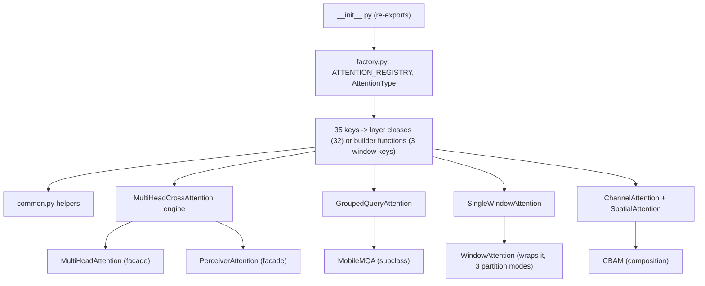

# attention

Path: `src/dl_techniques/layers/attention`
Purpose: Keras 3 attention and token-mixing layers plus a strict-kwargs factory (`create_attention_layer`) over 35 registered keys.

## Scope

In: every attention or token-mixing `keras.layers.Layer` the library offers (self, cross, windowed, linear, vision gates, capsule, energy, Fourier), the registry/factory in `factory.py`, and the shared mask/scale/validation helpers in `common.py`.

Not in: feed-forward blocks, norms, embeddings and RoPE (sibling packages `layers/ffn`, `layers/norms`, `layers/embedding`, used from here through their factories), transformer blocks that compose attention (`layers/transformers`), models. Repo root for commands: `/media/arxwn/data_fast/repositories/dl_techniques`; use `.venv/bin/python`.

## Architecture

- `create_attention_layer(attention_type, name=None, **kwargs)` order: (1) look up the registry; if found, reject any kwarg outside `required_params | optional_params` with `ValueError` carrying `STRICT_DROPPED_KEY_MARKER` (`"unsupported parameter(s)"`); (2) inside a `try`, `validate_attention_config`; (3) merge `optional_params` defaults under caller kwargs; (4) add `name` if given; (5) call `info['class'](**params)`. Any `TypeError`/`ValueError` in steps 2 to 5 is re-raised as one `ValueError("Failed to create ...")` chained from the original. An unknown type skips step 1, fails in step 2 and surfaces as the same wrapped `ValueError`.
- `validate_attention_config` repeats the undeclared-key check (deliberate duplicate; removing either copy changes which failure fires first), then: unknown type, missing required, positive ints, rates in `[0,1]`, positive ratios, `max_seq_len > 0`, `group_query` (`num_heads % num_kv_heads == 0`), `differential` (`dim == num_heads * head_dim`). Checks are one flat name allowlist applied to every type, not per-type schemas.
- Facades: `MultiHeadAttention` and `PerceiverAttention` own no attention math; they hold one `MultiHeadCrossAttention` sub-layer named `cross_attention` (checkpoint weight paths depend on that name). A change to `MultiHeadCrossAttention.call` changes all three.
- `MobileMQA` subclasses `GroupedQueryAttention` with one K/V head, optional stride-2 depthwise K/V downsampling, RoPE off, and a learnable scalar residual `x + lambda * Attention(x)`.

## Key files

| File | Role | Notes |
| --- | --- | --- |
| `__init__.py` | Public surface | 44 names in `__all__`: 7 factory-interface names (6 functions plus the `AttentionType` alias) + 37 classes. Import order fixes Keras registration order, do not sort. |
| `factory.py` | Registry and factory | `ATTENTION_REGISTRY` (35), `AttentionType` Literal (35), `STRICT_DROPPED_KEY_MARKER`, `assemble_attention_config` (the 7th public function, not re-exported). |
| `common.py` | Shared primitives | Flat: no classes, no registration. Not re-exported from `__init__.py`. |
| `multi_head_cross_attention.py` | Engine | Self- and cross-attention; `shared_qk_projections=True` fuses `Dense(3*dim)` and is rejected with `kv_input` and with `kv_kernel_initializer`. |
| `window_attention.py` | `WindowAttention` + 5 builder functions | Three registered; `create_kan_key_window_attention` and `create_adaptive_softmax_window_attention` are not registered or exported. |
| `single_window_attention.py` | Inner window layer | `set_window_slots()` is the channel for the slot map, not a call keyword. |
| `tripse_attention.py` | `TripSE1..4` | Also `TripletAttentionBranch`, `_SEWeights` (internal, not exported). |
| `attention_routing_capsule.py` | `AttentionRoutingCapsule`, `CapsuleBlockV2` | Direct import only; `CapsuleBlockV2` used by `models/vision/capsnet/model_v2.py`. Both share one registration module string. |
| `lighthouse_attention.py` | Pyramid top-K causal attention | Static sequence length required; index buffers built in `build()`. |
| `energy_attention.py` | Energy Transformer attention | Hand-coded gradient; `energy()` and `update()` must be edited as a pair. |
| `ring_attention.py` | Online-softmax blockwise attention | Sequence length must be a static int. |
| other `*_attention.py`, `fnet_fourier_transform.py`, `mobile_mqa.py` | One layer each | Each registers as `dl_techniques.layers.attention.<module>`. |
| `GUIDE.md` | Authoring guide | Human-oriented; not code. |

## Public interface

Factory (all from `factory.py`; the first six are re-exported by `__init__.py`):

- `create_attention_layer(attention_type: AttentionType, name: Optional[str] = None, **kwargs) -> keras.layers.Layer`
- `create_attention_from_config(config: dict) -> keras.layers.Layer`: pops `'type'` from a copy and forwards the rest; `ValueError` if not a dict or no `'type'`.
- `validate_attention_config(attention_type: str, **kwargs) -> None`: raises `ValueError`; returns nothing.
- `list_attention_types() -> List[str]`: sorted keys.
- `get_attention_info() -> Dict[str, Dict]` and `get_attention_requirements(attention_type) -> Dict`: shallow `.copy()` of entries (nested `optional_params` and `required_params` are the registry's own objects). The latter raises `ValueError` on an unknown key.
- `assemble_attention_config(attention_type, wrapper_config, caller_args=None, *, passthrough=('name',)) -> dict`: NOT re-exported; import from `.factory`. Filters `wrapper_config` to the type's declared names, then merges `caller_args` unfiltered on top, so a caller typo still raises in `create_attention_layer`. Used by `layers/transformers/free_transformer.py`, `layers/time_series/mixed_sequential_block.py`, `layers/heads/nlp/base.py`, `layers/heads/vision/base.py`, `models/language/trm/components.py`. Raises `ValueError` on an unknown type.

`common.py`:

- `MASK_BIAS_VALUE = mask_sentinel("float32")` (from `dl_techniques.utils.dtype_policy`).
- `mask_dtype(compute_dtype: str) -> str`: `'float64'` if the layer computes in float64, else `'float32'`.
- `apply_attention_mask(logits, keep, *, out_dtype=None, rescue_axis=-1)`: adds a `where`-built bias in `mask_dtype`. `keep` is the caller's keep predicate (nonzero or True means attend, compared `> 0`; no polarity inference; must be binary). `rescue_axis` is the axis the caller's softmax reduces over (int, non-empty tuple/list of ints, or `None` to opt out): a slice keeping nothing is treated as keeping everything. Raises `ValueError` for an invalid `rescue_axis`, and for a `keep` statically size 1 along every named axis while `logits` is longer there (such a mask cannot mask anything).
- `validate_head_divisibility(dim, num_heads, *, dim_name="dim", num_heads_name="num_heads")`: `ValueError` if `dim % num_heads != 0`.
- `compute_attention_scale(head_dim) -> float`: `1.0 / math.sqrt(float(head_dim))`, a Python float. Call from `__init__` or `build`, never `call()`.

Call signatures (frozen; renaming or reordering breaks serialized configs and callers). Re-derived from each `def call`:

| Layer (registry key or class) | `call` |
| --- | --- |
| `area`, `beit`, `capsule_routing`, `fnet`, `gated`, `multi_head`, `spatial`, `wave_field`, `window` | `(inputs, attention_mask=None, training=None)` |
| `single_window` | `(inputs, attention_mask=None, training=None, pad_to_window=True)` |
| `non_local` | `(inputs, attention_mask=None, training=None, **kwargs)` |
| `differential` | `(inputs, attention_mask=None, layer_idx=0, training=None)`; `layer_idx` is not in `get_config()` |
| `group_query`, `mobile_mqa`, `ring` | `(inputs, training=None, attention_mask=None, return_attention_weights=False)`; `ring` returns `(output, None)` when asked for weights |
| `hopfield` | `(inputs, attention_mask=None, return_attention_scores=False, training=None)`; `inputs` may be a list/tuple `[query, key, value]` |
| `energy` | `(inputs, attention_mask=None, training=None, mask=None, adjacency_weight=None)`; `mask` is the Keras-propagated rank-2 mask, `supports_masking=True` |
| `multi_head_cross`, `multi_head_latent`, `perceiver` | `(query_input, kv_input=None, attention_mask=None, training=None)` |
| `shared_weights_cross` | `(inputs, split_sizes, attention_mask=None, training=None)` |
| `rpc` | `(inputs, mask=None, training=None, return_attention_scores=False)` |
| `linear` | `(inputs, training=None, mask=None)`; `mask` is deleted on the first line |
| `performer` | `(inputs, training=None, return_attention_scores=False)`, no mask |
| `anchor` | `(x, num_anchor_tokens=None, training=None)`, no mask; `None` is full self-attention, `K > 0` is hub-and-spoke |
| `lighthouse`, `channel`, `cbam`, `tripse1..4`, `multi_dconv_head_transposed`, `AttentionRoutingCapsule`, `CapsuleBlockV2` | `(inputs, training=None)` |
| `ideogram4` (`Ideogram4Attention`) | `(x, segment_ids, cos, sin, training=None)` |
| `mmdit_joint` (`MMDiTJointAttention`) | `(inputs=[hidden_states, encoder_hidden_states], training=None)`; returns the image stream only when `context_pre_only=True`, else a two-element list `[image_out, text_out]` |

`WindowAttention.call` is `(inputs, attention_mask=None, training=None)`: it dispatches through `_call_internal` bound in `build()` to `_call_grid`, `_call_zigzag` or `_call_band`. It has no `pad_to_window`; only the band path passes `pad_to_window=False` internally to its `SingleWindowAttention`. Accepted mask ranks: `grid` rank-2 `(B, N)` or rank-3 `(B, ws**2, ws**2)`; `band` rank-2 or rank-3 `(B, N, N)`; `zigzag` rank-2 only.

## Data shapes

- Sequence layers: `(B, N, dim)`. `group_query`/`mobile_mqa` also accept `(B, H, W, D)` (flattened to `H*W` and restored).
- Vision layers: `(B, H, W, C)` NHWC. `multi_dconv_head_transposed` is rank-4 only (raises `ValueError` otherwise). `area` takes a 4D map and an optional `(B, H, W)` or `(B, H*W)` keep mask. `ChannelAttention` returns weights `(B,1,1,C)`, `SpatialAttention` returns a map `(B,H,W,1)`; the caller multiplies them in. `CBAM` and `TripSE*` return the refined tensor, same shape as input.
- `beit` expects sequence length exactly `Wh*Ww + 1`, cls first; `window_size` may be an int or `(Wh, Ww)`.
- `shared_weights_cross`: `split_sizes` of length 2 is plain bidirectional cross-attention; length 4 splits each modality into anchors and queries. The sequence dimension must be static.
- Registry entry keys: `class`, `description`, `required_params` (list), `optional_params` (dict of defaults), `use_case`, `complexity`, `paper`.
- Window builders: `window`, `window_zigzag`, `window_band` use `kwargs.setdefault("use_relative_position_bias", ...)` with `True`, `False`, `False`. `partition_mode` is `'grid' | 'zigzag' | 'band'`. `band` means query `i` sees key `j` iff `abs(i-j) <= window_size`; the class requires `window_size >= 0` for band and refuses `use_relative_position_bias=True`.
- The `probability_type` hook goes through `ProbabilityOutput` from `layers/activations`; `WindowAttention` rejects `routing`, `deterministic_routing`, `hierarchical` and `hierarchical_routing`.

## Invariants and constraints

- Registration: every class uses `@register_dl_technique("dl_techniques.layers.attention.<module>")` from `dl_techniques.utils.keras_registration`, never a bare `register_keras_serializable`. Every `__init__` argument appears in `get_config()`.
- The registry key set, the `AttentionType` literals, and each entry's `required_params` / `optional_params` are public API, asserted by `tests/test_layers/test_factory_registry_drift.py`. Adding, renaming or removing one is a breaking change.
- Never filter-and-drop kwargs in the factory path. Wrappers that carry generic defaults pre-filter with `assemble_attention_config`.
- Factory defaults must agree with constructor defaults. `lighthouse` carries `qk_norm_type=None` in the registry because a registry `'rms_norm'` was silently applied and degraded the scorer (comment in `factory.py`).
- Declared on only some entries: `output_kernel_initializer` (`multi_head`, `multi_head_cross`), `kv_kernel_initializer` (`multi_head_cross`), `num_kv_heads` on `gated`, `kan_init_scheme`/`kan_init_seed` on `single_window` and the three window keys. A layer-accepted kwarg must be declared in the registry to be reachable through the factory.
- Masking:
  - Apply masks with `apply_attention_mask`. Never write `logits + (1 - mask) * MASK_BIAS_VALUE`: under float16 `-1e9` is `-inf` and `0 * -inf` is NaN. `MASK_BIAS_VALUE` is only safe inside `mask_dtype(...)`.
  - Pass the call site's own polarity verbatim; a blanket `mask > 0` rewrite inverts masking where the native convention differs. `rpc` passes `not_equal(mask, 0)`.
  - Derive `rescue_axis` from the layer's `probability_config` axis where the softmax is configurable. `beit`, `capsule_routing` and `ring` have their own reasons not to derive it.
  - `ring` must pass `rescue_axis=None` per tile and rescue once over the full key axis before the block loop; a per-tile rescue un-masks the future under a causal mask.
  - Do not add a second masking helper to `common.py`.
- Adopters of `apply_attention_mask` in this package: 12 (`area`, `beit`, `capsule_routing`, `differential`, `gated`, `group_query`, `hopfield`, `multi_head_cross`, `multi_head_latent`, `ring`, `rpc`, `single_window`). Outside the package it is also imported by `layers/matching/`, `layers/heads/masking.py`, `layers/heads/nlp/question_answering.py`, `layers/sequence_pooling/sequence_pooling.py`, `models/world_models/levjepa/blocks.py`. Importer counts of `validate_head_divisibility` (14) and `compute_attention_scale` (17) over `layers/` are stated in the `common.py` docstring as mechanical: derive them with an AST walk matching `ImportFrom` modules whose last component is `common`, not a text search.
- `compute_attention_scale` is the reciprocal (`1/sqrt(d)`). Do not adopt it where a layer stores `sqrt(head_dim)` and divides (`wave_field_attention.py`), and probe bit-identity before swapping `x ** -0.5`.
- `validate_head_divisibility` is not adopted where the local check is conditional on `head_dim is None` or the message carries a fix hint (`gated_attention.py`, `linear_attention.py`, `capsule_routing_attention.py`).
- Initializers: a layer resolves one initializer instance; the first projection keeps it, every other projection gets `clone_initializer(...)`, otherwise a seeded initializer replays identical draws at every projection. `multi_head` and `multi_head_cross` deliberately keep the shared default; separate their projections with `output_kernel_initializer` (and `kv_kernel_initializer`). Weight paths must not change. Guard: `tests/test_layers/test_attention/test_the_attention_projections_draw_independently.py`.
- `energy_attention.py`: edit `energy()` and `update()` together. Only the autodiff oracle test `test_gradient_oracle` in `tests/test_layers/test_attention/test_energy_attention.py` proves the closed-form gradient; a wrong direction still runs and looks finite.
- `common.py` stays flat (no classes, no registry).

## Dependencies

- Internal: `dl_techniques.utils.keras_registration.register_dl_technique`; `dl_techniques.utils.dtype_policy` (`mask_sentinel` in `common.py`, `stability_floor` in `multi_dconv_head_transposed_attention.py`); `dl_techniques.utils.logger.logger`; `dl_techniques.utils.activation_serialization` (`serialize_activation`, `deserialize_activation`); `dl_techniques.utils.masking` (`create_banded_attend_mask` in window band, `MaskFactory` in lighthouse); `dl_techniques.initializers` (`clone_initializer`, `IdentityPlusNoise` in wave_field, `create_kan_initializers` in single_window); `dl_techniques.layers.activations` (`ProbabilityOutput` for score normalization: `softmax`, `sparsemax`, `threshmax`, `adaptive`; `resolve_activation_layer`); `layers/norms` factory `create_normalization_layer` for `qk_norm_type`, `output_norm_type`, `normalization_type`; `layers/embedding` (RoPE via `create_embedding_layer` in gated attention, `RotaryPositionEmbedding` in group-query, `apply_rotary_pos_emb` from `multi_axis_rope` in ideogram4); `layers/norms.rms_norm.RMSNorm` in ideogram4 and mmdit; `layers/conv_blocks` (`SqueezeExcitation` in `tripse_attention.py`, `ConvBlock` in `area_attention.py`); `layers/ffn/kan_linear.KANLinear` in single_window.
- External: `keras` (3.x, use `keras.ops` only), `numpy` (index tables, window slots), `tensorflow` 2.18 as the backend. No raw `tf.*` in layer math.
- Consumers: `layers/transformers/transformer.py` (`TransformerLayer` builds attention through the factory and skips the mask for `_MASKLESS_ATTENTION_TYPES = frozenset({'fnet', 'anchor', 'lighthouse'})`), `layers/transformers/free_transformer.py`, `layers/time_series/mixed_sequential_block.py`, `layers/heads/*/base.py`, `models/language/trm/components.py`, `models/vision/capsnet/model_v2.py`, and several other layers and models importing classes directly.

## Failure modes

- Undeclared kwarg: `ValueError` containing `unsupported parameter(s)`. The marker contains regex characters; use `re.escape` or a substring check in `pytest.raises(match=...)`.
- Unhashable `attention_type` raises `TypeError` at the registry lookup, before the `try`. Everything else surfaces as `ValueError`.
- `validate_attention_config` rejects `window_size <= 0` for every type, so the factory cannot build `window_band` with `window_size=0` even though the class allows it. Tuple `window_size` (beit) is checked per component.
- `lighthouse`: `RuntimeError` in `call()` if built without a static sequence length. Required: `N` divisible by `pooling_factor ** (num_levels - 1)`. Causality is block-granular.
- `ring`: sequence length must be a static Python int (`ValueError` otherwise); no gradient checkpointing, so backward memory grows with `N`.
- `rpc`: no float16 SVD kernel outside XLA, so it cannot run under `mixed_float16`; cost is `max_pcp_iter` batched SVDs per call.
- `fnet` `implementation='fft'`: warns and uses the matrix DFT.
- `linear`: `mask=` accepted and discarded; feature maps `elu_plus_one`, `exp`, `softmax` rejected.
- `spatial`, `mobile_mqa`, `shared_weights_cross`: `attention_mask` accepted and never read.
- `non_local`: `attention_mask` is additive, clamped to the compute dtype's minimum (`np.finfo(...).min`) before the cast; it is not a keep mask.
- `wave_field`: do not assume token-level causality; it depends on `field_size` and `max_seq_len`.
- `anchor`: anchors are the first `K` tokens, so a left-padded batch corrupts every read; right-padded is safe.
- `ideogram4`: no padding mask; a padding token needs its own segment id.
- `beit`: wrong sequence length raises `ValueError` in `build()`.
- `hopfield`: `update_steps_eps` is stored for serialization and never read; the loop always runs `update_steps_max + 1` steps.
- Stale text: the `create_attention_layer` docstring says "all 33 registered types"; the registry has 35.

## Working here

- Docstrings: Sphinx/reST (`:param:`, `:type:`, `:return:`, `:raises:`) is the convention in this package; match the file you edit and never convert a file wholesale. Parameter names: `dim`, `num_heads`, `head_dim`, `dropout_rate`; `channels` stays on CNN-family layers by design.
- Compose, do not re-implement: score normalization through `ProbabilityOutput`, Q/K norm through `create_normalization_layer`, RoPE through the embedding factory, masks and scale through `common.py`. Create sub-layers in `__init__`, build them explicitly in `build()`, execute in `call()`.
- Add a layer: (1) new `<name>_attention.py` with `@register_dl_technique("dl_techniques.layers.attention.<name>_attention")` and full `get_config()`; (2) import and `__all__` entry in `__init__.py`; (3) if factory-constructible, add the literal to `AttentionType` and an `ATTENTION_REGISTRY` entry with `class`, `description`, `required_params`, `optional_params`, `use_case`, `complexity`, `paper`; every constructor argument the factory should reach must appear in the entry; (4) update the counts in the `factory.py` and `__init__.py` module docstrings (35 keys, 37 classes, 32 reachable as classes), the `common.py` docstring if adopters change, and this file; (5) add `tests/test_layers/test_attention/test_<name>_attention.py`, and update the drift test expectations if the registry changed.
- Do not rename call parameters or reorder them for uniformity; serialized configs and callers depend on the current signatures.
- Tests: scope to this package, for example `.venv/bin/python -m pytest tests/test_layers/test_attention/ -q` or one file such as `tests/test_layers/test_attention/test_attention_factory.py`. Also run `tests/test_layers/test_factory_registry_drift.py` after any registry change, and `tests/test_layers/test_transformers/` if you touch a layer `TransformerLayer` builds. Never run the full suite (about 1.5 hours) and never run pytest jobs in parallel. Tests and probes that use a GPU: one job at a time.
- Notable guard tests in `tests/test_layers/test_attention/`: `test_common.py`, `test_the_attention_projections_draw_independently.py`, `test_the_defining_mechanisms_are_live.py`, `test_the_remaining_mechanisms_are_live.py`, `test_the_window_slot_layout_is_pinned.py`, `test_the_lighthouse_mask_value_contract.py`, `test_the_non_local_mask_survives_fp16.py`, `test_the_performer_runs_in_mixed_precision.py`.
- Write numerics that must stay finite under `mixed_float16`: run the masked softmax chain in `mask_dtype(...)`.
