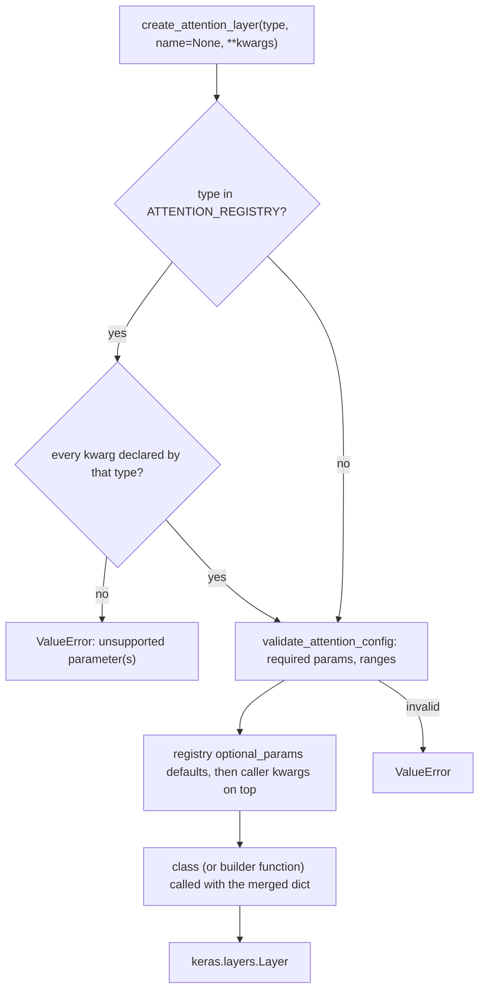

# attention

Keras 3 attention and token-mixing layers for the `dl_techniques` library, plus a factory that builds any of 36 registered types from a string key and a keyword dictionary. Import path: `dl_techniques.layers.attention`.

## What it is for

Different models need different ways to mix information between positions: standard multi-head attention for text, windowed attention for images, channel and spatial gates for CNNs, cheap linear or Fourier mixers for long sequences, compressed-cache variants for LLM inference. This package keeps all of them in one place with a shared constructor style, so a model can pick its attention type from a config file instead of hard-coding a class. The factory also checks the config before building, so a misspelled keyword fails loudly instead of being ignored.

## How it works

Every layer is a `keras.layers.Layer` registered for serialization under `dl_techniques.layers.attention.<module>` and implements `get_config()`. The factory is construction only. It standardizes how layers are built, not how they are called, and call signatures differ between layers (see below).



Details of the construction path:

- A keyword the type does not declare raises `ValueError`. Nothing is silently dropped.
- Any `TypeError` or `ValueError` from validation or from the layer constructor is re-raised as a single `ValueError` ("Failed to create ...") chained from the original.
- Three keys, `window`, `window_zigzag` and `window_band`, map to builder functions in `window_attention.py` that each return a `WindowAttention` locked to one `partition_mode`. The general `WindowAttention` class has no key of its own.
- Five exported classes have no factory key and are imported directly: `Ideogram4Attention`, `MMDiTJointAttention`, `AttentionRoutingCapsule`, `CapsuleBlockV2`, `WindowAttention`.

Shared building blocks live in `common.py`: an attention-mask helper (`apply_attention_mask`) that adds the mask bias in at least float32 so masking stays finite under mixed precision, a head-divisibility check, and the `1/sqrt(head_dim)` scale.

## Files

- `__init__.py` - re-exports 7 factory-interface names (6 functions and the `AttentionType` alias) and 38 layer classes, 45 names in `__all__`. Import order fixes Keras registration order.
- `factory.py` - `ATTENTION_REGISTRY` (36 entries with metadata), `AttentionType` literal, the six re-exported functions, and `assemble_attention_config` (not re-exported).
- `common.py` - `MASK_BIAS_VALUE`, `mask_dtype`, `apply_attention_mask`, `validate_head_divisibility`, `compute_attention_scale`. Not re-exported.
- `GUIDE.md` - authoring guide for new attention layers.
- `multi_head_attention.py` - `MultiHeadAttention`, a thin self-attention wrapper around `MultiHeadCrossAttention`.
- `multi_head_cross_attention.py` - `MultiHeadCrossAttention`, the shared engine for self- and cross-attention.
- `perceiver_attention.py` - `PerceiverAttention`, cross-attention from a small latent array into a large input, also a wrapper around the cross-attention engine.
- `group_query_attention.py` - `GroupedQueryAttention`, fewer key/value heads than query heads, optional RoPE, accepts 3D or 4D input.
- `mobile_mqa.py` - `MobileMQA`, a subclass of `GroupedQueryAttention` with one key/value head and optional K/V downsampling.
- `multi_head_latent_attention.py` - `MultiHeadLatentAttention`, DeepSeek-V2 latent KV compression with decoupled RoPE.
- `differential_attention.py` - `DifferentialMultiHeadAttention`, difference of two attention maps.
- `gated_attention.py` - `GatedAttention`, QK-norm, partial RoPE, sigmoid output gate, optional grouped KV heads.
- `shared_weights_cross_attention.py` - `SharedWeightsCrossAttention`, two modalities in one tensor sharing one QKV projection.
- `anchor_attention.py` - `AnchorAttention`, anchor-token bottleneck for long sequences.
- `hopfield_attention.py` - `HopfieldAttention`, iterative pattern retrieval.
- `mean_shift_attention.py` - `MeanShiftAttention`, `num_steps` mean-shift steps on tied query, key and value tokens with a learnable bandwidth.
- `capsule_routing_attention.py` - `CapsuleRoutingSelfAttention`, attention logits refined by capsule-style routing.
- `attention_routing_capsule.py` - `AttentionRoutingCapsule` and `CapsuleBlockV2`, single-pass capsule routing layers.
- `energy_attention.py` - `EnergyAttention`, Energy Transformer attention with no value matrix.
- `linear_attention.py` - `LinearAttention`, bias-free degree-1-homogeneous O(N) attention.
- `performer_attention.py` - `PerformerAttention`, FAVOR+ random-feature attention.
- `ring_attention.py` - `RingAttention`, exact blockwise attention with an online softmax.
- `rpc_attention.py` - `RPCAttention`, attention scores split into low-rank plus sparse parts.
- `lighthouse_attention.py` - `LighthouseAttention`, pooled pyramid with top-K selection and causal attention.
- `wave_field_attention.py` - `WaveFieldAttention`, FFT convolution on a 1-D field instead of dot-product scores.
- `fnet_fourier_transform.py` - `FNetFourierTransform`, parameter-free 2D DFT mixing.
- `window_attention.py` - `WindowAttention` (grid, zigzag or band partitioning) and the builder functions.
- `single_window_attention.py` - `SingleWindowAttention`, attention inside one window, optional KAN key projection and relative position bias.
- `beit_attention.py` - `BeitAttention`, BEiT attention with 2D relative position bias and a cls token.
- `area_attention.py` - `AreaAttention`, YOLOv12 area attention over a 4D feature map.
- `multi_dconv_head_transposed_attention.py` - `MultiDconvHeadTransposedAttention`, Restormer channel-wise attention.
- `non_local_attention.py` - `NonLocalAttention`, non-local block over spatial positions.
- `channel_attention.py`, `spatial_attention.py`, `convolutional_block_attention.py` - `ChannelAttention`, `SpatialAttention` and `CBAM`.
- `tripse_attention.py` - `TripSE1` to `TripSE4` triplet-attention variants, plus the internal `TripletAttentionBranch` and `_SEWeights` helpers.
- `ideogram4_attention.py` - `Ideogram4Attention`, packed-sequence attention with segment mask and mRoPE tables passed in.
- `mmdit_joint_attention.py` - `MMDiTJointAttention`, SD3-style dual-stream joint attention.

## How to use it

```python
from dl_techniques.layers.attention import create_attention_layer

mha = create_attention_layer('multi_head', dim=256, num_heads=8)
cbam = create_attention_layer('cbam', channels=128, ratio=16)
gqa = create_attention_layer('group_query', dim=1024, num_heads=16, num_kv_heads=4, name='gqa_1')
```

From a config dictionary, where the `type` key selects the entry:

```python
from dl_techniques.layers.attention import create_attention_from_config

layer = create_attention_from_config(
    {'type': 'group_query', 'dim': 1024, 'num_heads': 16, 'num_kv_heads': 4}
)
```

Discovery and pre-flight checks:

```python
from dl_techniques.layers.attention import (
    list_attention_types, get_attention_info, get_attention_requirements,
    validate_attention_config,
)

list_attention_types()                      # 36 keys, sorted
get_attention_requirements('window')        # one entry's metadata
validate_attention_config('window', dim=96, window_size=7, num_heads=4)  # raises on a bad config
```

Direct construction bypasses the factory checks and defaults:

```python
from dl_techniques.layers.attention import MultiHeadAttention, WindowAttention

mha = MultiHeadAttention(dim=512, num_heads=8)
win = WindowAttention(dim=96, window_size=7, num_heads=4, partition_mode='zigzag')
```

## Catalogue of factory keys

| Key | Class | What it is | Required params |
|---|---|---|---|
| `anchor` | `AnchorAttention` | Anchor tokens attend among themselves, the rest read only from anchors | `dim`, `num_heads` |
| `area` | `AreaAttention` | Splits a flattened `H*W` map into `area` groups; `area=1` is global | `dim` |
| `beit` | `BeitAttention` | Relative position bias over a `(Wh, Ww)` grid plus cls; key projection has no bias | `dim`, `window_size`, `num_heads` |
| `capsule_routing` | `CapsuleRoutingSelfAttention` | Self-attention with capsule routing over heads and tokens | `num_heads` |
| `cbam` | `CBAM` | Channel then spatial attention | `channels` |
| `channel` | `ChannelAttention` | Channel half of CBAM, returns weights `(B,1,1,C)` | `channels` |
| `differential` | `DifferentialMultiHeadAttention` | Two attention maps subtracted | `dim`, `num_heads`, `head_dim` |
| `energy` | `EnergyAttention` | Returns the negative gradient of a token-mixing energy | `dim` |
| `fnet` | `FNetFourierTransform` | Parameter-free Fourier mixing | none |
| `gated` | `GatedAttention` | QK-norm, partial RoPE, output gate | `dim`, `num_heads` |
| `group_query` | `GroupedQueryAttention` | Fewer K/V heads than Q heads | `dim`, `num_heads`, `num_kv_heads` |
| `hopfield` | `HopfieldAttention` | Hopfield retrieval; `update_steps_max=0` is plain attention | `num_heads`, `key_dim` |
| `lighthouse` | `LighthouseAttention` | Pooled pyramid, top-K, causal | `dim`, `num_heads` |
| `linear` | `LinearAttention` | Bias-free O(N) attention | `dim` |
| `mean_shift` | `MeanShiftAttention` | Mean-shift steps on tied Q=K=V tokens; `num_steps=1` is tied-QKV softmax attention | `dim` |
| `mobile_mqa` | `MobileMQA` | Multi-query attention for edge vision | `dim` |
| `multi_dconv_head_transposed` | `MultiDconvHeadTransposedAttention` | Restormer MDTA, rank-4 NHWC only | `dim`, `num_heads` |
| `multi_head` | `MultiHeadAttention` | Standard multi-head self-attention | `dim` |
| `multi_head_cross` | `MultiHeadCrossAttention` | Self- or cross-attention | `dim` |
| `multi_head_latent` | `MultiHeadLatentAttention` | DeepSeek-V2 MLA | `dim`, `num_heads`, `kv_latent_dim` |
| `non_local` | `NonLocalAttention` | Non-local block on 4D maps | `attention_channels` |
| `perceiver` | `PerceiverAttention` | Latent-to-input cross-attention | `dim` |
| `performer` | `PerformerAttention` | Random-feature linear attention | `dim` |
| `ring` | `RingAttention` | Exact blockwise attention | `dim` |
| `rpc` | `RPCAttention` | Low-rank plus sparse score decomposition | `dim` |
| `shared_weights_cross` | `SharedWeightsCrossAttention` | Tied-weight cross-modal attention | `dim` |
| `single_window` | `SingleWindowAttention` | Attention over one window | `dim`, `window_size`, `num_heads` |
| `spatial` | `SpatialAttention` | Spatial half of CBAM, returns a map `(B,H,W,1)` | none |
| `tripse1` to `tripse4` | `TripSE1` to `TripSE4` | Triplet attention with squeeze-and-excitation variants | none |
| `wave_field` | `WaveFieldAttention` | FFT damped-wave field mixing | `dim` |
| `window` | `create_grid_window_attention` | Swin grid windows | `dim`, `window_size`, `num_heads` |
| `window_zigzag` | `create_zigzag_window_attention` | Zigzag-ordered windows | `dim`, `window_size`, `num_heads` |
| `window_band` | `create_band_window_attention` | 1-D symmetric band, `window_size` is a half-width in tokens | `dim`, `window_size`, `num_heads` |

Everything not listed as required is optional with a registry default. Read the defaults with `get_attention_requirements(key)['optional_params']`.

## Things to know

- Call signatures differ. Most mask-taking layers are `call(inputs, attention_mask=None, training=None)`. Exceptions: `group_query`, `ring` and `mobile_mqa` put `training` before `attention_mask`; `differential` has an extra `layer_idx` argument before `training`; `hopfield` puts `return_attention_scores` before `training` and also accepts `[query, key, value]`; `mean_shift` has the same `return_attention_scores` position and accepts `[query, key_value]` with `blurring=False`; `energy` adds `mask` and `adjacency_weight` after `training`; `single_window` adds `pad_to_window`; `rpc` names its mask `mask=`; `linear` takes `training` then an ignored `mask=`; `shared_weights_cross` requires `split_sizes` positionally; `multi_head_cross`, `multi_head_latent` and `perceiver` take `query_input` and an optional `kv_input`. Layers with no mask argument at all: `channel`, `cbam` and `multi_dconv_head_transposed` take only `(inputs, training=None)`, as do `lighthouse` and `tripse*`; `performer` adds `return_attention_scores`; `anchor` takes `(x, num_anchor_tokens=None, training=None)`; `ideogram4` takes `(x, segment_ids, cos, sin, training=None)`; `mmdit_joint` takes one list `[hidden_states, encoder_hidden_states]`. `WindowAttention.call` is plain `(inputs, attention_mask=None, training=None)`. Pass `attention_mask` and `training` by keyword.
- Masks are not uniform. Most layers treat `attention_mask` as a keep mask (nonzero means attend). `non_local` instead takes an additive mask (0 keeps, a large negative value masks). `spatial`, `mobile_mqa` and `shared_weights_cross` accept the argument and never use it. `linear` silently discards `mask=`. `fnet` only zeroes padded rows after mixing.
- `window` folds a 1-D sequence into a square grid. For text use `window_band`. `window_band` refuses `use_relative_position_bias=True`. The class allows `window_size=0` for the band, but the factory rejects any `window_size <= 0`.
- `lighthouse` needs a statically known sequence length (else `RuntimeError` in `call`), and its causality is block-granular, not per position.
- `wave_field` is causal on its internal field grid, but token-level causality depends on `field_size` and `max_seq_len`. Check before using it in a decoder.
- `fnet` with `implementation='fft'` warns and falls back to the matrix DFT. `performer`'s `ortho_scaling` is a plain scalar multiply, not FAVOR+ orthogonalization. `rpc`'s `lambda_sparse` is a positive weight, not a 0-1 rate.
- `energy` returns an update to add to the residual stream, not a contextualized value, so it is not a drop-in for `multi_head`.
- `linear` rejects feature maps that break degree-1 homogeneity (`elu_plus_one`, `exp`, `softmax`); use `relu`, `relu_squared` or `abs`.
- `gated` types `qk_norm_type` as `str` (no `None` option) and defaults it to `'zero_centered_rms_norm'`. `multi_head_latent` defaults to `'rms_norm'`, `hopfield` to `'layer_norm'`. `ring` supports only `qk_norm_type`, with no `probability_type`.
- `output_kernel_initializer` is declared only for `multi_head` and `multi_head_cross` (the latter also `kv_kernel_initializer`).
- `gated` declares `num_kv_heads` as an optional factory parameter.
- Layers that share one `kernel_initializer` across several projections give the first projection the instance and the others `clone_initializer(...)` copies, so a seeded initializer does not replay the same numbers at every projection.
- CNN-family layers (`channel`, `spatial`, `cbam`, `non_local`, `tripse*`) keep `channels` / `attention_channels` because the argument is a real channel count on `(B, H, W, C)` maps.
- `get_attention_info()` and `get_attention_requirements()` return shallow copies: the nested `optional_params` dict and `required_params` list are the registry's own objects. Do not mutate them.
- Requires Keras 3 on TensorFlow 2.18; run with the repo `.venv`.
