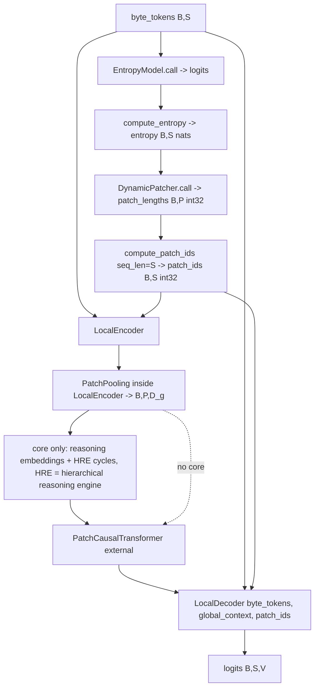

# blt

Path: `src/dl_techniques/layers/blt/`
Purpose: Keras 3 layers for the Byte Latent Transformer (byte tokenizer, entropy model, entropy-driven patcher, patch pooling, local encoder/decoder) plus a core layer that fuses them with a Hierarchical Reasoning Model (HRM) style reasoning loop.

## Scope

In: seven modules, one registered Keras layer each. Package `__init__.py` is empty (0 bytes), so import from submodules, e.g. `from dl_techniques.layers.blt.dynamic_patcher import DynamicPatcher`.

Not here:
- The global (patch-level) transformer, `PatchCausalTransformer`, lives in `layers/transformers/patch_causal_transformer.py`. `blt_core.py` imports it.
- The shared causal stack skeleton (`CausalTransformerStackMixin`, `build_causal_transformer_stack`, `build_causal_stack_norm`, `LAYER_NORM_EPSILON`) is in `layers/transformers/causal_stack.py`.
- `cap_boundaries_by_position` is in `dl_techniques/utils/sequence_ops.py`; `create_causal_attend_mask` is defined in `dl_techniques/utils/masking/factory.py` and re-exported by the package `dl_techniques/utils/masking/__init__.py`, so `from dl_techniques.utils.masking import create_causal_attend_mask` works.
- The assembled model is `src/dl_techniques/models/language/blt/model.py`; the trainer is `src/train/blt/train_blt.py`.
- No factory. The package is not registered in any `create_*_layer` registry.

## Architecture

`P` is `max_patches`, `S` is sequence length in bytes, `D_g` is `global_dim`, `V` is `vocab_size`.

Causal stacks: `EntropyModel` and `LocalEncoder` mix in `CausalTransformerStackMixin` (call `bind_causal_stack(positional_embedding, layers, final_norm)` in `__init__`, `build_causal_stack(shape)` in `build`, `run_causal_stack(x, training)` in `call`; it sets attributes `stack_positional_embedding`, `stack_layers`, `stack_final_norm`). `LocalDecoder` does not use the mixin because it interleaves a cross-attention after each block; it uses only the two builder functions and keeps three parallel lists: `decoder_layers`, `cross_attention_layers`, `cross_attention_norms`.

`ByteLatentReasoningCore.call(carry, inputs, training)`:
1. entropy from `entropy_model`, `patch_lengths` from `patcher`, `patch_ids` via `compute_patch_ids(patch_lengths, seq_len=ops.shape(byte_tokens)[1])`.
2. `local_encoder(byte_tokens, patch_ids)` gives patch reps; `_create_reasoning_embeddings` projects them to `embed_dim`, adds optional puzzle embedding, adds projected mean entropy (broadcast to all patches), adds learned positions if `pos_encodings == "learned"` (the sum is scaled by 0.707106781 first), multiplies by `embed_scale = sqrt(embed_dim)`.
3. Loop over `h_cycles` x `l_cycles` (the HRE, hierarchical reasoning engine): `z_l = l_reasoning([z_l, z_h + reasoning_input])` for every (h, l) pair except the very last; after each inner block, `z_h = h_reasoning([z_h, z_l])` except on the last outer step. Then `z_h` and `z_l` go through `stop_gradient`, and one final `l_reasoning` step and one final `h_reasoning` step run. Only those two final steps pass gradient back to the reasoning modules (the loop itself is not wrapped in `stop_gradient`; its outputs are detached).
4. `reasoning_to_byte_proj(z_h)` -> `global_transformer` -> `local_decoder`.
5. `q_head` on `concat(mean(z_h, axis=1), mean(entropy, axis=1, keepdims))`.

## Key files

| File | Role | Notes |
| --- | --- | --- |
| `byte_tokenizer.py` | `ByteTokenizer` | Python-only `text_to_bytes` / `tokens_to_text`. No `call`, no weights. Special ids pad 0, bos 1, eos 2, sep 3 are instance attributes. |
| `entropy_model.py` | `EntropyModel` | Token embedding, causal stack, Dense to `vocab_size`. `call` returns logits; `compute_entropy(logits)` returns entropy. |
| `dynamic_patcher.py` | `DynamicPatcher` | No weights. `call(entropy)`, `compute_patch_ids`, `warn_if_segmentation_is_degenerate`. |
| `patch_pooling.py` | `PatchPooling` | `max` / `mean` / `attention`; Python loop over `max_patches`. |
| `local_encoder.py` | `LocalEncoder` | Embedding + causal stack + `PatchPooling`. |
| `local_decoder.py` | `LocalDecoder` | Causal self-attention interleaved with previous-patch cross-attention. |
| `blt_core.py` | `ByteLatentReasoningCore` | Builds all of the above in `build()` plus two `HierarchicalReasoningModule` stacks (from the HRM code in `layers/reasoning/`) and heads. |

## Public interface

All classes are `@register_dl_technique("dl_techniques.layers.blt.<module>")` with `<module>` the file stem.

- `ByteTokenizer(vocab_size=260, byte_offset=4, **kwargs)`
  - `text_to_bytes(text, add_bos=True, add_eos=True) -> List[int]`: utf-8 encode with `errors='ignore'`, add `byte_offset`, optional bos/eos.
  - `tokens_to_text(tokens) -> str`: drops tokens `< byte_offset`; returns `""` if `bytes(...)` raises `ValueError`.
- `EntropyModel(vocab_size=260, hidden_dim=256, num_layers=6, num_heads=8, max_seq_len=2048, dropout_rate=0.1)`
  - `call(inputs, training) -> logits (B,S,V)`; `compute_entropy(logits) -> (B,S)` with probs floored at 1e-12; `compute_output_shape` appends `vocab_size` and needs a tuple.
- `DynamicPatcher(entropy_threshold=1.5, max_patches=512)`
  - `call(entropy, training=None) -> int32 (B, max_patches)`, rows sum to `S`.
  - `compute_patch_ids(patch_lengths, seq_len=None) -> int32 (B,S)`. Pass `seq_len`; `None` derives it from data and is XLA-incompatible.
  - `warn_if_segmentation_is_degenerate(entropy, mask=None) -> bool`. Eager only; returns True iff it logged a warning (boundary rate exactly 1.0, exactly 0.0, or an all-zero `mask`). Never called from `call`.
- `PatchPooling(pooling_method='attention', output_dim=768, num_queries=4, max_patches=64)`
  - `call(byte_hiddens, patch_ids, training) -> (B, max_patches, output_dim)`. Raises `ValueError("Unknown pooling method: ...")` in `call`.
  - `compute_output_shape` reports `(batch, None, output_dim)`.
- `LocalEncoder(vocab_size=260, local_dim=512, num_local_layers=6, num_heads_local=8, max_sequence_length=2048, max_patches=512, dropout_rate=0.1, patch_pooling_method='attention', global_dim=768, cross_attention_queries=4)`
  - `call(byte_tokens, patch_ids, training) -> (B, max_patches, global_dim)`.
- `LocalDecoder(vocab_size=260, local_dim=512, global_dim=768, num_local_layers=6, num_heads_local=8, max_sequence_length=2048, dropout_rate=0.1)`
  - `call(byte_tokens, global_context, patch_ids, training) -> logits (B,S,V)`.
  - `build` accepts a tuple or a list whose first entry is the byte shape.
- `ByteLatentReasoningCore(vocab_size, seq_len, embed_dim, local_dim=512, global_dim=768, max_patches=512, num_puzzle_identifiers=1000, puzzle_emb_dim=512, batch_size=32, h_layers=4, l_layers=4, h_cycles=2, l_cycles=2, num_heads=8, entropy_threshold=1.5, pos_encodings="rope", rope_theta=10000.0, dropout_rate=0.0, use_bias=False, embeddings_initializer="truncated_normal", kernel_initializer="he_normal", embeddings_regularizer=None, kernel_regularizer=None)`
  - `call(carry, inputs, training) -> (new_carry, outputs)`. `inputs` needs `"byte_tokens"`, optional `"puzzle_ids"`.
  - `empty_carry(batch_size)`, `reset_carry(reset_flag, carry)` (replaces halted rows with `h_init` / `l_init`, zeros the other two entries).
  - Output keys: `logits (B,S,V)`, `q_halt_logits (B,)`, `q_continue_logits (B,)`, `entropy (B,S)`, `patch_lengths (B,P)`.

## Data shapes

Carry dict: `z_h`, `z_l` `(B, max_patches, embed_dim)`; `patch_context` `(B, max_patches, global_dim)`; `entropy_state` `(B, seq_len)`. `call` only reads `z_h` and `z_l`; the other two are written but not read.

Patch ids: non-decreasing int32 per row, clamped at `max_patches - 1`. Worked example (max_patches 4): `is_boundary 0 1 0 0 1 0` -> `patch_index 0 1 1 1 2 2` -> `patch_lengths 1 3 2 0`.

`ByteTokenizer` config keys: `vocab_size`, `byte_offset`. `vocab_size` is stored only; no method reads it.

## Invariants and constraints

- Causality. `EntropyModel` and `LocalEncoder` get the mask through `run_causal_stack` in `causal_stack.py`; `LocalDecoder` calls `create_causal_attend_mask` itself. All three pass an explicit causal mask to their attention layers. The attention layer masks only with what it is given. Removing it makes position i read byte i+1.
- `LocalDecoder._masked_cross_attention` gathers patch `patch_ids[i] - 1` (clamped at 0 via `ops.maximum`, then multiplied by `has_prev = patch_ids > 0`), never the byte's own patch. Own-patch vectors are pooled over every byte in the patch, including the target. It also applies a causal mask over the gathered byte-length key axis; this is not redundant. Patch-0 bytes get a zeroed key vector (not a masked query row, which would give a fully-masked softmax row).
- Patch ids must stay non-decreasing; the decoder's previous-patch gather relies on it. Leading and trailing zero-length patches are legal and preserve it.
- `DynamicPatcher` caps boundaries by position order via `cap_boundaries_by_position(is_boundary, max_patches - 1)`, not by entropy magnitude. A top-k-by-entropy cap lets a later byte change an earlier byte's patch id and breaks causality. Do not change this.
- Always pass `seq_len` to `compute_patch_ids` (the core passes `ops.shape(byte_tokens)[1]`).
- `PatchPooling` `max` mode masks with `-1e9` then zeroes empty patches via `ops.any(mask)`. Keep the rescue, otherwise the sentinel reaches downstream LayerNorm.
- `PatchPooling` uses `self.max_patches` as the static loop count, so `LocalEncoder` must forward its own `max_patches` to it, and the output patch axis is always `max_patches` even though `PatchPooling.compute_output_shape` says `None`. `LocalEncoder.compute_output_shape` reports the static count.
- Explicit `build()` of every sub-layer (including `MultiHeadAttention` with query/key/value shapes, and `h_reasoning` / `l_reasoning` with a 2-element list of identical `(None, max_patches, embed_dim)` shapes) is load-bearing: a lazy first-call build leaves weights unloadable on `.keras` reload. New sub-layers need the same.
- Layer norms in the causal stacks use `LAYER_NORM_EPSILON = 1e-3` from `causal_stack.py`. Do not route them through `create_normalization_layer` (epsilon 1e-6); it moves the forward pass.
- `HierarchicalReasoningModule` is called with ONE list argument `[hidden_states, input_injection]`, never two positional args. `keras.ops.stop_gradient(x)` is a function call, not a context manager.
- `q_head` is initialized with zero kernel and bias constant -5.0 (both logits start at exactly -5.0).
- `h_init` / `l_init` are trainable weights, `TruncatedNormal(stddev=1.0)`, created in `build()` of the core.
- The pooled-entropy tensor in `_create_reasoning_embeddings` must be 3-D `(B,1,1)` before `tile([1, P, 1])`; two `expand_dims` are required.
- Registration strings follow the module path `dl_techniques.layers.blt.<file stem>`; changing a file name or string changes the serialized key.

## Dependencies

Internal:
- `layers/embedding/positional_embedding.PositionalEmbedding` (learned positions in encoder, decoder, entropy model, and the core's `"learned"` mode).
- `layers/embedding/rotary_position_embedding.RotaryPositionEmbedding` (core, `"rope"` mode).
- `layers/reasoning/hrm_reasoning_module.HierarchicalReasoningModule`, `layers/reasoning/hrm_sparse_puzzle_embedding.SparsePuzzleEmbedding` (core).
- `layers/transformers/causal_stack` and `layers/transformers/patch_causal_transformer.PatchCausalTransformer`.
- `utils/keras_registration.register_dl_technique`, `utils/masking.create_causal_attend_mask` (package `utils/masking/`, function in `factory.py`), `utils/sequence_ops.cap_boundaries_by_position`, `utils/logger.logger`.

External: `keras` (Keras 3), `math`, `typing`.

Consumers: `models/language/blt/model.py` imports `ByteTokenizer`, `DynamicPatcher`, `EntropyModel`, `LocalEncoder`, `LocalDecoder`; `src/train/blt/train_blt.py` imports `ByteTokenizer`, `DynamicPatcher`, `EntropyModel`. `layers/dynamic_chunking/__init__.py` and `datasets/byte_patch.py` mention the package in docstrings.

## Failure modes

- Untrained `EntropyModel` gives entropy near `ln(vocab_size)`; any lower `entropy_threshold` makes every position a boundary (boundary rate 1.0: patch 0 empty, one byte per patch, tail merged into the last patch). A threshold above every entropy gives one patch (rate 0.0). Detect with `warn_if_segmentation_is_degenerate`; the core deliberately does not warn at construction.
- Unknown `PatchPooling.pooling_method` fails at call time, not construction.
- `ByteTokenizer`: `byte_offset < 4` collides with special ids; tokens are never checked against `vocab_size`. `tokens_to_text` returns `""` for the whole call if one shifted value exceeds 255.
- `PatchPooling` attention mode passes no attention mask, so zeroed out-of-patch positions still serve as keys/values. Empty patches attend over an all-zero sequence.
- No padding mask anywhere in the causal stacks; padding bytes are attended as ordinary bytes.
- `SparsePuzzleEmbedding` in the core is constructed with `batch_size=self.batch_size` and `embeddings_initializer="zeros"` (the core's `embeddings_initializer` argument is not passed to it). `puzzle_emb_dim` is added to the `embed_dim`-wide reasoning input by slicing `[:, :, :embed_dim]`, so `puzzle_emb_dim < embed_dim` would fail the add.
- Dead or unused parts of the core (verify before relying on or removing): `tokenizer` sub-layer is built but never called; `lm_head` is built but `call` uses `local_decoder` for logits; `rope` is built in `"rope"` mode but never applied in `_create_reasoning_embeddings`; `carry["patch_context"]` and `carry["entropy_state"]` are never read.
- `get_config` of the core passes `embeddings_initializer` / `kernel_initializer` through `keras.initializers.serialize` and the regularizers through `keras.regularizers.serialize`; no `from_config` override exists.

## Working here

- Docstrings are Sphinx/reST (`:param:` / `:type:` / `:return:`); match them. Use `import keras` and qualify at the call site (`keras.ops.x`). The existing `from keras import ops` in four modules (`dynamic_patcher.py`, `entropy_model.py`, `local_decoder.py`, `patch_pooling.py`) is legacy; do not add new ones.
- Logging goes through `dl_techniques.utils.logger`, never `print`.
- Any new layer: register with `register_dl_technique("dl_techniques.layers.blt.<module>")`, implement `__init__`, `build` (explicit sub-layer builds), `call`, `compute_output_shape`, `get_config`.
- Changing the causal stacks: edit `layers/transformers/causal_stack.py` only if every user should change. Users here: `EntropyModel`, `LocalEncoder`, `LocalDecoder` (builders only); other packages may use it too.
- Tests: `tests/test_layers/test_blt/` (one file per module: `test_blt_core.py`, `test_byte_tokenizer.py`, `test_dynamic_patcher.py`, `test_entropy_model.py`, `test_local_decoder.py`, `test_local_encoder.py`, `test_patch_pooling.py`), plus the model-level tests in `tests/test_models/test_blt/` (`test_custom_entropy_model_roundtrip.py`, `test_fit_runs_under_xla.py`, `test_max_patch_pooling_empty_patches.py`, `test_model.py`, `test_smoke.py`). Run scoped, with the repo venv:
  `.venv/bin/python -m pytest tests/test_layers/test_blt/ tests/test_models/test_blt/`
  If you touch constructor arguments, also run the model tests that import these layers (`tests/test_models/test_blt/`). Do not run the full suite (about 1.5 hours).
- Config changes are serialization-visible: keep `get_config` keys equal to `__init__` argument names.
