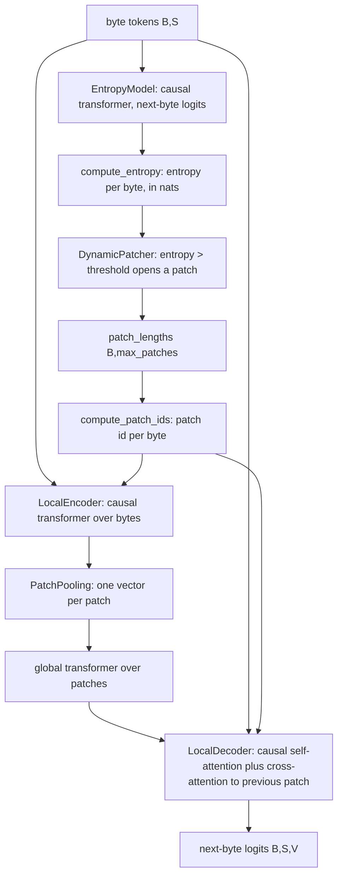

# blt

Keras 3 layers for a Byte Latent Transformer (BLT): a language model that reads raw bytes, groups them into variable-size patches based on how surprising each byte is, and predicts the next byte. The package also holds a core layer that adds an iterative reasoning loop on top of the patching.

It lives at `src/dl_techniques/layers/blt/` in the `dl_techniques` library.

## What it is for

Most language models split text into a fixed vocabulary of subword tokens. A byte-level model has no vocabulary problem (any UTF-8 text works) but the sequences get long, and every byte costs the same compute. BLT spends compute where the text is hard to predict. A small model scores how uncertain each next byte is. Where the uncertainty is high, a new patch starts. Easy stretches get merged into long patches, and hard stretches get short ones. The expensive "global" transformer then runs over patches, not bytes.

The paper is Pagnoni et al., 2024, "Byte Latent Transformer: Patches Scale Better Than Tokens" (https://arxiv.org/abs/2412.09871). `ByteLatentReasoningCore` is a repo-specific extension that wraps these pieces with a hierarchical reasoning module (two latent states refined over several cycles) and a halt-or-continue head.

## How it works



1. `EntropyModel` embeds the bytes and runs a causal transformer. Its output is next-byte logits. `compute_entropy` turns them into Shannon entropy per position.
2. `DynamicPatcher` marks position `t` as a patch start when its entropy is above `entropy_threshold`. Each byte gets the count of boundaries at or before it as its patch index, capped at `max_patches - 1`. It returns how many bytes each patch holds. `compute_patch_ids` turns those lengths back into a patch id per byte.
3. `LocalEncoder` embeds bytes, runs a causal transformer, then `PatchPooling` reduces each patch to one vector (`max`, `mean`, or `attention` pooling) and projects it to `global_dim`.
4. A global transformer (`PatchCausalTransformer`, which lives in `layers/transformers/`, not here) runs over the patch vectors.
5. `LocalDecoder` predicts next-byte logits. Each byte attends causally to earlier bytes, then cross-attends to the global vector of the previous patch (not its own patch, because the own-patch vector was pooled from bytes that include the target byte).

`ByteLatentReasoningCore` chains steps 1 to 5 and inserts a reasoning loop between the encoder and the global transformer. It keeps a high-level state `z_h` and a low-level state `z_l`. Across `h_cycles` outer and `l_cycles` inner steps it updates `z_l` from `z_h` plus the patch input, and `z_h` from `z_l`. The loop runs, then both states are detached (`stop_gradient`) and one last `z_l` step and one last `z_h` step run, so gradients flow only through those two final steps. A `q_head` outputs halt and continue logits from the mean of `z_h` and the mean entropy.

## Files

- `byte_tokenizer.py` - `ByteTokenizer`: text to byte token ids and back. Pure Python, no weights, no `call`.
- `entropy_model.py` - `EntropyModel`: small causal transformer producing next-byte logits, plus `compute_entropy`.
- `dynamic_patcher.py` - `DynamicPatcher`: entropy threshold to patch lengths and patch ids. No weights. Also has an opt-in degenerate-segmentation warning.
- `patch_pooling.py` - `PatchPooling`: pools byte hidden states into one vector per patch slot.
- `local_encoder.py` - `LocalEncoder`: byte embedding, causal transformer, patch pooling.
- `local_decoder.py` - `LocalDecoder`: byte-level decoder with cross-attention to the previous patch's global vector.
- `blt_core.py` - `ByteLatentReasoningCore`: the full stack plus hierarchical reasoning and the halt head.
- `__init__.py` - empty. Import from the submodules.

## How to use it

Tokenize, score entropy, patch (eager execution):

```python
import keras
from dl_techniques.layers.blt.byte_tokenizer import ByteTokenizer
from dl_techniques.layers.blt.entropy_model import EntropyModel
from dl_techniques.layers.blt.dynamic_patcher import DynamicPatcher

tok = ByteTokenizer(vocab_size=260, byte_offset=4)
ids = tok.text_to_bytes("Hello")            # [1, 76, 105, 112, 112, 115, 2]
x = keras.ops.convert_to_tensor([ids])

entropy_model = EntropyModel(vocab_size=260, hidden_dim=64, num_layers=2,
                             num_heads=4, max_seq_len=64, dropout_rate=0.0)
entropy = entropy_model.compute_entropy(entropy_model(x))   # (1, 7), nats

patcher = DynamicPatcher(entropy_threshold=1.5, max_patches=8)
patcher.warn_if_segmentation_is_degenerate(entropy)         # optional check
lengths = patcher(entropy)                                  # (1, 8), sums to 7
# With an untrained model every position is a boundary, so the check above
# logs a warning (returns True) and lengths is [0, 1, 1, 1, 1, 1, 1, 1].
patch_ids = patcher.compute_patch_ids(lengths, seq_len=x.shape[1])
```

Full core layer (it takes a carry dict and an inputs dict and returns a new carry and an outputs dict):

```python
from dl_techniques.layers.blt.blt_core import ByteLatentReasoningCore

core = ByteLatentReasoningCore(vocab_size=260, seq_len=64, embed_dim=64,
                               local_dim=64, global_dim=64, max_patches=16,
                               num_heads=4, puzzle_emb_dim=0)
carry = core.empty_carry(batch_size=2)
tokens = keras.ops.zeros((2, 64), dtype="int32")
carry, out = core(carry, {"byte_tokens": tokens})
# out keys: logits, q_halt_logits, q_continue_logits, entropy, patch_lengths
```

The unit tests under `tests/test_layers/test_blt/` show working constructions of each layer. Run them with `.venv/bin/python -m pytest tests/test_layers/test_blt/`.

## Things to know

- All layers are registered with `register_dl_technique("dl_techniques.layers.blt.<module>")` and support `get_config()`.
- Special token ids are fixed in `ByteTokenizer`: pad 0, bos 1, eos 2, sep 3. A `byte_offset` below 4 collides with them. Nothing checks this, and nothing checks tokens against `vocab_size`.
- `ByteTokenizer.text_to_bytes` drops undecodable input. `tokens_to_text` drops tokens below `byte_offset`.
- An untrained `EntropyModel` outputs near-uniform predictions, so entropy is near `ln(vocab_size)`. With a threshold below that, every position becomes a boundary. Use `DynamicPatcher.warn_if_segmentation_is_degenerate(entropy, mask=...)` on eager data to detect this, and pass `mask` for padded batches.
- The patch cap works by position: boundaries after the `(max_patches - 1)`-th are dropped, so the tail merges into the last patch. This keeps earlier patch ids independent of later bytes. Empty (zero-length) patches are normal.
- `PatchPooling` always emits `max_patches` slots by looping in Python, so the graph grows with `max_patches`. Empty patches pool to zero for `max` and `mean`. An unknown `pooling_method` raises `ValueError` in `call`, not in the constructor.
- `PatchPooling` attention mode zeroes out-of-patch bytes instead of masking them, so they still count as keys and values.
- Attention in the encoder, entropy model and decoder is causal only. There is no padding mask, so padding positions are treated as ordinary bytes.
- `LocalDecoder` gives bytes in patch 0 no global context (their key vector is zeroed).
- Layer norms in the causal stacks use epsilon `1e-3` (`LAYER_NORM_EPSILON` in `layers/transformers/causal_stack.py`), not the `1e-6` of the repo's norm factory. This is deliberate.
- In `ByteLatentReasoningCore`: the `tokenizer` sub-layer is built but not used in `call`. The `lm_head` Dense and the RoPE layer (when `pos_encodings="rope"`) are built but not used in `call`; only `"learned"` positions are added to the reasoning input. Pooled entropy is a mean over the whole sequence, broadcast to every patch. The `EntropyModel` inside the core is hard-coded to 4 layers. `h_layers` and `l_layers` set both the reasoning module depths and the global transformer and local encoder/decoder depths.
- `ByteLatentReasoningCore` also takes optional `puzzle_ids`; with `puzzle_emb_dim > 0` a sparse puzzle embedding is added to every patch's reasoning input. The `reset_carry(reset_flag, carry)` method swaps halted rows back to the learned `h_init` / `l_init` states.
- `ByteLatentReasoningCore.call` is `call(carry, inputs, training)`, not the usual single-input form. `inputs` needs `byte_tokens`; `puzzle_ids` is optional.
- The tokenizer, entropy model, patcher, local encoder and decoder are also used by `src/dl_techniques/models/language/blt/model.py`, and the tokenizer, patcher and entropy model by `src/train/blt/train_blt.py`.
