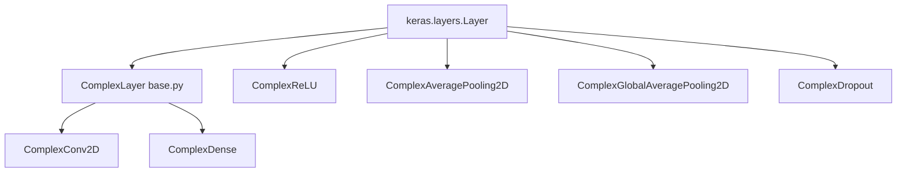

# complex

Path: `src/dl_techniques/layers/complex`
Purpose: Keras 3 layers over `complex64` tensors, built from split real/imaginary arithmetic. TensorFlow backend only.

## Scope

In: `ComplexLayer` (base for weight-owning layers), `ComplexConv2D`, `ComplexDense`, `ComplexReLU`, `ComplexAveragePooling2D`, `ComplexGlobalAveragePooling2D`, `ComplexDropout`. One class per module, each in a file of its own.

Out: any factory (none exists here), any package-level export (`__init__.py` is zero bytes), any other complex op. Consumers import from the module files. The old single multi-class module these were split from no longer exists, and there is no compat shim.

Consumers: `src/dl_techniques/models/vision/coshnet/model.py` (imports Dense, Conv2D, ReLU, Dropout, GlobalAveragePooling2D), `src/train/coshnet/train_coshnet.py`. Tests: `tests/test_layers/test_complex/test_complex_layers.py`, `tests/test_models/test_the_two_documented_dead_knobs.py`, helper `tests/complex_dead_knob_ast.py`.

## Architecture

Only `ComplexConv2D` and `ComplexDense` own weights, so only they extend `ComplexLayer`. The other four extend `keras.layers.Layer` directly and never import `base.py`.

Forward pattern in every layer: `tf.math.real` / `tf.math.imag` to split, real `keras.ops` calls, `tf.complex` to recombine.

- Conv/dense: `real = conv(Ir,Kr) - conv(Ii,Ki)`, `imag = conv(Ir,Ki) + conv(Ii,Kr)` (matmul for dense). The complex bias is added as `real(bias)` and `imag(bias)` onto the matching parts before `tf.complex`.
- Pooling: `keras.ops.average_pool` on each part (padding lowercased for the call). Global pooling: `keras.ops.mean(axis=[1, 2], keepdims=self.keepdims)` on each part.
- ReLU: `keras.ops.relu` on each part (split CReLU, not modReLU).
- Dropout: `mask = self.dropout_layer(tf.ones_like(tf.math.real(inputs)), training=training)`; output `inputs * tf.cast(mask, inputs.dtype)`.

## Key files

| File | Role | Notes |
| --- | --- | --- |
| `base.py` | `ComplexLayer`: `_init_complex_weights`, `get_config`, `from_config` | Registered as `dl_techniques.layers.complex.base`. Concrete (not abstract), has no `call`. |
| `complex_conv2d.py` | `ComplexConv2D` | Kernel shape `(*kernel_size, in_channels, filters)`, bias `(filters,)`, both `complex64`. |
| `complex_dense.py` | `ComplexDense` | Kernel `(input_dim, units)`, bias `(units,)`, both `complex64`. |
| `complex_relu.py` | `ComplexReLU` | `get_config` is `super().get_config()` only. |
| `complex_average_pooling2d.py` | `ComplexAveragePooling2D` | No `build`. |
| `complex_global_average_pooling2d.py` | `ComplexGlobalAveragePooling2D` | No `build`. |
| `complex_dropout.py` | `ComplexDropout` | Only weightless layer with a `build` (builds its inner `Dropout`). |
| `__init__.py` | empty | |

## Public interface

Concrete layers (every class except `ComplexLayer`): `call(inputs, training=None)`, `compute_output_shape`, `get_config`. `ComplexLayer` (`base.py`) is the base class only: it defines `_init_complex_weights`, `get_config` and `from_config`, and has no `call` and no `compute_output_shape`, so it is not usable as a layer on its own. All seven classes are registered via `@register_dl_technique("dl_techniques.layers.complex.<module>")`, where `<module>` is the file stem (`base`, `complex_conv2d`, `complex_dense`, `complex_relu`, `complex_average_pooling2d`, `complex_global_average_pooling2d`, `complex_dropout`).

| Class | Constructor | Config keys added |
| --- | --- | --- |
| `ComplexLayer` | `(epsilon=1e-7, kernel_regularizer=None, kernel_initializer=None, **kwargs)` | `epsilon`, `kernel_regularizer`, `kernel_initializer` |
| `ComplexConv2D` | `(filters, kernel_size, strides=1, padding='SAME', **kwargs)` | `filters`, `kernel_size`, `strides`, `padding` |
| `ComplexDense` | `(units, **kwargs)` | `units` |
| `ComplexReLU` | `(**kwargs)` | none |
| `ComplexAveragePooling2D` | `(pool_size=(2, 2), strides=None, padding='VALID', **kwargs)` | `pool_size`, `strides`, `padding` |
| `ComplexGlobalAveragePooling2D` | `(keepdims=False, **kwargs)` | `keepdims` |
| `ComplexDropout` | `(rate, **kwargs)` | `rate` |

`ComplexConv2D` and `ComplexDense` forward `epsilon`, `kernel_regularizer`, `kernel_initializer` to `ComplexLayer` through `**kwargs`.

Output shapes:
- Conv `SAME`: `ceil(dim / stride)` computed as `(dim + s - 1) // s`. Conv `VALID`: `(dim - k) // s + 1`. Channel axis becomes `filters`. `None` dims propagate.
- Average pooling `SAME`: `(dim + s - 1) // s`. `VALID`: `(dim - pool + s) // s`.
- Global pooling: `(B, C)` or `(B, 1, 1, C)` with `keepdims`.
- Dense: last dim replaced by `units`. ReLU and dropout: identity shape.

Raised errors (`ValueError`): `epsilon <= 0`; `filters <= 0`; `units <= 0`; padding not `SAME`/`VALID`; `ComplexConv2D.build` on non-rank-4 input or `None` channels; `ComplexDense.build` on `None` last dim; `compute_output_shape` on non-rank-4 input for conv, average pooling and global pooling; `rate` outside `[0, 1)`.

## Data shapes

- Inputs and outputs: `complex64` tensors. Conv, pooling: `[B, H, W, C]`. Dense, ReLU, dropout: `[..., D]`.
- Weights are added with `dtype=tf.complex64`, initializer `self._init_complex_weights` for kernels, `'zeros'` for biases. `ComplexLayer._init_complex_weights(shape, dtype=tf.complex64)`: `fan_in = prod(shape[:-1])`, `fan_out = shape[-1]`, `sigma = sqrt(2 / (fan_in + fan_out))`, magnitude `rayleigh(shape, sigma)` from `dl_techniques.utils.random`, phase `keras.random.uniform(shape, -pi, pi)`, built with `tf.complex`.
- Config sequences: `kernel_size`, `strides`, `pool_size` are stored as tuples and emitted as tuples. A `.keras` archive returns them as lists.

## Invariants and constraints

- Two dead knobs on `ComplexLayer`: `epsilon` and `kernel_initializer` are stored, serialized and read by no computation. Do not wire either up under its current name. Removing either breaks `from_config` on saved `.keras` checkpoints (`TypeError` on unknown key). `kernel_initializer` is also not invoked during `build` for conv or dense. The source comments pin this as a decision (base.py DECISION anchors, D-053 and D-002, referring to a `decisions.md` that is not in this directory). Wiring it up with one initializer instance called twice gives imag == real (Keras 3.8 initializers are deterministic per shape), so a proper change needs two distinct-seed initializers and moves kernel scale. Propose that as a new opt-in mode, not a rename of the existing parameter.
- `tests/test_models/test_the_two_documented_dead_knobs.py` and `tests/complex_dead_knob_ast.py` guard the dead-knob claim by AST scan. `test_complex_layers.py` also counts AST nodes that read `epsilon` and `kernel_initializer` across the package. Adding a read of either can fail those tests on purpose.
- Sequence coercion must use `isinstance(x, (list, tuple))`, never tuple only. A tuple-only test re-wraps `[3, 3]` into `([3, 3], [3, 3])` on reload and makes the layer unloadable (D-006 in the anchors).
- `ComplexConv2D.compute_output_shape` `SAME` branch must stay `ceil(dim / stride)`. Floor division disagrees with the real forward pass when the stride does not divide the input.
- `ComplexDropout` keeps `name="dropout"` on its inner `Dropout` (otherwise a second instance auto-names it `dropout_1`) and builds it in `build()` against the input shape. One shared real mask for both parts is the point of the layer; do not draw separate masks.
- Weightless layers (ReLU, both pools, dropout) must stay on `keras.layers.Layer` and not inherit `ComplexLayer`. `ComplexAveragePooling2D`, `ComplexGlobalAveragePooling2D`, and `ComplexReLU` define no `build`.
- `ComplexReLU` is split CReLU. It is not magnitude based and does not preserve phase.
- `ComplexGlobalAveragePooling2D` reduces axes `[1, 2]` only, never the channel axis.
- `ComplexAveragePooling2D` upper-cases `padding` on init and lower-cases it only for `keras.ops.average_pool`. `strides=None` becomes `pool_size`.
- `from_config` in `ComplexLayer` copies the dict (`dict(config)`), deserializes `kernel_regularizer` and `kernel_initializer` only when they are dicts, and passes everything else through to `cls(**config)`. It must not consume the caller's dict.
- Registration key is the module's own dotted path. A test pins this per class.

## Dependencies

Internal:
- `dl_techniques.utils.random.rayleigh` (used by `base.py`).
- `dl_techniques.utils.keras_registration.register_dl_technique` (all modules).
- `dl_techniques.layers.complex.base.ComplexLayer` (conv and dense).

External: `keras` (3.8 era; `keras.ops`, `keras.random`, `keras.regularizers`, `keras.initializers`), `tensorflow` (`tf.complex`, `tf.math.real`, `tf.math.imag`, `tf.ones_like`, `tf.cast`), `numpy` (`base.py` only).

## Failure modes

- Non-TensorFlow backend: raw `tf.*` calls fail. There is no fallback.
- Real-dtype input is not a supported path; the layers are written for `complex64` and do not convert.
- Old checkpoint with dict-valued `kernel_regularizer` or `kernel_initializer`: handled by `ComplexLayer.from_config`.
- Loading a layer through a path that skips `ComplexLayer.from_config` leaves raw dicts on the attribute and fails far from the load site.
- Output is complex; a real loss on it needs an explicit reduction such as `tf.abs`.

## Working here

- New complex layer: one class per new file, `@register_dl_technique("dl_techniques.layers.complex.<module>")` with the file stem, `get_config` covering all constructor args. Extend `ComplexLayer` only if the layer owns complex weights drawn by `_init_complex_weights`; otherwise extend `keras.layers.Layer`.
- Use `keras.ops` for real arithmetic. Use `tf.complex`, `tf.math.real`, `tf.math.imag` only for the complex boundary.
- Add `compute_output_shape` that agrees with the real forward pass, including `None` dimensions. Tests compare the two.
- Do not add a factory or `__all__` here without updating the consumers; the package currently exports nothing.
- Docstrings are Sphinx/reST (`:param:`, `:type:`). Match the file you edit.
- Tests: `.venv/bin/python -m pytest tests/test_layers/test_complex -q` and `tests/test_models/test_the_two_documented_dead_knobs.py`. If you touch these layers also run the CoShNet model tests (`tests/test_models/test_coshnet/`). Do not run the full suite.
