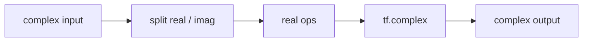

# complex

Keras layers that work on complex-valued tensors (`complex64`): a convolution, a dense layer, a ReLU, two kinds of average pooling and a dropout. The package is `dl_techniques.layers.complex`, one class per module.

## What it is for

Some models carry complex numbers through the whole network, for example a classifier that reads the output of a shearlet or Fourier-style transform. Stock Keras layers do not accept complex inputs or hold complex weights. These layers do the arithmetic on the real and imaginary parts separately and glue the result back into a complex tensor. They are used by the CoShNet model (`dl_techniques/models/vision/coshnet/model.py`) and its trainer (`src/train/coshnet/train_coshnet.py`).

## How it works

A complex number is `z = x + iy`. Every layer splits its input into `x` (real part) and `y` (imaginary part), runs ordinary real operations, and recombines with `tf.complex`.

- Convolution and dense: complex multiplication expands into four real products. For input `I = I_r + i I_i` and kernel `K = K_r + i K_i`, the output is `(I_r*K_r - I_i*K_i) + i(I_r*K_i + I_i*K_r)`, plus a complex bias. Convolution uses `keras.ops.conv`, dense uses `keras.ops.matmul`.
- Average pooling and global average pooling: averaging is linear, so pooling the two parts independently is exactly pooling the complex tensor.
- ReLU: applied to each part separately, `max(0, x) + i*max(0, y)`. It does not look at magnitude and does not keep the phase. A value in the third quadrant becomes 0.
- Dropout: one real mask is drawn from a regular `keras.layers.Dropout` over a tensor of ones and multiplied into the complex tensor. A dropped unit loses both parts, and a kept unit keeps its phase.

Weights for the conv and dense layers are complex numbers drawn with a Rayleigh-distributed magnitude (scale `sqrt(2 / (fan_in + fan_out))`) and a phase uniform over `[-pi, pi]`. Biases start at zero.



## Files

- `base.py` - `ComplexLayer`, the base class of the two layers that own weights. Holds the complex weight draw, `get_config` and `from_config`.
- `complex_conv2d.py` - `ComplexConv2D`, 2D convolution with a complex kernel and bias.
- `complex_dense.py` - `ComplexDense`, fully connected layer with a complex kernel and bias.
- `complex_relu.py` - `ComplexReLU`, ReLU on real and imaginary parts separately.
- `complex_average_pooling2d.py` - `ComplexAveragePooling2D`, windowed spatial average.
- `complex_global_average_pooling2d.py` - `ComplexGlobalAveragePooling2D`, mean over height and width.
- `complex_dropout.py` - `ComplexDropout`, dropout with a shared mask for both parts.
- `__init__.py` - empty. Import from the module files.

## How to use it

```python
import keras
import tensorflow as tf

from dl_techniques.layers.complex.complex_conv2d import ComplexConv2D
from dl_techniques.layers.complex.complex_relu import ComplexReLU
from dl_techniques.layers.complex.complex_global_average_pooling2d import ComplexGlobalAveragePooling2D
from dl_techniques.layers.complex.complex_dense import ComplexDense
from dl_techniques.layers.complex.complex_dropout import ComplexDropout

inputs = keras.Input(shape=(32, 32, 3), dtype=tf.complex64)
x = ComplexConv2D(filters=16, kernel_size=(5, 5), strides=(2, 2), padding='VALID')(inputs)
x = ComplexReLU()(x)
x = ComplexGlobalAveragePooling2D()(x)      # shape (batch, 16)
x = ComplexDense(64)(x)
x = ComplexDropout(0.3)(x)
outputs = ComplexDense(10)(x)
model = keras.Model(inputs, outputs)
```

The output is complex. Reduce it to real values (for example with `tf.abs`) before applying a real loss.

## Things to know

- TensorFlow backend only. The code calls `tf.complex`, `tf.math.real` and `tf.math.imag` directly because `keras.ops` has no complex constructor.
- Inputs must already be complex tensors. The layers do not convert real inputs.
- `ComplexLayer` takes `epsilon` (default `1e-7`, must be positive) and `kernel_initializer` (default `GlorotUniform`). Neither is used in any computation. They are kept and serialized only so that old `.keras` files keep loading. Passing a different `kernel_initializer` does not change how weights are drawn.
- `ComplexConv2D` defaults to `padding='SAME'`. `ComplexAveragePooling2D` defaults to `'VALID'`, `pool_size=(2, 2)`, and `strides` equal to `pool_size`. Padding is case-insensitive and must be `SAME` or `VALID`.
- `kernel_size`, `strides` and `pool_size` accept an int or any sequence. A saved model hands them back as lists, and the layers convert them to tuples.
- `ComplexConv2D`, `ComplexAveragePooling2D` and `ComplexGlobalAveragePooling2D` require rank-4 input (`[batch, H, W, C]`) in `compute_output_shape`. `ComplexConv2D.build` also requires it and a known channel count. `ComplexDense.build` requires a known last dimension.
- `ComplexDropout` rate must be in `[0, 1)`. Its inner `Dropout` is named `"dropout"` explicitly, so every instance has the same sub-layer name.
- `ComplexGlobalAveragePooling2D` averages axes 1 and 2 only. Output is `(batch, channels)`, or `(batch, 1, 1, channels)` with `keepdims=True`.
- Each class registers under its own module path, for example `dl_techniques.layers.complex.complex_dense`. The base class registers as `dl_techniques.layers.complex.base`.
- Tests: `tests/test_layers/test_complex/test_complex_layers.py`.
