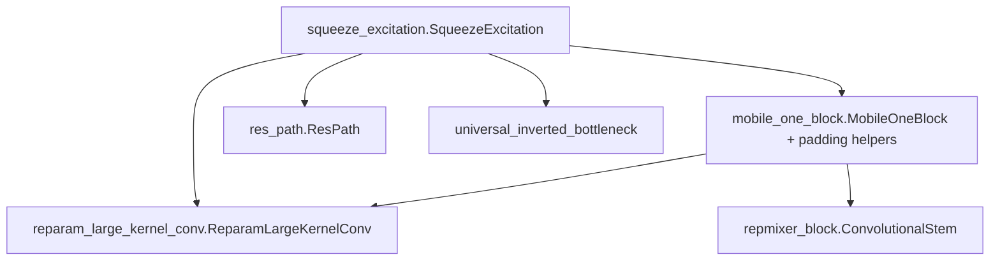

# conv_blocks

Path: `src/dl_techniques/layers/conv_blocks/`
Purpose: Registered Keras 3 convolutional layers (ResNet, ConvNeXt, MobileNet-family, bias-free, stem, adaptive convs, SE gate) that other layers and models build on.

## Scope

In: 19 modules, 22 registered `keras.layers.Layer` classes plus the helper functions listed under Public interface. Each module registers under its own path, `dl_techniques.layers.conv_blocks.<module>` (`@register_dl_technique(...)` from `dl_techniques.utils.keras_registration`).

Out: attention, FFN, norm and activation layers (they live in sibling `layers/` packages and are only consumed here through factories), full models, trainers, and any weight folding or reparameterization pass (not implemented in this folder).

Layout facts:

- `__init__.py` has `__all__ = ["ConvStem"]`. Nothing else is re-exported. Import every other class from its module.
- There is no `factory.py` in this folder. No class here is a factory key.
- Tests: `tests/test_layers/test_conv_blocks/` (one `test_<module>.py` per module plus single-claim guards named `test_the_*` / `test_a_*`, and a shared instrument `stem_instruments.py`).

## Architecture

Every layer follows one pattern: construct sub-layers in `__init__`, call `sub.build(shape)` on each in forward order inside `build()`, run them in `call()`, then `super().build(input_shape)` last. Exceptions that build sub-layers in `build()`: `DynamicConv2D`, `SqueezeExcitation`, `RADConv2D` (its two predictor convs), `UniversalInvertedBottleneck` (sets `expand_conv.filters` there), `BiasFreeResidualBlock`/`BiasFreeResidualBlock1D` (shortcut conv), and `MobileOneBlock` / `ReparamLargeKernelConv` when `group_size > 0`.

Intra-folder dependencies (the bias-free residual blocks use their own file's `BiasFreeConv1D` / `BiasFreeConv2D`):



Families:

| Family | Classes |
| --- | --- |
| ResNet units | `BasicBlock`, `BottleneckBlock` |
| Generic | `ConvBlock`, `ConvStem` |
| Bias-free | `BiasFreeConv1D`, `BiasFreeResidualBlock1D`, `BiasFreeConv2D`, `BiasFreeResidualBlock`, `MatchChannels` |
| ConvNeXt | `ConvNextV1Block`, `ConvNextV2Block` (residual branch only) |
| Mobile / efficient | `DepthwiseSeparableBlock`, `GaborDepthwiseSeparableBlock`, `UniversalInvertedBottleneck`, `MobileOneBlock`, `ReparamLargeKernelConv`, `RepMixerBlock`, `ConvolutionalStem` |
| Adaptive conv | `DynamicConv2D`, `RADConv2D` |
| Helpers | `SqueezeExcitation`, `ResPath` |

## Key files

| File | Role | Notes |
| --- | --- | --- |
| `stem.py` | `ConvStem`, `_canonical_activation`, `_LAYERS_BY_RANK` | Only curated export. `rank` 2 or 3 chosen by the `_LAYERS_BY_RANK` table. conv2 gets `clone_initializer` copies. |
| `basic_block.py`, `bottleneck_block.py` | ResNet units | Norm/act by factory name. `kernel_initializer` goes through `initializer_spec` and `clone_initializer`. |
| `conv_block.py` | `ConvBlock` | Norm via `create_normalization_layer`, activation via `resolve_activation_layer`. |
| `bias_free_conv2d.py` | `BiasFreeConv2D`, `BiasFreeResidualBlock`, `resolve_denoiser_normalization` | Three norm modes. Used by bias-free denoiser models. |
| `bias_free_conv1d.py` | 1D twins | BatchNorm only (`center=False`); no `normalization_type`, no dropout. |
| `convnext_v1_block.py`, `convnext_v2_block.py` | ConvNeXt branches | V2 adds `GlobalResponseNormalization` after the activation. Hand-written `from_config`. |
| `mobile_one_block.py` | `MobileOneBlock` and shared padding/group helpers | `ReparamLargeKernelConv` imports `PADDING_MODES`, `resolve_num_groups`, `resolve_conv_padding`, `conv_output_size` from here. |
| `reparam_large_kernel_conv.py` | Large + small Conv-BN branch pair | Default `padding_mode='reference'`. Hand-written `from_config`. |
| `repmixer_block.py` | `RepMixerBlock`, `ConvolutionalStem` | Two classes, one registration string. Consumed by `models/vision_language/fastvlm/model.py`. |
| `squeeze_excitation.py` | `SqueezeExcitation` | Rank 2/3/4. Convs are created in `build()` with cloned initializers. |
| `universal_inverted_bottleneck.py` | UIB | Flags select the block structure. Stride owner logic in `__init__`. |
| `gabor_depthwise_separable_block.py` | Frozen Gabor depthwise + 1x1 | Uses `create_gabor_depthwise_conv2d` from `dl_techniques.initializers.gabor_filters_initializer`. |
| `dynamic_conv2d.py` | `DynamicConv2D` | `_expert_output` has an XLA-motivated path for grouped + dilated convs. |
| `rad_conv.py` | `RADConv2D` | Module-level `_sat_gather`, `_sat_bilinear`, `_box_average`, constant `AREA_EPSILON = 1e-6`. |
| `res_path.py` | `ResPath` | Imports `reference_batch_norm` from `layers/acc_unet/reference_batch_norm.py`. |
| `match_channels.py` | `MatchChannels` | No weights. Rank-4 only. |
| `depthwise_separable_block.py` | MobileNetV1 block | Layer names include `block_id`. |

## Public interface

Constructor signatures are abbreviated to the arguments that matter. All classes accept `**kwargs` for `keras.layers.Layer`.

ResNet and generic:

- `BasicBlock(filters, stride=1, use_projection=False, kernel_regularizer=None, normalization_type="batch_norm", normalization_kwargs=None, activation_type="relu", kernel_initializer="he_normal")`. Output `(B, H/stride, W/stride, filters)`.
- `BottleneckBlock(...)` same arguments. Output width `filters * 4` (`self.expansion = 4`). Stride sits on the 3x3 conv.
- `ConvBlock(filters, kernel_size=3, strides=1, padding="same", normalization_type="batch_norm", activation_type="relu", dropout_rate=0.0, use_pooling=False, pool_size=2, pool_type="max", kernel_regularizer=None, kernel_initializer="glorot_uniform", normalization_kwargs=None, activation_kwargs=None, groups=1, use_bias=True)`. Order: conv, norm, activation, dropout, pool. Raises `ValueError` if `activation_kwargs` is given for a name not in `ACTIVATION_REGISTRY`. `'linear'` builds a weightless identity.
- `ConvStem(filters, kernel_size=3, strides=1, padding="same", use_bias=True, num_convs=1, conv2_filters=None, normalization_type="batch_norm", normalization_kwargs=None, activation_type="relu", activation_kwargs=None, final_activation=True, use_pooling=False, pool_type="max", pool_size=2, pool_strides=None, pool_padding="valid", kernel_initializer, bias_initializer, kernel_regularizer, bias_regularizer, rank=2, name=None)`.
  - `normalization_type=None` means no norm; `activation_type` of `None` or `'linear'` means no activation layer.
  - Raises `ValueError` for: `num_convs` not 1 or 2, `rank` not 2 or 3, `normalization_kwargs` with no norm, `activation_kwargs` for a non-registry activation, a Layer activation that holds weights or cannot be located by Keras.
  - Calls `refuse_input_shape` (from `dl_techniques.utils.model_build`) on `kwargs`, so `input_shape=` is refused.
  - The stem's `dtype_policy` is passed to every sub-layer; an explicit `dtype` in `normalization_kwargs` / `activation_kwargs` wins.

Bias-free:

- `BiasFreeConv2D(filters, kernel_size=3, activation='relu', kernel_initializer='glorot_uniform', kernel_regularizer=None, use_batch_norm=True, normalization_type='batchnorm', dropout_rate=0.0)`. `normalization_type` is one of `'batchnorm'`, `'layernorm'`, `'bias_free_batchnorm'` (anything else raises `ValueError`). `dropout_rate` must be in `[0, 1)`. Needs rank-4 input with a known channel dim.
- `BiasFreeResidualBlock(...)` same arguments. `conv1` has the activation and the dropout, `conv2` has neither. Shortcut is a 1x1 `Conv2D(use_bias=False)` created in `build()` only when input channels differ from `filters`.
- `resolve_denoiser_normalization(normalization_type: str) -> str`: maps `'batchnorm'` to `'bias_free_batchnorm'`, passes everything else through. For model builders only, never call from a layer.
- `BiasFreeConv1D(filters, kernel_size=3, activation='relu', kernel_initializer='glorot_uniform', kernel_regularizer=None, use_batch_norm=True)` and `BiasFreeResidualBlock1D(filters, kernel_size=3, ...)`. Rank-3 input `(B, T, C)`. `use_batch_norm` must be a `bool` (else `TypeError`).
- `MatchChannels(target_channels, slice_side="head")`. Fewer channels: zero-pad at the end. More: slice `[..., :target]` for `'head'`, `[..., -target:]` for `'tail'`. Equal: passthrough.

ConvNeXt:

- `ConvNextV1Block(kernel_size, filters, activation="gelu", kernel_regularizer=None, use_bias=True, dropout_rate=0.0, spatial_dropout_rate=0.0, use_gamma=True, gamma_initial_value=1.0, use_softorthonormal_regularizer=False, depthwise_initializer=None, depthwise_regularizer=None, normalization_type="layernorm")`. `normalization_type` is `'layernorm'` or `'batchnorm'` (the latter builds `BiasFreeBatchNorm`). Input width is not checked against `filters`; the output has `filters` channels.
- `ConvNextV2Block(...)` same arguments, plus `GlobalResponseNormalization(eps=1e-6)` between activation and dropout.

Efficient blocks:

- `DepthwiseSeparableBlock(filters, depthwise_kernel_size=3, stride=1, block_id=0, kernel_initializer="he_normal", kernel_regularizer=None, normalization_type="batch_norm", activation_type="relu", normalization_kwargs=None, activation_kwargs=None)`. Depthwise, norm, act, pointwise, norm, act. Convs have no bias.
- `GaborDepthwiseSeparableBlock(filters, filters_per_channel=4, kernel_size=11, strides=1, padding='same', sigma_range=None, theta_range=(0.0, 180.0), lambda_range=None, gamma_range=(0.5, 1.5), psi_range=(0.0, 360.0), sweep="product", normalize=True, normalization_type=None, normalization_kwargs=None, activation=None, activation_kwargs=None, pointwise_use_bias=False, kernel_initializer="he_normal", kernel_regularizer=None)`. Non-square `strides` raise `ValueError` in the constructor. Norm and activation sub-layers do not exist unless requested.
- `UniversalInvertedBottleneck(filters, expansion_factor=4, expanded_channels=None, use_expansion=True, stride=1, kernel_size=3, use_start_dw=False, start_dw_kernel_size=3, use_dw1=True, use_dw2=False, activation_type='relu', normalization_type='batch_norm', dropout_rate=0.0, drop_path_rate=0.0, use_squeeze_excitation=False, se_ratio=0.25, se_divisor=1, se_activation='relu', se_use_bias=False, se_gate_activation='sigmoid', use_bias=False, padding='same', block_type='UIB', ...)`. Residual add only when `stride == 1` and input channels equal `filters`. `drop_path_rate` must be in `[0, 1)`. `build()` raises `ValueError` when `use_expansion=False` and the expanded width differs from the input width.
- `MobileOneBlock(out_channels, kernel_size, stride=1, padding='same', padding_mode='keras_same', use_se=False, num_conv_branches=1, group_size=0, use_act=True, use_scale_branch=True, se_reduction_ratio=0.25, se_use_bias=False, norm_epsilon=1e-3, se_position='post_act', activation='gelu', ...)`. Sum of `num_conv_branches` k x k Conv-BN branches, an optional 1x1 scale branch (only if `kernel_size > 1`), and an identity BN skip (built in `build()` only if input channels equal `out_channels` and `stride == 1`). `call()` raises `ValueError` if no branch exists. After the sum: activation then SE (`'post_act'`) or SE then activation (`'pre_act'`).
- Helper functions in `mobile_one_block.py`: `resolve_num_groups(group_size, in_channels) -> int`, `resolve_conv_padding(kernel_size, padding, padding_mode) -> (pad, keras_padding)`, `conv_output_size(size, kernel_size, stride, padding, padding_mode)`, constant `PADDING_MODES = ('keras_same', 'reference')`.
- `ReparamLargeKernelConv(out_channels, kernel_size, stride, group_size, small_kernel=None, use_se=False, activation=None, padding_mode='reference', norm_epsilon=1e-3, kernel_initializer='he_normal', kernel_regularizer=None)`. `out_channels`, `kernel_size`, `stride`, `group_size` have no defaults. `small_kernel` must be positive, at most `kernel_size`, and the same parity as `kernel_size`. SE is fixed at ratio 0.25 with bias. Build raises `ValueError` if the resolved group count does not divide both channel counts.
- `RepMixerBlock(dim, kernel_size=3, expansion_ratio=4.0, dropout_rate=0.0, activation='gelu', use_layer_norm=True, ...)`. `kernel_size` must be odd. `build()` raises `ValueError` if input channels differ from `dim`. Pre-norm token mixer (DW kxk, BN, act, DW 1x1, BN) then pre-norm channel mixer, each with a residual add.
- `ConvolutionalStem(out_channels, use_se=False, activation='gelu', kernel_initializer='he_normal', kernel_regularizer=None)`. Three `MobileOneBlock`s: k3 s2, k3 s2, k1 s1 (names `stem_block_1`, `stem_block_2_dw`, `stem_block_3_pw`). Output is H/4, W/4.

Adaptive convs:

- `DynamicConv2D(filters, kernel_size, num_kernels=4, temperature=30.0, attention_reduction_ratio=4, strides=1, padding="valid", dilation_rate=1, groups=1, activation=None, use_bias=True, ...)`. `num_kernels >= 2`, `temperature > 0`. Output is `sum_k softmax(att / temperature)_k * conv_k(x)`. Default padding is `"valid"`, unlike most blocks here.
- `RADConv2D(filters, kernel_size=3, groups=1, use_bias=True, offset_bias_init=1.0, kernel_initializer="glorot_uniform", bias_initializer="zeros", kernel_regularizer=None)`. Always stride 1, same spatial size out. `filters` and input channels must be divisible by `groups`.

Helpers:

- `SqueezeExcitation(reduction_ratio=0.25, divisor=1, activation='relu', gate_activation='sigmoid', use_bias=False, kernel_initializer='glorot_normal', ...)`. Input rank 2, 3 or 4, channel dim known. `reduction_ratio` in `(0, 1]`. `divisor` 1 means `max(1, round(C * r))`; above 1 uses `dl_techniques.utils.tensors.make_divisible`. Output shape equals input shape.
- `ResPath(channels, num_blocks, kernel_initializer='glorot_uniform', kernel_regularizer=None)`. Per block: conv 3x3 (no bias), BN, SE, LeakyReLU(0.01), add. Then final SE, LeakyReLU, BN.

## Data shapes

- All 2D blocks are channels-last `(B, H, W, C)`. 1D bias-free blocks use `(B, T, C)`. `ConvStem(rank=3)` uses `(B, D, H, W, C)`.
- `RADConv2D` kernel weight shape: `(groups, K, C_in/groups, filters/groups)` with `K = kh * kw`. Its `offset_conv` has `4 * K * groups` filters (top, bottom, left, right) and `weight_conv` has `K * groups`. Both start with zero kernels, so initial weights are uniform and each offset is `softplus(offset_bias_init)`.
- Config keys serialized by `get_config()` mirror constructor arguments. Special cases:
  - `BiasFreeConv1D/2D` and both residual blocks write `activation=None` as the serialized `linear` activation.
  - `BasicBlock` and `BottleneckBlock` store `kernel_initializer` as a serialized spec (via `initializer_spec`).
  - `DepthwiseSeparableBlock`, `ConvBlock`, `GaborDepthwiseSeparableBlock` write the resolved initializer, so `"he_normal"` reads back as a serialized dict.
  - `ConvStem` writes `activation_type` through `dl_techniques.utils.activation_serialization.serialize_activation`.
  - `MobileOneBlock` and `ReparamLargeKernelConv` write the activation with `exact_name(...)` or `keras.activations.serialize`.

## Invariants and constraints

- Initializers are cloned per weight. A seedless initializer instance replays one draw at every weight it initializes. Files that follow the rule use `clone_initializer` from `dl_techniques.initializers.clone`: `BasicBlock`, `BottleneckBlock`, `DepthwiseSeparableBlock`, `MobileOneBlock`, `ReparamLargeKernelConv`, `SqueezeExcitation`, `UniversalInvertedBottleneck`, `ConvStem` (conv2). `ConvNext*` builds one fresh initializer per pointwise conv. A seeded initializer replays by contract.
- Files that hand one initializer instance to several sub-layers without cloning: `ConvBlock` (one conv only), `BiasFreeConv*` residual blocks (conv1, conv2, shortcut), `RepMixerBlock`, `ResPath`, `DynamicConv2D` (experts and attention Dense layers), `GaborDepthwiseSeparableBlock` (pointwise only). Adding clones there changes draws at a fixed seed.
- Bias-free blocks must stay bias-free: `use_bias=False` on every conv and `center=False` on every norm. `BiasFreeConv2D(normalization_type='batchnorm')` is stock `BatchNormalization(center=False)` and is not degree-1 homogeneous after training. That spelling stays because old `.keras` configs carry it. Only `'bias_free_batchnorm'` is homogeneous. Do not change what `'batchnorm'` builds.
- `resolve_denoiser_normalization` is applied at model level, never inside a layer.
- `ConvNextV1Block` / `ConvNextV2Block`: `LayerScale` gamma is `CHANNEL`-wise, L2 `1e-5`, constrained to `[1e-6, 1.0]` by `ValueRangeConstraint`. The floor keeps the branch alive. The caller adds the skip and `StochasticDepth`. In V1, `use_softorthonormal_regularizer=True` also switches the pointwise initializer to `OrthogonalHypersphereInitializer`. In V2 it only sets the regularizer, the initializer stays `TruncatedNormal(0, 0.02)`.
- The ConvNeXt blocks use fixed sub-layer names (`depthwise_conv`, `layer_norm`, `expand_conv`, `reduce_conv`, `activation`, `gamma_scale`, ...), and the normalization `LAYERNORM_EPSILON` is `1e-6`.
- `MobileOneBlock` and `ReparamLargeKernelConv` must resolve group counts and padding through the shared helpers in `mobile_one_block.py`. Two branches summed in one block must use the same padding convention or they sample different pixels. Defaults: `norm_epsilon=1e-3` (Keras default), not the reference `1e-5`.
- `MobileOneBlock` `post_act` SE order and `padding_mode='keras_same'` are the defaults on purpose (the FastVLM model depends on them).
- `GaborDepthwiseSeparableBlock.call` forwards `training=` to every stage explicitly. Keep it. The Gabor depthwise stage is created with `trainable=False` and `use_bias=False`. Its homogeneity warning allowlist is `{None, 'linear', 'relu', 'leaky_relu'}`, a private copy that must not import from `models/`. Strides must be square.
- `DynamicConv2D._expert_output` computes grouped, dilated experts with `keras.ops.depthwise_conv` or per-group `keras.ops.conv` instead of calling the `Conv2D`. The reason in the code: under XLA the grouped dilated `Conv2D` bakes its kernel in as a constant and recompiles each step. Keep it. A guard test exists: `test_dynamic_conv2d_compiles_once_under_xla.py`.
- `ConvStem` owns its activation dispatch on purpose (so a per-layer dtype reaches the activation and an exact callable survives a config round trip). Do not swap it for `resolve_activation_layer`. A Layer activation is stored as a config dict and rebuilt at each site.
- `SqueezeExcitation` with `divisor=1` must stay `max(1, int(round(C * ratio)))`; do not fold it into `make_divisible(width, 1)`, which rounds differently at ties.
- `UniversalInvertedBottleneck` stride goes to the first existing spatial op in the order `start_dw`, `dw1`, `dw2`, `project_conv`. `drop_path` acts on the branch before the residual add, and only when the residual exists.
- `RADConv2D` computes offsets, SAT and box averages in float32 and casts back to `compute_dtype`. The `training` argument is unused.

## Dependencies

Internal:

- `dl_techniques.layers.norms` (`create_normalization_layer`, `NormalizationType`, `bias_free_batch_norm.BiasFreeBatchNorm`, `global_response_norm.GlobalResponseNormalization`).
- `dl_techniques.layers.activations` (`create_activation_layer`, `resolve_activation_layer`, `ACTIVATION_REGISTRY`, `common.resolve_activation` / `serialize_activation` / `activation_spec`, `exact_activations` (`substitute_exact`, `exact_name`, `ExactLeakyReLU`), `gelu_tanh.resolve_activation`).
- `dl_techniques.layers.regularization` (`layer_scale.LayerScale`, `stochastic_depth.StochasticDepth`).
- `dl_techniques.layers.acc_unet.reference_batch_norm.reference_batch_norm` (only `ResPath`).
- `dl_techniques.initializers` (`clone`, `gabor_filters_initializer`, `hypersphere_orthogonal_initializer`), `dl_techniques.regularizers.soft_orthogonal`, `dl_techniques.constraints.value_range_constraint`.
- `dl_techniques.utils` (`keras_registration`, `activation_serialization`, `logger`, `tensors.make_divisible`, `model_build.refuse_input_shape`).

External: `keras` (Keras 3, `import keras` and `keras.ops` only), `numpy` (only `rad_conv.py`).

Consumers (importers of this folder): `layers/heads/vision`, `layers/acc_unet`, `layers/yolo12`, `layers/attention`, and models including `vision/mobilenet`, `vision/fastvit`, `vision/convnext`, `vision/capsnet`, `vision/bias_free_denoisers`, `vision/squeezenet`, `vision/cliffordnet`, `vision/resnet`, `vision/mambalct`, `vision_language/fastvlm`, `vision_language/sam`. `MatchChannels` is used by `models/vision/convunext/model.py`, `bfconvunext.py` and `bfunet.py`.

## Failure modes

- Constructor validation raises `ValueError` (or `TypeError` for wrong types) with the offending value in the message.
- `build()` raises `ValueError` for wrong rank or an undefined channel dim in `BiasFree*`, `DynamicConv2D`, `RADConv2D`, `GaborDepthwiseSeparableBlock`, `SqueezeExcitation`, `MobileOneBlock`, `ReparamLargeKernelConv`, `RepMixerBlock`, `DepthwiseSeparableBlock`. `MatchChannels.build` does `int(input_shape[-1])` with no guard, so an undefined channel dim fails with a `TypeError`.
- `BasicBlock` / `BottleneckBlock` without projection and with mismatched channels fail at the `Add`, not at construction.
- `MobileOneBlock` with `num_conv_branches=0`, no scale branch, and no identity skip raises `ValueError` in `call()`.
- `MobileOneBlock.inference_mode` is set to `False` and never read. `ConvolutionalStem` has no `reparameterize()` / `reset_reparameterization()` (removed: `MobileOneBlock` has no fold, so they could only log a failure or raise `AttributeError`); `test_it_offers_no_reparameterization_the_blocks_cannot_do` pins that.
- Unregistered custom activation callables in `ConvStem` write a config that fails at reload (`TypeError`). Register with `keras.saving.register_keras_serializable`.
- `GaborDepthwiseSeparableBlock` with a non-allowlisted activation only logs a warning.
- `SqueezeExcitation.build` logs at `info` level on every build.
- Docs vs code mismatches found: the `MobileOneBlock` class docstring says branches fuse at inference, but no fusion code exists in the folder. The `MatchChannels` docstring example uses the import path `dl_techniques.layers.match_channels`, which does not exist.

## Working here

- New block: add `<name>.py` with one class, `@register_dl_technique("dl_techniques.layers.conv_blocks.<name>")`, `__init__` / `build` / `call` / `compute_output_shape` / `get_config`, and a test file `tests/test_layers/test_conv_blocks/test_<name>.py`. Do not add the class to `__init__.py` unless the curated surface is meant to grow (it is `ConvStem` only now).
- Docstrings here are Sphinx/reST (`:param x:` / `:type x:`). Match the file you edit.
- Pick norm and activation through the factories (`create_normalization_layer`, `create_activation_layer`) rather than direct Keras classes. The factory epsilon is `1e-6`; Keras `BatchNormalization` defaults to `1e-3`. A direct Keras norm needs an explicit `epsilon=` with a reason.
- Give every sub-layer its own `clone_initializer(...)` of a stored initializer.
- Do not change a default or a stored config key without checking saved `.keras` files, factories and the consumers listed above. Several defaults are pinned to existing checkpoints (`BiasFreeConv2D` `'batchnorm'`, `MobileOneBlock` `'keras_same'` and `'post_act'`, `norm_epsilon=1e-3`).
- Registration strings are per module. Two classes in one module share the string (`bias_free_conv1d`, `bias_free_conv2d`, `repmixer_block`). Do not reuse a bare class name that exists elsewhere in the library. Use a prefix (the FastViT variant is `FastVitRepMixerBlock` for this reason).
- Run tests scoped to this folder, from the repo root with `.venv`:

```bash
.venv/bin/python -m pytest tests/test_layers/test_conv_blocks/ -q
```

  Also run the suites of the consumers you touch (for example `tests/test_models/test_mobilenet/`). Do not run the full test suite. Never run pytest jobs in parallel.
- Use `keras.ops`, `import keras` only, and `dl_techniques.utils.logger` rather than `print`.
