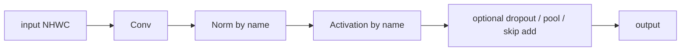

# conv_blocks

A folder of ready-made convolutional building blocks for Keras 3 models: ResNet blocks, ConvNeXt blocks, MobileNet-style blocks, bias-free blocks for denoisers, a configurable stem, and a few small helpers. It lives at `src/dl_techniques/layers/conv_blocks/` inside the `dl_techniques` library.

## What it is for

Vision models repeat the same few shapes: convolution, normalization, activation, maybe a skip connection. Writing each one by hand in every model leads to copies that drift apart. This folder holds one tested version of each shape, so a model builder can stack them instead.

Most blocks pick their normalization and activation by name (for example `"batch_norm"`, `"relu"`), using the library's `norms` and `activations` factories. That lets a caller swap one for another without editing the block. A few blocks are fixed by design, such as the bias-free blocks, which never add a constant, so that scaling the input by a positive number scales the output by the same number.

## How it works

Each file defines one or two Keras `Layer` classes. A layer creates its sub-layers in `__init__`, builds them explicitly in `build()` (so saved weights can be restored), and runs them in `call()`. Every layer has `get_config()` so it can be saved and loaded inside a `.keras` model file.



The blocks fall into families:

- ResNet units: `BasicBlock` (two 3x3 convs, output width `filters`) and `BottleneckBlock` (1x1, 3x3, 1x1, output width `filters * 4`). Both add a shortcut, optionally a 1x1 projection.
- General block: `ConvBlock` is Conv2D, norm, activation, optional dropout, optional pooling.
- Stem: `ConvStem` is one or two convs, optional norm, optional activation, optional pool, for 2D images or 3D volumes.
- Bias-free: `BiasFreeConv1D`, `BiasFreeResidualBlock1D`, `BiasFreeConv2D`, `BiasFreeResidualBlock`. No conv bias, no normalization beta.
- ConvNeXt: `ConvNextV1Block`, `ConvNextV2Block`. These are only the residual branch, the caller adds the skip.
- Efficient mobile-style: `DepthwiseSeparableBlock`, `GaborDepthwiseSeparableBlock`, `UniversalInvertedBottleneck`, `MobileOneBlock`, `ReparamLargeKernelConv`, `RepMixerBlock`, `ConvolutionalStem`.
- Adaptive convolutions: `DynamicConv2D` (mixes several kernels per input) and `RADConv2D` (region-aware deformable convolution using summed-area tables).
- Small helpers: `SqueezeExcitation` (channel gate), `ResPath` (U-Net skip refinement), `MatchChannels` (zero-pad or slice the channel axis, no weights).

## Files

- `__init__.py` - exports only `ConvStem`.
- `basic_block.py` - `BasicBlock`, the ResNet-18/34 unit.
- `bottleneck_block.py` - `BottleneckBlock`, the ResNet-50/101/152 unit.
- `conv_block.py` - `ConvBlock`, factory-driven Conv2D + norm + activation + dropout + pool.
- `stem.py` - `ConvStem`, a configurable one- or two-conv stem for rank 2 or 3.
- `bias_free_conv1d.py` - `BiasFreeConv1D` and `BiasFreeResidualBlock1D` for `(B, T, C)` signals.
- `bias_free_conv2d.py` - `BiasFreeConv2D`, `BiasFreeResidualBlock`, and the function `resolve_denoiser_normalization`.
- `convnext_v1_block.py` - `ConvNextV1Block`.
- `convnext_v2_block.py` - `ConvNextV2Block` (adds Global Response Normalization).
- `depthwise_separable_block.py` - `DepthwiseSeparableBlock`, the MobileNetV1 block.
- `gabor_depthwise_separable_block.py` - `GaborDepthwiseSeparableBlock`, a frozen Gabor depthwise bank plus a learnable 1x1.
- `universal_inverted_bottleneck.py` - `UniversalInvertedBottleneck`, one block that becomes an inverted bottleneck, ConvNeXt-like, FFN-like or ExtraDW block by flags.
- `mobile_one_block.py` - `MobileOneBlock` plus shared helpers `resolve_num_groups`, `resolve_conv_padding`, `conv_output_size`, and the tuple `PADDING_MODES`.
- `reparam_large_kernel_conv.py` - `ReparamLargeKernelConv`, a large plus small Conv-BN branch pair (FastViT downsampling).
- `repmixer_block.py` - `RepMixerBlock` and `ConvolutionalStem` (three MobileOne blocks, 4x downsample).
- `dynamic_conv2d.py` - `DynamicConv2D`.
- `rad_conv.py` - `RADConv2D` and its private SAT helpers.
- `squeeze_excitation.py` - `SqueezeExcitation` for rank 2, 3 or 4 input.
- `res_path.py` - `ResPath`.
- `match_channels.py` - `MatchChannels`.

## How to use it

Only `ConvStem` is re-exported. Import everything else from its own module.

```python
import numpy as np
from dl_techniques.layers.conv_blocks import ConvStem
from dl_techniques.layers.conv_blocks.basic_block import BasicBlock
from dl_techniques.layers.conv_blocks.convnext_v1_block import ConvNextV1Block

x = np.random.rand(2, 32, 32, 3).astype("float32")

stem = ConvStem(filters=16, kernel_size=3, strides=2)          # (2, 16, 16, 16)
y = stem(x)

block = BasicBlock(filters=32, stride=2, use_projection=True)  # (2, 8, 8, 32)
y = block(y)

# ConvNeXt blocks return only the residual branch. Add the skip yourself.
branch = ConvNextV1Block(kernel_size=7, filters=32)(y)
y = y + branch
```

Run the tests for this folder from the repo root:

```bash
.venv/bin/python -m pytest tests/test_layers/test_conv_blocks/ -q
```

## Things to know

- `ConvNextV1Block` and `ConvNextV2Block` do not add the skip connection or stochastic depth. Standalone use silently drops both.
- `BasicBlock` and `BottleneckBlock` with `use_projection=False` need the input channel count to equal the output width (`filters`, or `filters * 4` for the bottleneck). This is not checked up front, the add fails instead.
- `MobileOneBlock` and `ReparamLargeKernelConv` implement the training-time multi-branch form only. Nothing here folds branches into one convolution, and `ConvolutionalStem` has no `reparameterize()`.
- `group_size` in `MobileOneBlock` and `ReparamLargeKernelConv` follows timm: `0` is a dense conv, `k > 0` means `groups = in_channels // k`, so `1` is depthwise.
- `padding_mode` defaults differ: `MobileOneBlock` uses `'keras_same'`, `ReparamLargeKernelConv` uses `'reference'`.
- Bias-free homogeneity depends on the normalization. In `BiasFreeConv2D`, only `normalization_type='bias_free_batchnorm'` is degree-1 homogeneous. The default `'batchnorm'` is stock Keras `BatchNormalization(center=False)`, which still has a moving mean.
- `GaborDepthwiseSeparableBlock` freezes its Gabor bank at construction. Toggling `trainable` on an enclosing model unfreezes it again.
- The `RepMixerBlock` here is not the FastViT RepMixer. The FastViT one is `FastVitRepMixerBlock` in `models/vision/fastvit/components.py`.
- `RADConv2D` only supports stride 1 with output size equal to input size, and does its internal math in float32.
- The `MatchChannels` docstring example imports `dl_techniques.layers.match_channels`, which is the wrong path. The module is `dl_techniques.layers.conv_blocks.match_channels`.
- Inputs are channels-last (NHWC, or NDHWC for 3D stems). `SqueezeExcitation` also accepts `(B, C)` and `(B, S, C)`.
