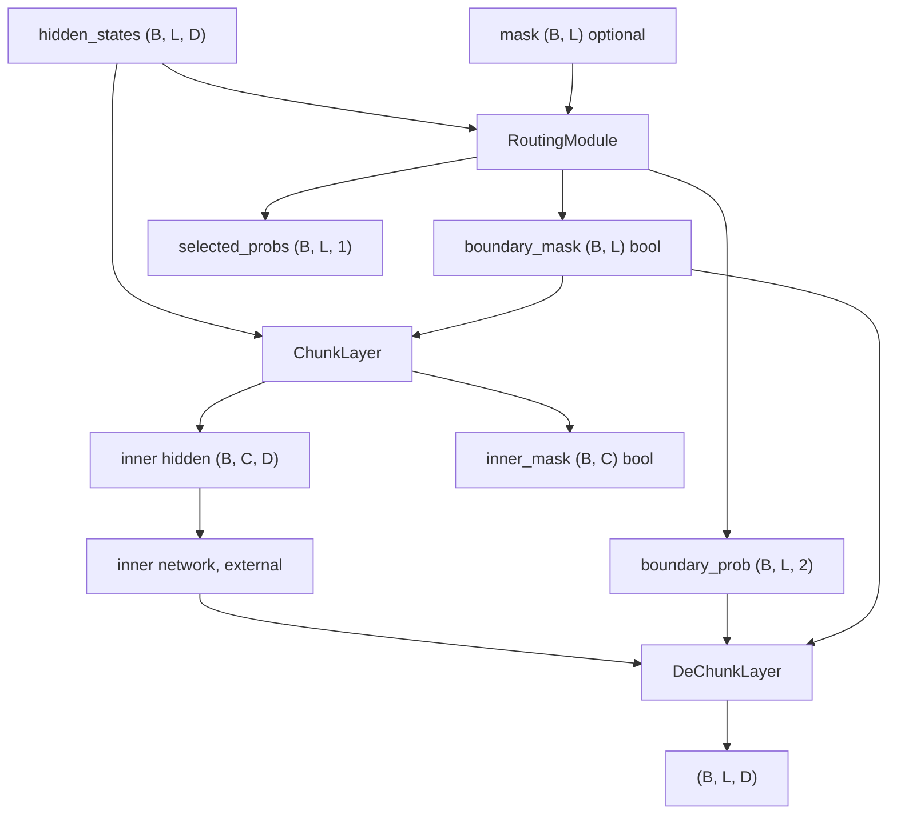

# dynamic_chunking

Path: `src/dl_techniques/layers/dynamic_chunking`
Purpose: H-Net learned dynamic chunking as three Keras 3 layers (route, chunk, dechunk), consumed by one model.

## Scope

In: `RoutingModule`, `ChunkLayer`, `DeChunkLayer`, each in its own module, plus a curated `__init__.py`.

Out:
- The shared index helpers. `pad_permutation_to_width`, `batched_gather`, `dim` and `cap_boundaries_by_position` live in `src/dl_techniques/utils/sequence_ops.py`. There is no `indexing.py` in this package.
- The H-Net model, its stages and losses: `src/dl_techniques/models/language/hnet/` (`stage.py` builds one of each layer per stage; `losses.py` documents the router outputs).
- Any factory or registry. This is a standing decision (`DECISION D-004` / `D-015` in `__init__.py`): one consumer, so no `factory.py`, no `DYNAMIC_CHUNKING_REGISTRY`, and no registration into another domain's factory. The package follows the shape of `layers/blt/`.

Reference: Hwang et al., 2025, "Dynamic Chunking for End-to-End Hierarchical Sequence Modeling", arXiv 2507.07955. Code comments cite `dc.py:<line>`, the line numbers in the reference implementation.

## Architecture



`C` is `ChunkLayer.max_chunks`. `L` is the full-resolution length. In `DeChunkLayer`, the inner width is called `M` and is read from the inner tensor (`dim(inner_hidden_states, 1)`), so in practice `M == C`.

Stable-partition trick used by both chunk and dechunk: `token_idx = arange(L) + (~keep) * L`, then `argsort(axis=1)`. Kept positions get keys in `[0, L)` and dropped ones in `[L, 2L)`, so all keys are distinct and boundaries come first in position order. Then `pad_permutation_to_width(perm, width)` right-pads with index 0 or truncates to `width` columns, and `batched_gather` gathers through it.

Data flow in `DeChunkLayer.call`:
1. `p_full = clip(boundary_prob[..., -1], clamp_min, clamp_max)`. A rank-2 `boundary_prob` is taken as `p` directly.
2. `keep = boundary_mask & mask`. Rebuild the partition permutation and gather `p_full` into inner order, width `M`.
3. `_ema_scan`: `while_loop` over `M` steps with `carry = p_t * x_t + (1 - p_t) * carry`, writing into an accumulator by one-hot masked add.
4. `plug_back_idx = clip(cumsum(keep) - 1, 0, M - 1)`, then `batched_gather(out, plug_back_idx)`.

## Key files

| File | Role | Notes |
| --- | --- | --- |
| `__init__.py` | Curated exports, `__all__` of 3 names | Docstring holds the D-004/D-015 no-factory decision. Importing it registers all three classes |
| `routing_module.py` | `RoutingModule`, constants `NORMALIZE_EPS = 1e-12`, `FORCED_FIRST_BOUNDARY_PROB = 1.0` | Two bias-free `Dense(d_model)` layers `q_proj`, `k_proj` with `keras.initializers.Identity()` |
| `chunk_layer.py` | `ChunkLayer` | No weights. Calls `cap_boundaries_by_position`, `pad_permutation_to_width`, `batched_gather` |
| `dechunk_layer.py` | `DeChunkLayer`, constants `DEFAULT_CLAMP_MIN = 1e-4`, `DEFAULT_CLAMP_MAX = 1.0 - 1e-4` | No weights. Calls `batched_gather`, `dim`, `pad_permutation_to_width` |

## Public interface

Registered names (via `register_dl_technique`):
- `dl_techniques.layers.dynamic_chunking.routing_module` for `RoutingModule`
- `dl_techniques.layers.dynamic_chunking.chunk_layer` for `ChunkLayer`
- `dl_techniques.layers.dynamic_chunking.dechunk_layer` for `DeChunkLayer`

`RoutingModule(d_model: int, **kwargs)`
- `call(hidden_states, mask=None, training=None) -> (boundary_prob (B, L, 2), boundary_mask (B, L) bool, selected_probs (B, L, 1))`
- `boundary_prob` is `stack([1 - p, p], -1)`. `p[:, 0]` is forced to 1.0. For t >= 1, `p_t = clip((1 - cos(q_proj(h_{t-1}), k_proj(h_t))) / 2, 0, 1)`.
- `boundary_mask = (p > 0.5)`, ANDed with `mask` if given.
- `selected_probs = where(p > 0.5, p, 1 - p)` expanded on the last axis, computed before masking, so padded positions are not zeroed.
- `build` raises `ValueError` for rank != 3 or a last axis (when known) != `d_model`. `__init__` raises `ValueError` if `d_model` is not a positive non-bool int.
- `compute_output_shape` returns `((B, L, 2), (B, L), (B, L, 1))`. `get_config` adds `d_model`.
- `training` is accepted and deleted.

`ChunkLayer(max_chunks: int, **kwargs)`
- `call(hidden_states, boundary_mask=None, mask=None, training=None) -> (next_hidden_states (B, max_chunks, D), inner_mask (B, max_chunks) bool)`
- `keep = boundary_mask & mask`, then `keep = cap_boundaries_by_position(keep, max_chunks)`. `inner_mask = arange(max_chunks) < sum(keep)`.
- Raises `ValueError` if `boundary_mask` is `None`, if `max_chunks` is not a positive non-bool int, or (in `build`) if the hidden states are not rank 3.
- `compute_output_shape` returns `((B, max_chunks, D), (B, max_chunks))`. `get_config` adds `max_chunks`.

`DeChunkLayer(clamp_min: float = 1e-4, clamp_max: float = 1 - 1e-4, **kwargs)`
- `call(inner_hidden_states, boundary_prob=None, boundary_mask=None, mask=None, training=None) -> (B, L, D)`
- Raises `ValueError` if `boundary_prob` or `boundary_mask` is `None`, if `build` sees rank != 3, or if the clamps are not non-bool numbers with `0 < clamp_min < clamp_max <= 1`.
- `compute_output_shape(inner_hidden_states_shape, boundary_prob_shape=None, boundary_mask_shape=None, mask_shape=None)` takes `L` from `boundary_mask_shape[1]`, else `boundary_prob_shape[1]`, else `None`. `get_config` adds `clamp_min` and `clamp_max` (stored as floats).

Calling convention: pass the tensors after the first as keywords, as `models/language/hnet/stage.py` does. Keras passes the first call argument's shape to `build`, so `build` only ever sees `hidden_states` (chunk, router) or `inner_hidden_states` (dechunk).

## Data shapes

| Tensor | Shape | Dtype / notes |
| --- | --- | --- |
| `hidden_states` | `(B, L, D)` | `D == d_model` for the router |
| `mask` | `(B, L)` | True or nonzero = real token; cast to bool |
| `boundary_prob` | `(B, L, 2)` | `[1 - p, p]`; differentiable w.r.t. `q_proj` and `k_proj` (position 0 is the constant `[0.0, 1.0]`, so `p` is 1.0 there and `1 - p` is 0.0); `DeChunkLayer` also accepts `(B, L)` holding `p` |
| `boundary_mask` | `(B, L)` | bool from the router, no gradient; the chunk and dechunk layers cast any bool or int mask to bool |
| `selected_probs` | `(B, L, 1)` | probability of the winning class; differentiable w.r.t. `q_proj` and `k_proj`, like `boundary_prob` |
| inner hidden | `(B, max_chunks, D)` | slots past the row's boundary count gather filler tokens, marked False in `inner_mask` |

## Invariants and constraints

- Chunk and dechunk must partition on the same predicate: `boundary_mask & mask`, with the same `mask` passed to both. The router already ANDs `mask` into `boundary_mask`, and the AND in the other two layers makes the pairing robust when a caller passes a raw mask.
- Both layers use `pad_permutation_to_width` so inner column j means the same thing on both sides. Do not re-inline slicing or padding in either layer. Slicing alone gives `min(L, M)` columns and breaks when `L < M`.
- Capping is by position order (first `max_chunks` boundaries), not by score. `cap_boundaries_by_position` is shared with BLT's dynamic patcher. `DeChunkLayer` does not cap explicitly. It gets the same effect from truncating the permutation to `M` columns, and clips the scatter index to `[0, M - 1]`.
- The router threshold is strict `p > 0.5` (D-012). The reference `argmax([1 - p, p])` resolves a tie to index 0, i.e. no boundary. Do not change to `>=`. A tie is reachable bit-exactly with orthogonal neighbours (`cos = 0`).
- Identity initialization comes from `keras.initializers.Identity()`, not from an `.assign()` after build. A post-build assign is discarded when the layer is first built from a parent's `call()` (Keras 3 builds inside a `StatelessScope`). Keep the initializer.
- `q_proj` reads `h_t` (positions `[:-1]`) and `k_proj` reads `h_{t+1}` (positions `[1:]`). Under identity init a swap is bit-identical, so only a test with non-identity weights can catch it.
- `_normalize` divides by `max(||x||, 1e-12)`, not by `||x|| + eps`, so an all-zero row stays zero instead of becoming NaN. Padded rows can be all-zero.
- `DeChunkLayer._ema_scan` keeps the `while_loop` with a one-hot masked-add accumulator (D-014). The closed form goes NaN at `M >= 64` and `slice_update` has no gradient. `maximum_iterations=inner_len` is set so the XLA backward pass can size its tensor list.
- Masks are built from `arange` broadcasts. Do not use `keras.ops.tril` or `triu`, which raise `TypeError` under `tf.function` (D-010b).
- Gathers go through `batched_gather`, not `take_along_axis` (unusable under XLA on GPU retrace) and not numpy fancy indexing.
- Width is the constructor value `max_chunks`, never derived from data, so shapes stay static for `tf.function` and XLA.
- `DeChunkLayer` computes in `inner_hidden_states.dtype`: `p_full` is cast to it before clamping.

## Dependencies

Internal:
- `dl_techniques.utils.keras_registration.register_dl_technique` - registration decorator, used by all three modules.
- `dl_techniques.utils.sequence_ops` - `batched_gather`, `pad_permutation_to_width`, `cap_boundaries_by_position` (chunk), `batched_gather`, `dim`, `pad_permutation_to_width` (dechunk).

External: `keras` (3.x) only, through `keras.ops`. No raw TensorFlow ops.

Consumer: `src/dl_techniques/models/language/hnet/stage.py` imports the three classes from their module paths (not from the package).

## Failure modes

- Missing required call argument: `ValueError` from `call` naming the missing keyword (chunk: `boundary_mask`; dechunk: `boundary_prob` or `boundary_mask`).
- Wrong rank: `ValueError` from `build`.
- Router `d_model` mismatch: `ValueError` from `build` when the last input axis is static and differs.
- Invalid constructor arguments (non-int, bool, zero, negative, bad clamp bounds): `ValueError` from `__init__`.
- More boundaries than `max_chunks`: no error. The tail boundaries are dropped silently and `inner_mask` is all True for that row.
- No boundary at position 0 in a caller-supplied mask: the dechunk scatter index would be -1 and is clipped to 0, so leading positions read inner slot 0.
- Filler slots (columns at or past a row's boundary count) hold non-boundary tokens in position order, as long as the column index is below `L`. When `max_chunks > L`, the surplus columns at index `L` and beyond hold the row's first token, via the index-0 padding in `pad_permutation_to_width`. Consumers must use `inner_mask` and not trust filler values.

## Working here

- Keep one class per module, each with its own `register_dl_technique("dl_techniques.layers.dynamic_chunking.<module>")` string. Adding a class means adding it to `__init__.py` imports and `__all__`.
- Do not add a factory or registry here, and do not register these classes in another domain factory (D-004/D-015).
- The layers hold no unusual state, but any new constructor argument must be validated in `__init__` and added to `get_config`.
- If you change the partition or padding rule, change `utils/sequence_ops.py` so both layers move together. Run the router, chunk and dechunk suites plus the H-Net tests.
- Docstrings are Sphinx/reST (`:param:`, `:type:`, `:raises:`), matching the rest of `layers/`. Use `import keras` and qualify at the call site.
- Tests: `tests/test_layers/test_dynamic_chunking/` (`test_routing_module.py`, `test_chunk_layer.py`, `test_dechunk_layer.py`, `test_hnet_reference_numpy.py`, `test_indexing.py`, with a numpy oracle in `hnet_reference_numpy.py`) and `tests/test_models/test_hnet/`. Scope pytest to these. The full suite takes about 1.5 hours:

```bash
.venv/bin/python -m pytest tests/test_layers/test_dynamic_chunking/ tests/test_models/test_hnet/ -q
```
