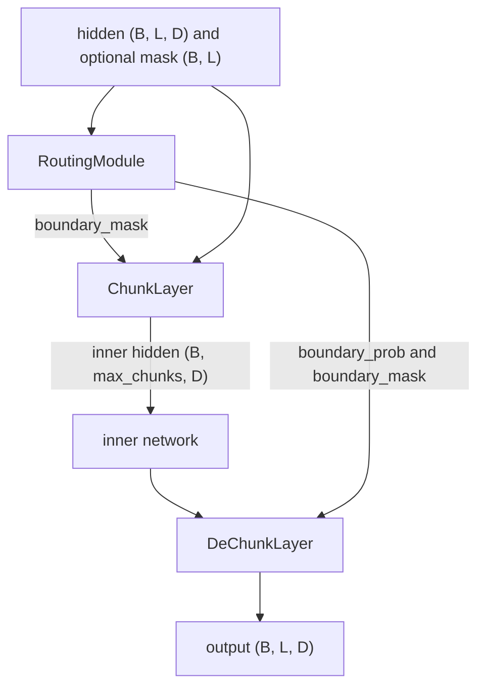

# dynamic_chunking

Three Keras 3 layers that implement H-Net's learned, data-dependent sequence chunking. They live in `dl_techniques/layers/dynamic_chunking/` and are meant to be used together as a route, chunk, dechunk triple.

## What it is for

A sequence model usually spends the same compute on every token. H-Net (Hwang et al., 2025, https://arxiv.org/abs/2507.07955) instead lets the model decide where a new chunk of the sequence starts, then runs an expensive inner network only on the chunk starts. The result is a shorter sequence in the middle of the network and the full-length sequence at both ends.

These layers provide the three steps around that inner network. One layer scores each position as a possible chunk start. One layer picks those positions out into a shorter sequence. One layer expands the inner network's output back to the original length. The layers have no connection to any single model, but the only consumer in this repo is the H-Net stage in `models/language/hnet/stage.py`.

## How it works



1. `RoutingModule` projects each token with two learned matrices (one for the earlier token, one for the next). It compares neighbouring tokens by cosine similarity and turns that into a boundary probability `p = clip((1 - cos) / 2, 0, 1)`. Tokens that point in a different direction from their predecessor get a high `p`. Position 0 is always a boundary (`p = 1.0`). The router returns `boundary_prob (B, L, 2)` as `[1 - p, p]`, `boundary_mask (B, L)` as a bool, and `selected_probs (B, L, 1)`, the probability of whichever class won. A position is a boundary when `p > 0.5`. Both matrices start as the identity, so an untrained layer measures plain cosine similarity.
2. `ChunkLayer` moves the boundary positions to the front in their original order and keeps the first `max_chunks` of them. It returns those tokens plus a mask that says which inner slots are real.
3. The inner network runs on the short sequence (not part of this module).
4. `DeChunkLayer` smooths the inner sequence with an exponential moving average, `h_t = p_t * x_t + (1 - p_t) * h_{t-1}`, then copies each chunk's value to every position of that chunk to get back to length `L`.

## Files

- `__init__.py` - exports `ChunkLayer`, `DeChunkLayer`, `RoutingModule`; the docstring records that this package has no factory and no registry on purpose.
- `routing_module.py` - `RoutingModule`: boundary probabilities, the hard boundary mask and the probability of the chosen class.
- `chunk_layer.py` - `ChunkLayer`: weightless fixed-width gather of boundary tokens.
- `dechunk_layer.py` - `DeChunkLayer`: weightless EMA over the inner sequence and scatter back to full length.

## How to use it

```python
import keras, numpy as np
from dl_techniques.layers.dynamic_chunking import ChunkLayer, DeChunkLayer, RoutingModule

router = RoutingModule(d_model=8)
chunker = ChunkLayer(max_chunks=6)
dechunker = DeChunkLayer()

h = keras.ops.convert_to_tensor(np.random.randn(2, 16, 8).astype("float32"))
pad = keras.ops.ones((2, 16), dtype="bool")

boundary_prob, boundary_mask, selected_probs = router(h, mask=pad)
inner, inner_mask = chunker(h, boundary_mask=boundary_mask, mask=pad)
# ... run an inner network on `inner` (2, 6, 8) here ...
out = dechunker(inner, boundary_prob=boundary_prob,
                boundary_mask=boundary_mask, mask=pad)
print(out.shape)  # (2, 16, 8)
```

## Things to know

- Chunk width is fixed. `ChunkLayer` outputs `max_chunks` slots whatever the data. A row with more boundaries than `max_chunks` loses its later boundaries (the first ones in position order are kept, not the highest scoring). A row with fewer gets filler slots that `inner_mask` marks False. `max_chunks` may be larger than `L`.
- `boundary_mask` is required for `ChunkLayer`, and `boundary_prob` and `boundary_mask` are required for `DeChunkLayer`. They default to `None` in the signature only so Keras can inspect it. Missing ones raise `ValueError`.
- Pass the same `mask` to all three layers so they agree on which positions are real tokens.
- `boundary_mask` is a hard decision (boolean) and carries no gradient. `boundary_prob` and `selected_probs` are built from the differentiable cosine expression, so both carry gradient back to the router's two projections. `DeChunkLayer` consumes `boundary_prob`, so the EMA gates train the router. `boundary_prob` has shape `(B, L, 2)` and holds `[1 - p, p]` per position, so its last channel is `p`. Position 0 of every row is the constant `[0.0, 1.0]`: `p` is forced to 1.0 and `1 - p` is 0.0.
- A position with `p` exactly 0.5 (for example two orthogonal neighbours) is not a boundary.
- The last axis of the router input must equal `d_model`. All three layers require rank-3 input.
- Only the padded-batch form of the reference implementation is ported. There is no packed `cu_seqlens` path and no inference cache.
- `DeChunkLayer` runs its EMA in a `keras.ops.while_loop`, one iteration per inner slot, so its cost grows with `max_chunks`.
- `ChunkLayer` and `DeChunkLayer` have no weights. `RoutingModule` has two `(d_model, d_model)` kernels with no bias.
- Each class registers under its own module path, so importing the package makes all three deserializable from a saved `.keras` file.
- There is no factory. Import the classes directly.
