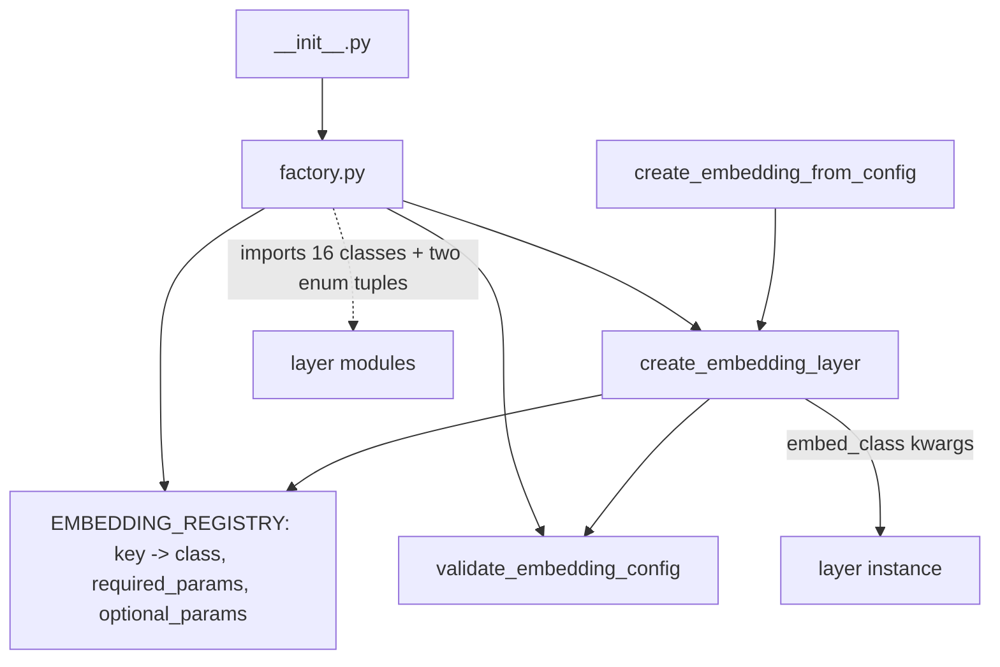

# embedding

Path: `src/dl_techniques/layers/embedding/`
Purpose: Keras 3 embedding and position-encoding layers (patch, token, positional, rotary, conditioning, special tokens) plus a registry-backed factory for 16 of them.

## Scope

Lives here: 24 layer classes in 23 modules (`patch_embedding.py` holds two), the pure-NumPy sin-cos table builders, the module function `apply_rotary_pos_emb`, and `factory.py`.

Does not live here:

- Attention layers that consume the rotary output (`layers/attention/`).
- Normalization layers (`layers/norms/`).
- Model-private embedders. `models/vision_language/bit_diffusion/blocks.py` keeps its own `DiTXATimestepEmbedder` (a differently named class with the same four constructor options as `TimestepEmbedding`: `hidden_size`, `frequency_embedding_size`, `max_period`, `kernel_stddev`) and its own copies of `get_1d_sincos_pos_embed_from_grid`, `get_2d_sincos_pos_embed_from_grid`, `get_2d_sincos_pos_embed`, left in place on purpose. Two tests tie the copies to this package (listed under Working here).

## Architecture

`create_embedding_layer(embedding_type, name=None, **kwargs)` order: `validate_embedding_config` (type known, required present, value ranges) then merge `optional_params` defaults under `kwargs`, then raise on any `kwargs` name not in `required | optional` (message contains `STRICT_DROPPED_KEY_MARKER = "unsupported parameter(s)"`), then add `name`, log params at INFO, construct. One `except (TypeError, ValueError)` at the bottom logs and re-raises everything as `ValueError` with the class name, required params, provided params and `Original error:`. Nothing leaves as `TypeError`.

Layer families:

| Family | Classes |
| --- | --- |
| Patch tokenizers | `PatchEmbedding1D`, `PatchEmbedding2D` (same file), `PatchEmbed3D` |
| Token tables | `BertEmbeddings`, `ModernBertEmbeddings`, `AlbertFactorizedEmbedding`, `HierarchicalCodebookEmbedding` |
| Additive position | `PositionalEmbedding`, `PositionEmbeddingSine2D`, `ContinuousSinCosEmbed`, `RepConditionalPosEnc` |
| Rotary | `RotaryPositionEmbedding`, `DualRotaryPositionEmbedding`, `AxialRoPE2D`, `Ideogram4MRoPE`, `VideoRoPE3D`, `ContinuousRoPE` (phases only) |
| Conditioning | `TimestepEmbedding`, `ScalarSinusoidalEmbedding`, `ClassLabelEmbedding` |
| Special tokens | `ClassTokenPrepend`, `RegisterTokens`, `MaskTokenApply`, `StateIndicatorEmbedding` |
| NumPy helpers (not layers) | `get_1d_sincos_pos_embed_from_grid`, `get_2d_sincos_pos_embed_from_grid`, `get_2d_sincos_pos_embed`, `get_3d_sincos_pos_embed` |

## Key files

| File | Role | Notes |
| --- | --- | --- |
| `__init__.py` | Curated exports, `__all__` has 11 names | Only 3 are layer classes: `AxialRoPE2D`, `ClassLabelEmbedding`, `TimestepEmbedding`. Docstring is stale (says 23 classes, 7 direct-only). |
| `factory.py` | Registry, validation, construction | Registry key set, `Literal` `EmbeddingType` and each entry's `required_params`/`optional_params` are public API. |
| `patch_embedding.py` | `PatchEmbedding2D`, `PatchEmbedding1D` | Both registered with the same package string; keys differ by class name. 1D replaces NaN with 0. |
| `patch_embed_3d.py` | `PatchEmbed3D` | `Conv3D` kernel = stride = `(tubelet_size, ph, pw)`; not in factory. |
| `positional_embedding.py` | `PositionalEmbedding` | Overrides `build_from_config`; `supports_masking = True`. |
| `positional_embedding_sine_2d.py` | `PositionEmbeddingSine2D` | No weights, no `build`; channels-first output. |
| `rotary_position_embedding.py` | `RotaryPositionEmbedding` | Interleaved; `rope_dim = int(head_dim * rope_percentage)` rounded down to even. |
| `dual_rotary_position_embedding.py` | `DualRotaryPositionEmbedding`, `RopeType` | Split-half; four float32 weights. |
| `axial_rope_2d.py` | `AxialRoPE2D` | Interleaved; NumPy tables, no weights. |
| `multi_axis_rope.py` | `Ideogram4MRoPE`, `apply_rotary_pos_emb`, `_rotate_half` | Split-half; `layers/attention/ideogram4_attention.py` imports `apply_rotary_pos_emb`, and `_rotate_half` is a private helper used only inside this module. |
| `video_rope.py` | `VideoRoPE3D` | Interleaved; no weights; tables recomputed per call. |
| `continuous_rope_embedding.py` | `ContinuousRoPE` | Outputs phase angles, not a rotated tensor. |
| `continuous_sin_cos_embedding.py` | `ContinuousSinCosEmbed` | Last `padding` output channels are exactly zero. |
| `sincos_pos_embed_2d.py` | NumPy 1D/2D tables | w-first meshgrid is deliberate. |
| `sincos_pos_embed_3d.py` | NumPy 3D table | 3-argument `np.meshgrid`, deliberate. |
| `bert_embeddings.py` | `BertEmbeddings`, `VALID_NORMALIZATION_TYPES`, `VALID_POSITION_EMBEDDING_TYPES` | The two tuples are the only home of those enums; `factory.py` imports them. |
| `modern_bert_embeddings.py` | `ModernBertEmbeddings` | All 7 args required; no position term. |
| `albert_factorized_embedding.py` | `AlbertFactorizedEmbedding` | `Embedding` (`inner`) then bias-free `Dense` (`proj`); one initializer used for both. |
| `hierarchical_codebook_embedding.py` | `HierarchicalCodebookEmbedding` | Not in factory; `epsilon` default 1e-3. |
| `class_label_embedding.py` | `ClassLabelEmbedding` | Table size depends on `dropout_rate`. |
| `timestep_embedding.py` | `TimestepEmbedding` | Public method `timestep_embedding(t)` returns the basis only. |
| `scalar_sinusoidal_embedding.py` | `ScalarSinusoidalEmbedding` | `dim >= 4`. |
| `rep_conditional_pos_enc.py` | `RepConditionalPosEnc` | `spatial_shape` is the kernel size, not a feature-map size. |
| `class_token.py`, `register_tokens.py`, `mask_token.py`, `state_indicator_embedding.py` | Special tokens | Weights created in `build()`, not `__init__`. |

## Public interface

Factory (`factory.py`):

- `create_embedding_layer(embedding_type: EmbeddingType, name: Optional[str] = None, **kwargs) -> keras.layers.Layer`
- `create_embedding_from_config(config: Dict[str, Any]) -> keras.layers.Layer`: copies `config`, pops `'type'`, calls the above. Raises `ValueError` if `config` is not a dict or lacks `'type'`.
- `validate_embedding_config(embedding_type: str, **kwargs) -> None`: raises `ValueError("Unknown embedding type '<x>'. Available types: [...]")` for an unregistered type, `ValueError` for a missing required name or an out-of-range value, and `TypeError` only for a `patch_2d` `patch_size` that is neither int nor list/tuple. Unknown keyword names pass it; they are rejected later by `create_embedding_layer`.
- `get_embedding_info() -> Dict` (deep copy of the registry; not in `__all__`, import from `factory`).
- `STRICT_DROPPED_KEY_MARKER: str`. It is a regex-significant string because of `(s)`; use `in str(exc)` or `re.escape`.

Registry (key: class, required, number of optional):

| Key | Class | Required | Optional |
| --- | --- | --- | --- |
| `patch_1d` | `PatchEmbedding1D` | `patch_size`, `embed_dim` | 5 |
| `patch_2d` | `PatchEmbedding2D` | `patch_size`, `embed_dim` | 7 |
| `positional_learned` | `PositionalEmbedding` | `max_seq_len`, `dim` | 3 |
| `rope` | `RotaryPositionEmbedding` | `head_dim`, `max_seq_len` | 2 |
| `dual_rope` | `DualRotaryPositionEmbedding` | `head_dim`, `max_seq_len` | 2 |
| `continuous_rope` | `ContinuousRoPE` | `dim`, `ndim` | 1 |
| `continuous_sincos` | `ContinuousSinCosEmbed` | `dim`, `ndim` | 1 |
| `bert_embeddings` | `BertEmbeddings` | `vocab_size`, `hidden_size`, `max_position_embeddings` | 8 |
| `modern_bert_embeddings` | `ModernBertEmbeddings` | `vocab_size`, `hidden_size`, `type_vocab_size`, `initializer_range`, `layer_norm_eps`, `dropout_rate`, `use_bias` | 0 |
| `albert_factorized` | `AlbertFactorizedEmbedding` | `vocab_size`, `bottleneck_dim`, `output_dim` | 3 |
| `positional_sine_2d` | `PositionEmbeddingSine2D` | none | 4 |
| `scalar_sinusoidal` | `ScalarSinusoidalEmbedding` | `dim` | 1 |
| `mrope_ideogram4` | `Ideogram4MRoPE` | `head_dim`, `rope_theta`, `mrope_section` | 0 |
| `class_label` | `ClassLabelEmbedding` | `num_classes`, `hidden_size` | 3 |
| `timestep` | `TimestepEmbedding` | `hidden_size` | 3 |
| `rep_conditional_pos_enc` | `RepConditionalPosEnc` | `dim` | 6 |

Call signatures that are not `layer(x)`:

- `RotaryPositionEmbedding(x)`: x is `(B, heads, L, head_dim)`.
- `DualRotaryPositionEmbedding(x, rope_type='global'|'local')`.
- `AxialRoPE2D(query, key=None, num_k_exclude=0)`: returns `query_rot`, or `(query_rot, key_rot)` when `key` is given. Build signature is `build(query_shape, key_shape=None)`.
- `VideoRoPE3D(q, k, num_frames, height_patches, width_patches, token_ids=None)` -> `(q_rot, k_rot)`. `num_frames` only builds the default `token_ids`.
- `Ideogram4MRoPE(position_ids)` with `(B, L, 3)` ints -> `(cos, sin)`, each `(B, L, head_dim)` float32. Apply with `apply_rotary_pos_emb(q, k, cos, sin)`.
- `ContinuousRoPE(coords)` -> phases `(..., ndim * (d'//2) + padding//2)`; `ContinuousSinCosEmbed(coords)` -> `(..., dim)`.
- `BertEmbeddings(input_ids, token_type_ids=None, position_ids=None)`; `ModernBertEmbeddings(input_ids, token_type_ids=None)`.
- `ClassLabelEmbedding(labels, training=None, force_drop_ids=None)`; labels `(B,)` or `(B, 1)`.
- `MaskTokenApply((embeddings, mask))`, mask bool `(B, L)`, `True` = replace. `StateIndicatorEmbedding((tokens, flag))`, flag `(B,)` or `(B, 1)`.
- `RegisterTokens(reference_seq)` -> `(B, num_tokens, embed_dim)`; only the batch size of the input is read.
- `PositionEmbeddingSine2D(inputs, mask=None)`; mask bool `(B, H, W)`, `True` = padding.

## Data shapes

| Layer | Input | Output |
| --- | --- | --- |
| `PatchEmbedding2D` | `(B, H, W, C)` | `(B, N, D)`, or `(B, H/ph, W/pw, D)` with `flatten=False` |
| `PatchEmbedding1D` | `(B, L, F)` | `(B, ceil(L/stride), D)` for `same`/`causal`; `(L - patch)//stride + 1` for `valid` |
| `PatchEmbed3D` | `(B, T, H, W, C)` | `(B, N, D)` or 5D grid |
| `PositionalEmbedding` | `(B, L, dim)` | same; weight `pos_embedding` `(1, max_seq_len, dim)` |
| `PositionEmbeddingSine2D` | `(B, H, W, C)` | `(B, 2*num_pos_feats, H, W)` |
| `RepConditionalPosEnc` | `(B, H, W, dim)` | same |
| `ClassTokenPrepend` | `(B, L, D)` | `(B, L+1, D)` |
| `ScalarSinusoidalEmbedding` | `(...,)` or `(..., 1)` | `(..., dim)` |
| `TimestepEmbedding` | `(B,)` or `(B, 1)` | `(B, hidden_size)` |
| `AlbertFactorizedEmbedding`, `HierarchicalCodebookEmbedding` | int ids, any rank | ids shape + `(output_dim,)` |

Config-key facts: `PatchEmbedding2D` and `PatchEmbed3D` report `patch_size` as a 2-tuple from `get_config`. `PatchEmbedding1D` reports the resolved `stride`. `HierarchicalCodebookEmbedding` reports the resolved `chunk_bits`. `BertEmbeddings` stores `type_vocab_size=None` (with a warning) when token types are off. `Ideogram4MRoPE` serializes `mrope_section` as a list.

## Invariants and constraints

Ordering:

1. In the factory, `validate_embedding_config` runs before the unknown-key check. Unknown-type, missing-required and bad-value calls must keep failing earlier than the strict-key check.
2. The strict check subtracts `required | optional` from `kwargs` (the caller's keys), not `params`, and must not be narrowed to `required_params`. It must raise, not drop, not warn.
3. In `BertEmbeddings.__init__`, sub-layer creation order (word, position, token type, norm, dropout) is part of the contract: each `TruncatedNormal` seeds at construction, so reordering changes every weight with output movement below `atol=1e-6`.
4. In `RotaryPositionEmbedding` and siblings, weights are created in `build()`, and sub-layers are built explicitly in `build()`, not lazily in `call()`.

Fixed tables:

- Constant tables (`omega`, `inv_freq`, `select_onehot`, cos/sin caches) must be filled by an **initializer** passed to `add_weight`. Never `add_weight(initializer='zeros')` plus `.assign(...)` in `build()`: Keras runs the symbolic build in a `StatelessScope`, which discards the assign, leaving zeros (RoPE becomes identity). Never close over a `keras.ops` tensor computed in `build()`; close over NumPy. `ScalarSinusoidalEmbedding`, `TimestepEmbedding` use `keras.initializers.Constant(np_array)`.
- A fixed table must be a non-trainable weight, not a plain tensor attribute (not serialized).
- `AxialRoPE2D` is the exception: its tables are NumPy constants held on the layer, deliberately not weights, to stay out of the mixed-precision autocast. It needs a static token axis.

Dtype:

- `ContinuousRoPE`, `ContinuousSinCosEmbed`, `AxialRoPE2D` compute in `float64` if `compute_dtype == "float64"` else `float32`, then cast back to `compute_dtype`. Do not hard-code `"float32"` (breaks float64 policy) and do not use `compute_dtype` for the math (narrows under mixed precision). `ContinuousSinCosEmbed.build` makes `omega` float64 only when `variable_dtype == "float64"`.
- `RotaryPositionEmbedding` builds tables at `variable_dtype`, casts the table to `x.dtype` in `call`. `DualRotaryPositionEmbedding` tables are fixed float32; output cast to `x.dtype`.
- `PositionEmbeddingSine2D` computes in float32 and casts the result to `compute_dtype`.
- `BertEmbeddings._sinusoidal_position_embeddings` computes in the wider of float32 and `variable_dtype`, then casts to the dtype of `word_embeds`.
- `Ideogram4MRoPE` emits float32 tables; `ScalarSinusoidalEmbedding` and `TimestepEmbedding` cast the input to float32 and compute the sinusoidal basis there.

Numerics that look like style (each is a silent column or ladder change with no shape symptom):

- Pairing: interleaved = `RotaryPositionEmbedding`, `AxialRoPE2D`, `VideoRoPE3D` (angles built with `repeat(..., 2)`); split-half = `DualRotaryPositionEmbedding`, `Ideogram4MRoPE` (`concat([freqs, freqs])` plus `_rotate_half`). Do not swap packing and rotation, and do not mix a table from one with a rotation of the other.
- `get_1d_sincos_pos_embed_from_grid`: `[sin | cos]`, float64. `get_2d_sincos_pos_embed` builds `np.meshgrid(grid_w, grid_h)` and the first half of columns comes from the column index. Swapping the two meshgrid arguments is a no-op on a square grid; the real mutations are `indexing='ij'` or swapping halves.
- `get_3d_sincos_pos_embed`: the 3-argument `np.meshgrid(grid_h, grid_d, grid_w)` yields `(D, H, W)` arrays, concat order `[emb_d, emb_h, emb_w]`, then `[:, :embed_dim]`. Default band split is `embed_dim//2` depth, `embed_dim//4` each spatial.
- `TimestepEmbedding`: ladder divides by `half`, concat `[cos, sin]`, no rescale, odd width gets a trailing zero column. `ScalarSinusoidalEmbedding`: divides by `half - 1`, `[sin, cos]`, input rescaled `1e4 * (x - min) / (max - min)`. The outer `1e4` and the ladder base `1e4` are separate factors.
- `AxialRoPE2D`: x and y share the same `D/4` bands; `scale_pos` multiplies the coordinates (both axes) before the outer product; `repeat_k` broadcasts the same table over key blocks.
- `VideoRoPE3D`: band = `2 * ((head_dim // 3) // 2)`, remainder channels pass through; token index decomposes row-major `(frame, height, width)`, the same flatten order as `PatchEmbed3D` and `get_3d_sincos_pos_embed`.
- `Ideogram4MRoPE`: slot `j` takes axis h when `j % 3 == 1` (up to `mrope_section[1]*3`), w when `j % 3 == 2`, else t; `mrope_section[0]` is never used.

Other:

- `bert_embeddings` conditional rule: `type_vocab_size` is not in `required_params`; `validate_embedding_config` requires it when `use_token_type_embeddings` (default read from the registry) is true. Keep both.
- Unrecognized `position_embedding_type` or `normalization_type` must raise in `BertEmbeddings`; no fallback to `learned`/`layer_norm`.
- `PositionEmbeddingSine2D.__init__` raises on odd `num_pos_feats`; `from_config` rounds odd up and warns (changes output width). Do not copy the raise into `from_config`.
- `PositionalEmbedding`: the `scale` argument only applies when `pos_initializer` is the bare string `"truncated_normal"`; branch on the argument, not on `isinstance(...TruncatedNormal)`.
- `ContinuousRoPE.from_config` and `ContinuousSinCosEmbed.from_config` pop the removed `assert_positive` key with a warning. Do not reinstate it (no graph-safe assert op in `keras.ops`; `tf.debugging` asserts are dropped under XLA).
- `ClassLabelEmbedding`: no mutable `self.training`; reads the `training` call arg. The drop mask draws from the layer's own `SeedGenerator(seed)` created in `build()`. A fresh initializer copy is made for the table.
- `StateIndicatorEmbedding`: the absent vector gets a fresh initializer instance built from the serialized one; a shared instance gives identical draws.
- `ModernBertEmbeddings` has no position term; `layer_norm` uses `center=use_bias`. It validates only `vocab_size`, `hidden_size`, `type_vocab_size`, `dropout_rate`.
- `mask_token.py` and `state_indicator_embedding.py` convert the bare string `"truncated_normal"` to `TruncatedNormal(stddev=0.02)`. `ClassTokenPrepend` and `RegisterTokens` pass the initializer straight to `add_weight` / `keras.initializers.get`.
- `BertEmbeddings` does not propagate a Keras mask (`supports_masking` is false; the inner `Embedding` mask dies at the sum).

## Dependencies

Internal:

- `dl_techniques.utils.logger.logger` (logging; no `print`).
- `dl_techniques.utils.keras_registration.register_dl_technique` on every class, with the package string `dl_techniques.layers.embedding.<module>`.
- `dl_techniques.layers.activations.common.resolve_activation`, `serialize_activation` (`patch_embedding.py`, `patch_embed_3d.py`).
- `layers/norms/rms_norm.RMSNorm`, `layers/norms/band_rms.BandRMS` (`bert_embeddings.py`, relative import).
- `sincos_pos_embed_3d.py` imports from `sincos_pos_embed_2d.py` by absolute path.

External: `keras` (>=3.8), `numpy`. Only `import keras`, qualify at the call site; several older files here still use `from keras import ops`, match the file you edit.

Known consumers (directories with a real `import` line from this package, not docstring mentions): `models/language/{bert,distilbert,fnet,modern_bert,qwen,wave_field,zamba2}`, `models/vision/{beit,detr,dino,dit,energy_transformer,fastvit,fftnet,omnipoint,swin_transformer,vit,vit_hmlp,vit_siglip}`, `models/vision_language/{bit_diffusion,ideogram4,mobile_clip,sam,sd3_mmdit}`, `models/world_models/{levjepa,video_jepa}`, `models/graph/graph_energy_transformer`, `models/probabilistic/neural_hmm`, `models/time_series/tirex`, and inside `layers/`: `attention`, `blt`, `geometric`, `reasoning`, `transformers`. A rename or signature change here needs a grep of all of these.

## Failure modes

| Symptom | Cause |
| --- | --- |
| `ValueError ... unsupported parameter(s) [...]` | kwarg not in the entry's `required | optional` (for example `dtype=` on `patch_2d`). |
| `ValueError: Failed to create '<type>' embedding layer (...) Original error: ...` | any validation or constructor failure, wrapped. |
| `ValueError: Expected 4D input (batch, heads, seq_len, head_dim)` | RoPE layer called on a 3D projection. |
| `ValueError: Input sequence length (N) exceeds max_seq_len` | `rope`/`dual_rope` static length above table. `PositionalEmbedding` raises the same kind at `build()`. |
| `ValueError: AxialRoPE2D requires a STATIC token axis` | dynamic token dim. |
| RoPE output equals input, or all zeros | table filled by `.assign()` inside a symbolic build, or an old `.keras` file saved with zero tables (loading overwrites the initializer, no error). |
| Output differs from a reference only in a column order | cos/sin order, pairing convention, or meshgrid layout (see Invariants). |
| `ValueError` in `force_drop_ids` call | `ClassLabelEmbedding` built with `dropout_rate == 0`, so no CFG row exists. |
| `ValueError: token_type_ids was provided but use_token_type_embeddings is False` | `BertEmbeddings` called with `token_type_ids` and token types off. |
| `ValueError: hidden_size must be even` | `BertEmbeddings` with `position_embedding_type='sinusoidal'` and odd size. |
| Reduced-precision error on large coordinates | `ContinuousSinCosEmbed`/`ContinuousRoPE` under `mixed_float16`/`mixed_bfloat16`: Keras narrows `coords` before `call()`. Keep the layer in float32. |
| `RepConditionalPosEnc` raises on `dim_out != dim` or an even kernel size | by design. |

## Working here

- New layer: add `<name>.py` with `@register_dl_technique("dl_techniques.layers.embedding.<name>")`, Sphinx/reST docstrings (match the file you edit), `__init__`/`build`/`call`/`compute_output_shape`/`get_config`. Build sub-layers explicitly in `build()`.
- Adding a factory key means: import the class in `factory.py`, add it to the `EmbeddingType` `Literal`, add an `EMBEDDING_REGISTRY` entry (`class`, `description`, `required_params`, `optional_params`, `use_case`), add its type-specific checks to `validate_embedding_config` scoped by `embedding_type`, and update the tables in the module docstring of `factory.py`. Adding, renaming or removing any registry key or param name is a breaking change. Do not add a name to the shared `positive_params`, `positive_float_params` or `dropout_params` lists unless every type that uses that name should be range-checked.
- The registry surface is asserted by `tests/test_layers/test_factory_registry_drift.py`; the registry size (16) is also written in other docs, so update those on a change.
- Registry param names must be the names the class `__init__` accepts, and the factory's optional defaults override class defaults, so defaults can diverge from the class (`bert_embeddings` factory and class both use `layer_norm_eps=1e-8`; `HierarchicalCodebookEmbedding` is not in the factory).
- Tests: `tests/test_layers/test_embedding/`. Layout: one `test_<module>.py` for every layer module except `register_tokens.py`, which has no file there (and `sincos_pos_embed_2d.py` is covered by `test_the_sincos_grid_is_w_first.py`; `sincos_pos_embed_3d.py` has `test_sincos_pos_embed_3d.py`). `RegisterTokens` is exercised only by `tests/test_models/test_dino/test_register_tokens_are_independent.py` (bank shape `(1, R, D)`, rows pairwise distinct inside a DINOv2 model); add a layer-level test file before changing it. Cross-cutting files: `test_embedding_factory.py`, `test_factory_ideogram4.py`, `test_tables_survive_stateless_build.py`, `test_the_sincos_grid_is_w_first.py`, `test_timestep_embedding.py`. Run scoped, never the full suite:
  `.venv/bin/python -m pytest tests/test_layers/test_embedding/ -q`
  Also run `tests/test_layers/test_factory_registry_drift.py` after touching the registry. Per-class counts for a changed consumer come from its own test directory.
- Smoke check after a change to the factory: `PYTHONPATH=src .venv/bin/python -c "from dl_techniques.layers.embedding.factory import EMBEDDING_REGISTRY as R; print(len(R))"` prints 16.
- Fixing numerics (pairing, ladder, concat order) in a layer with a published reference changes what checkpoints it can load. Check the reference and the existing docstring before editing, and add an elementwise test against an independent oracle, since shape and norm checks do not see these changes.
- Stale text to know about: `__init__.py` docstring (says 23 classes, 20 not exported, seven direct-only, omits `StateIndicatorEmbedding`; the code has 24, 21 and eight), the `factory.py` module docstring optional-count column (shows 2 for `continuous_rope` and `continuous_sincos`; the registry has 1) and the `create_embedding_layer` docstring ("15 registered"). Treat the code as correct.
- Do not delete `sincos_pos_embed_2d.py` or `timestep_embedding.py` in favor of the `bit_diffusion` copies: that would invert the layers/models dependency direction. The module docstrings of both call the copies "bit-exact"; the tests support a narrower statement:
  - `test_timestep_embedding.py::TestItAgreesWithTheBitDiffusionSibling` asserts `TimestepEmbedding` and `DiTXATimestepEmbedder` give equal sinusoidal bases at exact equality for `(hidden, freq)` = (16, 32), (64, 256), (8, 7), and equal full outputs under one seed (32, 64).
  - `test_the_sincos_grid_is_w_first.py::TestItAgreesWithTheBitDiffusionSibling` asserts `get_2d_sincos_pos_embed` equals the `bit_diffusion` function at exact equality for `(embed_dim, grid_size)` = (8, 4), (64, 3), (16, 1), (32, 7). The 1D helper and `get_2d_sincos_pos_embed_from_grid` are not compared directly, only through that call.
  - `tests/test_models/test_bit_diffusion/test_the_embedders.py` compares `DiTXATimestepEmbedder` against `ScalarSinusoidalEmbedding` (not `TimestepEmbedding`) to pin the four differences between them, and checks the 2D table against a hand-written formula.
  - A numeric change in either copy alone reddens the first two tests.
