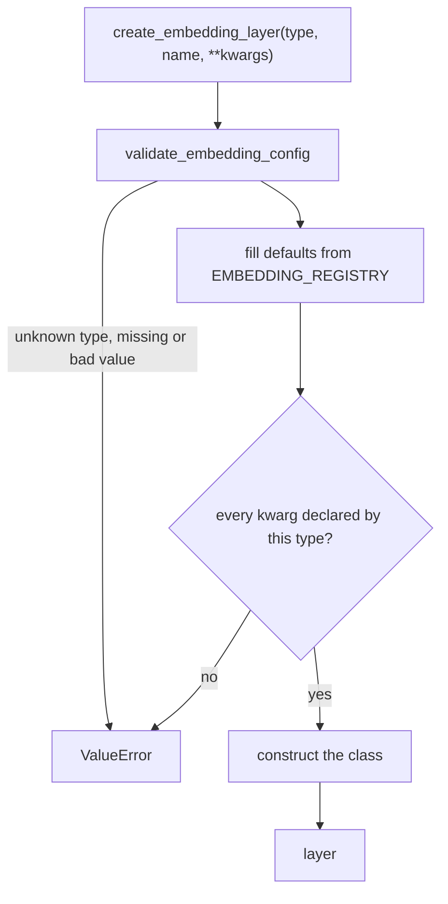

# embedding

Keras 3 layers that turn raw inputs (pixels, token ids, timesteps, coordinates) into vectors a transformer can use, and layers that tell a transformer where each token sits. It also holds a factory that builds sixteen of these layers from a string key.

Path: `src/dl_techniques/layers/embedding/` in the `dl_techniques` library. Import path: `dl_techniques.layers.embedding`.

## What it is for

A transformer sees a bag of vectors. Before it can work, someone has to cut an image into patches, look words up in a table, or encode a diffusion timestep. It also has no idea about order or position until something adds that. This package supplies those pieces in one place, so models do not each carry a private copy.

The layers fall into six groups:

- Tokenizers that cut raw data into vectors: image patches (2D), time series patches (1D), video tubelets (3D).
- Word and token tables: BERT, ModernBERT, ALBERT-style factorized, and a compressed codebook table.
- Absolute position encodings added to a sequence: a learned table, and fixed sinusoidal tables for 2D feature maps and for coordinates.
- Rotary position embeddings (RoPE), which rotate query and key vectors inside attention: plain, dual global/local, 2D axial, 3D multi-axis, and 3D video.
- Conditioning embeddings for diffusion models: timestep, scalar, and class label with a "no label" row for classifier-free guidance.
- Special tokens for vision transformers: class token, register tokens, mask token, and a present/absent flag vector.

## How it works

Most layers are small and independent. The package has one shared control path, the factory:



Every failure leaves the factory as a `ValueError`, including the ones that start as a `TypeError`. A keyword the chosen type does not declare is rejected (it is never silently dropped), and the message contains the text held in `STRICT_DROPPED_KEY_MARKER`.

Not every layer is in the factory. Sixteen are. Eight must be imported from their own module (see Files).

Rotary layers do not add anything to the token. They take query and key tensors shaped `(batch, heads, seq_len, head_dim)` and rotate pairs of channels by an angle that depends on the position. After rotation, the dot product of a query and a key depends only on how far apart the two tokens are.

## Files

- `__init__.py` - exports 11 names: `AxialRoPE2D`, `ClassLabelEmbedding`, `TimestepEmbedding`, `STRICT_DROPPED_KEY_MARKER`, the factory functions `create_embedding_layer`, `create_embedding_from_config`, `validate_embedding_config`, and the four sin-cos table builders. All other classes are imported from their own module.
- `factory.py` - `EMBEDDING_REGISTRY` (16 keys), `get_embedding_info()`, `validate_embedding_config()`, `create_embedding_layer()`, `create_embedding_from_config()`.
- `patch_embedding.py` - `PatchEmbedding2D` (image to patch tokens) and `PatchEmbedding1D` (series to patch tokens, may overlap, NaN replaced by zero).
- `patch_embed_3d.py` - `PatchEmbed3D`, video clip to tubelet tokens with one `Conv3D`.
- `positional_embedding.py` - `PositionalEmbedding`, learned absolute table added to a sequence.
- `positional_embedding_sine_2d.py` - `PositionEmbeddingSine2D`, fixed DETR-style 2D code, channels-first output.
- `rotary_position_embedding.py` - `RotaryPositionEmbedding`, plain RoPE with a rotated fraction.
- `dual_rotary_position_embedding.py` - `DualRotaryPositionEmbedding`, two RoPE tables (global and local base) chosen per call.
- `axial_rope_2d.py` - `AxialRoPE2D`, RoPE by 2D grid position, matching SAM 2.
- `multi_axis_rope.py` - `Ideogram4MRoPE` (builds cos/sin tables from `(t, h, w)` ids) plus the module functions `apply_rotary_pos_emb` and `_rotate_half`.
- `video_rope.py` - `VideoRoPE3D`, RoPE with separate channel bands for frame, height and width.
- `continuous_rope_embedding.py` - `ContinuousRoPE`, turns continuous N-D coordinates into RoPE phase angles.
- `continuous_sin_cos_embedding.py` - `ContinuousSinCosEmbed`, fixed sin/cos code of continuous coordinates.
- `sincos_pos_embed_2d.py` - pure NumPy `get_1d_sincos_pos_embed_from_grid`, `get_2d_sincos_pos_embed_from_grid`, `get_2d_sincos_pos_embed`.
- `sincos_pos_embed_3d.py` - pure NumPy `get_3d_sincos_pos_embed` for video grids.
- `bert_embeddings.py` - `BertEmbeddings` (word + position + optional segment, normalized), plus `VALID_NORMALIZATION_TYPES` and `VALID_POSITION_EMBEDDING_TYPES`.
- `modern_bert_embeddings.py` - `ModernBertEmbeddings`, word + segment only, every argument required.
- `albert_factorized_embedding.py` - `AlbertFactorizedEmbedding`, small table then a shared projection.
- `hierarchical_codebook_embedding.py` - `HierarchicalCodebookEmbedding`, token id split into bit chunks, one small table per chunk, summed.
- `class_label_embedding.py` - `ClassLabelEmbedding`, label table with an optional extra "unconditional" row.
- `timestep_embedding.py` - `TimestepEmbedding`, DiT/GLIDE timestep embedder.
- `scalar_sinusoidal_embedding.py` - `ScalarSinusoidalEmbedding`, Ideogram4 scalar embedder.
- `rep_conditional_pos_enc.py` - `RepConditionalPosEnc`, `depthwise_conv(x) + x` on a channels-last feature map.
- `class_token.py` - `ClassTokenPrepend`, adds one learnable `[CLS]` token at the front.
- `register_tokens.py` - `RegisterTokens`, a bank of independent learnable tokens broadcast to the batch.
- `mask_token.py` - `MaskTokenApply`, replaces flagged positions with a learnable token.
- `state_indicator_embedding.py` - `StateIndicatorEmbedding`, adds one of two learned vectors per sample, chosen by a boolean flag.

## How to use it

Build from the factory:

```python
import keras
from dl_techniques.layers.embedding import create_embedding_layer

patch = create_embedding_layer('patch_2d', patch_size=16, embed_dim=64)
patch(keras.random.normal((2, 32, 32, 3))).shape        # (2, 4, 64)

rope = create_embedding_layer('rope', head_dim=64, max_seq_len=128)
rope(keras.random.normal((2, 8, 16, 64))).shape         # (2, 8, 16, 64)
```

Build from a config dict (the `type` key picks the layer):

```python
from dl_techniques.layers.embedding import create_embedding_from_config

bert = create_embedding_from_config({
    'type': 'bert_embeddings', 'vocab_size': 30522, 'hidden_size': 768,
    'max_position_embeddings': 512, 'type_vocab_size': 2,
})
```

Check a config without building anything, and read every default:

```python
from dl_techniques.layers.embedding import validate_embedding_config
from dl_techniques.layers.embedding.factory import get_embedding_info   # not re-exported

validate_embedding_config('rope', head_dim=64, max_seq_len=128)
info = get_embedding_info()['bert_embeddings']
print(info['required_params'], info['optional_params'])
```

Import a layer that has no factory key:

```python
import keras
from dl_techniques.layers.embedding.video_rope import VideoRoPE3D

q = keras.random.normal((2, 4, 18, 24))
q_rot, k_rot = VideoRoPE3D(head_dim=24)(
    q, q, num_frames=2, height_patches=3, width_patches=3)
```

Factory keys: `patch_1d`, `patch_2d`, `positional_learned`, `positional_sine_2d`, `scalar_sinusoidal`, `rope`, `dual_rope`, `continuous_rope`, `continuous_sincos`, `mrope_ideogram4`, `bert_embeddings`, `modern_bert_embeddings`, `albert_factorized`, `class_label`, `timestep`, `rep_conditional_pos_enc`.

Direct import only: `AxialRoPE2D` (also re-exported from the package), `ClassTokenPrepend`, `MaskTokenApply`, `RegisterTokens`, `StateIndicatorEmbedding`, `HierarchicalCodebookEmbedding`, `PatchEmbed3D`, `VideoRoPE3D`.

## Things to know

- Rotary layers take a post-head-split 4D tensor `(batch, heads, seq_len, head_dim)`. A 3D projection output raises `ValueError`. Reshape and transpose first.
- RoPE has two ways of pairing channels, and the wrong one trains fine but gives wrong numbers with a foreign checkpoint. Interleaved (channel 0 with 1, 2 with 3): `RotaryPositionEmbedding`, `AxialRoPE2D`, `VideoRoPE3D`. Split-half (channel `j` with `j + head_dim/2`): `DualRotaryPositionEmbedding`, `Ideogram4MRoPE` with `apply_rotary_pos_emb`. Loading weights across the two needs the `q_proj`/`k_proj` rows permuted.
- `positional_sine_2d` takes channels-last input and returns channels-first `(batch, 2*num_pos_feats, H, W)`. `num_pos_feats` must be even.
- `timestep` and `scalar_sinusoidal` are not interchangeable. `TimestepEmbedding` divides its frequency ladder by `half` and emits `[cos, sin]` with no input rescale. `ScalarSinusoidalEmbedding` divides by `half - 1`, emits `[sin, cos]` and first rescales the input onto `[0, 1e4]`.
- `get_1d_sincos_pos_embed_from_grid` is sin-first and `TimestepEmbedding` is cos-first. Both are intended.
- Fixed tables must be installed as non-trainable weights through an initializer. Doing `add_weight` and then `.assign()` inside `build()` leaves the table at zero in real models, because Keras discards the assign during its symbolic build.
- `class_label` has `num_classes + 1` rows when `dropout_rate > 0` and `num_classes` rows when it is 0. `force_drop_ids` raises when `dropout_rate` is 0.
- `bert_embeddings` needs `type_vocab_size` unless `use_token_type_embeddings=False`. Its `layer_norm_eps` default is `1e-8`.
- `HierarchicalCodebookEmbedding` has `epsilon=1e-3` by default (Keras' default). Pass `epsilon=1e-6` for a new model.
- `AxialRoPE2D` needs a static token axis, and the query token count must equal `H * W` of `feat_shape`.
- `PositionalEmbedding` raises in `build()` when a static sequence length exceeds `max_seq_len`. Reloading a saved model only warns.
- `continuous_rope` and `continuous_sincos` no longer accept `assert_positive`. Old saved configs that carry it still load, with a warning.
- The cos/sin and frequency tables of `RotaryPositionEmbedding`, `DualRotaryPositionEmbedding`, `Ideogram4MRoPE`, `ContinuousRoPE` and `ContinuousSinCosEmbed` are non-trainable weights, so they are saved with the model. A `.keras` file written before the table-initializer fix (2026-08-15, per code comments) can hold all-zero tables for `rope`, and loading it does not repair them.
- Some text in `__init__.py` and `factory.py` docstrings is stale: `__init__.py` says 23 classes and seven direct-import classes, and the `create_embedding_layer` docstring says 15 types. The code has 24 classes, 16 factory keys and eight direct-import classes.
