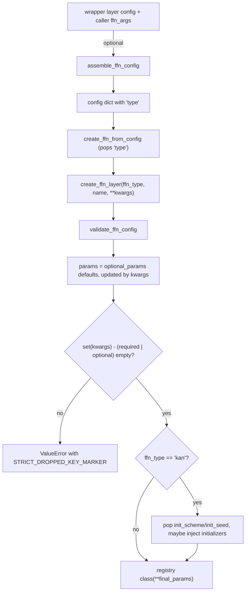

# ffn

Path: `src/dl_techniques/layers/ffn/`
Purpose: 20 feed-forward / MLP-style Keras 3 layer classes plus a strict string-keyed factory (`FFN_REGISTRY`, 22 keys) that builds any of them.

## Scope

In: the layer classes (one module each, except `logic_ffn.py` which also holds two preset functions), `factory.py` (registry, validation, construction, wrapper-config assembly), `__init__.py` (curated exports, `__all__` of 27 names).

Out: attention, normalization, embeddings (own packages under `layers/`). The transformer blocks and task heads that consume this factory live elsewhere (`layers/transformers/`, `layers/heads/`, `layers/moe/experts.py`, `models/...`). They build FFNs through `create_ffn_layer` / `assemble_ffn_config`. This package imports none of them.

## Architecture



- Registry is one dict, `FFN_REGISTRY: Dict[str, Dict[str, Any]]`. Direct class import bypasses it entirely.
- Everything inside `create_ffn_layer` runs in one `try`; `TypeError` and `ValueError` are logged with `logger.error` and re-raised as a single `ValueError(... ) from e`. That includes the strict-key error and constructor failures.
- Layers follow the Keras 3 pattern: sub-layers created in `__init__`, explicitly built in `build()` in call order, `self.built` guard first, `super().build()` last.

## Key files

| File | Role | Notes |
| --- | --- | --- |
| `factory.py` | Registry and all factory functions | 1075 lines; most of it is registry entries and DECISION comments |
| `__init__.py` | Re-exports 20 classes + 7 factory names | Docstring states "20 classes / 22 keys" |
| `mlp.py` | `MLPBlock` | Registry key `mlp`; dropout is `None` at rate 0; extra `output_kernel_initializer` |
| `swiglu_ffn.py` | `SwiGLUFFN` | Hidden width from 2/3 rule; dropout after `down_proj`; has `num_parameters` property |
| `glu_ffn.py` | `GLUFFN` | Backs `glu`, `reglu`, `bilinear`; activation via `keras.activations.get` |
| `geglu_ffn.py` | `GeGLUFFN` | One `Dense(2H)` split in half; no `built` guard in `build()` |
| `gelu_mlp_ffn.py` | `GELUMLPFFN` | `gelu_tanh` fixed; no initializer/regularizer args; `fc2` re-created in `build()` when `output_dim=None` |
| `orthoglu_ffn.py` | `OrthoGLUFFN` | Two `OrthoBlock`s from `layers/structured_linear/orthoblock.py`; no initializer args |
| `diff_ffn.py` | `DifferentialFFN` | Odd-symmetry push-pull; `verify_odd_symmetry()` |
| `residual_block.py` | `ResidualBlock` | Dense shortcut always present |
| `swin_mlp.py` | `SwinMLP` | `fc2` created in `build()`; has `activity_regularizer` |
| `squared_relu_ffn.py` | `SquaredReLUFFN` | Fixed `square(relu(x))` |
| `lowrank_ffn.py` | `LowRankFFN` | `u1,v1,u2,v2`; `rank` resolved in `__init__`, config keeps `_rank_arg` |
| `monarch_ffn.py` | `MonarchFFN` | Weights via `add_weight` in `build()`; einsum Monarch map |
| `mlp_mixer_block.py` | `MixerBlock` | Rank-3 only, `S` and `C` static; back-projections created in `build()` |
| `gated_dconv_ffn.py` | `GatedDConvFeedForward` | Rank-4 NHWC; `exact_gelu` on first chunk |
| `gated_mlp.py` | `GatedMLP` | Three 1x1 `Conv2D`; five allowed activation names |
| `power_mlp_layer.py` | `PowerMLPLayer` | Uses `ReLUK`, `BasisFunction` from `layers/activations/` |
| `kan_linear.py` | `KANLinear` | B-spline basis (Cox-de Boor); `update_grid_from_samples()`; `grid` is a non-trainable weight with `autocast=False` |
| `tversky_projection.py` | `TverskyProjectionLayer` | Separable fast path vs chunked broadcast; `diagnose()`, `verify_fast_path()`; exports `VALID_*_REDUCTIONS` frozensets |
| `counting_ffn.py` | `CountingFFN` | Rank-3, mask-aware, sequential `keras.ops.scan`; `verify_mask_invariance()` |
| `logic_ffn.py` | `LogicFFN` + `create_logic_ffn_standard`, `create_logic_ffn_regularized` | Presets are not in `__init__.py` or the registry |
| `README.md` | Human-facing overview | Keep in step with the registry |

## Public interface

Exported from `dl_techniques.layers.ffn`:

```python
create_ffn_layer(ffn_type: FFNType, name: Optional[str] = None, **kwargs) -> keras.layers.Layer
create_ffn_from_config(config: Dict[str, Any]) -> keras.layers.Layer   # needs 'type'; config copied
validate_ffn_config(ffn_type: str, **kwargs) -> None                   # raises ValueError
assemble_ffn_config(ffn_type: str, wrapper_config: Mapping, caller_args: Optional[Mapping] = None,
                    *, passthrough: Sequence[str] = ('type', 'name')) -> Dict[str, Any]
get_ffn_info() -> Dict[str, Dict[str, Any]]    # deepcopy of FFN_REGISTRY (class objects shared)
STRICT_DROPPED_KEY_MARKER: str = "unsupported parameter(s)"
FFNType  # Literal of the 22 keys
```

`validate_ffn_config` checks, in order: key exists; all `required_params` present; `dropout_rate` in `[0.0, 1.0)`; every given non-`None` dim in `hidden_dim, output_dim, count_dim, logic_dim, filters, units, features, num_features, tokens_mlp_dim, channels_mlp_dim` is positive; per-type rules (`swiglu`, `counting`, `logic`, `gated_mlp`, `monarch`, `lowrank`, `power_mlp`, `kan`, `tversky`); activation strings (`activation`, `branch_activation`, `attention_activation`, `output_activation`) other than `'linear'` resolve via `keras.activations.get`; `kernel_initializer` / `bias_initializer` strings resolve via `keras.initializers.get`. It does not check for unknown keys.

`assemble_ffn_config` keeps wrapper keys that are in `required | optional | passthrough` of the target type, then `update`s with `caller_args` unfiltered. Neither input is mutated. Unknown type raises `ValueError`.

Layer classes (all `keras.layers.Layer`, each registered with `@register_dl_technique("dl_techniques.layers.ffn.<module>")`): `MLPBlock`, `SwiGLUFFN`, `DifferentialFFN`, `GLUFFN`, `GeGLUFFN`, `GELUMLPFFN`, `GatedMLP`, `OrthoGLUFFN`, `PowerMLPLayer`, `ResidualBlock`, `SwinMLP`, `LogicFFN`, `CountingFFN`, `KANLinear`, `TverskyProjectionLayer`, `MonarchFFN`, `MixerBlock`, `SquaredReLUFFN`, `LowRankFFN`, `GatedDConvFeedForward`.

## Data shapes

Registry entry (every one of the 22 has all six keys):

```python
'mlp': {
    'class': MLPBlock,
    'description': str,
    'required_params': ['hidden_dim', 'output_dim'],
    'output_dim_param': 'output_dim',   # arg that sets compute_output_shape(...)[-1]; None when out width == in width
    'optional_params': {'activation': 'gelu', 'dropout_rate': 0.0, ...},   # default values injected by the factory
    'use_case': str,
}
```

`output_dim_param` values: `output_dim` for most; `filters` (`gated_mlp`), `features` (`kan`), `units` (`power_mlp`, `tversky`); `None` for `mixer` and `gated_dconv`.

Required params by key: `output_dim` only: `swiglu`. `hidden_dim` only: `gelu_tanh`, `swin_mlp`. `hidden_dim, output_dim`: `mlp, geglu, glu, reglu, bilinear, differential, residual, squared_relu, lowrank, monarch, orthoglu`. Others: `mixer` (`tokens_mlp_dim, channels_mlp_dim`), `gated_dconv` (`dim`), `gated_mlp` (`filters`), `power_mlp` (`units`), `kan` (`features`), `tversky` (`units, num_features`), `counting` (`output_dim, count_dim`), `logic` (`output_dim, logic_dim`).

Registry defaults worth knowing: `counting.counting_scope='causal'`; `swiglu.use_bias=False`, `ffn_expansion_factor=4`, `ffn_multiple_of=256`, `hidden_dim=None`; `gated_dconv.ffn_expansion_factor=2.66`, `use_bias=False`; `power_mlp.kernel_initializer='he_normal'`, `k=3`; `kan` extras `init_scheme=None`, `init_seed=None` (factory-only); `tversky.difference_reduction='subtractmatch'`.

Per-class behaviour that differs (read before wrapping or swapping types):

| Class | Dropout layer | Activation resolver | Input contract |
| --- | --- | --- | --- |
| `MLPBlock` | `None` at rate 0, after activation | `activations.common.resolve_activation` | rank >= 2; `build()` has no None check |
| `SwiGLUFFN` | `None` at rate 0, after `down_proj` | fixed `keras.ops.silu` | rank >= 2; `build()` has no None check |
| `GLUFFN`, `GeGLUFFN`, `OrthoGLUFFN` | always present, after gating | `keras.activations.get`; GeGLU uses `activations.gelu_tanh.resolve_activation` | last axis static, checked in `build()` |
| `ResidualBlock` | `None` at rate 0, between Denses | `common.resolve_activation` | rank >= 2; `build()` has no None check |
| `SwinMLP` | `drop1` and `drop2`, always present | `common.resolve_activation` | rank >= 2 and last axis static, both checked in `build()` |
| `GELUMLPFFN`, `MonarchFFN`, `DifferentialFFN` | always present | fixed / `keras.activations.get` (Monarch) / `common.resolve_activation` | last axis static, checked in `build()` |
| `SquaredReLUFFN`, `LowRankFFN` | always present | fixed / `common.resolve_activation` | rank >= 2; `build()` has no None check |
| `MixerBlock` | `token_dropout`, `channel_dropout` | `keras.activations.get` | rank 3, `S` and `C` static |
| `CountingFFN` | none | `common.resolve_activation` | rank 3 and last axis static, checked in `build()`; optional `mask` argument in `call` |
| `GatedMLP` | none | five names only, `deserialize_activation` | rank 4, `data_format`; `build()` has no None check |
| `GatedDConvFeedForward` | none | fixed `exact_gelu` | rank 4 NHWC; last axis must equal `dim` only when it is not None (a None passes the check) |

## Invariants and constraints

- **Strict keys.** `create_ffn_layer` raises on any key outside `required | optional` of the type. Never change this to filter-and-drop. Wrappers that push generic defaults must go through `assemble_ffn_config`.
- **Registry keys, `FFNType`, `required_params`, `optional_params` are public API.** They are read by config-driven callers and guarded by `tests/test_layers/test_factory_registry_drift.py`. Adding, renaming, removing is a breaking change.
- **Registry defaults must be accepted by the class.** Every `optional_params` key is injected on every call. A key the class `__init__` does not take makes every `create_ffn_layer` call for that type fail with `TypeError` wrapped as `ValueError`. `differential` must not get a `gate_activation` key (the class has no such argument).
- **`counting.counting_scope` default stays `'causal'`.** `'local'` is bidirectional and breaks autoregressive models.
- **`output_dim_param` is `None` for `mixer` and `gated_dconv`** on purpose: their output width equals the input width and is not a free choice. Do not set it to `channels_mlp_dim` or `dim`.
- **`gated_dconv` is rank-4 only.** Do not add a rank-3 path, special-case it in the factory, or exempt it from test grids that parametrize all registry keys over rank-3 input (per a comment in `factory.py`, those grids classify only the strict-key marker as failure and swallow other exceptions, so it passes there without running).
- **`output_kernel_initializer` exists only in the `mlp` entry.** Adding it to another entry would turn a wrong-type error into a silent no-op.
- **`dropout_rate` is half-open `[0.0, 1.0)`** in the factory and in every class. `keras.layers.Dropout` rejects 1.0 at training time. Do not widen it.
- **Per-Dense initializer clones.** Same-shape projections take `clone_initializer(...)` copies (gate/value, `u1/u2`, `v1/v2`, Monarch factors, `conv_gate/conv_up`, ...). A shared instance replays the same draw and makes the projections identical. A seeded initializer still reproduces itself in each clone.
- **`activity_regularizer` in `SwinMLP`** is set on the layer only and never forwarded to `fc1`/`fc2`, so it is charged once.
- **`DifferentialFFN` oddness** needs `tie_branches=True`, `norm_diff` with `center=False`, and a bias-free `output_proj`. Changing any one breaks `y(-x) = -y(x)`.
- **`KANLinear.grid`** is initialized through the weight initializer, not `.assign()` in `build()` (Keras 3 `StatelessScope` discards that assign). `update_grid_from_samples()` is the runtime writer. It is `autocast=False` so the basis recursion runs in the variable dtype.
- **`TverskyProjectionLayer`:** shared banks are held behind `_SharedRef` so Keras does not adopt them. They are not serialized. With `non_negative_contrast=True` the stored `theta/alpha/beta` are pre-softplus values.
- **`get_config()` returns the constructor argument, not the resolved value** for `SwiGLUFFN.hidden_dim` (`_hidden_dim_arg`), `LowRankFFN.rank` (`_rank_arg`), `GELUMLPFFN.output_dim`, `SwinMLP.output_dim`. A reload re-resolves.
- **`CountingFFN` recurrence runs in float32** whatever the compute dtype, via sequential `keras.ops.scan`. Do not go back to `associative_scan`: it recurses forever at sequence length 1 and fails inside `tf.function`.
- **No print statements.** Logging is `dl_techniques.utils.logger.logger`. The factory logs every constructor parameter at INFO.

## Dependencies

Internal:
- `dl_techniques.utils.keras_registration.register_dl_technique` (registration), `dl_techniques.utils.logger.logger`.
- `dl_techniques.initializers.clone.clone_initializer` (also importable as `dl_techniques.initializers.clone_initializer`).
- `dl_techniques.initializers.kan_initializer.create_kan_initializers`, `VALID_KAN_SCHEMES` (factory, `kan` only).
- `dl_techniques.layers.activations.common` (`resolve_activation`, `serialize_activation`), `.gelu_tanh` (`gelu_tanh`, `resolve_activation`), `.exact_activations` (`exact_gelu`, `exact_name`), `.relu_k.ReLUK`, `.basis_function.BasisFunction`.
- `dl_techniques.layers.structured_linear.orthoblock.OrthoBlock` (`OrthoGLUFFN`).
- `dl_techniques.utils.activation_serialization` (`GatedMLP` only).

Consumers (found by grep): `layers/transformers/transformer.py`, `layers/transformers/transformer_decoder.py`, `layers/heads/{nlp,vision,vlm}`, `layers/moe/experts.py`, `layers/fnet_encoder_block.py`, `layers/time_series/*`, several `models/` packages (for example `models/language/qwen/qwen3.py`).

External: `keras` (>= 3.8, `keras.ops` only for tensor math), `copy`, `math` (counting). TensorFlow is the tested backend; `CountingFFN` and `KANLinear` comments describe TF-backend behaviour.

## Failure modes

- Unknown key: `ValueError("Unknown FFN type ...")`, wrapped.
- Missing required param: `ValueError("Required parameters missing ...")`.
- Unsupported kwarg: `ValueError` containing `unsupported parameter(s)`, listing the offending and accepted names. The outer wrapper prefixes `Failed to create <type> FFN layer (...)`.
- `kan` with `init_scheme` not in `VALID_KAN_SCHEMES`: `ValueError`. If the caller also passes `kernel_initializer` or `base_scaler_initializer`, that value wins over the scheme and a `logger.warning` is emitted. The injection is per key.
- `tversky` default pair (`product` + `subtractmatch`) on rank > 2: `ValueError` raised from `build()`.
- `monarch` with width not divisible by `nblocks`: `ValueError` (`input_dim` checked in `build()`).
- `mixer` with rank != 3 or a `None` `S` / `C`: `ValueError` in `build()`.
- `gated_dconv` with rank != 4 or channel mismatch: `ValueError` in `build()`.
- `counting` with rank != 3: `ValueError` in `build()`. `CountingFFN` under XLA (`jit_compile=True`): training fails when differentiating the scan's `while_loop`. Pass `jit_compile=False`.
- `PowerMLPLayer` raises `TypeError` for non-int `units` or `k`, before the range check. The factory re-raises it as `ValueError`.
- **None last axis, derived from each `build()` (20 classes).** These 12 raise `ValueError` explicitly: `GLUFFN`, `GeGLUFFN`, `OrthoGLUFFN`, `GELUMLPFFN`, `SwinMLP`, `DifferentialFFN`, `MonarchFFN`, `KANLinear`, `LogicFFN`, `CountingFFN`, `TverskyProjectionLayer`, and `MixerBlock` (which checks both `S` and `C`). These 8 have no such check: `MLPBlock`, `SwiGLUFFN`, `SquaredReLUFFN`, `ResidualBlock`, `LowRankFFN`, `PowerMLPLayer`, `GatedMLP`, `GatedDConvFeedForward` (its channel check is skipped when the axis is None). In those 8 the None reaches the sub-layer `build()` calls, so any error comes from Keras, not from this package.
- `SwiGLUFFN` out-of-range `dropout_rate` message says `[0, 1]` although the check is half-open. Tests match that text, so do not reword it casually.

## Working here

Add a new FFN type:
1. New module `<name>.py`, class registered with `@register_dl_technique("dl_techniques.layers.ffn.<name>")`; implement `__init__`, `build` (build sub-layers explicitly), `call`, `compute_output_shape`, `get_config` (all constructor args). Use `clone_initializer` per Dense; dropout bound `[0.0, 1.0)`.
2. Import it in `factory.py` and `__init__.py`; add it to `__all__`.
3. Add the key to the `FFNType` Literal and a `FFN_REGISTRY` entry with all six fields. Every `optional_params` key must be a real constructor argument. Set `output_dim_param` honestly.
4. Add per-type rules to `validate_ffn_config` if the class has constraints; add new dimension names to its `positive_dims` list.
5. Update the counts that appear as text: "20 classes" / "22 keys" in the `__init__.py` docstring, three places in `factory.py` docstrings (module docstring, the `Variants (FFN_REGISTRY, 22 entries)` table in `create_ffn_layer`, the `FFNType` mention), `README.md`, and any doc elsewhere in the repo that states 22 (grep `22`).
6. Add `tests/test_layers/test_ffn/test_<name>.py` and a case in `test_factory.py` (it has `TestOutputDimParamRegistryField`). Keep `tests/test_layers/test_factory_registry_drift.py` green.

Change a default or a parameter name: treat as a breaking change to the public registry. Check callers with `grep -rn "ffn_args\|create_ffn_layer\|assemble_ffn_config" src/`.

Conventions: Sphinx/reST docstrings (`:param:`, `:type:`, `:raises:`), type hints, `import keras` then qualify (`keras.ops.split`), `keras.ops` only, no raw TensorFlow ops.

Tests (run from the repo root, scoped; do not run the full suite):

```bash
.venv/bin/python -m pytest tests/test_layers/test_ffn/ -q
.venv/bin/python -m pytest tests/test_layers/test_factory_registry_drift.py -q
```

Other test modules in that directory worth knowing: `test_initializer_independence.py` (clone rule), `test_reglu_bilinear_alias.py`, `test_gated_dconv_ffn.py` (rank contract, truncation of the hidden width).
