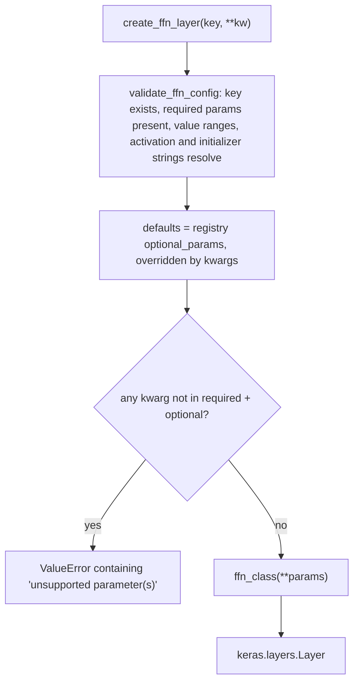

# dl_techniques.layers.ffn

Twenty feed-forward layer classes (Keras 3 layers) and one factory that builds any of them from a string key. Path: `src/dl_techniques/layers/ffn/`.

`create_ffn_layer(ffn_type, name=None, **kwargs)` looks the key up in `FFN_REGISTRY` (22 keys over the 20 classes: `glu`, `reglu` and `bilinear` are three configurations of one class, `GLUFFN`), checks the arguments, fills in registry defaults and constructs the layer. A keyword the chosen type does not declare raises `ValueError`. It is never silently dropped.

## What it is for

A transformer block usually has an attention part and a feed-forward part (FFN) that transforms every token on its own. Many variants of that second part exist: plain MLP, gated units (GLU family), structured or factorized matrices, convolutional gating, and some research variants (soft logic, counting, Kolmogorov-Arnold, Tversky similarity). This package keeps them all behind one construction interface, so a model or a wrapper layer can pick the FFN with a config string instead of hard-coding a class.

Use the factory when the FFN type comes from a config. Import the class directly when the choice is fixed.

## How it works



- Any `TypeError` or `ValueError` raised during these steps is caught and re-raised as one `ValueError` that names the type, its required parameters and the parameters given, chained to the original error.
- `create_ffn_from_config({'type': ..., ...})` pops `'type'` and forwards the rest, `'name'` included.
- `assemble_ffn_config(ffn_type, wrapper_config, caller_args)` is for wrapper layers (for example a transformer block) that carry generic defaults such as `activation` or `dropout_rate`. It drops the wrapper keys the target type does not accept, then merges `caller_args` on top without filtering, so a typo from the end user still reaches the factory and still raises.
- `get_ffn_info()` returns a deep copy of the registry: `class`, `description`, `required_params`, `output_dim_param`, `optional_params`, `use_case` for each key. `output_dim_param` names the constructor argument that sets the output width. It is `None` for `mixer` and `gated_dconv`, whose output width equals the input width.
- `kan` accepts two factory-only keys, `init_scheme` and `init_seed`. The factory pops them and turns them into initializers through `create_kan_initializers`. They are not `KANLinear` arguments.

## Files

- `__init__.py` - re-exports the 20 classes and the factory interface (`__all__` has 27 names).
- `factory.py` - `FFN_REGISTRY`, `FFNType`, `create_ffn_layer`, `create_ffn_from_config`, `validate_ffn_config`, `assemble_ffn_config`, `get_ffn_info`, `STRICT_DROPPED_KEY_MARKER`.
- `mlp.py` - `MLPBlock`, Dense, activation, Dense.
- `swiglu_ffn.py` - `SwiGLUFFN`, SiLU-gated unit with a derived hidden width.
- `glu_ffn.py` - `GLUFFN`, gate and value projections; backs `glu`, `reglu`, `bilinear`.
- `geglu_ffn.py` - `GeGLUFFN`, one wide Dense split into gate and value.
- `gelu_mlp_ffn.py` - `GELUMLPFFN`, MLP with tanh-approximate GELU (Stable Diffusion 3 style).
- `orthoglu_ffn.py` - `OrthoGLUFFN`, GLU built from two `OrthoBlock`s with an orthonormality penalty.
- `diff_ffn.py` - `DifferentialFFN`, push-pull layer whose output is an exactly odd function of its input.
- `residual_block.py` - `ResidualBlock`, two-layer MLP plus a Dense shortcut.
- `swin_mlp.py` - `SwinMLP`, MLP with two dropouts and optional output width.
- `squared_relu_ffn.py` - `SquaredReLUFFN`, Primer FFN with `relu(x)**2`.
- `lowrank_ffn.py` - `LowRankFFN`, each projection split into two Dense layers through a rank bottleneck.
- `monarch_ffn.py` - `MonarchFFN`, projections as order-2 Monarch matrices (two block-diagonal factors).
- `mlp_mixer_block.py` - `MixerBlock`, MLP-Mixer token-mixing and channel-mixing block.
- `gated_dconv_ffn.py` - `GatedDConvFeedForward`, Restormer gated depthwise-conv FFN.
- `gated_mlp.py` - `GatedMLP`, channel gating from three 1x1 convolutions.
- `power_mlp_layer.py` - `PowerMLPLayer`, ReLU-k branch plus Swish branch.
- `kan_linear.py` - `KANLinear`, learnable B-spline activation per connection.
- `tversky_projection.py` - `TverskyProjectionLayer`, Tversky-similarity projection against learned prototypes.
- `counting_ffn.py` - `CountingFFN`, decay-weighted event density over a sequence, gated into a residual.
- `logic_ffn.py` - `LogicFFN`, soft AND/OR/XOR mix; also the helper functions `create_logic_ffn_standard` and `create_logic_ffn_regularized` (not exported from `__init__.py`).

## Catalogue

| Key | Class | What it is | Required params |
|---|---|---|---|
| `mlp` | `MLPBlock` | Dense, activation (default `gelu`), Dense. The default transformer FFN. | `hidden_dim`, `output_dim` |
| `swiglu` | `SwiGLUFFN` | SwiGLU. Hidden width derived from `ffn_expansion_factor` unless `hidden_dim` is given. LLaMA-style, no bias by default. | `output_dim` |
| `geglu` | `GeGLUFFN` | GELU-gated linear unit. | `hidden_dim`, `output_dim` |
| `glu` | `GLUFFN` | Gated linear unit, gate activation `swish`. | `hidden_dim`, `output_dim` |
| `reglu` | `GLUFFN` | Same class with `activation='relu'`. | `hidden_dim`, `output_dim` |
| `bilinear` | `GLUFFN` | Same class with `activation='linear'` (no gate nonlinearity). | `hidden_dim`, `output_dim` |
| `gelu_tanh` | `GELUMLPFFN` | Two-layer MLP, tanh GELU only. `output_dim` optional, defaults to input width. | `hidden_dim` |
| `differential` | `DifferentialFFN` | Splits input into `relu(x)` and `relu(-x)`, runs both through one shared branch, subtracts. | `hidden_dim`, `output_dim` |
| `residual` | `ResidualBlock` | MLP plus a Dense shortcut, summed. | `hidden_dim`, `output_dim` |
| `swin_mlp` | `SwinMLP` | MLP with dropout after the activation and after the output. `output_dim` optional. | `hidden_dim` |
| `squared_relu` | `SquaredReLUFFN` | Fixed `relu(x)**2` activation. No `activation` argument. | `hidden_dim`, `output_dim` |
| `lowrank` | `LowRankFFN` | Each projection is `Dense(rank, no bias)` then `Dense(out)`. | `hidden_dim`, `output_dim` |
| `monarch` | `MonarchFFN` | Monarch-structured projections. `nblocks` must divide all three widths. | `hidden_dim`, `output_dim` |
| `mixer` | `MixerBlock` | MLP-Mixer block. Rank 3 `(B, S, C)` in and out. | `tokens_mlp_dim`, `channels_mlp_dim` |
| `orthoglu` | `OrthoGLUFFN` | GLU with orthonormality-regularized projections. | `hidden_dim`, `output_dim` |
| `gated_dconv` | `GatedDConvFeedForward` | Restormer GDFN. Rank-4 NHWC only, output width equals input width. | `dim` |
| `gated_mlp` | `GatedMLP` | Channel GLU from 1x1 convolutions. Rank 4 only. | `filters` |
| `power_mlp` | `PowerMLPLayer` | ReLU-k branch plus Swish branch. | `units` |
| `kan` | `KANLinear` | B-spline activation per input-output connection. | `features` |
| `tversky` | `TverskyProjectionLayer` | Tversky-similarity scoring against `units` learned prototypes. | `units`, `num_features` |
| `counting` | `CountingFFN` | Event density over the sequence axis, rank 3 only. | `output_dim`, `count_dim` |
| `logic` | `LogicFFN` | Softmax mix of soft AND, OR and XOR. | `output_dim`, `logic_dim` |

Everything else is optional with a registry default. Read the defaults from the registry, not from prose:

```python
from dl_techniques.layers.ffn import get_ffn_info

info = get_ffn_info()['mlp']
print(info['required_params'])            # ['hidden_dim', 'output_dim']
print(sorted(info['optional_params']))
```

## How to use it

```python
from dl_techniques.layers.ffn import create_ffn_layer, create_ffn_from_config

mlp = create_ffn_layer('mlp', hidden_dim=512, output_dim=256, activation='relu', dropout_rate=0.1)
swiglu = create_ffn_layer('swiglu', output_dim=768, ffn_expansion_factor=4)   # hidden_dim becomes 2048

ffn = create_ffn_from_config({
    'type': 'differential',
    'hidden_dim': 1024,
    'output_dim': 512,
    'branch_activation': 'relu',
    'name': 'diff_ffn_block',
})
```

Check a config before building:

```python
from dl_techniques.layers.ffn import validate_ffn_config

validate_ffn_config('swiglu', output_dim=768, ffn_expansion_factor=4)  # returns None, or raises ValueError
```

Direct import when the type is fixed:

```python
from dl_techniques.layers.ffn import MLPBlock, SwiGLUFFN

mlp = MLPBlock(hidden_dim=512, output_dim=256, activation='relu')
swiglu = SwiGLUFFN(output_dim=768)
```

Inside a wrapper layer, store the config dict, not the built layer, so `get_config()` round-trips:

```python
import keras
from dl_techniques.layers.ffn import create_ffn_layer
from dl_techniques.utils.keras_registration import register_dl_technique

@register_dl_technique("my_project.ffn_block")
class FFNBlock(keras.layers.Layer):
    def __init__(self, ffn_config, **kwargs):
        # e.g. {'ffn_type': 'mlp', 'hidden_dim': 8, 'output_dim': 6}
        super().__init__(**kwargs)
        self.ffn_config = dict(ffn_config)
        self.ffn = create_ffn_layer(**self.ffn_config)

    def call(self, inputs, training=None):
        return self.ffn(inputs, training=training)

    def get_config(self):
        return {**super().get_config(), 'ffn_config': self.ffn_config}
```

`register_dl_technique` takes the defining module's dotted path as its package string. A bare `@keras.saving.register_keras_serializable()` is not used in this repo because its `Custom>ClassName` key has no module path, so two same-named classes would share one slot.

## Things to know

- **Input rank varies by type.**
  - Most layers take any rank of 2 or more and change only the last axis.
  - `mixer` needs rank 3 with both `S` and `C` known at build time.
  - `counting` needs rank 3 `(batch, sequence, features)`.
  - `gated_dconv` needs rank 4 NHWC and a last axis equal to `dim`.
  - `gated_mlp` is built on `Conv2D`, so it needs rank 4, `channels_last` or `channels_first`.
  - `gated_dconv` compares the last axis with `dim` only when that axis is known. An unknown (`None`) last axis passes that check.
  - `tversky` with the factory defaults (`product` + `subtractmatch`) accepts rank 2 only. With a separable pair (intersection `product`, `mean` or `gmean`, difference `ignorematch`) it accepts any rank of 2 or more.
- **Unknown last axis.** These types raise `ValueError` in `build()` when the last input axis is `None`: `glu`, `reglu`, `bilinear`, `geglu`, `orthoglu`, `gelu_tanh`, `swin_mlp`, `differential`, `monarch`, `kan`, `logic`, `counting`, `tversky`, and `mixer` (which also needs the token axis known). These types have no such check and leave a `None` to the sub-layers they build: `mlp`, `swiglu`, `squared_relu`, `residual`, `lowrank`, `power_mlp`, `gated_mlp`, `gated_dconv`.
- **`gated_mlp` is not gMLP.** All kernels are 1x1, so nothing mixes across spatial positions. Both branches go through the same activation (default `relu`).
- **`monarch`:** `nblocks` (default 4) must divide `input_dim`, `hidden_dim` and `output_dim`. The first two are checked in `__init__`, the input width in `build`.
- **`swiglu` derives its hidden width.** `int(output_dim * ffn_expansion_factor * 2 / 3)` rounded up to a multiple of `ffn_multiple_of` (256): `output_dim=768` gives 2048. Pass `hidden_dim` to set it exactly. `get_config()` stores the value you passed (possibly `None`), not the computed one.
- **`lowrank`:** `rank=None` resolves to `max(1, hidden_dim // 4)` at construction. `rank <= 0` raises.
- **`squared_relu` has no `activation` argument.** Passing one through the factory raises.
- **`reglu` and `bilinear` return a `GLUFFN`.** An isinstance check cannot tell the three apart. The serialized config carries the `activation`.
- **`differential` expects sign-varying input.** Placed straight after a ReLU, the negative half is all zeros and the push-pull effect disappears. Its output projection has no bias and its difference norm has no beta on purpose, because either would break `y(-x) = -y(x)`. `tie_branches=False` is an ablation switch that destroys the symmetry. `verify_odd_symmetry()` checks it numerically.
- **`counting`:** the default `counting_scope` is `causal`. `local` looks both forward and backward, so it leaks the future and must not be used in autoregressive models. The decay recurrence runs through `keras.ops.scan`, which fails under XLA during training, so pass `jit_compile=False` to `model.compile()` where XLA might be selected. It accepts a Keras padding mask and ignores padded positions.
- **`orthoglu`:** the input projection never has a bias, whatever `use_bias` says. The orthonormality penalty is a loss term, not a hard constraint.
- **`gelu_tanh` and `orthoglu` have no initializer or regularizer arguments.** `gated_dconv` only takes `dim`, `ffn_expansion_factor` and `use_bias`. Passing other keys through the factory raises.
- **`gated_dconv`:** hidden width is `int(dim * ffn_expansion_factor)`, truncated (`dim=48` gives 127).
- **`dropout_rate` must be in `[0.0, 1.0)`.** The upper bound is excluded because `keras.layers.Dropout` crashes at 1.0 during training.
- **An undeclared keyword raises.** `create_ffn_layer('mlp', hidden_dim=8, output_dim=8, foo=1)` raises a `ValueError` whose message contains `unsupported parameter(s)` (exported as `STRICT_DROPPED_KEY_MARKER`).
- **Sub-layers get their own initializer clones**, so same-shape projections (gate and value, for example) do not start from identical weights. A seeded initializer still gives identical copies.
- Tests live in `tests/test_layers/test_ffn/`.
