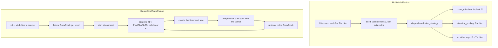

# fusion

Path: `src/dl_techniques/layers/fusion`
Purpose: two Keras 3 layers that fuse several feature tensors into one: `MultiModalFusion` (one tensor per modality, eight strategies) and `HierarchicalScaleFusion` (a fine-to-coarse feature pyramid folded into its finest level).

## Scope

Lives here: two registered `keras.layers.Layer` classes, one module-level helper, and a docstring-only `__init__.py`.

- `MultiModalFusion` and the `FusionStrategy` literal in `multimodal_fusion.py`
- `HierarchicalScaleFusion` and `check_pyramid_shapes` in `hierarchical_fusion.py`

Does not live here:

- The factories the layers build from: `layers/ffn/` (`create_ffn_layer`), `layers/attention/` (`create_attention_layer`), `layers/norms/` (`create_normalization_layer`).
- `ConvBlock` (`layers/conv_blocks/conv_block.py`) and `PixelShuffle2D` (`layers/pooling/pixel_unshuffle.py`), which `HierarchicalScaleFusion` is built from.
- `clone_initializer`, `initializer_spec` (`dl_techniques/initializers/clone.py`).
- The vision-language heads that consume `MultiModalFusion` (`layers/heads/vlm/`).
- There is no factory, no registry and no `create_*` function in this package.

## Architecture

- `MultiModalFusion` creates its sub-layers in `build()`, not `__init__`, because their number and kind depend on the strategy and on the number of modalities. Each strategy has one `_build_*` and one `_call_*` method; `'addition'` and `'multiplication'` share `_build_elementwise` and `_call_elementwise`, so eight keys make seven paths. Only the sub-layers the chosen strategy needs are built.
- Strategy output shapes: `'cross_attention'` returns a tuple of N tensors `(B, Ti, dim)`; `'attention_pooling'` returns `(B, dim)`; the other six return `(B, T, dim)`. `compute_output_shape` encodes the same three-way fork.
- `HierarchicalScaleFusion` creates every sub-layer in `__init__` (it takes `num_levels` for that reason) and builds only the ones `call()` runs. Both upsample paths are created; `build()` builds the sub-pixel pair for `upsample="subpixel"` and the `UpSampling2D` for `"bilinear"`.
- The weighted merge is `(w_a * a + w_b * b) / (w_a + w_b + epsilon)` with `w = relu(fusion_logits[i])`, one pair per fuse step. `fusion_logits` has shape `(num_levels - 1, 2)` and starts at ones.
- The refine step is `y = y + ConvBlock(y)`: conv, norm, activation, then an external residual. The lateral blocks are conv plus norm with a linear (weightless) activation.
- Odd sizes: level `i + 1` must be `ceil(H_i / 2)`. The x2 upsample of an odd level overshoots by one row or column, and `_upsample` crops it back to the finer level's size.

## Key files

| File | Role | Notes |
| --- | --- | --- |
| `__init__.py` | Docstring only | No imports, no `__all__`. `from dl_techniques.layers.fusion import MultiModalFusion` raises `ImportError` |
| `multimodal_fusion.py` | `MultiModalFusion`, `FusionStrategy` | About 1900 lines. 8 strategy keys, 7 call paths. `LENGTH_AGNOSTIC_STRATEGIES` is a class constant |
| `hierarchical_fusion.py` | `HierarchicalScaleFusion`, `check_pyramid_shapes` | `check_pyramid_shapes(shapes, num_levels)` is the one place the pyramid contract lives |

## Public interface

`MultiModalFusion(dim=768, fusion_strategy='cross_attention', num_fusion_layers=1, attention_config=None, ffn_type='mlp', ffn_config=None, norm_type='layer_norm', norm_config=None, num_tensor_projections=8, dropout_rate=0.1, use_residual=True, activation='gelu', kernel_initializer='glorot_uniform', bias_initializer='zeros', kernel_regularizer=None, bias_regularizer=None, **kwargs)`

- `call(inputs, training=None)`: a list or tuple of at least 2 tensors, each `(batch, seq_len, dim)`. `'bilinear'` takes exactly 2.
- Strategy keys: `cross_attention`, `concatenation`, `addition`, `multiplication`, `gated`, `attention_pooling`, `bilinear`, `tensor_fusion`.
- `num_fusion_layers > 1` is accepted for `'cross_attention'` only. `num_tensor_projections` is read by `'tensor_fusion'` only. `dropout_rate` is used by `'concatenation'` only. `use_residual` is read by `'cross_attention'` only.
- FFN is applied by `cross_attention`, `addition` and `multiplication` only. Norm is applied by all but `attention_pooling` and `tensor_fusion`.

`HierarchicalScaleFusion(filters, num_levels, upsample='subpixel', weighted_fusion=True, normalization_type='batch_norm', activation_type='gelu', epsilon=1e-4, kernel_initializer='he_normal', kernel_regularizer=None, **kwargs)`

- `call(inputs, training=None)`: a list of `num_levels` channels-last tensors `(B, H_i, W_i, N_i)`, fine to coarse. Returns `(B, H_0, W_0, filters)`.
- `upsample` is `'subpixel'` (learned) or `'bilinear'` (fixed). `normalization_type` is a norms-factory key. `activation_type` is an activations-factory key or a Keras activation name.

`check_pyramid_shapes(shapes, num_levels) -> None`: raises `ValueError` on a wrong level count, a non-rank-4 shape, or a known size that breaks `H_{i+1} = ceil(H_i / 2)`. `None` sizes pass.

Both layers: `compute_output_shape` works on an unbuilt layer; `get_config` returns every constructor argument.

## Data shapes

`MultiModalFusion` output by strategy:

| Strategy | Output | Builds (besides norm and dropout noted above) |
| --- | --- | --- |
| `cross_attention` | tuple of N, `(B, Ti, dim)` | N-1 cross-attention layers per modality per block, one norm, one FFN |
| `concatenation` | `(B, T, dim)` | Dense, norm, dropout |
| `addition`, `multiplication` | `(B, T, dim)` | align Dense when N > 2, norm, FFN |
| `gated` | `(B, T, dim)` | N sigmoid gates, Dense, norm; no FFN |
| `attention_pooling` | `(B, dim)` | N self-attention layers, Dense |
| `bilinear` | `(B, T, dim)` | Dense, norm |
| `tensor_fusion` | `(B, T, dim)` | `num_tensor_projections` Dense(dim) plus one linear projection |

`HierarchicalScaleFusion` weights, for `L = num_levels` (paths shown for a layer named `fusion`):

| Variable | Shape | Present when |
| --- | --- | --- |
| `fusion/lateral_<i>/lateral_<i>_conv/kernel` | `(1, 1, N_i, filters)`, i in 0..L-1 | always |
| `fusion/lateral_<i>/lateral_<i>_norm/*` | gamma, beta, moving_mean, moving_variance, `(filters,)` each | batch norm |
| `fusion/up_conv_<i>/kernel` | `(3, 3, filters, 4 * filters)`, i in 0..L-2 | `upsample='subpixel'` |
| `fusion/refine_<i>/refine_<i>_conv/kernel` | `(3, 3, filters, filters)`, i in 0..L-2 | always |
| `fusion/refine_<i>/refine_<i>_norm/*` | as the lateral norm | batch norm |
| `fusion/fusion_logits` | `(L - 1, 2)` | `weighted_fusion=True` |

Measured: `filters=8`, 3 levels with channels 4, 8, 16, batch norm, sub-pixel, weighted gives 6148 parameters (counting the non-trainable BN statistics).

Registration keys:

- `dl_techniques.layers.fusion.multimodal_fusion>MultiModalFusion`
- `dl_techniques.layers.fusion.hierarchical_fusion>HierarchicalScaleFusion`

Each also binds the `Custom>ClassName` alias via `register_dl_technique`.

## Invariants and constraints

- Rename or move of either class breaks saved `.keras` archives. The key includes the module path.
- `MultiModalFusion` creating its sub-layers in `build()` is an accepted deviation from the guide's "create in `__init__`" rule (plan-2026-09-07T183458-be1c267e, D-003). It holds only while every `build()`-created sub-layer carries an explicit `name=`; `test_the_fusion_build_matches_the_lazy_build.py` is the guard. Do not add an unnamed sub-layer.
- Equal-length contract: `concatenation`, `addition`, `multiplication`, `gated`, `bilinear` and `tensor_fusion` need the same `seq_len` in every modality and raise a named `ValueError` otherwise. `cross_attention` and `attention_pooling` (`LENGTH_AGNOSTIC_STRATEGIES`) accept different lengths. A `None` sequence axis and rank <= 2 inputs are never refused by this check.
- `'tensor_fusion'` computes no outer product and no tensor decomposition. It is concatenation with a wider non-linear hidden layer. Only `'bilinear'` forms a cross-modal product. Do not "fix" the name or the docstring note.
- `MultiModalFusion` resolves `activation` with `keras.activations.get` on purpose (it passes a `Layer` through and resolves a bare string). Do not swap it for `resolve_activation` (rejects Layers) or `deserialize_activation` (does not resolve strings). Decision anchors D-010 and D-003 in the source record the measurement.
- `MultiModalFusion.from_config` writes into the dict it receives. Pass a copy.
- Initializers: `MultiModalFusion` clones its kernel and bias initializer per Dense so the children do not replay one draw (`test_the_fusion_initializer_does_not_fan_out.py`). `HierarchicalScaleFusion` stores `initializer_spec(kernel_initializer)` and hands the spec to every `ConvBlock` and `Conv2D`, so each conv resolves a fresh instance.
- `HierarchicalScaleFusion` uses `PixelShuffle2D`, not `keras.ops.depth_to_space` and not a Lambda (decision D-002 in `pooling/pixel_unshuffle.py`). Its channel order is `output[b, h*s + i, w*s + j, c] = x[b, h, w, (i*s + j)*C + c]`; a guard pins it.
- `HierarchicalScaleFusion` norm epsilon is the norms-factory default (`1e-6`), not the Keras batch-norm default (`1e-3`). No checkpoint predates this.
- The pyramid contract is checked in `build`, in `call` (static sizes) and in `compute_output_shape`, all through `check_pyramid_shapes`. A layer built on a fully dynamic pyramid still rejects a bad static one at call time.
- `call()` never logs and never branches on a tensor value. Branches are on stored configuration only.
- Inputs to `HierarchicalScaleFusion` are channels-last.

## Dependencies

Internal:

- `MultiModalFusion`: `layers.ffn.create_ffn_layer`, `layers.attention.create_attention_layer`, `layers.norms.create_normalization_layer`, `initializers.clone.clone_initializer`, `utils.keras_registration.register_dl_technique`, `utils.activation_serialization`.
- `HierarchicalScaleFusion`: `layers.conv_blocks.conv_block.ConvBlock`, `layers.pooling.pixel_unshuffle.PixelShuffle2D`, `initializers.clone.initializer_spec`, `utils.keras_registration.register_dl_technique`. `ConvBlock` in turn uses the norms and activations factories.

External: `keras` (`keras.ops`, `keras.layers.Conv2D`, `keras.layers.UpSampling2D`, `keras.layers.Dense`).

Consumers:

- `MultiModalFusion`: `layers/heads/vlm/base.py` (`BaseVLMHead._build_fusion_stack`), used by `ImageTextMatchingHead` and `VisualGroundingHead`. NanoVLM stopped using it on 2026-10-15 because the symmetric `'cross_attention'` leaks future text into a causal model.
- `HierarchicalScaleFusion`: none yet.

## Failure modes

- `MultiModalFusion` constructor: `ValueError` for non-positive `dim` or `num_fusion_layers`, `dropout_rate` outside `[0, 1]`, non-positive `num_tensor_projections` under `'tensor_fusion'`, or `num_fusion_layers > 1` for any strategy but `'cross_attention'`.
- `MultiModalFusion.build`: `ValueError` for fewer than 2 shapes, a shape that is not rank 3, a last axis different from `dim`, or a modality count other than 2 under `'bilinear'`.
- `MultiModalFusion.call`: `ValueError` for fewer than 2 tensors, an unknown strategy key, or unequal static sequence lengths under a length-sensitive strategy.
- `HierarchicalScaleFusion` constructor: `ValueError` for `filters <= 0`, `num_levels < 2`, `epsilon <= 0`, or `upsample` outside `{'subpixel', 'bilinear'}`.
- `HierarchicalScaleFusion` build, call and `compute_output_shape`: `ValueError` for a level count different from `num_levels`, a non-rank-4 shape, or a known size that is not `ceil(H_i / 2)`.
- Passing the `cross_attention` tuple output straight into something expecting one tensor fails downstream, not here. Read the output table first.
- `'attention_pooling'` drops the sequence axis; a consumer that expects `(B, T, dim)` gets `(B, dim)`.

## Working here

- Docstrings are Sphinx/reST (`:param:`, `:type:`, `:raises:`). Match the file you edit; do not convert.
- Use `import keras` and `keras.ops.*` qualified at the call site. Both files already do.
- Adding a `MultiModalFusion` strategy: extend `FusionStrategy`, add a `_build_*` and a `_call_*`, extend both dispatch dicts, decide whether the key belongs in `LENGTH_AGNOSTIC_STRATEGIES`, extend `compute_output_shape`, and update the strategy tables in the class docstring, here and in `README.md`. Give every sub-layer an explicit `name=`.
- Adding a `HierarchicalScaleFusion` argument: add it to `__init__`, `get_config`, the class docstring and a knob-sensitivity test. A sub-layer a flag can remove must be created always and built only when `call()` runs it.
- A new fusion layer gets its own module, `@register_dl_technique("dl_techniques.layers.fusion.<module>")`, and a line in this file, `README.md`, the `fusion/` rows of `layers/AGENTS.md` and `layers/README.md`, and the `fusion/__init__.py` docstring. This package does not export names, so do not add imports to `__init__.py`.
- Tests: `tests/test_layers/test_fusion/`. Files: `test_multimodal_fusion.py`, `test_length_contract.py`, `test_the_fusion_build_matches_the_lazy_build.py`, `test_the_fusion_initializer_does_not_fan_out.py`, `test_hierarchical_fusion.py`.
- Run only this directory: `CUDA_VISIBLE_DEVICES='' .venv/bin/python -m pytest tests/test_layers/test_fusion/ -q`. Add `-W error::UserWarning` to surface a `call()` that crashed during a build trace. Do not run the full suite.
- A change to `MultiModalFusion` also needs `tests/test_layers/test_heads/` for the VLM heads that consume it. A change to `ConvBlock` or `PixelShuffle2D` affects `HierarchicalScaleFusion`; run `tests/test_layers/test_conv_blocks/` and `tests/test_layers/test_pooling/test_pixel_shuffle_2d.py` too.
