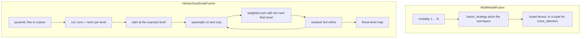

# fusion

Two Keras 3 layers that merge several feature tensors into one. Lives at `src/dl_techniques/layers/fusion/` in the `dl_techniques` library.

## What it is for

Models often have more than one stream of features that must become one: image and text tokens in a vision-language head, or the several resolutions a backbone produces. Concatenating everything is simple but wasteful, and a hand-written merge is easy to get subtly wrong. These layers do the merge and expose the choices as constructor arguments.

- `MultiModalFusion` fuses one tensor per modality (vision, text, audio, and so on) by one of eight strategies you pick by name.
- `HierarchicalScaleFusion` fuses a feature pyramid (maps that halve in size from level to level) into a single map at the finest resolution, without ever resizing every level to full size.

## How it works



`MultiModalFusion` strategies, by the exact key you pass:

- `'cross_attention'`: every modality attends to every other one, then norm and FFN. Returns a tuple, one tensor per modality.
- `'concatenation'`: concatenate on the feature axis, project back to `dim`, norm, dropout.
- `'addition'` and `'multiplication'`: combine element-wise (aligning first when there are more than two modalities), then norm and FFN.
- `'gated'`: a learned sigmoid gate scales each modality, then concatenate, project, norm.
- `'attention_pooling'`: self-attend each modality, average over the sequence, concatenate, project. Returns `(batch, dim)`.
- `'bilinear'`: the outer product of exactly two modalities, flattened and projected.
- `'tensor_fusion'`: concatenate, then a wide hidden layer of parallel Dense units, then one projection. Despite the name it computes no outer product.

`HierarchicalScaleFusion` projects every level to `filters` channels at its own resolution. Going from coarse to fine, it upsamples the running map by two with a 3x3 conv to `4 * filters` channels followed by depth-to-space (a sub-pixel convolution), crops it to the finer level's size, merges it with that level, and refines the result with a residual 3x3 block. The merge is `(w_a * a + w_b * b) / (w_a + w_b + epsilon)` with learned non-negative weights. A sum of per-level convolutions equals one convolution over the concatenated levels, so this spans concat-then-conv while each level is computed at its native size.

## Files

- `__init__.py` - docstring only. The package exports nothing.
- `multimodal_fusion.py` - `MultiModalFusion` and the `FusionStrategy` literal.
- `hierarchical_fusion.py` - `HierarchicalScaleFusion` and `check_pyramid_shapes`.

## How to use it

Neither class is exported by the package, so import from the module.

Fusing two modalities:

```python
import keras
from dl_techniques.layers.fusion.multimodal_fusion import MultiModalFusion

vision = keras.random.normal((2, 16, 64))
text = keras.random.normal((2, 16, 64))

fused = MultiModalFusion(dim=64, fusion_strategy="gated")([vision, text])
fused.shape  # (2, 16, 64)
```

Folding a feature pyramid:

```python
import keras
from dl_techniques.layers.fusion.hierarchical_fusion import HierarchicalScaleFusion

f0 = keras.Input((128, 128, 32))
f1 = keras.Input((64, 64, 64))
f2 = keras.Input((32, 32, 128))
y = HierarchicalScaleFusion(64, num_levels=3)([f0, f1, f2])
y.shape  # (None, 128, 128, 64)
```

Options on the pyramid layer: `upsample="bilinear"` swaps the learned sub-pixel step for a fixed bilinear one, `weighted_fusion=False` makes the merge a plain sum, `normalization_type` and `activation_type` take factory keys.

## Things to know

- Shapes: `MultiModalFusion` wants a list of at least two `(batch, seq_len, dim)` tensors with the last axis equal to `dim`. `HierarchicalScaleFusion` wants `num_levels` channels-last maps, fine to coarse, where each level's height and width are `ceil` of half the previous one. That is what stride-2 layers with `padding="same"` produce.
- Output shape depends on the strategy. Most return `(batch, seq_len, dim)`, `'attention_pooling'` returns `(batch, dim)`, and `'cross_attention'` returns a tuple. Check this before wiring the output into the next layer.
- Equal lengths: six strategies need every modality to have the same sequence length and raise a named `ValueError` otherwise. `'cross_attention'` and `'attention_pooling'` accept different lengths.
- `'bilinear'` takes exactly two modalities. `num_fusion_layers` above 1 works for `'cross_attention'` only.
- `'cross_attention'` is symmetric: every modality sees every other. In a causal language model that leaks future text into earlier positions, which is why NanoVLM no longer uses it.
- `HierarchicalScaleFusion` takes `num_levels` up front so every sub-layer can be created in the constructor. Passing a different number of maps raises `ValueError`, at build and at call.
- Odd sizes work: an upsampled odd level overshoots by one row or column and is cropped back.
- Normalization in `HierarchicalScaleFusion` comes from the norms factory, so the epsilon is `1e-6`, not the Keras batch-norm default of `1e-3`.
- Both layers serialize through `get_config`. Saved models register under the module path, for example `dl_techniques.layers.fusion.hierarchical_fusion>HierarchicalScaleFusion`. Renaming a class or moving it to another module breaks `.keras` archives saved earlier.
- `MultiModalFusion.from_config` modifies the dict you pass, so give it a copy.
- Consumers today: `MultiModalFusion` is used by the VLM heads in `src/dl_techniques/layers/heads/vlm/`. `HierarchicalScaleFusion` has no consumer yet.
- The code uses only `keras.ops` and stock Keras layers. The repo targets Keras 3 on TensorFlow 2.18.

## References

- Baltrusaitis et al. (2018). Multimodal Machine Learning: A Survey.
- Vaswani et al. (2017). Attention Is All You Need.
- Zadeh et al. (2017). Tensor Fusion Network (the name of `'tensor_fusion'` only; its mechanism is not implemented).
- Lu et al. (2019). ViLBERT.
- Lin et al. (2017). Feature Pyramid Networks for Object Detection.
- Shi et al. (2016). Real-Time Single Image and Video Super-Resolution Using an Efficient Sub-Pixel Convolutional Neural Network.
- Tan et al. (2020). EfficientDet: Scalable and Efficient Object Detection.
