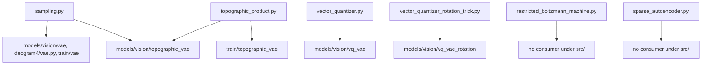

# generative

Path: `src/dl_techniques/layers/generative/`
Purpose: Keras 3 layers for generative and latent-variable models: RBM, sparse autoencoder, VAE samplers, vector quantizers, topographic Student-t prior.

## Scope

Lives here: six single-concept modules, each holding registered `keras.layers.Layer` subclasses with full `get_config()` (`sampling.py` holds three plus an inline factory).

Does not live here: the models that compose these layers (`src/dl_techniques/models/vision/vae/`, `models/vision/vq_vae/`, `models/vision/vq_vae_rotation/`, `models/vision/topographic_vae/`), their trainers (`src/train/vae/`, `src/train/topographic_vae/`), `CapsuleRoll` (`src/dl_techniques/layers/capsules.py`), and the generic topographic-smoothness primitives (`src/dl_techniques/layers/regularization/spatial_smoothness.py`).

`__init__.py` is zero bytes. Nothing is re-exported. Import from the module path, e.g. `from dl_techniques.layers.generative.sampling import create_sampling_layer`. There is no `factory.py`; `sampling.py` carries its own inline factory.

## Architecture

No file imports another file in this package. Every file imports `keras` and `dl_techniques.utils.keras_registration.register_dl_technique`. Extra imports per file:

| File | Extra imports |
| --- | --- |
| `sampling.py` | `math`, `tensorflow as tf`, `from keras import ops`, `dl_techniques.utils.logger.logger` |
| `sparse_autoencoder.py` | `from keras import ops, initializers, regularizers, constraints`, `dl_techniques.initializers.clone_initializer` |
| `topographic_product.py` | `numpy`, `from keras import ops`, `logger` |
| `vector_quantizer_rotation_trick.py` | `numpy`, `logger`; `sklearn.cluster` imported lazily |
| `restricted_boltzmann_machine.py` | `from keras import ops, initializers, regularizers` |
| `vector_quantizer.py` | none (uses `keras.ops` qualified) |

Registration: each class uses `@register_dl_technique("dl_techniques.layers.generative.<module>")`. The three sampler classes share the string `dl_techniques.layers.generative.sampling` and are distinguished by class name.

## Key files

| File | Role | Notes |
| --- | --- | --- |
| `sampling.py` (1166 lines) | `Sampling`, `HypersphereSampling`, `VMFSampling`, `vmf_kl_divergence`, inline sampler factory | Only module importing raw `tensorflow` (`tf.math.bessel_i0e` in `_log_iv`). |
| `sparse_autoencoder.py` (1094) | `SparseAutoencoder`, `SAEVariant`, `create_sparse_autoencoder` | Overrides `from_config`. Uses `clone_initializer`. |
| `topographic_product.py` (759) | `TopographicProduct` + NumPy helpers | Helpers are the test oracle. No trainable weights. |
| `vector_quantizer_rotation_trick.py` (812) | `VectorQuantizerRotationTrick` | Optional sklearn (`MiniBatchKMeans`). |
| `vector_quantizer.py` (468) | `VectorQuantizer` | Straight-through, optional EMA. |
| `restricted_boltzmann_machine.py` (473) | `RestrictedBoltzmannMachine` | Own CD-k update, no optimizer. |

## Public interface

### sampling.py

- `Sampling(seed: Optional[int] = None)`: input `[z_mean, z_log_var]`, equal shapes apart from batch, rank >= 2. Output `z_mean + exp(0.5*log_var) * eps`, `eps` drawn with `dtype=self.compute_dtype`. `TypeError` if `seed` is not int or None.
- `HypersphereSampling(radius=1.0, shell_thickness=0.1, seed=None)`: inputs `[z_mean [B,D], z_log_var [B,1]]` (last dim of `z_log_var` must be 1). `u = z_mean + eps` normalized, a zero vector resolves to `e_0`. `r = radius * (1 + shell_thickness * exp(0.5*clip(log_var, -20, 6)) * eta)`, floored at `0.05 * radius`. Output `r * u`. `radius <= 0` or `shell_thickness <= 0` raise `ValueError`. Noise draws pass no `dtype=`.
- `VMFSampling(rejection_oversample=32, seed=None)`: inputs `[z_mean [B,D], kappa [B,1]]`, `D >= 2`; `call` reads `int(z_mean.shape[-1])`, so `D` must be static. Unit-norm output. Draws `K = rejection_oversample` Wood candidates per row with `keras.random.beta`, takes the first accepted, falls back to `w = 1`. A Householder reflection maps `e_0` to the normalized mean. `kappa` floored at `1e-6`. `rejection_oversample` must be a positive non-bool int, else `ValueError`.
- `vmf_kl_divergence(kappa, dim) -> Tensor`: KL of vMF versus the uniform sphere. `kappa` clipped to `[1e-6, 1e4]`. Even and odd `dim` via `_log_iv` (integer order telescopes from `log I_0`, half-integer from `log I_{1/2}`) and `_bessel_ratio_cf` (downward recurrence, `n_extra=64`).
- `SamplingType = Literal["gaussian", "hypersphere", "vmf"]`. `SAMPLING_REGISTRY` maps each key to `class`, `description`, `required_params` (all empty lists), `optional_params`, `use_case`.
- `get_sampling_info() -> Dict`: shallow copy of each registry entry.
- `validate_sampling_config(sampling_type, **kwargs)`: `ValueError` on unknown type, missing required params, or `radius <= 0`.
- `create_sampling_layer(sampling_type, name=None, **kwargs) -> Layer`: first checks kwargs against `required_params | optional_params`; any undeclared name raises `ValueError` whose text contains `STRICT_DROPPED_KEY_MARKER` (`"unsupported parameter(s)"`). That check sits before the `try`, so the re-wrapper cannot bury the marker. Everything inside the `try` (validation, construction) that raises `TypeError` or `ValueError` is re-raised as `ValueError` with the original as `__cause__`. An unknown `sampling_type` skips the pre-check and fails in `validate_sampling_config`, wrapped the same way.
- `create_sampling_from_config(config)`: pops `'type'` from a copy; `ValueError` if missing.

### sparse_autoencoder.py

- `SparseAutoencoder(d_input, d_latent, variant='topk', k=32, batch_topk_decay=0.99, l1_coefficient=1e-3, l0_coefficient=1e-3, tied_weights=False, normalize_decoder=True, use_pre_encoder_bias=True, aux_k=256, aux_coefficient=1/32, dead_steps_threshold=1000, kernel_initializer='glorot_uniform', bias_initializer='zeros', kernel_regularizer=None)`. `SAEVariant` is `'relu' | 'topk' | 'batch_topk' | 'jumprelu' | 'gated'`.
- `call(inputs, training=None, return_latents=False)`: returns the reconstruction, or `(reconstruction, latents, total_loss)`. `add_loss(total_loss)` runs on every forward pass regardless of `return_latents`.
- `encode(inputs, training)`, `decode(latents, freeze=False)`. `freeze=True` wraps decoder weight, decoder bias and pre-encoder bias in `stop_gradient`.
- `create_sparse_autoencoder(d_input, d_latent, variant='topk', expansion_factor=None, **kwargs)`: if `expansion_factor` is given, `d_latent = d_input * expansion_factor` and the passed `d_latent` is ignored.
- Constructor `ValueError`s: unknown variant, `k` None or <= 0 for `topk`/`batch_topk`, non-positive `d_input`, `d_latent`, or a non-None `aux_k <= 0`. `build` raises on an input last dim different from `d_input`. `aux_k > d_latent` is allowed and clamped with `min(aux_k, d_latent)` at use.

### topographic_product.py

- `TopographicProduct(num_capsules, capsule_dim, coherence_window=0, neighborhood_size=1, temporal_coherence=None, topography='capsule_1d', grid_shape=None, kernel_shape=None, degrees_of_freedom=1.0, prior_mean=30.0, epsilon=ENERGY_EPSILON)`.
- Call: `layer([z, u])`, both `(B, S, D)` with `D = num_capsules * capsule_dim`. Output `sqrt(2) * (z - prior_mean) / sqrt(nu * energy + eps)`. Energy is clamped at 0 before the sqrt.
- `temporal_coherence=None` resolves to `"shifting"` for `capsule_1d`, `"none"` for `torus_2d`. An explicit `"shifting"` or `"stationary"` with `torus_2d` raises in `__init__`.
- Constants: `TEMPORAL_COHERENCE_TYPES = ("none", "stationary", "shifting")`, `TOPOGRAPHY_TYPES = ("capsule_1d", "torus_2d")`, `ENERGY_EPSILON = 1e-12`, plus the `TemporalCoherenceType` and `TopographyType` literals.
- Helpers (NumPy, float64): `build_window_matrix_1d(latent_dim, neighborhood_size)`, `build_window_matrix_2d(grid_height, grid_width, kernel_height, kernel_width)`, `build_roll_matrix_1d(latent_dim, shift)`, `build_window_stack(window, latent_dim, coherence_window, temporal_coherence, num_capsules=1) -> (2L+1, D, D)`, `windowed_stack_energy(window_stack, squared_u)`.
- Sequence boundaries of the temporal window are edge-replicated (clamped gather index), not zero-padded.

### vector_quantizer.py

- `VectorQuantizer(num_embeddings, embedding_dim, commitment_cost=0.25, initializer='uniform', use_ema=False, ema_decay=0.99, epsilon=1e-5)`. Output shape equals input shape. Input last dim must equal `embedding_dim` (`ValueError` in `build`). `ema_decay` is range-checked only when `use_ema`.
- `get_codebook_indices(inputs) -> (B, ...)` int; builds the layer if unbuilt.
- `quantize_from_indices(indices) -> (B, ..., D)`; `ValueError` if the layer is unbuilt.

### vector_quantizer_rotation_trick.py

- `VectorQuantizerRotationTrick(num_embeddings, embedding_dim, commitment_cost=0.25, gradient_mode='rotation', distance_mode='euclidean', initializer='uniform', use_ema=False, ema_decay=0.99, epsilon=1e-5, num_heads=1, kmeans_init=False, kmeans_init_steps=1, kmeans_seed=42, dead_code_threshold=0, diversity_coefficient=0.0, orthogonal_reg_coefficient=0.0)`.
- `gradient_mode` in `("rotation", "reflection", "no_grad_scale", "ste")`; `distance_mode` in `("euclidean", "cosine")`. `embedding_dim % num_heads == 0` required.
- `get_codebook_indices(inputs)`: `(B, ..., num_heads)`, squeezed to `(B, ...)` when `num_heads == 1`. `quantize_from_indices(indices)` is the inverse.
- `warm_start_codebook(batches)`: eager only. `RuntimeError` without scikit-learn; `ValueError` if unbuilt, `kmeans_init` is False, or feature width != `embedding_dim`. Sets `kmeans_init_done` to 1.0. `batches` is one array or a list/tuple of arrays, flattened over all non-channel axes.
- `is_codebook_warm_started` property: reads `kmeans_init_done` eagerly; False when `kmeans_init` is False.

### restricted_boltzmann_machine.py

- `RestrictedBoltzmannMachine(n_hidden, learning_rate=0.01, n_gibbs_steps=1, visible_unit_type='binary', use_bias=True, kernel_initializer='glorot_uniform', visible_bias_initializer='zeros', hidden_bias_initializer='zeros', kernel_regularizer=None)`.
- `call(inputs, training=None)` returns `P(h=1|v)` `(B, n_hidden)`; `training` is unused.
- Also: `sample_hidden_given_visible(visible, sample=True)`, `sample_visible_given_hidden(hidden, sample=True)`, `gibbs_sampling_step(visible) -> (new_visible, hidden_probs)`, `contrastive_divergence(visible_data) -> (reconstruction_error, {'reconstruction_error', 'free_energy_diff'})`, `reconstruct(visible, n_steps=1)`.
- `visible_unit_type` is `'binary'` or `'gaussian'`; anything else raises `ValueError`. Non-positive `n_hidden`, `learning_rate`, `n_gibbs_steps` raise `ValueError`.

## Data shapes

| Layer | Weights (name: shape) |
| --- | --- |
| `VectorQuantizer` | `embeddings: (K, D)`; with EMA also `ema_cluster_size: (K,)`, `ema_embeddings: (K, D)`, `ema_step: ()`, all float32, `autocast=False` |
| `VectorQuantizerRotationTrick` | `embeddings: (H, K, D/H)`; EMA: `ema_cluster_size: (H, K)`, `ema_embeddings: (H, K, D/H)`, `ema_step: ()`; `dead_code_unused: (H, K)` when `dead_code_threshold > 0`; `kmeans_init_done: ()` when `kmeans_init` |
| `SparseAutoencoder` | `encoder_weight: (d_input, d_latent)`, `decoder_weight: (d_latent, d_input)` (absent if `tied_weights`), `encoder_bias`, `decoder_bias`, `pre_encoder_bias` (if used); `threshold: (d_latent,)` (jumprelu, `NonNeg`, init 0.001); `batch_topk_threshold: ()` (batch_topk, non-trainable); `gate_weight`, `gate_bias` (gated); `dead_steps: (d_latent,)` (non-trainable, only if `aux_k` is set and variant != gated) |
| `TopographicProduct` | `window_stack: (2L+1, D, D)`, non-trainable, `D = num_capsules * capsule_dim` |
| `RestrictedBoltzmannMachine` | `W: (n_visible, n_hidden)`, `visible_bias`, `hidden_bias` (if `use_bias`) |

Sampler optional params: `gaussian {seed}`, `hypersphere {radius, shell_thickness, seed}`, `vmf {rejection_oversample, seed}`.

## Invariants and constraints

- Every `add_weight`-bound table must be created in `build()` via an initializer, never assigned afterwards. `TopographicProduct.window_stack` uses `_window_stack_initializer` for this reason: a parent's first `build()` runs in a `StatelessScope` that discards assignments.
- EMA accumulators (`ema_*`, `dead_code_unused`) stay float32 with `autocast=False`, and `ema_embeddings` starts at zeros (not the codebook initializer). `_update_ema` must keep both the bias correction by `1 - decay**step` and the Laplace smoothing; the source comments name a step-1 blow-up if either is removed. `ema_step` is float32, not int32.
- One-hot encodings in the quantizer lookups use `dtype=self.compute_dtype` (needed under `mixed_float16`). The EMA and dead-code one-hots stay float32. `VectorQuantizer.quantize_from_indices` is the exception: its one-hot has no dtype argument.
- `SparseAutoencoder.build` clones `kernel_initializer` / `bias_initializer` per weight with `clone_initializer`. Do not pass the bare attribute to `add_weight`: a shared seedless instance replays the same draw at every site. A seeded instance stays tied across equal-shaped weights by design.
- `SparseAutoencoder` `batch_topk`: inference must use the stored `batch_topk_threshold`, never recompute from the batch. The first training step (stored threshold <= 0) seeds the threshold with the batch value instead of blending from zero.
- `SparseAutoencoder` AuxK targets the stop-gradient residual `inputs - main_reconstruction`, not the raw input. The `gated` variant uses a frozen-decoder aux loss (`decode(..., freeze=True)`) and allocates no `dead_steps`. `jumprelu` threshold gets gradient only from the sigmoid L0 term; the hard mask blocks the rest.
- `SparseAutoencoder.decode` normalizes `decoder_weight` along `axis=-1` (per-latent rows of the `(d_latent, d_input)` matrix) when `normalize_decoder` is True, though the helper is named `_normalize_decoder_columns`.
- Rotation trick: the unit vectors and the reflection axis are `stop_gradient`ed so the transform is a constant linear map of `x`. `rotation` and `no_grad_scale` build the same rotated vector; they differ only in whether the `q_norm / x_norm` scale carries gradient. Cosine mode returns the raw codebook row, not rescaled by norm ratio.
- `VectorQuantizerRotationTrick.call` does no k-means work; k-means lives only in `warm_start_codebook`. EMA, dead-code, diversity and orthogonal terms run only when `training is True` (identity check, so `training=1` does not trigger them). `VectorQuantizer` tests `training` by truthiness.
- Codebook and commitment losses are added on every call in both quantizers, including under `use_ema=True`.
- `VMFSampling`: fixed-K rejection, no `while_loop`. The Naesseth implicit-reparameterization correction is deliberately omitted.
- `HypersphereSampling` shell is floored at `0.05 * radius` so the radius is always positive.
- `sampling.py` factory: every constructor parameter of a sampler must appear in its `optional_params` (or `required_params`). A name that is not listed is not filtered out; `create_sampling_layer` raises `ValueError` ("unsupported parameter(s)") before building. Omitting a parameter therefore makes it unreachable through the factory.
- `TopographicProduct` is stateless in training: `training` is accepted and ignored.

## Dependencies

- Internal: `dl_techniques.utils.keras_registration.register_dl_technique` (all files), `dl_techniques.utils.logger.logger` (`sampling.py`, `topographic_product.py`, `vector_quantizer_rotation_trick.py`), `dl_techniques.initializers.clone_initializer` (`sparse_autoencoder.py`).
- External: `keras` (all), `numpy` (`topographic_product.py`, `vector_quantizer_rotation_trick.py`), `math` and `tensorflow` (`sampling.py`; `tf.math.bessel_i0e` is the one raw-TF op), scikit-learn `MiniBatchKMeans` (rotation trick; `__init__` raises `RuntimeError` if `kmeans_init=True` and `sklearn.cluster` cannot import).
- Consumers (read-only for this package): `models/vision/vae/model.py` (`create_sampling_layer`, `vmf_kl_divergence`), `models/vision/vq_vae/model.py` (`VectorQuantizer`), `models/vision/vq_vae_rotation/model.py` (rotation trick), `models/vision/topographic_vae/model.py` (`create_sampling_layer`, `TopographicProduct`, `TEMPORAL_COHERENCE_TYPES`, `TOPOGRAPHY_TYPES`), `models/vision_language/ideogram4/vae.py` (`Sampling`), `src/train/vae/train_vae.py`, `src/train/vae/evaluate_samplers.py`, `src/train/topographic_vae/train_topographic_vae.py` (the two constants). `tests/test_layers/test_factory_registry_drift.py` references `SAMPLING_REGISTRY` as `dl_techniques.layers.generative.sampling` / `SAMPLING_REGISTRY`. `RestrictedBoltzmannMachine` and `SparseAutoencoder` have no importer under `src/`.

## Failure modes

- `VMFSampling` under XLA on GPU fails: `keras.random.beta` has no XLA-GPU kernel in TF 2.18 (per the source docstring). Run with `jit_compile=False` or eagerly.
- `HypersphereSampling` and `VMFSampling` draw their noise and build their `e_0` / mask constants with `dtype=self.compute_dtype`, like `Sampling`; `TestSamplingFollowsTheComputeDtype` runs both under `mixed_float16` and `float64`.
- `HypersphereSampling` draws `epsilon` and `eta` with the same raw `seed`; all samplers reuse one raw int across their draws.
- `warm_start_codebook` on an unbuilt layer, or with `kmeans_init=False`, raises `ValueError`. A head with fewer samples than `num_embeddings` logs a warning and pads the missing centroids from the current codebook.
- `TopographicProduct` rejects at construction: `torus_2d` with `temporal_coherence != "none"`, `grid_shape` or `kernel_shape` with `capsule_1d`, missing `grid_shape` with `torus_2d`, `grid_height * grid_width != capsule_dim`, `neighborhood_size` outside `[1, capsule_dim]`, a `kernel_shape` outside the grid, and a `kernel_shape` area different from `neighborhood_size**2`. `build` rejects non-rank-3 inputs and a last axis different from `num_capsules * capsule_dim`.
- `build_window_stack(window, latent_dim, coherence_window, temporal_coherence, num_capsules=1)` builds the roll as `kron(I_num_capsules, roll(latent_dim // num_capsules))`, so `"shifting"` rolls within each capsule. The layer passes `self.num_capsules`; the default `1` is only right for a single capsule. The test `_oracle` passes it too, and `test_the_shifting_roll_stays_inside_each_capsule` checks the layer's own weight against a literal block-diagonal matrix.
- `RestrictedBoltzmannMachine.contrastive_divergence` builds the layer from the data shape if unbuilt, and requires a defined last dimension. It updates `W` and biases by hand with `assign_add`; `kernel_regularizer` is registered on `W` but is not part of that update. `_free_energy` is the same formula for `'gaussian'` and `'binary'` visible units (no quadratic visible term) and uses `log(1 + exp(x))` unguarded.
- `VectorQuantizer.quantize_from_indices` before build raises `ValueError`. `get_codebook_indices` builds on demand.
- Under `use_ema=True` the quantizer `embeddings` are non-trainable; the codebook loss is still added but moves nothing.

## Working here

- One concept per file; register with `@register_dl_technique("dl_techniques.layers.generative.<module>")`. Implement `__init__`, `build`, `call`, `compute_output_shape`, `get_config`. Every constructor argument must round-trip through `get_config()`.
- A new sampler: add the class in `sampling.py`, add a `SAMPLING_REGISTRY` entry listing every constructor parameter in `optional_params` / `required_params`, extend `SamplingType`, and update `tests/test_layers/test_factory_registry_drift.py` if the key set is asserted there.
- Docstrings in this package are Sphinx/reST (`:param:` / `:type:`). Match the file you edit. Four files use `from keras import ops`; the repo convention for new code is `import keras` and qualified calls, and `tests/test_the_keras_submodule_import_population_cannot_grow.py` pins per-file `from keras import` statement counts for this package (rbm 3, sampling 1, sparse_autoencoder 1, topographic_product 1), so do not add more.
- Use `logger` from `dl_techniques.utils.logger`, not `print`.
- Tests: `tests/test_layers/test_generative/` has one module per source file (`test_sampling.py`, `test_sparse_autoencoder.py`, `test_topographic_product.py`, `test_vector_quantizer.py`, `test_vector_quantizer_rotation_trick.py`, `test_restricted_boltzmann_machine.py`). Run with `.venv/bin/python -m pytest tests/test_layers/test_generative/ -q` from the repo root. When a public signature changes, also run the consumer tests: `tests/test_models/test_vae/`, `tests/test_models/test_vq_vae/`, `tests/test_models/test_vq_vae_rotation/`, `tests/test_models/test_topographic_vae/`.
- Do not run the full test suite for a change here; it takes about 1.5 hours.
- Initializer aliasing in `sparse_autoencoder.py` is pinned by `TestInitializerAliasing` in `test_sparse_autoencoder.py`; keep it in step with the long comment in `build()`.
- Keep the NumPy helpers in `topographic_product.py` independent of the layer's `call()`; they exist so a test can compare two separate implementations.
