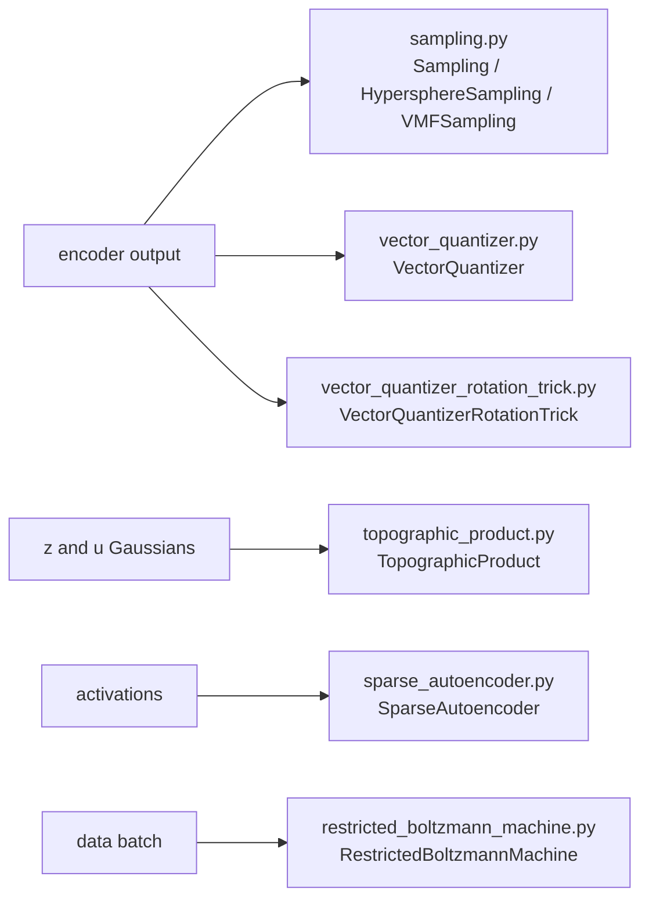

# generative

Keras 3 layers for generative and latent-variable models: a restricted Boltzmann machine, a sparse autoencoder, three VAE latent samplers, two vector quantizers, and a topographic Student-t prior. It lives at `src/dl_techniques/layers/generative/` in the `dl_techniques` library.

## What it is for

Generative models often need a small piece in the middle of the network that is not an ordinary dense or conv layer. A VAE needs a way to draw a random latent and still pass gradients back to the encoder. A VQ-VAE needs to snap a continuous vector to the nearest entry of a codebook, which has no gradient by itself. A sparse autoencoder needs to force most hidden units to be zero. This package holds those pieces as self-contained layers, so models in `models/vision/` (VAE, VQ-VAE, VQ-VAE with rotation trick, topographic VAE) and the trainers in `src/train/` can reuse them. The restricted Boltzmann machine and the sparse autoencoder have no model package that uses them in this repo; they are used directly.

## How it works

Each file is one concept. Every layer is registered with `register_dl_technique` and has `get_config()`, so it saves and loads inside a `.keras` model.



- **Samplers.** Take `(z_mean, z_log_var)` or `(z_mean, kappa)` and return a differentiable sample. `Sampling` is the usual `mu + sigma * eps`. `HypersphereSampling` normalizes `z_mean + noise` onto the unit sphere and scales it by a thin random radius. `VMFSampling` draws a true von Mises-Fisher sample with a fixed-K Wood rejection sampler plus a Householder rotation. `vmf_kl_divergence` gives the matching KL to the uniform sphere prior.
- **Vector quantizers.** Find the nearest codebook vector, return it, and add a codebook loss and a commitment loss with `add_loss`. `VectorQuantizer` copies the gradient straight through (straight-through estimator). `VectorQuantizerRotationTrick` instead pushes the gradient through a rotation or reflection, supports several codebook heads, cosine distance, EMA codebook updates, dead-code reset, and a k-means warm start.
- **SparseAutoencoder.** Encodes to a wider latent, keeps few units active, decodes back. Five sparsity variants: `relu` (L1 penalty), `topk`, `batch_topk`, `jumprelu`, `gated`. An auxiliary loss revives latents that stopped firing.
- **TopographicProduct.** A deterministic layer with no trainable weights. It turns two Gaussian tensors `z` and `u` into Student-t variables whose neighbours are correlated, using a fixed neighbourhood matrix baked into a non-trainable weight.
- **RestrictedBoltzmannMachine.** `call` returns hidden probabilities. Training is done by calling `contrastive_divergence(batch)`, which updates the weights itself with no optimizer.

## Files

- `restricted_boltzmann_machine.py` - `RestrictedBoltzmannMachine`, binary or Gaussian visible units, CD-k training, Gibbs sampling, free energy.
- `sampling.py` - `Sampling`, `HypersphereSampling`, `VMFSampling`, `vmf_kl_divergence`, and an inline factory: `SAMPLING_REGISTRY`, `get_sampling_info`, `validate_sampling_config`, `create_sampling_layer`, `create_sampling_from_config`.
- `sparse_autoencoder.py` - `SparseAutoencoder`, the `SAEVariant` literal, and `create_sparse_autoencoder`.
- `topographic_product.py` - `TopographicProduct`, its constants, and the pure NumPy helpers `build_window_matrix_1d`, `build_window_matrix_2d`, `build_roll_matrix_1d`, `build_window_stack`, `windowed_stack_energy`.
- `vector_quantizer.py` - `VectorQuantizer`, straight-through, optional EMA codebook.
- `vector_quantizer_rotation_trick.py` - `VectorQuantizerRotationTrick`.
- `__init__.py` - empty. Import from the module, not the package.

## How to use it

```python
import numpy as np
import keras
from dl_techniques.layers.generative.sampling import create_sampling_layer
from dl_techniques.layers.generative.vector_quantizer import VectorQuantizer
from dl_techniques.layers.generative.sparse_autoencoder import create_sparse_autoencoder

# VAE latent sample
z_mean = keras.random.normal((8, 16))
z_log_var = keras.random.normal((8, 16))
z = create_sampling_layer("gaussian", seed=0)([z_mean, z_log_var])

# vMF sample: second input is a positive concentration of shape (B, 1)
kappa = keras.ops.ones((8, 1)) * 10.0
z_vmf = create_sampling_layer("vmf")([z_mean, kappa])

# Vector quantizer: output has the input shape, losses land in layer.losses
vq = VectorQuantizer(num_embeddings=64, embedding_dim=16)
quantized = vq(keras.random.normal((8, 4, 4, 16)))
codes = vq.get_codebook_indices(keras.random.normal((8, 4, 4, 16)))  # (8, 4, 4)

# Sparse autoencoder with 8x expansion
sae = create_sparse_autoencoder(d_input=32, d_latent=0, variant="topk", expansion_factor=8, k=16)
recon = sae(keras.random.normal((8, 32)), training=True)
extra_loss = sum(sae.losses)
```

Run the tests for this package with `.venv/bin/python -m pytest tests/test_layers/test_generative/ -q` from the repo root.

## Things to know

- **Losses come from `add_loss`.** The quantizers and the sparse autoencoder add their losses on every forward pass. Under `model.fit()` read them from `model.losses`. Calling the sparse autoencoder with `return_latents=True` also returns `total_loss`; adding that to your own loss counts it twice.
- **`VMFSampling` needs XLA off on GPU.** Its rejection step uses `keras.random.beta`, which has no XLA-GPU kernel in TensorFlow 2.18. Compile with `jit_compile=False` or call it eagerly.
- **`sampling.py` imports `tensorflow` directly** for one op (`tf.math.bessel_i0e`), because `keras.ops` has no Bessel function. It is used only by the KL helper.
- **Sampler seeds are raw ints**, passed straight to `keras.random`. The same int is reused across draws inside one layer.
- **`create_sampling_layer` rejects unknown keyword arguments** with a `ValueError` containing `unsupported parameter(s)`. Only the names listed per type in `SAMPLING_REGISTRY` are accepted: `seed` for `gaussian`; `radius`, `shell_thickness`, `seed` for `hypersphere`; `rejection_oversample`, `seed` for `vmf`.
- **`VectorQuantizerRotationTrick` k-means warm start is manual.** `kmeans_init=True` only allocates a flag and checks that scikit-learn is importable. You must call `warm_start_codebook(batches)` eagerly on a built layer before training.
- **EMA state is float32 and not autocast**, so mixed precision does not corrupt the counts.
- **With `use_ema=True` the codebook is not trainable.** `VectorQuantizer` still adds the codebook loss in that case, but it has no weights to move.
- **`TopographicProduct` has no trainable weights.** Its `window_stack` is a non-trainable weight filled by an initializer. `prior_mean` defaults to 30.0. `topography="torus_2d"` only works with `temporal_coherence="none"`.
- **`TopographicProduct` shifting roll**: with `temporal_coherence="shifting"` each capsule is rolled on its own (the roll matrix is block-diagonal, `kron(I_capsules, roll(capsule_dim))`), so no unit moves between capsules. `build_window_stack` takes `num_capsules` for this; callers outside the layer must pass it.
- **`RestrictedBoltzmannMachine` bypasses the Keras optimizer.** `contrastive_divergence` calls `assign_add` on the weights. `learning_rate` is a layer argument. A `kernel_regularizer` is attached to the weight but is not part of that manual update. The free-energy metric uses one formula for both binary and Gaussian visible units.
- **Initializer cloning in `SparseAutoencoder`.** Each weight draws from its own clone of `kernel_initializer`, so a seedless initializer gives independent weights. A seeded initializer instance stays tied across equal-shaped weights.
