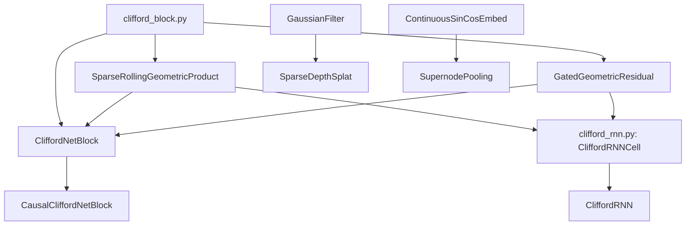

# geometric

Path: `src/dl_techniques/layers/geometric/`
Purpose: Keras 3 layers for Clifford-algebra feature mixing (block and RNN) and for point, ray and depth geometry.

## Scope

In this directory: the CliffordNet block and its primitives, the Clifford recurrent cell and layer, a DGCNN point cloud autoencoder with its correspondence head, supernode pooling, a ray/distance combiner, a sparse depth densifier.

Not here: the models that use these layers (`models/vision/cliffordnet/`, `models/language/cliffordlm/`, `models/vision_language/clifford_clip/`, `models/world_models/video_jepa/`, `models/vision/rbf_protonet/`, `models/vision/omnipoint/`, `models/point_cloud/latent_gmm_registration/`), and the trainers (`src/train/cliffordnet/`). `__init__.py` is empty: no curated exports, no factory. Import from the submodule.

There is no `fields/` subpackage and no other subdirectory here: the directory is flat.

## Architecture

`CliffordNetBlock.call` (always on an internal rank-4 `(B, H, W, D)` tensor):
1. `input_norm(x)` gives `x_norm`.
2. `z_det = linear_det(x_norm)`. `z_ctx = act(ctx_norm(dw_conv2(dw_conv(x_norm))))`. With `ctx_mode="diff"`, `z_ctx = z_ctx - z_det`.
3. `g_feat = local_geo_prod(z_det, z_ctx)`.
4. If `use_global_context`: `c_glo` is the spatial mean of `x_norm` (causal: cumulative mean over positions 0..i), `g_feat += global_geo_prod(z_det, c_glo - z_det)`.
5. Return `ggr(x_norm, g_feat)` = `gamma * (feature_act(x_norm) + alpha * g_feat)`, `alpha = gate_act(gate_dense(concat(x_norm, g_feat)))`. The residual add and drop-path are the caller's.

`SparseRollingGeometricProduct`: for each shift `s < channels`, rolls `z_ctx` (and `z_det` for wedge) along the channel axis, builds `dot = act(z_det * roll(z_ctx))` and `wedge = z_det * roll(z_ctx) - z_ctx * roll(z_det)`, concatenates, applies one Dense `proj`.

`CliffordRNNCell.call` per step: `h_norm = state_norm(h)`; `z_det = linear_det(x_t)`; `z_ctx = act(ctx_norm(linear_ctx(h_norm)))` (minus `z_det` in diff mode); same product and GGR; carry rule by `state_update`: `gated` `h = sigmoid(carry_dense([x, h_norm])) * h + term`, `decay` `h = sigmoid(decay_logit) * h + term`, `residual` `h = h + term`. State list is `[h]`, plus `[c]` (ema) or `[c, n]` (cumulative_mean) when `use_global_context`.

## Key files

| File | Role | Notes |
| --- | --- | --- |
| `clifford_block.py` (1968 lines) | `SparseRollingGeometricProduct`, `GatedGeometricResidual`, `CliffordNetBlock`, `CausalCliffordNetBlock` | Module docstring has 8 numbered implementation notes with measurements. Read them before changing behaviour. Registered under `dl_techniques.layers.geometric.clifford_block`. |
| `clifford_rnn.py` (1066 lines) | `CliffordRNNCell`, `CliffordRNN` | Has `__all__ = ["CliffordRNNCell", "CliffordRNN"]`. Imports the two product layers from `.clifford_block`. Registered under `...clifford_rnn`. |
| `point_cloud_autoencoder.py` | `PointCloudAutoencoder`, `CorrespondenceNetwork`, `_get_graph_feature` | Both classes registered under `...point_cloud_autoencoder`. |
| `supernode_pooling.py` | `SupernodePooling` | Single point cloud, no batch axis. |
| `ray_point_combinator.py` | `RayPointCombinator` | No weights, no `build()`. |
| `sparse_depth_splat.py` | `SparseDepthSplat` | Two non-trainable `GaussianFilter` sublayers. |
| `__init__.py` | empty | |

## Public interface

Constructor defaults only where they matter; full signatures are in the files.

`SparseRollingGeometricProduct(channels, shifts, cli_mode="full", use_bias=True, dot_activation="silu", kernel_initializer, bias_initializer, kernel_regularizer, bias_regularizer)`
- `call(z_det, z_ctx)` returns a tensor shaped like the inputs. Rank-agnostic (works at ranks 2 to 5); `build` checks only `input_shape[-1] == channels`.
- Shifts must be ints >= 1 (`_validate_shifts`). Shifts `>= channels` are dropped with a warning; if none remain, `ValueError`. `get_config` stores the filtered list.

`GatedGeometricResidual(channels, layer_scale_init=1e-5, use_bias=True, gate_activation="sigmoid", feature_activation="silu", use_gate=True, ...)`
- `call(h_norm, g_feat, training=None)` returns the gamma-scaled term only.
- `use_gate=False` gives `feat + g_feat` (degree-1 homogeneous path). `gate_dense` is still built (frozen with `trainable=False`) so the weight layout does not change.

`CliffordNetBlock(channels, shifts, cli_mode="full", ctx_mode="diff", use_global_context=False, causal=False, input_mode=None, layer_scale_init=1e-5, use_bias=True, activation="silu", dot_activation="silu", gate_activation="sigmoid", feature_activation="silu", use_gate=True, context_kernel_size=3, kernel/bias initializer/regularizer, normalization_type=None, normalization_kwargs=None, input_normalization_type=None, input_normalization_kwargs=None)`
- `call(inputs, training=None)` returns the same rank and shape as `inputs`.
- `input_mode=None` resolves to `"sequence"` if `causal` else `"image"`; the resolved value is serialized.
- Image mode: rank 4 only, `(K, K)` same-padded depthwise convs. Sequence mode: rank 3 `(B, L, D)` or rank 4 `(B, 1, L, D)`, `(1, K)` convs; valid padding with an explicit left pad when causal, same padding otherwise.
- `normalization_type=None` resolves to `"batch_norm"` (image) or `"zero_centered_rms_norm"` (sequence). The resolved string is serialized.
- `from_config` repairs legacy causal configs (see Failure modes).

`CausalCliffordNetBlock(**kwargs)`: forces `causal=True`, `setdefault("normalization_type", "zero_centered_rms_norm")`, class attribute `_FORCES_CAUSAL = True`.

`CliffordRNNCell(units, shifts=(1, 2, 4), cli_mode="full", ctx_mode="diff", use_global_context=False, global_context_mode="cumulative_mean", state_update="gated", include_vector_grade=False, layer_scale_init=1.0, forget_bias_init=1.0, ..., recurrent_initializer="orthogonal", dropout_rate=0.0, recurrent_dropout_rate=0.0, seed=None)`. Inherits `DropoutRNNCell` from `keras.src.layers.rnn.dropout_rnn_cell`. `build` requires a rank-2 per-step shape.

`CliffordRNN(units, <all cell args>, return_sequences=False, return_state=False, go_backwards=False, stateful=False, unroll=False, zero_output_for_mask=False, **kwargs)`: subclass of `keras.layers.RNN` that builds a cell named `clifford_rnn_cell`. `input_spec` is `ndim=3`. `get_config` flattens the cell config and deletes the `cell` key. `from_config` is `cls(**config)`.

`PointCloudAutoencoder(k_neighbors=20)`: `call((source_pc, target_pc))`, each `(B, N, 3)`, returns `((x_rec, y_rec), (local_x, local_y), (global_x, global_y))` with local `(B, N, 1024)` and global `(B, 2048)`.

`CorrespondenceNetwork(num_gaussians)`: `call((local_features, global_features))` returns softmax `(B, N, K)`. MLP 1024, 256, 128, K.

`SupernodePooling(hidden_dim, ndim, radius=None, k_neighbors=None, max_neighbors=32, mode="relpos", activation="gelu", ...)`: `call({"positions": (P, ndim), "supernode_indices": (S,)})` returns `(1, S, hidden_dim)`. Exactly one of `radius` / `k_neighbors`. `mode` is `"abspos"` or `"relpos"`.

`RayPointCombinator(epsilon=1e-8)`: `call((raw_ray (...,3), raw_distance (...,1)))` returns `(unit_ray, positive_distance, point)`. `ValueError` if the input is not a pair.

`SparseDepthSplat(kernel_size=(9, 9), sigma=2.0, epsilon=1e-8)`: `call((sparse_depth, validity_mask))`, each `(B, H, W, 1)`, returns `(dense_depth, dense_confidence)`. `ValueError` if `kernel_size` is not length 2.

## Data shapes

- Block internal tensor: `(B, H, W, D)`. Rank-3 sequence input is expanded to `(B, 1, L, D)` on entry and squeezed on exit.
- Product projection input width: `(2 if cli_mode == "full" else 1) * len(shifts) * channels`. At `cli_mode="full"` this is a materialized concat kept for backward (note 5 in the block docstring).
- Sublayer names that checkpoints depend on: block `input_norm`, `linear_det`, `dw_conv`, `dw_conv2`, `ctx_bn` (the context norm keeps this name although its type is configurable), `local_geo_prod`, `global_geo_prod`, `ggr`; GGR `gate_dense`, `gamma_scale`; product `proj`; cell `state_norm`, `linear_det`, `linear_ctx`, `ctx_norm`, `local_geo_prod`, `global_geo_prod`, `ggr`, `carry_dense`, weights `decay_logit`, `ema_logit`.
- Depthwise kernel shapes: sequence `(1, K, D, 1)`, image `(K, K, D, 1)`.
- Global branch constants (block and cell): `shifts=[1, 2]`, `cli_mode="full"`, differential context, superposition weight 1.

## Invariants and constraints

- The block returns the transform only. Do not move the residual add or drop-path inside `GatedGeometricResidual` or `CliffordNetBlock`.
- Keep `CliffordNetBlock` internally rank 4. Do not replace the `DepthwiseConv2D` pair with `DepthwiseConv1D`: it changes kernel shapes and breaks loading of existing causal checkpoints.
- Do not add a rank check to `SparseRollingGeometricProduct.build`. The RNN cell uses it on `(B, D)` and `clifford_clip` uses it on pooled vectors.
- `input_mode` is a constructor choice, never inferred from input rank (it fixes the kernel shape).
- `GatedGeometricResidual` builds its `LayerScale` with `initializer=Constant(layer_scale_init)` and `constraint=None`. The LayerScale defaults (`ones`, `non_neg`) would silently be wrong. Keep both arguments.
- Image-mode default `batch_norm` must stay. Changing it breaks tests and batch-size assumptions in the `video_jepa` path.
- Registration: all classes use `@register_dl_technique("dl_techniques.layers.geometric.<module>")`. Do not use a bare `package=` on the stock Keras decorator, which would drop the legacy `Custom>ClassName` alias.
- Activation arguments go through `activation_spec` / `resolve_activation` / `serialize_activation` from `layers/activations/common.py`. Do not re-copy a local version.
- `_call_with_training_gate` routes `training` through `keras.ops.cond` when it is a tensor (needed under `@tf.function` for batch-norm and dropout). A Python bool or `None` passes straight through. Do not resolve the flag to a bool at the call site.
- `_causal_cumulative_mean` accumulates in float32 for float16 and bfloat16 inputs and casts back. float64 stays float64.
- Cell dropout: `dropout_rate` masks the input, `recurrent_dropout_rate` masks only the state fed to the streams, never the carry path. The `DropoutRNNCell` base is required so `keras.layers.RNN` resets masks between batches. Its import is hard on purpose.
- The cell carry gate always uses sigmoid; `gate_activation` configures only the GGR `alpha`.
- The cell's `layer_scale_init` default is 1.0, not 1e-5: gamma near 0 would freeze a recurrent state.
- `SupernodePooling._aggregate_messages` builds its divisor in the numerator dtype. Do not hard-code float32 (breaks mixed precision).
- `SupernodePooling` validates `positions` as rank 2 with last dim `ndim` at build time, and requires a dict input with keys `positions` and `supernode_indices`.
- `SparseDepthSplat.build` builds both `GaussianFilter`s on `(None, None, None, 1)` unconditionally so they are never left unbuilt.

## Dependencies

Internal:
- `dl_techniques.utils.keras_registration.register_dl_technique` (all files).
- `dl_techniques.utils.logger.logger` (block, RNN).
- `dl_techniques.layers.regularization.layer_scale.LayerScale` (GGR gamma).
- `dl_techniques.layers.norms.create_normalization_layer` (context and input norms).
- `dl_techniques.layers.activations.common` (activation trio; also used by `supernode_pooling.py`, which imports `resolve_activation` and `serialize_activation`).
- `dl_techniques.layers.embedding.continuous_sin_cos_embedding.ContinuousSinCosEmbed` (supernode pooling).
- `dl_techniques.layers.signal_processing.gaussian_filter.GaussianFilter` (depth splat).

External: `keras` (3.x, `keras.ops` only for tensor math), plus the private `keras.src.layers.rnn.dropout_rnn_cell.DropoutRNNCell` in `clifford_rnn.py`.

Consumers (import these classes): `CliffordNetBlock` and variants in the cliffordnet, cliffordlm, clifford_clip, video_jepa and rbf_protonet models and in `src/train/cliffordnet/`; `PointCloudAutoencoder` and `CorrespondenceNetwork` in `latent_gmm_registration`; `SparseDepthSplat` in omnipoint `conditioning.py`; `RayPointCombinator` in omnipoint `heads.py`. No source file other than tests imports `SupernodePooling` or `CliffordRNN`.

## Failure modes

- `ctx_mode="diff"` with `cli_mode="wedge"`: logs a warning, no effect on the math.
- `causal=True` with `input_mode="image"`: `ValueError`. `causal=True` with `normalization_type` in `batch_norm`, `bias_free_batch_norm`, `global_response_norm`: `ValueError` (future leaks into past).
- `from_config` with a legacy causal config carrying one of those norms: replaced with `zero_centered_rms_norm`, warning logged, outputs change. The constructor path stays strict on purpose.
- `use_global_context=True` with `channels < 3` (block) or `units < 2` (cell): `ValueError`.
- Rank-4 sequence input with a static axis 1 other than 1: `ValueError` at `build` and again at `call` (a `(B, L, 1, D)` tensor is an axis mix-up).
- Wrong channel count: `ValueError` in `build` of the product, GGR and block.
- Sequence mode and masks: `supports_masking` is False, so Keras drops the mask with a `UserWarning`. Padded batches give different outputs than unpadded ones (boundary effect always; pad-length effect with the global branch). Pinned by `TestSequencePaddingHazard`. If masking is added, those tests fail and the block docstring note 8 must be rewritten.
- `SupernodePooling(k_neighbors=...)` is broken. `_knn_neighbors` calls `top_k` over the supernode axis (the last axis of the `(P, S)` distance matrix), so it raises `InvalidArgumentError` ("input must have at least k columns") when `S < k_neighbors`. Otherwise it calls `take_along_axis` with a 1-D index array on a 2-D array and raises `ValueError` ("`x` and `indices` must have the same number of dimensions"). Two tests carry `@pytest.mark.xfail` for it, both in `tests/test_layers/test_geometric/test_supernode_pooling.py`: `test_forward_pass_k_neighbors` and `test_k_neighbors_mode_output_shape`. Even if the shape error were fixed, the threshold it builds is the k-th LARGEST squared distance, so the mask would select the wrong points. `max_neighbors` is validated (must be positive), stored and serialized, but never read in `call`. `radius` mode works.
- `PointCloudAutoencoder.build` raises `ValueError` if the point count is `None`. It also hard-codes `mlp1.build((None, None, None, 6))`, so inputs must be 3D coordinates. `decoder_mlp3` is sized `num_points * 3` from the build-time shape.
- `CliffordRNNCell.build` raises `ValueError` unless the per-step shape is rank 2. `state_update="residual"` logs a warning (unbounded carry).
- `RayPointCombinator` does not check channel counts; a wrong one surfaces as a broadcast error.

## Working here

- Docstrings are Sphinx/reST (`:param:` / `:type:`) in this directory. Match the file.
- A new layer here: decorate with `@register_dl_technique("dl_techniques.layers.geometric.<module>")`, create sublayers in `__init__`, build them explicitly in `build`, round-trip via `get_config`. No factory exists for this package.
- Defaults are frozen for checkpoint safety: `glorot_uniform` init (the paper uses truncated normal 0.02), image-mode `batch_norm` with Keras momentum 0.99 (reference 0.1 in torch terms). Add new behaviour as an opt-in kwarg, do not change defaults.
- Do not change a serialized default (for example the `normalization_type` resolution) without a migration path. `get_config` serializes the resolved values.
- When changing the block, check the other users listed under Dependencies, especially `video_jepa` (causal blocks and batch-norm in the encoder) and `cliffordlm`.
- Tests: `tests/test_layers/test_geometric/` holds `test_clifford_block.py`, `test_clifford_block_external_residual.py`, `test_clifford_rnn.py`, `test_point_cloud_autoencoder.py`, `test_ray_point_combinator.py`, `test_sparse_depth_splat.py`, `test_supernode_pooling.py`, `test_symbolic_training_gate.py`. Run from the repo root:
  `.venv/bin/python -m pytest tests/test_layers/test_geometric/ -q`
  Also run the model tests of the consumers you affect (`tests/test_models/test_cliffordnet/`, `test_cliffordlm/`, `test_clifford_clip/`, `test_video_jepa/`, `test_omnipoint/`). Do not run the full suite.
- Use `keras.ops`, not raw TensorFlow ops. Use `dl_techniques.utils.logger`, not `print`.
