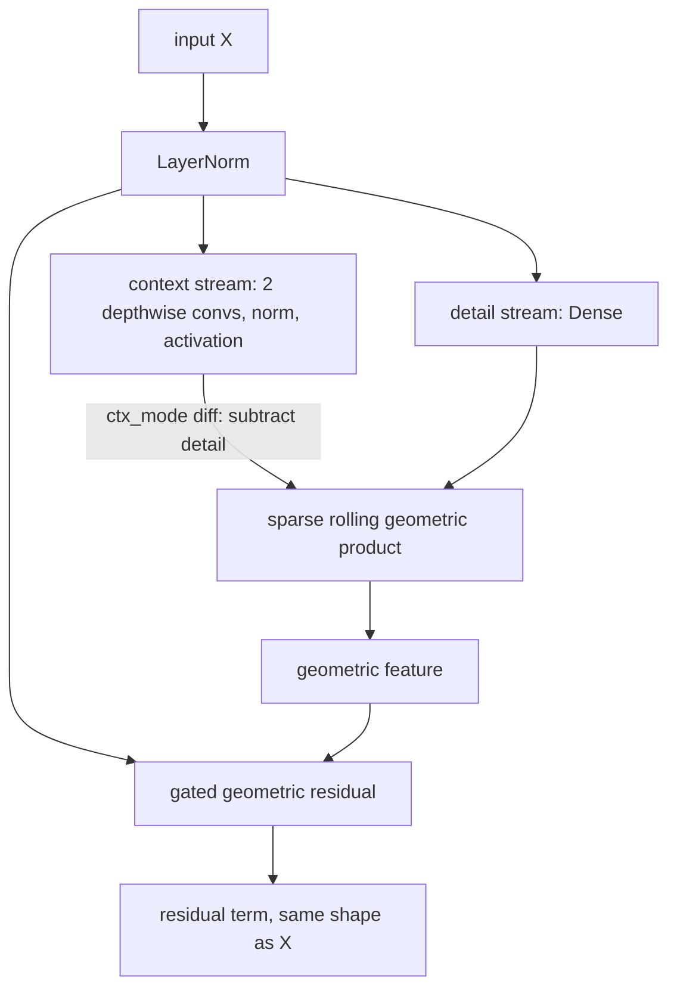

# geometric

Keras 3 layers that work with geometry: a Clifford (geometric) algebra block and recurrent cell, point cloud layers, a ray/distance combiner and a sparse depth densifier. It lives at `src/dl_techniques/layers/geometric/` in the `dl_techniques` library.

## What it is for

Several models in the library need layers that treat features or coordinates as geometric objects instead of plain vectors. The largest part of this module is the CliffordNet block. It replaces the usual "token mixer plus feed-forward network" pair with one operation, the Clifford geometric product. That product has two parts: an inner part that measures how well two feature vectors agree, and a wedge part that measures how they differ in orientation. Ordinary dot-product attention keeps only the first part.

The rest of the module is smaller and independent: layers for 3D point clouds (a graph-based autoencoder, a soft assignment network, supernode pooling), a layer that turns raw network outputs into unit rays and positive distances, and a layer that fills in a sparse depth map.

## How it works

### CliffordNet block (`clifford_block.py`)

The block takes a feature tensor and returns only a residual term. The caller adds it to the input.



- The detail stream is a 1x1 projection. The context stream gathers local neighbours.
- The geometric product is made cheap by "rolling": the context stream is shifted along the channel axis by a few offsets (for example 1, 2, 4). For each offset the layer computes a dot term and a wedge term. All terms are joined and projected back to the original channel count with one Dense layer.
- The residual layer scales the result by a learned per-channel factor that starts near zero, so a deep stack starts close to identity.
- An optional global branch adds a whole-input summary.
- The same block works on images `(B, H, W, D)` and on sequences `(B, L, D)`. With `causal=True` each position sees only itself and earlier positions.

### CliffordNet recurrent layer (`clifford_rnn.py`)

The same idea applied over time. The present input forms the detail stream. The previous hidden state forms the context stream. The cell works inside `keras.layers.RNN`, and `CliffordRNN` is a ready-made RNN layer with the GRU/LSTM-style options.

### Point cloud layers

- `PointCloudAutoencoder` runs two point clouds through a shared graph-based encoder (three nearest-neighbour edge-convolution blocks) and a shared decoder.
- `CorrespondenceNetwork` takes per-point and global features and outputs the probability that each point belongs to each of K Gaussian components.
- `SupernodePooling` picks some points as supernodes, collects messages from their neighbours and averages them.

### Ray and depth layers

- `RayPointCombinator` normalizes a 3-channel ray to unit length, makes a 1-channel distance positive, and multiplies them into a 3D point.
- `SparseDepthSplat` blurs masked depth values and the mask with the same Gaussian, then divides one by the other to get a dense depth map and a confidence map.

## Files

- `__init__.py` - empty. Import from the submodules.
- `clifford_block.py` - `SparseRollingGeometricProduct`, `GatedGeometricResidual`, `CliffordNetBlock`, `CausalCliffordNetBlock`. Its docstring holds the theory and the measured behaviour notes.
- `clifford_rnn.py` - `CliffordRNNCell` and `CliffordRNN`.
- `point_cloud_autoencoder.py` - `PointCloudAutoencoder`, `CorrespondenceNetwork`, and the private helper `_get_graph_feature`.
- `supernode_pooling.py` - `SupernodePooling`.
- `ray_point_combinator.py` - `RayPointCombinator`.
- `sparse_depth_splat.py` - `SparseDepthSplat`.

## How to use it

```python
import keras
from dl_techniques.layers.geometric.clifford_block import (
    CliffordNetBlock, CausalCliffordNetBlock,
)
from dl_techniques.layers.geometric.clifford_rnn import CliffordRNN
from dl_techniques.layers.geometric.ray_point_combinator import RayPointCombinator

# Image block. It returns only the residual term, so add the input yourself.
x = keras.random.normal((2, 16, 16, 32))
block = CliffordNetBlock(channels=32, shifts=[1, 2, 4])
y = x + block(x)

# Causal sequence block on (B, L, D).
seq = keras.random.normal((2, 20, 32))
y = seq + CausalCliffordNetBlock(channels=32, shifts=[1, 2])(seq)

# Recurrent layer, used like GRU. The dropout kwargs end in _rate.
inp = keras.Input((None, 32))
out = CliffordRNN(64, return_sequences=True, dropout_rate=0.1)(inp)

# Raw ray and distance logits to a point.
ray, distance, point = RayPointCombinator()(
    (keras.random.normal((2, 8, 8, 3)), keras.random.normal((2, 8, 8, 1)))
)
```

## Things to know

- `CliffordNetBlock` and `CausalCliffordNetBlock` return only the transformed term. Add the residual yourself.
- `ctx_mode` ("diff" or "abs") has no mathematical effect on the wedge term. With `cli_mode="wedge"` the setting does nothing, and with `"full"` it changes only the inner term. Outputs differ by about 1e-7, not exactly zero.
- Sequence mode does not support masks. A Keras mask is dropped with a warning and padding is treated as data. With `use_global_context=True`, the amount of padding changes every real position. Group sequences by length or pool with an explicit mask outside the block.
- Image mode uses batch norm for the context stream by default, with Keras defaults (momentum 0.99, epsilon 1e-6 through the factory), not the 0.1 and 1e-5 of the original PyTorch code. Pass `normalization_kwargs={"epsilon": 1e-5, "momentum": 0.9}` to match it.
- Weight init is `glorot_uniform` by default, not the paper's truncated normal with std 0.02.
- A causal block rejects `normalization_type` values that average over the sequence (`batch_norm`, `bias_free_batch_norm`, `global_response_norm`), because they leak the future. Loading an old config with that combination swaps in `zero_centered_rms_norm` and logs a warning, so the loaded model is not numerically identical.
- `use_global_context=True` needs `channels >= 3` in the block and `units >= 2` in the RNN cell.
- `CliffordRNN` imports a private Keras path (`keras.src.layers.rnn.dropout_rnn_cell`). A Keras upgrade that moves it fails at import, on purpose.
- `SupernodePooling` works on one point cloud at a time: `positions` is `(num_points, ndim)` with no batch axis, and the output is `(1, num_supernodes, hidden_dim)`. With `k_neighbors`, a point joins a supernode when its squared distance is no larger than that supernode's k-th smallest, so ties at the k-th distance keep every tied point. The `max_neighbors` argument is stored but never used.
- `PointCloudAutoencoder` accepts 3D coordinates only (the first sub-layer is built for 6 edge-feature channels), and the number of points must be known when the layer is built.
- `SparseDepthSplat` forces the depth to exactly 0.0 wherever the Gaussian window holds no valid sample.
- Tests live in `tests/test_layers/test_geometric/`. Run only that directory, not the full suite.
