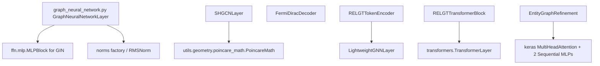

# graphs

Path: `src/dl_techniques/layers/graphs/`
Purpose: Keras 3 layers for graph-structured inputs (node features plus a dense adjacency matrix), plus an entity-graph discovery layer for plain embedding sequences.

## Scope

Lives here: one general GNN layer, the sHGCN layer and its Fermi-Dirac decoder, the three RELGT building blocks, and `EntityGraphRefinement` with two NumPy analysis helpers.

Does not live here: whole models. The consumers are `src/dl_techniques/models/graph/relgt/model.py` (imports `RELGTTransformerBlock` and `RELGTTokenEncoder`) and `src/dl_techniques/models/graph/shgcn/model.py` (imports `FermiDiracDecoder` and `SHGCNLayer`). No module under `src` imports `GraphNeuralNetworkLayer`, `LightweightGNNLayer` or `EntityGraphRefinement`; only tests do (`LightweightGNNLayer` is used inside `RELGTTokenEncoder`). There is no `factory.py` here and `__init__.py` is empty (zero bytes), so always import from the submodule.

## Architecture

All layers follow the Keras 3 pattern: `build()` builds sublayers explicitly, `super().build()` is called last, `get_config()` returns every constructor argument. Most sublayers are created in `__init__`. Two layers are exceptions:

- `EntityGraphRefinement` creates its `MultiHeadAttention`, the positional `Embedding` and both `Sequential` MLPs in `build()` (the `__init__` only sets the attributes to `None`). Its `entity_library` weight is also made in `build()`.
- `RELGTTransformerBlock` creates `combination_ffn` in `build()` (via `create_ffn_layer`); it is `None` after `__init__`. `global_centroids` is a weight made in `build()` too.

Each class is decorated `@register_dl_technique("dl_techniques.layers.graphs.<module_name>")`; the three RELGT classes share one package string and differ by class name.

Call input per layer (all adjacency tensors are dense):

| Layer | Call input |
| --- | --- |
| `GraphNeuralNetworkLayer`, `SHGCNLayer`, `LightweightGNNLayer` | `[features (B, N, D), adjacency (B, N, N)]` |
| `FermiDiracDecoder` | `[u, v]`, each `(B, D)` |
| `RELGTTokenEncoder` | dict with five named keys (see Data shapes) |
| `RELGTTransformerBlock` | `[local_tokens (B, K, E), seed_node_features (B, 1, E)]` |
| `EntityGraphRefinement` | one tensor `(B, S, D)` |

Adjacency handling in `GraphNeuralNetworkLayer.call`: `deg = sum(adjacency, axis=-1)` floored at 1e-12, then `normalized_adj = adjacency * (1/deg)[:, :, None]`, i.e. `D^-1 A`: row `i` is scaled by `1/deg[i]`, every row with an edge sums to 1, and a node's update is the mean over its neighbours. No self-loops are added (the adjacency decides whether a node sees itself). It is not the symmetric `D^-1/2 (A+I) D^-1/2`; that is `LightweightGNNLayer`. GCN computes `normalized_adj @ h` then a Dense. GraphSAGE computes a self Dense on `h` plus a neighbour Dense on `normalized_adj @ h`. GIN uses the raw `adjacency @ h`. GAT uses `cast(adjacency > 0, float32)` as the attention mask. `TestAdjacencyNormalization` pins the row sums with identity kernels. Before this was fixed the code scaled columns (`A[i, j] / deg[j]`), so outputs of older runs on non-regular graphs differ.

## Key files

| File | Role | Notes |
| --- | --- | --- |
| `graph_neural_network.py` | `GraphNeuralNetworkLayer` | 833 lines, 235 of them comment lines; 11 lines contain "DECISION". Four message-passing modes. |
| `simplified_hyperbolic_graph_convolutional_neural_layer.py` | `SHGCNLayer` | Module-level `_poincare_math = PoincareMath(eps=1e-5)`. |
| `fermi_diract_decoder.py` | `FermiDiracDecoder` | File name is misspelled "diract" and is part of the registered key and the import path. Do not rename without migrating both. |
| `relational_graph_transformer_blocks.py` | `LightweightGNNLayer`, `RELGTTokenEncoder`, `RELGTTransformerBlock`, `SUMMARY_BROADCAST_SCALE` | Holds three classes and one module constant. |
| `entity_graph_refinement.py` | `EntityGraphRefinement`, `get_graph_statistics`, `extract_hierarchies` | The two functions are NumPy, not layers. |

## Public interface

`GraphNeuralNetworkLayer(concept_dim, num_layers=3, message_passing='gcn', aggregation='attention', normalization='layer', activation='relu', dropout_rate=0.1, use_residual=True, num_attention_heads=4, epsilon=0.0, kernel_initializer='glorot_uniform', bias_initializer='zeros', kernel_regularizer=None, bias_regularizer=None)`
- `message_passing` in `gcn|graphsage|gat|gin`; `aggregation` in `mean|max|attention|sum|none`; `normalization` in `none|batch|layer|rms`.
- Call: `layer([node_features, adjacency], training=)`. Output `(B, 1, D)` for mean/max/sum, `(B, N, D)` for attention/none, where `D = concept_dim`.
- `ValueError` in `__init__`: non-positive `concept_dim`/`num_layers`/`num_attention_heads`, `dropout_rate` outside `[0,1]`, unknown `message_passing` or `aggregation`, `concept_dim % num_attention_heads != 0`. `normalization` is NOT validated: an unknown string silently means no normalization (falls to the `else` branch, `None`).
- `ValueError` in `build()`: adjacency or nodes not rank 3, adjacency not square, batch or node-count mismatch (concrete axes only).

`SHGCNLayer(units, activation='relu', use_bias=True, use_curvature=True, dropout_rate=0.0, kernel_initializer='glorot_uniform', bias_initializer='zeros')`
- Call: `layer([x, adj])`, returns `(..., N, units)`. The adjacency is used as given (`matmul(adj, h_tangent)`), with no normalization. `dropout_rate` must be in `[0, 1)`; `units > 0`. `build` raises `ValueError` unless input is a 2-item list/tuple.
- `curvature` property: `softplus(c_theta)`. `c_theta` is a trainable scalar initialized to 0.54 when `use_curvature`, otherwise the Python float 0.54.

`FermiDiracDecoder(r_initializer=None, t_initializer=None)`
- Defaults: `r` = `Constant(2.0)`, `t` = `Constant(1.0)`. Weights `threshold` (`self.r`) and `temperature` (`self.t`), scalars.
- Call: `decoder([u, v])` returns logits `(B,)` = `-(sum((u-v)^2) - r) / t`. `build` raises `ValueError` if not two shapes or last dims differ.

`LightweightGNNLayer(units, activation='relu', kernel_initializer='glorot_uniform', kernel_regularizer=None)`
- Call: `[features, adjacency]`. Adds `I` to the adjacency, applies `D^-1/2 (A+I) D^-1/2`, then `norm_adj @ (X @ W)`, then the activation. No bias. `ValueError` if `units <= 0` or the feature last dim is `None` at build.

`RELGTTokenEncoder(embedding_dim, num_node_types, max_hops=2, gnn_pe_dim=32, gnn_pe_layers=2, dropout_rate=0.1, normalization_type='layer_norm', kernel_initializer='glorot_uniform')`
- Call input dict keys: `node_features (B,K,F)`, `node_types (B,K)`, `hop_distances (B,K)`, `relative_times (B,K,1)`, `subgraph_adjacency (B,K,K)`. Output `(B,K,embedding_dim)`.
- `max_hops` may be 0 (non-negative); the hop table has `max_hops + 1` rows.

`RELGTTransformerBlock(embedding_dim, num_heads, num_global_centroids, ffn_dim, dropout_rate=0.1, ffn_type='mlp', normalization_type='layer_norm', kernel_initializer='glorot_uniform', return_tokens=False)`
- Call: `[local_tokens (B,K,E), seed_node_features (B,1,E)]`. Returns `(B,E)`, or `((B,E), (B,K,E))` when `return_tokens`.
- `ValueError` if `embedding_dim % num_heads != 0` or any size is non-positive.

`EntityGraphRefinement(max_entities, entity_dim, num_refinement_steps=3, initial_density=0.8, attention_heads=8, dropout_rate=0.1, refinement_activation='gelu', entity_activity_threshold=0.1, use_positional_encoding=True, max_sequence_length=1000, regularization_weight=0.01, activity_regularization_target=0.1)`
- Call: `layer(embeddings (B,S,D), training=)` returns `(entities (B,M,entity_dim), graph (B,M,M), entity_mask (B,M))`.
- `ValueError` from `_validate_hyperparameters` for out-of-range values; `ValueError` in `build` if the embedding dim is `None`.
- `get_graph_statistics(entities, graph, entity_mask, threshold=0.1) -> dict`; `extract_hierarchies(graph, entity_mask, threshold=0.3) -> List[(parent, child, strength)]`, sorted by strength descending.

## Data shapes

- RELGT dict input keys are listed above and are read by name in `RELGTTokenEncoder.build` and `call`.
- `EntityGraphRefinement` internals: MHA `key_dim = max(entity_dim // attention_heads, 1)`; refinement MLP input width `2*entity_dim + 1 + D`; gate MLP input width `2*entity_dim`; edges are processed flattened to `(B*M*M, features)`. The context vector is `mean(input_embeddings)` taken BEFORE the positional encoding is added.
- `GraphNeuralNetworkLayer` weights: GCN `gcn_dense_{i}`; GraphSAGE `sage_self_{i}`, `sage_neighbor_{i}`; GAT `gat_attention_{i}`; GIN `gin_mlp_{i}` plus `gin_epsilon` of shape `(num_layers,)`; norms `gnn_layer_norm_{i}`, `gnn_rms_norm_{i}`, `gnn_batch_norm_{i}`; `aggregation_attention`.

## Invariants and constraints

- GraphSAGE layers stay in two flat lists, `sage_self_layers` and `sage_neighbor_layers`, with `None` placeholders in `gnn_layers`. A list of dicts loses all eight GraphSAGE Dense weights on `.keras` save (measured in the source comment). `tests/test_layers/test_graphs/test_the_graphsage_weights_reach_the_archive.py` guards it.
- In `GraphNeuralNetworkLayer.build`, the message-passing sublayer is built at the block INPUT width (raw width at block 0, `concept_dim` after) while dropout and norm are built at the block OUTPUT width (`concept_dim`). `_block_input_shape` is the single source of that arithmetic for both `build` and `compute_output_shape`. Do not collapse to one shape.
- GAT `MultiHeadAttention` keeps `output_shape=self.concept_dim`. Without it the output width is the query width, not `concept_dim`.
- `kernel_initializer` is deliberately not wrapped in `clone_initializer` for the GAT, GIN and aggregation-attention sites, because the callee already re-clones. Wrapped for GCN and GraphSAGE Dense layers. A custom initializer whose `get_config()` raises makes GAT/aggregation-attention `build()` fail loudly.
- Normalization for `layer` and `batch` goes through `create_normalization_layer` (epsilon 1e-6, not Keras' 1e-3). `rms` constructs `RMSNorm` directly. Keep names explicit (`name=`) so weight paths do not depend on Keras' global counter.
- `num_attention_heads` sizes BOTH the GAT attention and the aggregation attention.
- `GraphNeuralNetworkLayer` residual: applied only when `h_input.shape[-1] == h_new.shape[-1]`. Activation is skipped for GIN (the `MLPBlock` already has it).
- `SHGCNLayer` fixed curvature must remain a Python float, not a tensor created in `build()` or `__init__`. A tensor made in `build()` belongs to Keras' scratch graph and raises "out of scope" in `call()`. The `curvature` property converts lazily.
- `FermiDiracDecoder` must return the logit. Do not add a sigmoid back; consumers (`models/graph/shgcn`) train with `from_logits=True`.
- `RELGTTransformerBlock.call` with `return_tokens=True` returns `(output, output_tokens)` where `output_tokens = local_processed_tokens + SUMMARY_BROADCAST_SCALE * expand_dims(output, 1)`. Here `local_processed_tokens` is the output of `self.local_transformer` (not the call input `local_tokens`) and `output` is the `(B, E)` combined representation after `combination_norm`. Returning the raw `local_processed_tokens` instead leaves the global half (centroids, global attention, residual projection, combination norm and FFN) without gradient in every non-final block. `SUMMARY_BROADCAST_SCALE = 0.1` is bounded: the summary-to-token ratio grows with depth and touched 1.0 at the 4th block in the worst measured draw (source comment). Re-measure before using more than 4 stacked blocks. A source comment records that a learnable scale was measured to get a `None` gradient in the last block, because `RELGT.call` discards that block's tokens.
- `RELGTTokenEncoder`: `TimeEncoder` and `PEProjection` get `clone_initializer` copies; `FeatureEncoder` keeps the stored instance so `get_config` reports what the caller passed.
- `EntityGraphRefinement`: no logging and no log-only reductions in `call` or its helpers. The source comment says a per-batch statistic belongs in a metric or a callback, not in `call`. (`__init__`, `build` and the two NumPy helpers do log.)
- `build()` must call `super().build(input_shape)` last in every class.

## Dependencies

Internal:
- `dl_techniques.utils.keras_registration.register_dl_technique` (all files).
- `dl_techniques.layers.activations.common`: `resolve_activation`, `serialize_activation` (GNN, sHGCN, RELGT).
- `dl_techniques.utils.activation_serialization`: `serialize_activation`, `deserialize_activation` (entity refinement only; a different pair from the one above).
- `dl_techniques.utils.logger.logger` (entity refinement only).
- `dl_techniques.utils.geometry.poincare_math.PoincareMath`: `exp_map_0`, `log_map_0`, `mobius_add`, `project`.
- `..ffn.mlp.MLPBlock`, `..norms.rms_norm.RMSNorm`, `..norms.factory.create_normalization_layer`, `...initializers.clone.clone_initializer` (GNN).
- `..ffn.create_ffn_layer`, `..transformers.TransformerLayer`, `..norms.create_normalization_layer`, `...initializers.clone_initializer` (RELGT).

External: `keras` (3.x), `numpy` (entity refinement helpers and `get_graph_statistics`).

## Failure modes

- Mismatched adjacency and node shapes in `GraphNeuralNetworkLayer` raise a named `ValueError` at build time. The other layers do no such check; a bad adjacency surfaces as a matmul error or silent batch broadcast.
- `EntityGraphRefinement` with no active entities: `get_graph_statistics` logs a warning and returns `{'active_entities': 0, 'warning': ...}`; `extract_hierarchies` returns `[]` for 0 or 1 active entities.
- `EntityGraphRefinement` output is stochastic at inference (random initial graph via `keras.random.uniform`). `RELGTTokenEncoder` is stochastic at inference too (random Gaussian features for the structural encoding). Tests that compare two runs must seed or account for this.
- Unknown `normalization` string in `GraphNeuralNetworkLayer` is silently treated as `'none'`.
- Nothing constrains `FermiDiracDecoder.t` positive, so training can drive it to zero or below.

## Working here

- Tests live in `tests/test_layers/test_graphs/`: `test_graph_neural_network.py`, `test_simplified_hyperbolic.py`, `test_fermi_diract_decoder.py`, `test_relational_graph_transformer_blocks.py`, `test_entity_graph_refinement.py`, `test_the_graphsage_weights_reach_the_archive.py`. Consumer tests: `tests/test_models/test_shgcn/` and `tests/test_models/test_relgt/`. Run from the repo root with the venv, scoped, for example `.venv/bin/python -m pytest tests/test_layers/test_graphs/ -q`. Do not run the full suite.
- Docstrings in this folder use Sphinx/reST (`:param:`, `:type:`, `:raises:`). Match them.
- Register new layers with `@register_dl_technique("dl_techniques.layers.graphs.<module>")`, add `get_config` covering every constructor argument, and add a test under `tests/test_layers/test_graphs/`. The files use `import keras` and `keras.ops`; `entity_graph_refinement.py` also does `from keras import ops, layers`.
- No factory exists for this folder.
- Changing a registered package string or class name breaks loading of existing `.keras` archives.
- Existing `DECISION plan-...` comments record measured defects. Read the comment before changing the code beside it.
