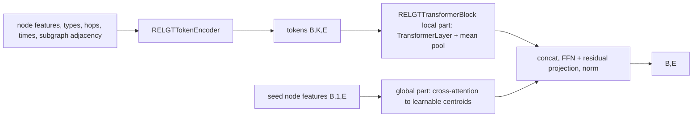

# graphs

Keras 3 layers for data shaped like a graph: a set of nodes plus an adjacency matrix that says which nodes are linked. The folder is `src/dl_techniques/layers/graphs/` in the `dl_techniques` library.

## What it is for

Most layers treat their input as a flat sequence or a grid. Graph data is different: each node should mix in information from its neighbours, and the edges themselves can carry meaning. This folder holds seven layer classes for that, in four groups:

- a general graph neural network (GNN) layer with four message-passing styles (`GraphNeuralNetworkLayer`),
- a hyperbolic graph convolution (sHGCN) layer and a link-prediction decoder that goes with it (`SHGCNLayer`, `FermiDiracDecoder`),
- the three blocks of a Relational Graph Transformer (RELGT) for heterogeneous, time-aware graphs (`LightweightGNNLayer`, `RELGTTokenEncoder`, `RELGTTransformerBlock`),
- a layer that discovers a graph of "entities" inside an ordinary embedding sequence (`EntityGraphRefinement`).

The groups do not depend on each other. Inside the RELGT group, `RELGTTokenEncoder` uses `LightweightGNNLayer`.

## How it works

There is no single input format. Each layer takes its own:

| Layer | Call input |
| --- | --- |
| `GraphNeuralNetworkLayer`, `SHGCNLayer`, `LightweightGNNLayer` | a pair `[features (B, N, D), adjacency (B, N, N)]` |
| `FermiDiracDecoder` | a pair `[u (B, D), v (B, D)]` of node embeddings |
| `RELGTTokenEncoder` | a dict with five keys (listed under "How to use it") |
| `RELGTTransformerBlock` | a pair `[local_tokens (B, K, E), seed_node_features (B, 1, E)]` |
| `EntityGraphRefinement` | one tensor of embeddings `(B, S, D)` |

Adjacency matrices are dense, shape `(batch, nodes, nodes)`.

**GraphNeuralNetworkLayer** stacks `num_layers` blocks. Each block does message passing, activation, dropout, an optional residual add, then a normalization. At the end it optionally pools across nodes. Before the blocks, `call` builds a scaled adjacency: entry `[i, j]` is `adjacency[i, j] / deg[j]`, where `deg[j]` is the row sum of row `j` (floored at 1e-12). So column `j` is scaled by `1/deg[j]`. In general its rows do not sum to 1 for a non-symmetric adjacency, so it is not a plain neighbour average. The message-passing style is one of:

- `gcn`: multiply the scaled adjacency by the node features, then apply a Dense layer.
- `graphsage`: one Dense on the node itself, another on the scaled-adjacency product, summed.
- `gat`: multi-head attention, with the adjacency (`> 0`) as the attention mask.
- `gin`: `(1 + eps) * h + adjacency @ h` using the raw adjacency, then an MLP. `eps` is learnable, one per block.

**SHGCNLayer** does a linear map, moves the result onto a Poincare ball (a curved space), adds the bias there with Moebius addition, moves back to flat space, and only then aggregates over neighbours by multiplying with the adjacency. Curvature is learnable by default.

**FermiDiracDecoder** scores a pair of node embeddings `u, v` as `-(||u - v||^2 - r) / t`, with learnable `r` and `t`. It returns this logit. `sigmoid` of it is the edge probability.

**RELGT blocks**:



`RELGTTokenEncoder` adds five embeddings per node (features, type, hop distance, relative time, and a structural encoding from `LightweightGNNLayer` run over random noise on the subgraph adjacency), then normalizes and applies dropout. `LightweightGNNLayer` adds self-loops to the adjacency, applies symmetric normalization `D^-1/2 (A+I) D^-1/2`, multiplies by `X @ W`, and applies the activation.

**EntityGraphRefinement** takes an embedding sequence `[B, S, D]`. A learnable library of `max_entities` vectors queries the sequence with multi-head attention, giving entity vectors. A random dense graph over the entities is then rewritten `num_refinement_steps` times by a shared MLP that sees both endpoints, the current edge value and the mean of the input. A second MLP produces 0 to 1 gates that thin the graph. Edges touching inactive entities, and self-edges, are zeroed. It returns `(entities, graph, entity_mask)`.

## Files

- `graph_neural_network.py` - `GraphNeuralNetworkLayer`: GCN / GraphSAGE / GAT / GIN stack with normalization, residuals and final pooling.
- `simplified_hyperbolic_graph_convolutional_neural_layer.py` - `SHGCNLayer`: sHGCN layer (Eq. 14 of Arevalo et al.).
- `fermi_diract_decoder.py` - `FermiDiracDecoder`: link-prediction decoder returning edge logits. The file name is spelled "diract" in the code; keep it, imports use it.
- `relational_graph_transformer_blocks.py` - `LightweightGNNLayer`, `RELGTTokenEncoder`, `RELGTTransformerBlock`, and the constant `SUMMARY_BROADCAST_SCALE = 0.1`.
- `entity_graph_refinement.py` - `EntityGraphRefinement` layer plus two NumPy helpers, `get_graph_statistics` and `extract_hierarchies`.
- `__init__.py` - empty. Import from the submodule.

## How to use it

```python
import numpy as np
from dl_techniques.layers.graphs.graph_neural_network import GraphNeuralNetworkLayer
from dl_techniques.layers.graphs.simplified_hyperbolic_graph_convolutional_neural_layer import SHGCNLayer
from dl_techniques.layers.graphs.fermi_diract_decoder import FermiDiracDecoder
from dl_techniques.layers.graphs.entity_graph_refinement import (
    EntityGraphRefinement, get_graph_statistics, extract_hierarchies,
)

x = np.random.randn(2, 5, 16).astype("float32")                 # (batch, nodes, features)
adj = (np.random.rand(2, 5, 5) > 0.5).astype("float32")         # (batch, nodes, nodes)

gnn = GraphNeuralNetworkLayer(concept_dim=16, message_passing="gcn", aggregation="mean")
pooled = gnn([x, adj])                                          # (2, 1, 16)

h = SHGCNLayer(units=8)([x, adj])                               # (2, 5, 8)

logits = FermiDiracDecoder()([x[:, 0], x[:, 1]])                # (2,), train with BinaryCrossentropy(from_logits=True)

entities, graph, mask = EntityGraphRefinement(
    max_entities=6, entity_dim=16, attention_heads=4)(x)        # (2,6,16) (2,6,6) (2,6)
stats = get_graph_statistics(
    np.array(entities[0]), np.array(graph[0]), np.array(mask[0]))
links = extract_hierarchies(np.array(graph[0]), np.array(mask[0]))
```

RELGT inputs are dictionaries and lists:

```python
# RELGTTokenEncoder takes a dict with these keys
{"node_features": (B,K,F), "node_types": (B,K) int, "hop_distances": (B,K) int,
 "relative_times": (B,K,1), "subgraph_adjacency": (B,K,K)}
# RELGTTransformerBlock takes [local_tokens (B,K,E), seed_node_features (B,1,E)]
```

## Things to know

- `GraphNeuralNetworkLayer`: `num_attention_heads` must divide `concept_dim` (raises `ValueError`). Adjacency must be rank 3, square, and agree with the node features on batch and node count; `None` axes are skipped but the rank is always checked. `aggregation='attention'` keeps all nodes (shape `(B, N, D)`); `mean`, `max`, `sum` give `(B, 1, D)`.
- `GraphNeuralNetworkLayer` skips the residual add in any block whose input width differs from `concept_dim`, which is normally block 0.
- `GraphNeuralNetworkLayer` uses the column-scaled adjacency described above for GCN and GraphSAGE, even though its docstrings describe a row-normalized or symmetric form. GIN uses the raw adjacency. GAT only uses it as a mask. An unknown `normalization` string is not rejected; it means no normalization.
- `GraphNeuralNetworkLayer` with `graphsage` keeps its Dense layers in two flat lists. A comment in the source records that holding them in a list of dicts left them out of the saved `.keras` archive.
- `SHGCNLayer` uses the adjacency as given, with no normalization, so any normalization has to happen before the call. Dropout is applied to the input features only when `training` is true and the rate is above 0.
- `FermiDiracDecoder` returns logits, not probabilities. Nothing forces the temperature `t` to stay positive.
- `EntityGraphRefinement` draws a new random initial graph on every call, including at inference, so two calls on the same input differ slightly. Its L1 and activity penalties are added with `add_loss` only when `training` is true and `regularization_weight > 0`. An entity is active only if its largest attention weight exceeds `entity_activity_threshold`; on long sequences attention weights are small, so check the mask.
- `RELGTTokenEncoder` also draws fresh Gaussian noise on every call, at inference too. Its hop embedding table has `max_hops + 1` rows, so `hop_distances` values must be in `[0, max_hops]`.
- `RELGTTransformerBlock` needs `embedding_dim` divisible by `num_heads`, and seed features whose last axis equals `embedding_dim`.
- `RELGTTransformerBlock(return_tokens=True)` returns `(summary, tokens)` so blocks can be stacked. The summary is added onto the locally processed tokens at scale 0.1. A comment in the source records that the summary-to-token ratio grows with depth and that the worst of 20 measured draws touched 1.0 at the 4th block.
- All layers register under `dl_techniques.layers.graphs.<module>`, so saved `.keras` files resolve them by class name inside that module path.
- Tests: `tests/test_layers/test_graphs/`.
