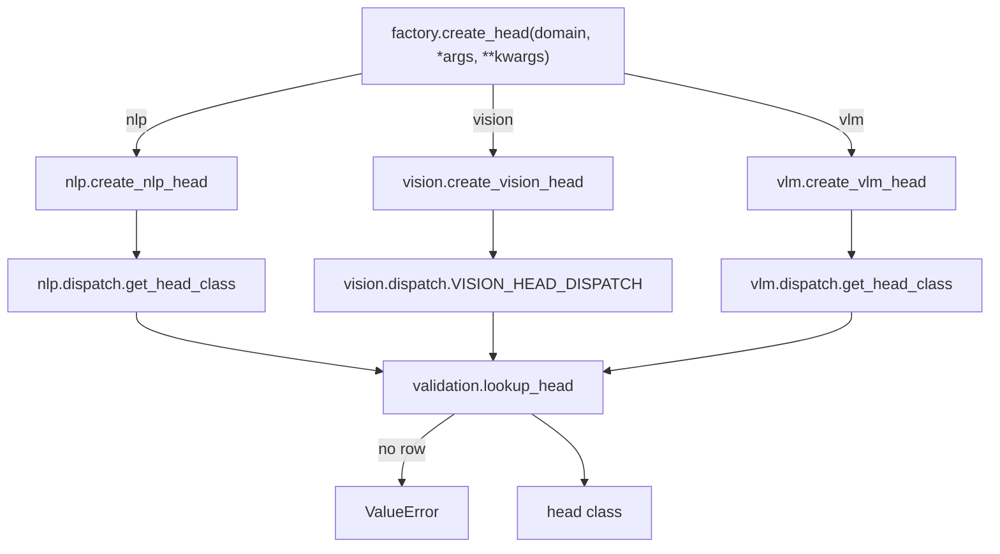

# heads

Path: `src/dl_techniques/layers/heads`
Purpose: Keras 3 task-head layers for `dl_techniques`, grouped by domain (`nlp/`, `vision/`, `vlm/`), with a thin `create_head` dispatch facade and the argument checks shared by the domains.

## Scope

Lives here: three domain sub-packages (heads, task-type enums and configs, dispatch tables, factories), the facade `factory.py`, the aggregator `task_types.py`, and two cross-domain helper modules, `validation.py` and `masking.py`.

Does not live here: backbones (`models/`), the pooling, attention, FFN, norm and fusion layers the heads compose (`layers/sequence_pooling`, `layers/attention`, `layers/ffn`, `layers/norms`, `layers/fusion`; attention, FFN and norm layers are built through their factories, while `SequencePooling` and `MultiModalFusion` are constructed directly), trainers (`src/train/`). The package replaced three older packages (`nlp_heads`, `vision_heads`, `vlm_heads`) by `git mv`; every layer class name was preserved.

This file covers the shared surface, the rules that hold across all three domains, and enough of each domain to work in it. A head takes features, not raw inputs: NLP takes hidden states, vision a feature map, VLM a dict of feature tensors.

## Architecture

Import direction: `validation.py` and `masking.py` import nothing from the domains. The domains import them. `factory.py` imports the three `create_*_head` functions. `__init__.py` and `task_types.py` only re-export.

`create_head` checks `domain in ('nlp', 'vision', 'vlm')` (else `ValueError`), logs at debug, and returns `create_<domain>_head(*args, **kwargs)`. It forwards verbatim. The three signatures stay different on purpose: `nlp` takes `task_config` and `input_dim`, `vision` takes a task type plus head kwargs, `vlm` takes `task_config` plus head kwargs. Do not add a unified parameter set and do not merge the three `Base*Head` classes.

Per-domain structure:

- nlp: dependencies run `task_types` / `utils` -> `base` -> leaf heads -> `dispatch` -> `multitask` -> `factory` -> `model_head`. `BaseNLPHead` has no `call`; a leaf `call` runs a subset of pool -> `norm` -> `dropout` -> `intermediate` (`DenseBlock`) -> `task_attention` -> `ffn` -> output `Dense`, selected by class attributes `_POOLS`, `_APPLIES_TASK_ATTENTION`, `_APPLIES_FFN`.
- vision: `task_types` -> `dispatch`; `utils` -> `base` -> heads -> `dispatch` -> `multitask`, `config` -> `factory` (a re-export layer only). `BaseVisionHead` owns optional `attention` then `ffn` stages (no common norm or Dropout); depth, normals and flow share `decoder.py` (three ConvBlock + stride-2 transposed-conv stages, 8x upsampling).
- vlm: `task_types` -> (`utils`, `base`) -> leaf heads -> `dispatch` -> `multitask` -> `factory`. `BaseVLMHead` owns only a `fusion` (`MultiModalFusion`) layer; captioning, VQA and the wrapper derive from `keras.layers.Layer` directly.

Class families (24 classes with a `Head` name; 8 NLP + 10 vision + 6 VLM):

| Domain | Classes | Base |
| --- | --- | --- |
| nlp | `BaseNLPHead`, `TextClassificationHead`, `TokenClassificationHead`, `QuestionAnsweringHead`, `TextSimilarityHead`, `TextGenerationHead`, `MultipleChoiceHead`, `MultiTaskNLPHead` | leaf heads subclass `BaseNLPHead`; `MultiTaskNLPHead` does not |
| vision | `BaseVisionHead`, `DetectionHead`, `SegmentationHead`, `DepthEstimationHead`, `SurfaceNormalsHead`, `OpticalFlowHead`, `ClassificationHead`, `InstanceSegmentationHead`, `EnhancementHead`, `MultiTaskHead` | heads subclass `BaseVisionHead`; `MultiTaskHead` does not. Private `_DenseVectorHeadBase` (normals, flow) is unregistered and not counted |
| vlm | `BaseVLMHead`, `ImageCaptioningHead`, `VQAHead`, `VisualGroundingHead`, `ImageTextMatchingHead`, `MultiTaskVLMHead` | grounding and matching subclass `BaseVLMHead`; the rest subclass `keras.layers.Layer` |

Dispatch tables (one per domain, every helper reads the same table): `nlp.task_types.NLP_HEAD_DISPATCH` (24 rows of 37 `NLPTaskType` members; holds class NAMES, because `task_types.py` imports no head; `nlp.dispatch._HEAD_CLASSES` maps names to classes), `vision.dispatch.VISION_HEAD_DISPATCH` (10 rows of 37 `VisionTaskType`, each row a head class plus default kwargs, caller wins), `vlm.dispatch.VLM_HEAD_DISPATCH` (4 rows of 47 `VLMTaskType`).

## Key files

| File | Role | Notes |
| --- | --- | --- |
| `__init__.py` | Union re-export, 42 names in `__all__` | NLP 12, vision 18, VLM 11, plus `create_head`. The eight NLP in-model helpers (`TASK_HEAD_NAME`, `build_model_task_head`, ...) are not re-exported here; import them from `heads.nlp` |
| `factory.py` | `create_head`, `HeadDomain` literal | Single-head factories only. Carries two `DECISION` comments (keep thin; keep with no production caller) |
| `task_types.py` | Re-exports `NLPTaskType`, `NLPTaskConfig`, `VisionTaskType`, `TaskConfiguration`, `CommonTaskConfigurations`, `parse_task_list`, `VLMTaskType`, `VLMTaskConfig`, `VLMTaskConfiguration` | Imports only. No name collides; no alias |
| `validation.py` | Six shared checks | See Public interface |
| `masking.py` | `fill_masked` | Used by NLP attention pooling, NLP QA logits, VLM grounding scores. Lives here, not in `utils/dtype_policy.py`, which owns only the number (`mask_sentinel`), no tensor op |
| `nlp/` | NLP heads, `NLPTaskConfig`, dispatch, `create_nlp_head`, `create_multi_task_nlp_head`, `model_head.py` | `__all__` has 20 names. Modules: `task_types`, `utils`, `base`, six leaf heads, `multitask`, `dispatch`, `factory`, `model_head` |
| `vision/` | Vision heads, `VisionTaskType`, presets, `create_vision_head`, `create_multi_task_head`, `create_enhancement_head`, `build_model_vision_head` | `__all__` has 18 names; `vision/factory.py` is a re-export layer only, logic lives in the defining module. Other modules: `base`, `utils`, `decoder`, `dense_vector`, `multitask`, `dispatch`, `config`, `task_types` |
| `vlm/` | VLM heads, `VLMTaskConfig`, dispatch, `create_vlm_head`, `create_multi_task_vlm_head` | `__all__` has 11 names. Modules: `task_types`, `utils` (private helpers), `base`, four leaf heads, `multitask`, `dispatch`, `factory` |

## Public interface

Package-level imports: `from dl_techniques.layers.heads import create_head`, or per domain `from dl_techniques.layers.heads.{nlp,vision,vlm} import ...`. A task-type name can come from `dl_techniques.layers.heads.task_types`.

`create_head(domain: Literal['nlp','vision','vlm'], *args, **kwargs) -> Any`. `ValueError` on an unknown domain. All other errors come from the domain factory.

`validation.py` (each raises `ValueError` naming `owner` and the argument):

- `positive_int(value, name, owner)`: defined in `dl_techniques.utils.validation` and re-bound here (shared with adapters and the MoE config). Used for every vision count, `VQAHead.num_heads`, `VLMTaskConfig` and `NLPTaskConfig` counts, NLP `input_dim` and `intermediate_size`.
- `static_rank(x, name, owner) -> int`: reads rank from `x.shape` (tuple, or `TensorShape.rank`), and from `keras.ops.ndim` only when there is no `shape`. Refuses an unknown rank. Needed because `keras.ops.ndim` reports `-1` under the TensorFlow backend for unknown rank, and `ndim` alone raises `AttributeError` on a `tf.Variable`.
- `resolve_stage_knobs(owner, table, flags, given) -> dict`: `table` maps a stage flag name to `{knob: default}`. Stage on: a `None` knob takes its default, a given one is kept. Stage off: every knob resolves to `None` and a given value (even the default) raises. Returns a new dict. Used by `BaseVisionHead` and `BaseNLPHead`, each with its own table.
- `lookup_head(task_type, table, enum_cls, domain, owner='') -> (member, row)`: parses a string with `enum_cls.from_string`, raises for a non-member, raises for a member with no row and lists the members that have one. No fallback.
- `pool_or_passthrough(features, mask, pool, *, owner, features_name, mask_name)`: rank 2 returns unchanged (a mask raises), rank 3 calls `pool(features, mask)`, other ranks raise. Used by NLP and VLM heads.
- `key_by_name(items, name_of, owner, argument='task_configs') -> dict`: a dict passes through; a list or tuple is keyed by `name_of(entry)` and a repeated name raises; any other type raises. Used by the three multi-task factories.

`masking.fill_masked(scores, keep, sentinel_dtype=None)`: returns `keras.ops.where(cast(keep, bool), scores, sentinel)`, with `sentinel = mask_sentinel(dtype)` cast to `scores.dtype`. `sentinel_dtype` defaults to `scores`' dtype; a layer passes `self.compute_dtype`. Never write `scores + (1 - keep) * sentinel`: under float16 the sentinel overflows to `-inf` and `0 * -inf` is NaN at kept positions.

Domain entry points:

- nlp: `create_nlp_head(task_config, input_dim, **kwargs)`, `create_multi_task_nlp_head(task_configs, input_dim, **kwargs)`; `MultiTaskNLPHead.call(inputs, training=None, *, task_name=None)`; in-model helpers `TASK_HEAD_NAME = "task_head"`, `validate_task_head_knobs`, `build_model_task_head(task_config, input_dim, head_config_overrides=None, default_pooling=None, name=TASK_HEAD_NAME, vocab_size=None)`, `task_config_to_dict`, `finalize_head_outputs`, `head_attention_mask`, `head_output_shape`, `ids_shape_of`. `get_head_class` is importable from `nlp.dispatch` only. `build_model_task_head` refuses `MULTIPLE_CHOICE` and a `name` in the overrides.
- vision: `create_vision_head(task_type, **kwargs)`, `create_multi_task_head(task_configuration, **kwargs)`, `create_enhancement_head(task_type, **kwargs)` (denoising and super-resolution only), `HeadConfiguration.get_default_config` / `get_efficient_config`, `build_model_vision_head(task_type, head_config, head_config_overrides=None)` and `merge_head_config_overrides` (from `vision.factory` or `vision.config`). The build order is fixed: preset, then the model's keys, then the caller's overrides; overrides may not set `name`, `num_classes` or `task_type`.
- vlm: `create_vlm_head(task_config, **kwargs)`, `create_multi_task_vlm_head(task_configs, **kwargs)`; `MultiTaskVLMHead(task_configs, task_specific_kwargs=None, **shared)` with `call(inputs, training=None, *, task_name=None)`; `get_head_class` and `VLM_HEAD_DISPATCH` from `vlm.dispatch` only.

## Data shapes

- Config types: `NLPTaskConfig` (7 fields: `name`, `task_type`, `num_classes`, `dropout_rate`, `hidden_size`, `use_crf`, `vocabulary_size`), `VLMTaskConfig` (6 fields: `name`, `task_type`, `vocab_size`, `hidden_size=768`, `dropout_rate=0.1`, `num_classes`). Vision has no per-head config dataclass: it takes a task type plus kwargs, and `TaskConfiguration` is a validated set of task types. Every field of the two config dataclasses is read by some head; do not add a field no head reads.
- Head inputs: NLP a tensor or dict `{'hidden_states', 'attention_mask'?}`; vision a feature map `(B, H, W, C)` (or tokens `(B, N, D)` with `input_format='sequence'` for detection and segmentation); VLM a dict with `vision_features`, `text_features` or `question_features`, and optional `vision_mask`, `text_mask`, `question_mask` of shape `(batch, length)` (1 = real).
- Head outputs are dicts of pre-activation logits, except `SegmentationHead`, which returns one bare tensor. Keys: NLP `logits`, `probabilities`, `predictions`, `start_logits`, `end_logits`, `embeddings`, `similarity_score`; vision `classifications`, `regressions`, `instance_masks`, `logits`, `probabilities`, `depth`, `confidence`, `normals`, `flow`, `enhanced`; VLM `logits`, `hidden_states`, `answer_logits`, `bbox`, `confidence`, `grounded_features`, `similarity_matrix`, `match_score`, `vision_embeddings`, `text_embeddings`.
- Registered key shape: `dl_techniques.layers.heads.<domain>.<module>>ClassName`, plus the legacy alias `Custom>ClassName`.

## Invariants and constraints

- **Registration.** Every class uses `@register_dl_technique("dl_techniques.layers.heads.<domain>.<module>")` from `dl_techniques.utils.keras_registration`, with the defining module's dotted path (nothing is stripped under `layers/`). Moving a class changes its key. Never use a bare `@keras.saving.register_keras_serializable()`: its key `Custom>ClassName` ignores the module, so two same-named classes would share one slot. The helper also binds `Custom>ClassName` as an alias to the same object, keyed on the bare class name, so a class name must not change (`EnhancementHead` especially: it is module-scope, not a closure inside `create_enhancement_head`, and must not be re-nested). Keys were renamed when the NLP and VLM factories were split and the vision keys were aligned; archives saved under `dl_techniques.layers.heads.<domain>.factory>...` do not load, by decision. `tests/test_layers/test_heads/test_the_head_classes_register_under_their_own_module.py` pins all 24 classes.
- **No silent dispatch fallback.** An unimplemented task type raises `ValueError` through `lookup_head`. Do not restore a default head or add a placeholder row. NLP and VLM dispatchers once ended in `table.get(task_type, <default>)`, which turned a translation task into a classifier and made unimplemented VLM tasks return a `BaseVLMHead` with no `call`. `BaseVLMHead` refuses direct construction with `TypeError` and must never appear in `VLM_HEAD_DISPATCH`.
- **Logits out.** No class-like output gets an activation. Do not add one; the consumer's loss takes `from_logits=True`. `probabilities` entries are `softmax(logits)` in the compute dtype. Allowed squashed outputs: depth sigmoid, grounding `bbox` sigmoid, unit-normalized normals. `finalize_head_outputs` drops `probabilities` / `predictions` so a model compiles against one tensor.
- **A head owns what its `call` runs, and nothing else.** A sub-layer `call` never reaches is not created. An argument `call` can never read raises `ValueError` (it is not stored). Check by counting each sub-layer's `call` over one forward, not by weights: a layer created and never called is never built and holds none. The VLM version is `test_vlm.py::TestEveryVLMHeadOwnsOnlyWhatItRuns`. Per domain: NLP `_refuse_unapplied_stages`; vision `_refuse_common_layers_call_never_runs` (call it BEFORE `super().__init__`); VLM `_check_task_config_fields` (`vocab_size` belongs to captioning, `num_classes` to VQA).
- **Stage knobs.** `attention_type`, `ffn_type`, `ffn_expansion_factor` default to `None`, resolve to `'multi_head'`, `'mlp'`, `4` when their stage is on, and raise when given with the stage off (`resolve_stage_knobs`, one table per domain). Vision presets and `build_model_vision_head` drop a preset knob whose stage ends up off. The NLP `pooling_type` of a head that never pools is validated but not read (a language model passes its default pooling to every head).
- **NLP pooling.** `cls`, `mean`, `max`, `last` delegate to the shared `SequencePooling`. The `attention` strategy stays inline as the head's `attention_pooling` scorer, `Dense(1, tanh)` plus a masked softmax; do not route it through `SequencePooling('attention')`: different mechanism and weight set, it would change values and break checkpoints. `'last'` must pass the mask to `SequencePooling` so right padding is skipped; do not simplify to `inputs[:, -1, :]`.
- **Padding masks.** NLP heads that pool read `attention_mask` (classification, both forms of `TextSimilarityHead`, `MultipleChoiceHead` with `(batch, num_choices, seq)`); token and QA heads pass it to task attention, and an attention type whose `call` has no `attention_mask` parameter refuses a mask. VLM heads honour `vision_mask`, `text_mask`, `question_mask` in every pooling and attention; mean and max go through a weightless `SequencePooling`, which draws no random seed. A mask for an already pooled input raises. `TextGenerationHead` ignores `attention_mask`.
- **Float16 safety.** Cosine similarity divides by `max(norm, stability_floor(compute_dtype, 1e-8))`; a bare `1e-8` is 0.0 in float16. Normals use `keras.ops.normalize(..., order=2, epsilon=1e-12)` in float32 for half-precision input.
- **Static rank.** Heads that branch on rank read it once with `validation.static_rank`. Do not use `len(keras.ops.shape(x))`; `test_the_heads_read_a_static_rank.py` keeps it out of all three domains.
- **Vision attention layout.** The attention stage runs in the layout its type takes. `_SPATIAL_ATTENTION_TYPES` (in `vision/utils.py`) lists map-only types; a map is flattened for a sequence type, and a sequence head's tokens go onto `patch_grid_size` for a spatial type (no grid raises). Attention is built at `hidden_dim`, so input channels must equal it.
- **VLM FFN sites.** `ImageCaptioningHead.__init__` and `ImageTextMatchingHead._create_post_fusion_layers` build FFNs by the same three rules: pass `hidden_dim` only when the registry entry lists it in `required_params`; forward `ffn_expansion_factor` only to a type that lists it; take the output-width kwarg from `_ffn_width_kwargs`, never the literal `"output_dim"`. Fusion accepts six strategies; `cross_attention` and `attention_pooling` raise at build.
- **Round trips.** Every head round-trips through `.keras` by value. Every constructor field is in `get_config`; `get_config` is JSON-safe (no `Enum` members); sub-layers sit in flat lists or named attributes (Keras does not save a layer held only in a nested list); every sub-layer is named.
- **Configs are copied.** NLP heads copy every `NLPTaskConfig` (`NLPTaskConfig.coerce`). `MultiTaskHead._create_task_heads` copies each task dict before `pop('task_type')`. `VLMTaskConfig.coerce` returns an instance unchanged, without a copy.
- **Multi-task call signature.** `task_name` is keyword-only after `training` in `MultiTaskNLPHead` and `MultiTaskVLMHead`.
- **`VisionTaskType` has no alias.** The old generic enum name is gone; do not re-add it (`test_the_vision_task_enum_has_no_alias.py`).
- **Code style.** `import keras`, qualify at the call site (`keras.ops.reshape`), never `from keras import ops`. Log through `dl_techniques.utils.logger`, no `print`. Sub-layers are created in `__init__` or `build`. Docstrings in this package are Sphinx/reST (`:param:`, `:type:`, `:raises:`); match the file you edit. `DECISION ...` comments record why a non-obvious choice was made; supersede them with a dated note, do not delete them.

## Dependencies

Internal: `layers.sequence_pooling.SequencePooling`, `layers.attention` (`create_attention_layer`, `assemble_attention_config`), `layers.ffn` (`create_ffn_layer`, `assemble_ffn_config`, `FFN_REGISTRY`), `layers.norms.create_normalization_layer`, `layers.dense_block.DenseBlock`, `layers.conv_blocks.conv_block.ConvBlock`, `layers.fusion.multimodal_fusion.MultiModalFusion` (VLM base), `layers.activations`, `initializers.clone_initializer`, `utils.keras_registration.register_dl_technique`, `utils.dtype_policy` (`mask_sentinel`, `stability_floor`), `utils.validation.positive_int`, `utils.tensors` (`is_single_shape`, `is_power_of_two`), `utils.masking.MaskFactory`, `utils.logger`.

External: `keras` 3.x with `keras.ops` only; no direct TensorFlow use in this package.

Consumers outside the package (counted by grep of `src/` for imports of `layers.heads`, outside `layers/heads`):

- NLP: 16 files import from `layers.heads.nlp`, namely the 15 language models under `models/language/` and `src/train/common/nlp.py`. Each model imports `NLPTaskConfig` plus a subset of the eight in-model helpers; `train/common/nlp.py` imports only `NLPTaskConfig`, `NLPTaskType`, `TASK_HEAD_NAME` and `task_config_to_dict`. Models import from `heads.nlp`, never from `heads.nlp.model_head` (pinned by `tests/test_models/test_the_language_models_import_one_head_surface.py`). `utils/tied_embeddings.py` is not a consumer: it imports nothing from `heads` and only names `layers/heads/nlp/` in a comment saying the tying helper must not live there.
- Vision: 20 files under `models/vision/` and `models/vision_language/` call `vision.build_model_vision_head` (23 call sites). DETR, MambaLCT and SuperPoint call `create_vision_head` with full configs. The YOLOv12 stack (`layers/yolo12/yolo12_heads.py`, `losses/yolo12_multitask_loss.py`, `models/vision/yolo12/multitask.py`, `train/yolo12/train_coco.py`, `train/yolo12/train_multitask.py`) imports only task-type names from `heads.vision.task_types`.
- VLM and `create_head`: nothing in `src/` builds a VLM head, and nothing in `src/` calls `create_head`.

## Failure modes

- Unknown domain in `create_head`: `ValueError` listing `['nlp', 'vision', 'vlm']`.
- Task type with no head: `ValueError` from `lookup_head` listing the task types that have one (24 NLP, 10 vision, 4 VLM).
- Dead argument (a stage knob with its stage off, a flag for a stage the head never runs, a `VLMTaskConfig` field the head does not read): `ValueError` at construction naming the head and argument. A keyword a VLM head does not declare at all (for example `normalization_type` on `VisualGroundingHead`) is rejected by `Layer.__init__`.
- Unknown rank: `static_rank` raises; trace the head with a known-rank input signature.
- Mask for a rank-2 (already pooled) input: `ValueError`.
- Duplicate task name in a list or tuple of multi-task configs: `ValueError` (`key_by_name`).
- Width mismatch: vision attention channels vs `hidden_dim`; VLM captioning text width, VQA attention widths and fusion widths: `ValueError` at build.
- Generation-type NLP head with `vocabulary_size` different from the model's `vocab_size` in `build_model_task_head`: `ValueError`; an `NLPTaskConfig` instance that leaves the 32000 default on a model of another vocabulary also raises. A stored archive with such a config fails `load_model` / `from_config` the same way; fix the stored `task_config.vocabulary_size` or delete the key.
- Archives saved under the older `...<domain>.factory>X` registered keys: do not load. Archives from before the vision and VLM head layout changes (for example the removed DPT depth decoder, `decoder_style` / `dpt_*` keywords) can fail to load.
- `use_crf=True` builds no CRF; it only drops `predictions` from `TokenClassificationHead`.
- Known stale text in sub-package docstrings: `VisionTaskType.get_output_types` still mentions a DPT mode for depth `confidence` that no longer exists; the `MultiTaskVLMHead` and `create_multi_task_vlm_head` docstrings say "the other four heads" read `text_features` where only three do.

## Working here

- To add a head, follow the domain: write the class in its own module with its own registration string, add a row to that domain's dispatch table, export it from the domain `__init__.py` (and from `heads/__init__.py` if it is public API; update `__all__`), and extend the pinned lists in the tests (`test_the_head_classes_register_under_their_own_module.py`, and for VLM `test_the_vlm_dispatch_names_exactly_four_heads.py`). NLP also needs `_OUTPUT_TYPES` and `dispatch._HEAD_CLASSES`, and its stage flags set to match `call`; vision also needs a `get_output_types` entry and possibly a `HeadConfiguration` entry.
- A new task type for an existing head: add the enum member and a table row; do not restate the table elsewhere. Add it to the enum's `get_task_categories`.
- A new shared rule used by more than one domain goes in `validation.py` or `masking.py` with an `owner`-naming `ValueError`. A rule used by one domain stays in that domain's `utils.py`.
- Edit the module that defines a thing; `vision/factory.py` only re-exports, and `nlp/factory.py` defines only the two `create_*` functions (do not import classes from either).
- Do not unify the three factory signatures in `create_head`, do not route a model's head through it, and do not delete it without the docs that name it.
- Do not add a unified `Base*Head`, a default head to a dispatcher, or an activation to a class-like output.
- After a change to a head, build it, call it, and round-trip it through `.keras`; the round-trip tests compare weights by path (vision, NLP) or outputs (VLM).
- Tests: `tests/test_layers/test_heads/` (including `test_factory.py`, `test_nlp.py`, `test_vision.py`, `test_vlm.py`, `test_nlp_model_head.py`, `test_the_shared_head_helpers.py`, `test_head_dispatch_no_silent_fallback.py`). Run `.venv/bin/python -m pytest tests/test_layers/test_heads/ -q` from the repo root. Docs that tests read by path: `heads/nlp/README.md` (`tests/test_layers/test_the_sequence_pooling_docs_match_the_code.py`) and `heads/vlm/README.md` (output table, `test_the_vlm_dispatch_names_exactly_four_heads.py`). The full repo suite takes about 1.5 hours; do not run it. Do not run GPU jobs in parallel; use `CUDA_VISIBLE_DEVICES=` or a free GPU. Training outputs go to the repo-root `results/`, which must never be deleted.
- Re-derive the class count with `grep -hoP '^class \K\w+Head\b' src/dl_techniques/layers/heads/{nlp,vision,vlm}/*.py | sort -u | wc -l` (24 at the time of writing; the `\b` keeps names that only contain `Head` out).
