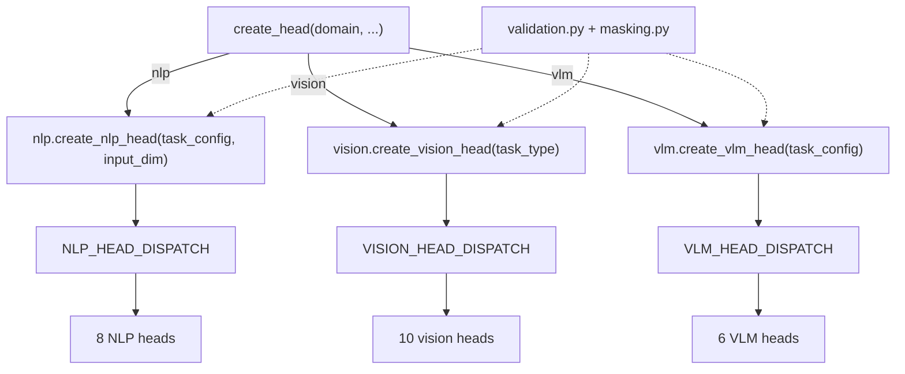

# heads

Task heads for the `dl_techniques` library, as Keras 3 layers: small networks that sit on top of a backbone and turn its features into a task answer. The package lives at `src/dl_techniques/layers/heads/`. It has three domain sub-packages, `nlp/`, `vision/` and `vlm/` (vision-language), plus a thin dispatch function, `create_head`, and two small modules of shared checks.

## What it is for

A backbone (BERT, ResNet, CLIP and so on) produces features. It does not produce answers. Each task needs a small head that reshapes those features into class scores, boxes, masks, depth maps, captions or similarity scores. Keeping the head apart from the backbone means one backbone can drive many heads, and one head class works on the features of any backbone with the right width.

This package holds 24 head classes (8 NLP, 10 vision, 6 VLM). Each domain also has a task vocabulary (an enum of task names plus a config type), a table that maps a task name to a head class, and factory functions that build a head from a task name. Models that own their head use two domain-specific helpers: language models use `build_model_task_head` (NLP), vision models use `build_model_vision_head`.

## How it works



`create_head(domain, *args, **kwargs)` checks that `domain` is `'nlp'`, `'vision'` or `'vlm'` (else `ValueError`) and calls that domain's single-head factory with every argument unchanged. The three factories have different signatures and `create_head` does not hide that:

- `nlp`: `task_config` and `input_dim`.
- `vision`: a task type (member or string) plus head keyword arguments.
- `vlm`: `task_config` plus head keyword arguments.

Multi-task heads are not reachable through `create_head`. Build them with `create_multi_task_nlp_head`, `create_multi_task_head` (vision) or `create_multi_task_vlm_head`.

Each domain has one dispatch table from task type to head class. A task type with no row raises `ValueError` listing the task types that do have a head. There is no fallback head, so a task without an implementation fails at once instead of returning something that looks right. How many task names have a head:

| Domain | Task names in the enum | Task names with a head |
| --- | --- | --- |
| NLP (`NLPTaskType`) | 37 | 24 |
| Vision (`VisionTaskType`) | 37 | 10 |
| VLM (`VLMTaskType`) | 47 | 4 |

### Domains

**`nlp/`** - `TextClassificationHead`, `TokenClassificationHead`, `QuestionAnsweringHead`, `TextSimilarityHead`, `TextGenerationHead`, `MultipleChoiceHead` and `MultiTaskNLPHead`, on a shared `BaseNLPHead`. Heads take hidden states `(B, S, D)` or a pooled `(B, D)`, either as a tensor or as a dict `{'hidden_states', 'attention_mask'}`. A head runs some of these stages in order: pool, norm, dropout, an optional intermediate block, optional task attention, optional feed-forward block, then its own output `Dense`. The `'attention'` pooling option is the head's own inline `Dense(1, tanh)` scorer with a masked softmax, not the shared `SequencePooling('attention')` layer. The task config is `NLPTaskConfig` (seven fields). The domain also holds the helpers a language model uses to own its head (`build_model_task_head`, `finalize_head_outputs` and six more).

**`vision/`** - `DetectionHead`, `SegmentationHead`, `ClassificationHead`, `InstanceSegmentationHead`, `DepthEstimationHead`, `SurfaceNormalsHead`, `OpticalFlowHead`, `EnhancementHead` (denoising and super-resolution) and `MultiTaskHead`, on a shared `BaseVisionHead`. Heads take a feature map `(B, H, W, C)`; detection and segmentation also take ViT tokens `(B, N, D)` with `input_format='sequence'`. Depth, normals and flow upsample 8x through one shared decoder. There is no per-head config dataclass: a head is chosen by a `VisionTaskType` plus keyword arguments, and `TaskConfiguration` is a validated set of task types. The domain also holds ready-made keyword presets (`HeadConfiguration`) and `build_model_vision_head`, the one call vision models use to build their head.

**`vlm/`** - `ImageCaptioningHead`, `VQAHead`, `VisualGroundingHead`, `ImageTextMatchingHead` and `MultiTaskVLMHead`, plus `BaseVLMHead`, which cannot be built directly. Heads take dicts of feature tensors, not images or token ids, and read every feature width from the input shapes. The task config is `VLMTaskConfig` (six fields). Outputs:

| Head | Reads | Output dict |
| --- | --- | --- |
| `ImageCaptioningHead` | `vision_features`, `text_features` | `logits` `(B, S, vocab_size)`, `hidden_states` `(B, S, hidden_size)` |
| `VQAHead` | `vision_features`, `question_features` | `answer_logits` `(B, num_classes)` |
| `VisualGroundingHead` | `vision_features`, `text_features` | `bbox` `(B, 4)`, `confidence` `(B, regions)`, `grounded_features` `(B, hidden_size)` |
| `ImageTextMatchingHead` | `vision_features`, `text_features` | `similarity_matrix` and `logits` `(B, B)`, `match_score` `(B,)`, `vision_embeddings`, `text_embeddings` `(B, projection_dim)` |

### Output contract

No head applies an activation to a class-like score. Classification, token, span, multiple-choice and generation outputs, detection `classifications`, the segmentation map, `instance_masks`, VQA `answer_logits`, captioning `logits`, grounding `confidence` and matching `match_score` are all pre-activation logits. Compile losses with `from_logits=True`. Where a head also returns `probabilities`, that is the softmax of `logits`. Squashed outputs, by design: the depth sigmoid, the grounding `bbox` sigmoid, unit-length surface normals. Optical flow is linear and signed. `SegmentationHead` is the one head that returns a bare tensor instead of a dict.

## Files

- `__init__.py` - re-exports 42 names: the full public API of the three domains (except the eight NLP in-model helpers) plus `create_head`.
- `factory.py` - `create_head(domain, *args, **kwargs)`, the dispatch facade.
- `task_types.py` - one import surface for the task-type enums and config classes of all three domains. Imports only.
- `validation.py` - shared argument and input checks: `positive_int`, `static_rank`, `resolve_stage_knobs`, `lookup_head`, `pool_or_passthrough`, `key_by_name`. Each raises `ValueError` naming the head.
- `masking.py` - `fill_masked(scores, keep, sentinel_dtype=None)`, which sets masked positions to the dtype's finite sentinel by selection.
- `nlp/` - NLP heads, task types, dispatch, factories and in-model helpers (20 exported names).
- `vision/` - vision heads, task types, dispatch, presets, factories and the one-call builder (18 exported names).
- `vlm/` - vision-language heads, task types, dispatch and factories (11 exported names).

## How to use it

```python
from dl_techniques.layers.heads import create_head
from dl_techniques.layers.heads.task_types import (
    NLPTaskConfig, NLPTaskType, VisionTaskType, VLMTaskConfig, VLMTaskType,
)

# NLP: task_config + input_dim
nlp = create_head(
    "nlp",
    task_config=NLPTaskConfig(name="sentiment",
                              task_type=NLPTaskType.SENTIMENT_ANALYSIS,
                              num_classes=3),
    input_dim=768,
)

# Vision: task type (+ head kwargs)
vis = create_head("vision", VisionTaskType.CLASSIFICATION, num_classes=1000)

# VLM: task_config (+ head kwargs; feature widths are read from the inputs)
vlm = create_head(
    "vlm",
    task_config=VLMTaskConfig(name="caption",
                              task_type=VLMTaskType.IMAGE_CAPTIONING,
                              vocab_size=50000),
    num_layers=2,
)
```

Per-domain imports expose more than the facade does:

```python
from dl_techniques.layers.heads.nlp import create_nlp_head, build_model_task_head
from dl_techniques.layers.heads.vision import create_vision_head, create_multi_task_head
from dl_techniques.layers.heads.vlm import create_vlm_head, create_multi_task_vlm_head
```

Tests: `.venv/bin/python -m pytest tests/test_layers/test_heads/ -q` from the repo root. The full repo suite takes about 1.5 hours; run only this directory.

## Things to know

- **`create_head` has no caller in `src/`.** The 15 language models under `models/language/` build heads with `nlp.build_model_task_head` and import the other in-model helpers from `heads.nlp`; 20 vision model files build theirs with `vision.build_model_vision_head` (23 call sites outside this package at the time of writing). DETR, MambaLCT and SuperPoint call `vision.create_vision_head` directly. The facade is kept as the library's documented entry point and is tested in `tests/test_layers/test_heads/test_factory.py`. Do not route a model's head through it.
- **No model, trainer or application builds a VLM head.** The only callers are this package and its tests.
- **A head builds only what its `call` runs.** An argument the head can never read is refused, not stored. Examples that raise `ValueError`: an attention or FFN setting (`attention_type`, `ffn_type`, `ffn_expansion_factor`) given while its stage is off; `use_pooling`, `use_task_attention` or `use_ffn` on an NLP head that never runs that stage; `vocab_size` on a VLM head other than captioning. VLM heads take no `vision_dim` or `text_dim`; widths come from the input shapes.
- **Stage knobs default to `None`.** With the stage on they resolve to `'multi_head'`, `'mlp'` and `4`.
- **Padding masks are honoured.** NLP heads read `attention_mask`; VLM heads read `vision_mask`, `text_mask`, `question_mask` (1 = real token). A mask for an input that is already pooled raises `ValueError`.
- **Registered names follow the defining module**, for example `dl_techniques.layers.heads.vision.enhancement>EnhancementHead`. Archives saved under the older `dl_techniques.layers.heads.<domain>.factory>...` keys do not load. The bare class name stays in the Keras registry as a legacy alias, so class names must not change.
- **Language-model vocabulary check.** `build_model_task_head(..., vocab_size=...)` raises `ValueError` when a generation-type head's `vocabulary_size` differs from the model's vocabulary. A dict config with no `vocabulary_size` takes the model's.
- **`use_crf=True` builds no CRF layer.** It only drops the `predictions` key from `TokenClassificationHead`.
- **Vision attention is built at `hidden_dim`**, so with attention on, the input channel count must equal `hidden_dim`. `MultiTaskHead` forces `use_attention` on every task head to `use_task_specific_attention` (default `True`); pass `False` when a task is denoising or super-resolution.
- **VLM width rules.** Captioning needs `text_features` exactly `hidden_size` wide. Grounding and matching need both inputs `hidden_size` wide for the fusion; only six fusion strategies work (`concatenation`, `addition`, `multiplication`, `gated`, `bilinear`, `tensor_fusion`). `VQAHead` reads `question_features`; the other three read `text_features`.
- **`VisionTaskType` has no alias** under any older name.
