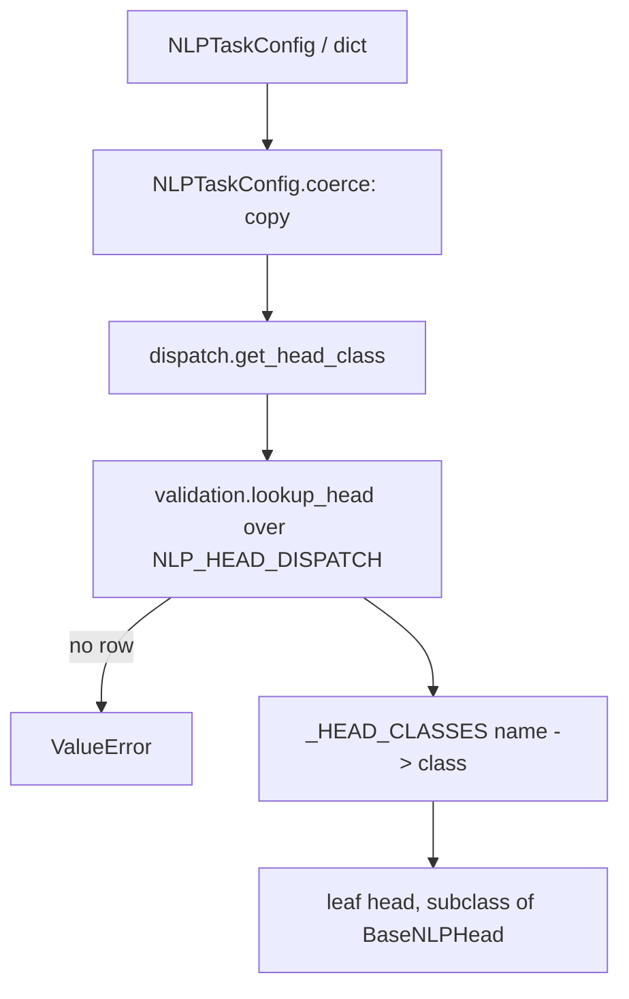

# heads/nlp

Path: `src/dl_techniques/layers/heads/nlp`
Purpose: NLP task heads (hidden states to task outputs), the task config types, the task-type dispatch, the factories, and the helpers a language model uses to own a head.

## Scope

Lives here: six leaf heads plus `MultiTaskNLPHead`, the shared `BaseNLPHead`, `NLPTaskType` / `NLPTaskConfig` and the dispatch table, `create_nlp_head` / `create_multi_task_nlp_head`, and `model_head.py` (in-model head glue).

Does not live here: the vision and VLM head packages (siblings under `layers/heads/`); the cross-domain helpers in `layers/heads/validation.py` (`positive_int`, `static_rank`, `resolve_stage_knobs`, `lookup_head`, `key_by_name`, `pool_or_passthrough`) and `layers/heads/masking.py` (`fill_masked`), which this package imports; the pooling, attention, FFN and norm layers (built through their factories); the language models that call `model_head` helpers (`models/language/*`); the tied-embedding helper (`utils/tied_embeddings.py` carries a comment saying it must not be placed here).

Heads take hidden states, not token ids, so one head works on any backbone output of the right width.

## Architecture

Dependencies run downward only: `task_types` / `utils` -> `base` -> leaf heads -> `dispatch` -> `multitask` -> `factory` -> `model_head`. `task_types.py` imports no head, which is why `NLP_HEAD_DISPATCH` holds class NAMES (strings) and `dispatch._HEAD_CLASSES` maps names to classes.

Stage pipeline in `BaseNLPHead` (a subclass `call` runs a subset, in this order):

`_pool_input` / `_pool_sequence` -> `norm` -> `dropout` -> `intermediate` (`DenseBlock`) -> `task_attention` -> `ffn` -> subclass output `Dense`.

`BaseNLPHead` has no `call`. `__init__` coerces the config, validates, then `_create_common_layers` builds `dropout` and `norm` always, and `sequence_pooler` / `attention_pooling`, `task_attention`, `intermediate`, `ffn` only when their flag asks.

Stage flags per head (class attributes `_POOLS`, `_APPLIES_TASK_ATTENTION`, `_APPLIES_FFN`; base default all True):

| Head | `_POOLS` | `_APPLIES_TASK_ATTENTION` | `_APPLIES_FFN` |
| --- | --- | --- | --- |
| `TextClassificationHead` | True | False | True |
| `TokenClassificationHead` | False | True | True |
| `QuestionAnsweringHead` | False | True | False |
| `TextSimilarityHead` | True | False | True |
| `TextGenerationHead` | False | False | True |
| `MultipleChoiceHead` | True | False | False |

`__init__` raises `ValueError` for `use_pooling` / `use_task_attention` / `use_ffn` set True on a head where the flag is False (`_refuse_unapplied_stages`). Token, QA and generation heads do `kwargs.setdefault('use_pooling', False)` before `super().__init__`.

Task attention defaults built in `_create_common_layers`: `dim` = stage width, `dropout_rate` = `task_config.dropout_rate`, `num_heads=8` for `multi_head` and `window`, `window_size=7` for `window`; passed through `assemble_attention_config`. Intermediate: `DenseBlock(units=hidden_size, ...)`. FFN: `create_ffn_layer(ffn_type, hidden_dim=hidden_size * ffn_expansion_factor, output_dim=hidden_size, ...)`.

## Key files

| File | Role | Notes |
| --- | --- | --- |
| `__init__.py` | Public surface | `__all__` has 20 names: 2 types, 2 factories, 8 head layers (incl. `BaseNLPHead`), 8 `model_head` helpers. `get_head_class` and `NLP_HEAD_DISPATCH` are NOT exported |
| `task_types.py` | `NLPTaskType` (37 members, `@unique`), `NLP_HEAD_DISPATCH` (24 rows), `_OUTPUT_TYPES`, `DEFAULT_VOCABULARY_SIZE` (32000), `NLPTaskConfig`, `NLPTaskConfiguration`, `CommonNLPTaskConfigurations` (10 presets) | Imports only `..validation.positive_int` |
| `utils.py` | `_DELEGATED_POOLING_STRATEGIES = ('cls','mean','max','last')`, `_POOLING_TYPES` (those plus `'attention'`), `NLP_STAGE_KNOB_DEFAULTS`, `_split_inputs`, `_is_pair`, `_apply_per_row` | Private-named helpers are shared by the leaf modules |
| `base.py` | `BaseNLPHead` | The only module in this package that calls `create_normalization_layer` |
| `text_classification.py` | `TextClassificationHead` | `classifier` `Dense(num_classes)`; outputs `logits`, `probabilities` |
| `token_classification.py` | `TokenClassificationHead` | `token_classifier`; `predictions` = argmax unless `use_crf` |
| `question_answering.py` | `QuestionAnsweringHead` | `start_classifier`, `end_classifier` (both `Dense(1)`); masks via `fill_masked` |
| `text_similarity.py` | `TextSimilarityHead` | `projection` + `similarity_layers` (only for `'learned'`); pair or single input |
| `text_generation.py` | `TextGenerationHead` | `lm_head` `Dense(vocabulary_size)`; ignores `attention_mask` |
| `multiple_choice.py` | `MultipleChoiceHead` | `scorer` `Dense(1)`; folds `(B,N,S,D)` to `(B*N,S,D)` |
| `multitask.py` | `MultiTaskNLPHead` | Not a `BaseNLPHead` subclass; owns `task_heads`, `task_projections` dicts |
| `dispatch.py` | `_HEAD_CLASSES`, `get_head_class` | Raises `ValueError` for the 13 task types with no row |
| `factory.py` | `create_nlp_head`, `create_multi_task_nlp_head` | Defines only these two; also binds `get_head_class` by import |
| `model_head.py` | In-model head glue | See Public interface |

## Public interface

Exports from the package (`from dl_techniques.layers.heads.nlp import ...`):

- `NLPTaskType`, `NLPTaskConfig`
- `create_nlp_head(task_config, input_dim, **kwargs) -> BaseNLPHead`: `NLPTaskConfig.coerce`, `get_head_class(task_config.task_type)`, then `head_class(task_config=..., input_dim=..., **kwargs)`. `ValueError` for a task type with no head or an invalid field; `TypeError` if `task_config` is neither a config nor a dict.
- `create_multi_task_nlp_head(task_configs, input_dim, **kwargs) -> MultiTaskNLPHead`: a list or tuple is coerced and keyed by config `name` through `validation.key_by_name` (a repeated name raises); a dict is used as given. `input_dim` becomes `shared_input_dim`.
- `BaseNLPHead(task_config, input_dim, normalization_type='layer_norm', activation_type='gelu', use_pooling=True, pooling_type='cls', use_intermediate=True, intermediate_size=None, use_task_attention=False, attention_type=None, use_ffn=False, ffn_type=None, ffn_expansion_factor=None, initializer_range=0.02, **kwargs)`
- `TextClassificationHead`, `TokenClassificationHead`, `QuestionAnsweringHead`, `MultipleChoiceHead`, `TextGenerationHead`: base arguments only. `TextSimilarityHead(output_embeddings=True, similarity_function='cosine'|'dot'|'learned', **kwargs)`.
- `MultiTaskNLPHead(task_configs: dict, shared_input_dim, use_task_specific_projections=False, **kwargs)`; `call(inputs, training=None, *, task_name=None)`. `task_name` is keyword-only. `compute_output_shape` and `compute_output_spec` also take `task_name`. Unknown `task_name` raises `ValueError`.
- `model_head` helpers:
  - `TASK_HEAD_NAME = "task_head"`
  - `validate_task_head_knobs(include_top, task_config, head_config_overrides)`: `include_top=True` needs a `task_config`; `task_config` or overrides with `include_top=False` raises.
  - `build_model_task_head(task_config, input_dim, head_config_overrides=None, default_pooling=None, name=TASK_HEAD_NAME, vocab_size=None)`: refuses `MULTIPLE_CHOICE`; refuses `name` in the overrides; `default_pooling` applies only when the overrides lack `pooling_type`; with `vocab_size` set, a generation-type head's `vocabulary_size` must equal it (dict config with it unset takes it from `vocab_size`).
  - `task_config_to_dict(task_config, vocab_size=None)`: JSON-safe dict of all config fields.
  - `finalize_head_outputs(outputs)`: drops `probabilities` / `predictions` when `logits` is present, then unwraps a single-key dict to the bare tensor. Non-dict input is returned unchanged.
  - `head_attention_mask(input_ids, attention_mask, pad_token_id, dtype)`: caller's mask, else `input_ids != pad_token_id`, else all ones when `pad_token_id` is `None`; cast to `dtype`.
  - `head_output_shape(task_head, input_shape, hidden_size)` and `ids_shape_of(input_shape)`: shapes `finalize_head_outputs` would give, from shapes alone.

Not exported: `get_head_class(task_type)` from `dispatch.py`; `NLP_HEAD_DISPATCH`, `NLPTaskConfiguration`, `CommonNLPTaskConfigurations`, `DEFAULT_VOCABULARY_SIZE` from `task_types.py`.

## Data shapes

`NLPTaskConfig` (dataclass, 7 fields): `name: str`, `task_type: NLPTaskType`, `num_classes: Optional[int]`, `dropout_rate: float = 0.1` (in `[0, 1)`), `hidden_size: Optional[int]`, `use_crf: bool = False`, `vocabulary_size: Optional[int]`. `__post_init__` parses a string `task_type`, checks counts with `positive_int`, then reads `NLP_HEAD_DISPATCH`: heads in `_HEADS_NEEDING_NUM_CLASSES` (`TextClassificationHead`, `TokenClassificationHead`) require `num_classes`; `TextGenerationHead` fills `vocabulary_size=32000` when unset. `to_dict()` writes `task_type` as its string value. `coerce(value)` copies an instance (`dataclasses.replace`) or builds from a dict; anything else raises `TypeError`.

Head input: a tensor, or a dict `{'hidden_states', 'attention_mask'?}`. `TextSimilarityHead` also takes a 2-tuple or 2-list of those. `MultipleChoiceHead` takes `(B, N, S, D)` with mask `(B, N, S)`, or pooled `(B, N, D)` with no mask.

Head outputs (dict, pre-activation):

| Head | Keys and shapes |
| --- | --- |
| `TextClassificationHead` | `logits` `(B,C)`, `probabilities` `(B,C)` |
| `TokenClassificationHead` | `logits` `(B,S,C)`; `predictions` `(B,S)` when not `use_crf` |
| `QuestionAnsweringHead` | `start_logits` `(B,S)`, `end_logits` `(B,S)` |
| `TextSimilarityHead` | single: `embeddings` `(B,hidden_size)`; pair: `similarity_score` `(B,)`, plus `embeddings_1`, `embeddings_2` when `output_embeddings` |
| `TextGenerationHead` | `logits` `(B,S,V)` |
| `MultipleChoiceHead` | `logits` `(B,N)`, `probabilities` `(B,N)` |

`NLP_HEAD_DISPATCH` rows by head: `TextClassificationHead` 10 (text classification, sentiment, emotion, intent, topic, spam, NLI, text regression, readability, quality), `TokenClassificationHead` 4 (token classification, NER, POS tagging, sequence labeling), `QuestionAnsweringHead` 2 (QA, span extraction), `TextSimilarityHead` 3 (text similarity, paraphrase, duplicate), `TextGenerationHead` 4 (text generation, MLM, summarization, completion), `MultipleChoiceHead` 1.

`get_config` of each head writes every constructor argument; `task_config` is written as `to_dict()`. `MultiTaskNLPHead.get_config` writes `task_configs` (dict of dicts), `shared_input_dim`, `use_task_specific_projections`. No head overrides `from_config`.

## Invariants and constraints

- Registration: `@register_dl_technique("dl_techniques.layers.heads.nlp.<module>")`, using the defining module's name (`base`, `text_classification`, `token_classification`, `question_answering`, `text_similarity`, `text_generation`, `multiple_choice`, `multitask`). Moving a class changes its key. Never use a bare `@keras.saving.register_keras_serializable()`. Archives saved under the old `...nlp.factory>X` keys do not load.
- Layers are created in `__init__` and built in `build`. A leaf `build` calls `super().build` first, then builds the output layer at `self._output_width()` (`hidden_size` if `use_intermediate` or `use_ffn`, else `input_dim`).
- `_stage_width` is `hidden_size` with the intermediate block and `input_dim` without it. Task attention and FFN are created and built at that width.
- `compute_output_shape` must work unbuilt and return the same keys `call` returns.
- Stage knobs: `attention_type`, `ffn_type`, `ffn_expansion_factor` default to `None`, resolve to `'multi_head'` / `'mlp'` / `4` through `validation.resolve_stage_knobs` with `NLP_STAGE_KNOB_DEFAULTS`, are stored as `None` with their stage off, and raise if given with their stage off.
- Pooling: `cls`, `mean`, `max`, `last` go to the shared `SequencePooling(strategy=...)`. `'attention'` stays inline as `Dense(1, tanh)` plus masked softmax. Do not route it through `SequencePooling('attention')`: different mechanism, different weights, breaks checkpoints. Any other `pooling_type` raises at construction, for every head, including heads that never pool.
- `'last'` must skip right padding; pass the mask to `SequencePooling` (`mask=attention_mask`). Do not simplify to `inputs[:, -1, :]`.
- Masking: use `layers/heads/masking.fill_masked(scores, keep, self.compute_dtype)` (a `keras.ops.where` selection). Never `scores + (1 - mask) * -1e9`: under float16 that is `0 * -inf = NaN` at kept positions.
- Task attention (`_apply_task_attention`): without a mask, called as `task_attention(x, training=...)`. With a mask, passes `attention_mask=`; if the attention layer's `call` has no `attention_mask` parameter (found by `inspect.signature`), raises `ValueError`.
- Cosine similarity divides by `max(norm, stability_floor(compute_dtype, 1e-8))`. A bare `1e-8` is 0.0 in float16 and gives NaN for an all-zero embedding.
- Rank is read statically: `MultipleChoiceHead` uses `validation.static_rank`; pooling uses `validation.pool_or_passthrough`. Do not branch on `len(keras.ops.shape(x))`.
- Configs are copied (`NLPTaskConfig.coerce`) at every entry: head `__init__`, `MultiTaskNLPHead.__init__`, the factories.
- `MultiTaskNLPHead` keeps `task_heads` and `task_projections` as dicts of layers (they round-trip through `.keras`). `task_name` stays keyword-only after `training`. It builds each sub-head from its task config and input width only; no per-head kwargs.
- No silent dispatch fallback. Do not add a default head for task types with no row.
- Heads return logits, not activated scores. `probabilities` and `predictions` are derived entries.
- Child layers have fixed name suffixes derived from `self.name` (default `"<task name>_head"`): `_dropout`, `_norm`, `_sequence_pooler`, `_attention_pooling`, `_attention`, `_intermediate`, `_ffn`, plus per-head `_classifier`, `_token_classifier`, `_start`, `_end`, `_projection`, `_sim_hidden`, `_sim_output`, `_lm_head`, `_scorer`. `model_head.build_model_task_head` names the head `task_head` so all its weight paths share one prefix.
- `DECISION ...` comments in the code record why a non-obvious choice was made. Supersede them with a dated note; do not delete them.
- `README.md` in this directory must keep the phrase ``inline `Dense(1, tanh)` scorer``; `tests/test_layers/test_the_sequence_pooling_docs_match_the_code.py` asserts it.

## Dependencies

Internal:
- `layers.activations` (`ActivationType`), `layers.dense_block.DenseBlock` (intermediate), `layers.ffn` (`create_ffn_layer`, `FFNType`), `layers.attention` (`AttentionType`, `create_attention_layer`, `assemble_attention_config` from `attention/factory`), `layers.norms.create_normalization_layer`, `layers.sequence_pooling.SequencePooling`.
- `layers.heads.validation` (`positive_int`, `static_rank`, `resolve_stage_knobs`, `lookup_head`, `key_by_name`, `pool_or_passthrough`), `layers.heads.masking.fill_masked`.
- `utils.keras_registration.register_dl_technique`, `utils.dtype_policy.stability_floor` (similarity head).

External: `keras` only (`keras.ops`; no raw TensorFlow).

Consumers in `src/` (re-derived by grepping `src/` for imports of `dl_techniques.layers.heads.nlp` and for relative forms; only import statements count):
- `layers/heads/__init__.py` (re-exports 12 names from `.nlp`), `layers/heads/factory.py` (`create_nlp_head`, for `create_head('nlp', ...)`), `layers/heads/task_types.py` (`NLPTaskType`, `NLPTaskConfig` from `.nlp.task_types`).
- 15 files under `models/language/`: `bert/model.py`, `modern_bert/model.py`, `distilbert/model.py`, `fnet/model.py`, `gpt2/gpt2.py`, `gemma/gemma3.py`, `qwen/qwen3.py`, `qwen/qwen3_next.py`, `mamba/mamba_v1.py`, `mamba/mamba_v2.py`, `zamba2/model.py`, `hnet/model.py`, `topolm/model.py`, `tree_transformer/model.py`, `wave_field/model.py`. They import `NLPTaskConfig` plus `model_head` helpers.
- `train/common/nlp.py` (`NLPTaskConfig`, `NLPTaskType`, `TASK_HEAD_NAME`, `task_config_to_dict`).

Not consumers: `utils/tied_embeddings.py` imports nothing from this package; it only names `layers/heads/nlp/` in a comment saying the tying helper must not be placed here. Other `src/train/` files and `datasets/nlp` mention NLP names only via `train.common.nlp` or are unrelated.

A model imports the helpers from this package, never from `.model_head` or any other submodule (pinned by `tests/test_models/test_the_language_models_import_one_head_surface.py`, an AST walk that also requires every imported name to be in `__all__`).

## Failure modes

All raise at construction unless noted:
- Unknown `pooling_type`; `use_pooling` / `use_task_attention` / `use_ffn` for a stage the head never runs; an attention or FFN knob with its stage off; non-positive `input_dim` / `intermediate_size` -> `ValueError` naming the head and argument.
- `num_classes` missing for classification and token heads -> `ValueError` (from `NLPTaskConfig` and again in the head). The head's own `vocabulary_size is None` check for `TextGenerationHead` is a backstop: the config fills 32000 for every generation-routed task type.
- Task type with no row (13 of 37) -> `ValueError` from `get_head_class` / `lookup_head` listing supported types. `NLPTaskType.get_output_types` raises the same way.
- Unknown `NLPTaskConfig` field -> `TypeError`.
- `similarity_function` not in `cosine`, `dot`, `learned` -> `ValueError`.
- At call time: rank-3 input with `use_pooling=False`; mask given for an already pooled (rank-2 or rank-3 pooled-choice) input; mask given to an attention type without `attention_mask`; `MultipleChoiceHead` input rank other than 3 or 4; unknown `task_name` -> `ValueError`.
- `build_model_task_head`: `MULTIPLE_CHOICE`, `name` in overrides, or a generation `vocabulary_size` different from `vocab_size` -> `ValueError`. An `NLPTaskConfig` instance that leaves the 32000 default on a model of another vocabulary also raises, since it cannot be told from an explicit 32000.
- `use_crf=True` builds no CRF; it only removes `predictions`.

## Working here

Adding a head:
1. New module `<name>.py`: subclass `BaseNLPHead`, decorate with `@register_dl_technique("dl_techniques.layers.heads.nlp.<name>")`.
2. Set `_POOLS`, `_APPLIES_TASK_ATTENTION`, `_APPLIES_FFN` honestly to match `call`.
3. Create the output layer in `__init__`. Implement `build` (call `super().build` first, then build the output layer at `self._output_width()`), `compute_output_shape` (unbuilt-safe, same keys as `call`) and `call` (start with `_split_inputs`).
4. Add the class to `dispatch._HEAD_CLASSES`, rows to `NLP_HEAD_DISPATCH`, an entry in `_OUTPUT_TYPES` (keyed by class name), and an export in `__init__.py` (update the `__all__` count in its docstring).
5. If the head needs `num_classes` or a vocabulary from the config, update `_HEADS_NEEDING_NUM_CLASSES` or the generation branch in `NLPTaskConfig.__post_init__`.
6. Add tests.

Adding a task type with an existing head: add the enum member and a row in `NLP_HEAD_DISPATCH`; add it to `get_task_categories`. Do not restate the table elsewhere; `get_head_class`, `NLPTaskConfig`, `get_output_types` and `model_head._GENERATION_HEAD_TASKS` all read it.

Do not import classes from `factory.py` (it defines only the two `create_*` functions). Keep `task_types.py` free of head imports.

Docstrings are Sphinx/reST (`:param:`, `:type:`, `:raises:`); match the file you edit.

Tests are in `tests/test_layers/test_heads/`: `test_nlp.py`, `test_nlp_model_head.py`, `test_every_nlp_head_survives_a_keras_round_trip.py`, `test_every_nlp_head_reports_the_shapes_it_returns.py`, `test_every_nlp_preset_builds.py`, `test_the_nlp_dispatch_is_one_table.py`, `test_the_nlp_heads_honour_padding_masks.py`, `test_the_nlp_task_attention_ignores_padding.py`, `test_the_nlp_heads_build_at_the_width_call_feeds.py`, `test_the_nlp_heads_own_their_task_configs.py`, `test_the_nlp_heads_refuse_bad_arguments_early.py`, `test_the_nlp_task_config_holds_only_live_fields.py`, `test_an_nlp_head_refuses_a_stage_knob_its_flag_turns_off.py`, `test_the_head_classes_register_under_their_own_module.py`. Repo-level pins that name files here: `tests/test_layers/test_norms/test_the_norm_factory_family_is_pinned.py` (the one norm-factory site in `base.py`), `tests/test_the_head_factories_and_finetune_scripts_bind_no_dead_names.py`, `tests/test_the_mask_sentinel_population_is_closed.py`, `tests/test_layers/test_the_sequence_pooling_docs_match_the_code.py`.

Run: `.venv/bin/python -m pytest tests/test_layers/test_heads/ -q` from the repo root. Scope runs to that directory; the full suite takes about 1.5 hours. Do not run GPU jobs in parallel.
