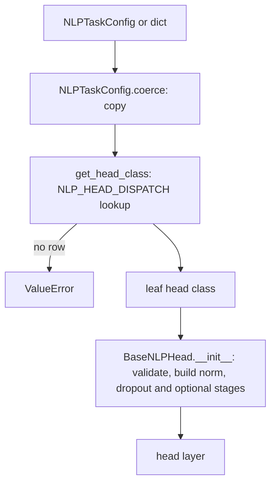

# heads/nlp

Task heads for language models: small Keras layers that turn a backbone's hidden states into task outputs (class scores, per-token labels, answer spans, embeddings, vocabulary logits). The package also holds the task description types, the factories that pick a head for a task, and helpers for a language model that owns its head. It lives at `src/dl_techniques/layers/heads/nlp/`.

## What it is for

A language backbone (BERT, GPT, Mamba and so on) produces one vector per token. A task such as sentiment analysis, entity tagging or question answering needs something different on top of those vectors. This package keeps that top part separate from the backbone. A head takes hidden states, not token ids, so one head class works on the output of any backbone with the same width.

You describe the task with an `NLPTaskConfig`. A factory reads its `task_type`, looks up the head class in a table, and builds the head. The same head code serves many task types: for example `TextClassificationHead` serves sentiment analysis, spam detection, natural language inference and text regression. Of the 37 task types in `NLPTaskType`, 24 have a head. The other 13 raise `ValueError` when you ask for a head, instead of quietly building a wrong one.

## How it works



Every head subclasses `BaseNLPHead`. Its `call` runs some of these stages, in this order:

1. Pool a sequence `(B, S, D)` to `(B, D)` (only heads that pool; options `cls`, `mean`, `max`, `last`, `attention`).
2. `norm`, then `dropout` (always).
3. `intermediate`: a `DenseBlock` to `hidden_size` (optional, on by default).
4. `task_attention`: an attention layer from the attention factory (optional, off by default).
5. `ffn`: a feed-forward block from the FFN factory (optional, off by default).
6. The head's own output `Dense` layer.

Not every head runs every stage. A head refuses a flag for a stage it never runs, with `ValueError`, instead of building unused weights.

| Head | Pools | Task attention | FFN | Output keys |
| --- | --- | --- | --- | --- |
| `TextClassificationHead` | yes | no | yes | `logits` `(B, C)`, `probabilities` |
| `TokenClassificationHead` | no | yes | yes | `logits` `(B, S, C)`, `predictions` `(B, S)` unless `use_crf` |
| `QuestionAnsweringHead` | no | yes | no | `start_logits` `(B, S)`, `end_logits` `(B, S)` |
| `TextSimilarityHead` | yes | no | yes | single input: `embeddings`; pair: `similarity_score`, optional `embeddings_1`, `embeddings_2` |
| `TextGenerationHead` | no | no | yes | `logits` `(B, S, V)` |
| `MultipleChoiceHead` | yes | no | no | `logits` `(B, N)`, `probabilities` |

`MultiTaskNLPHead` holds one head per task and runs one of them (`task_name=...`) or all of them.

Inputs are either a tensor or a dict `{'hidden_states': ..., 'attention_mask': ...}`. The mask (1 = real token) reaches pooling and task attention, so padding does not leak into the result. Heads that never pool and never use task attention, such as `TextGenerationHead`, do not read it.

## Files

- `__init__.py` - the public surface: 20 names in `__all__`.
- `task_types.py` - `NLPTaskType` (37 tasks), `NLP_HEAD_DISPATCH` (24 rows, task type to head class name), `NLPTaskConfig` (dataclass), `NLPTaskConfiguration` (a validated task set), `CommonNLPTaskConfigurations` (10 presets).
- `utils.py` - pooling-strategy tuples, `NLP_STAGE_KNOB_DEFAULTS`, and the small helpers `_split_inputs`, `_is_pair`, `_apply_per_row`.
- `base.py` - `BaseNLPHead`: argument checks, the shared layers, pooling, task-attention helper, `get_config`. It has no `call`.
- `text_classification.py` - `TextClassificationHead`.
- `token_classification.py` - `TokenClassificationHead`.
- `question_answering.py` - `QuestionAnsweringHead`.
- `text_similarity.py` - `TextSimilarityHead` (cosine, dot or learned scoring).
- `text_generation.py` - `TextGenerationHead`.
- `multiple_choice.py` - `MultipleChoiceHead`.
- `multitask.py` - `MultiTaskNLPHead`.
- `dispatch.py` - `get_head_class(task_type)`: resolves a task type to a head class.
- `factory.py` - `create_nlp_head` and `create_multi_task_nlp_head`.
- `model_head.py` - helpers for a language model that owns its head: `build_model_task_head`, `validate_task_head_knobs`, `task_config_to_dict`, `finalize_head_outputs`, `head_attention_mask`, `head_output_shape`, `ids_shape_of`, `TASK_HEAD_NAME`.

## How to use it

Build a head from a config and call it on hidden states:

```python
import keras
from dl_techniques.layers.heads.nlp import create_nlp_head, NLPTaskConfig, NLPTaskType

config = NLPTaskConfig(
    name="sentiment",
    task_type=NLPTaskType.SENTIMENT_ANALYSIS,
    num_classes=3,
)
head = create_nlp_head(config, input_dim=768, pooling_type="mean")

hidden = keras.random.normal((4, 16, 768))
mask = keras.ops.ones((4, 16))
out = head({"hidden_states": hidden, "attention_mask": mask})
out["logits"]  # (4, 3), pre-softmax
```

Extra keyword arguments go to the head constructor: `normalization_type`, `activation_type`, `use_pooling`, `pooling_type`, `use_intermediate`, `intermediate_size`, `use_task_attention`, `attention_type`, `use_ffn`, `ffn_type`, `ffn_expansion_factor`, `initializer_range`. `TextSimilarityHead` also takes `output_embeddings` and `similarity_function`.

Several tasks on one backbone:

```python
from dl_techniques.layers.heads.nlp import create_multi_task_nlp_head

multi = create_multi_task_nlp_head(
    [
        NLPTaskConfig(name="ner", task_type=NLPTaskType.NAMED_ENTITY_RECOGNITION, num_classes=9),
        NLPTaskConfig(name="sst", task_type=NLPTaskType.SENTIMENT_ANALYSIS, num_classes=2),
    ],
    input_dim=768,
)
all_outputs = multi({"hidden_states": hidden})              # {'ner': {...}, 'sst': {...}}
ner_only = multi({"hidden_states": hidden}, task_name="ner")  # {...}
```

Inside a language model that owns its head (`include_top=True`):

```python
from dl_techniques.layers.heads.nlp import (
    build_model_task_head, finalize_head_outputs, task_config_to_dict)

head = build_model_task_head(config, input_dim=768, default_pooling="last", vocab_size=30522)
logits = finalize_head_outputs(head({"hidden_states": hidden, "attention_mask": mask}))
```

## Things to know

- `NLPTaskConfig` has seven fields: `name`, `task_type`, `num_classes`, `dropout_rate`, `hidden_size`, `use_crf`, `vocabulary_size`. An unknown field raises `TypeError`. A string `task_type` is parsed. Task types routed to the classification or token head require `num_classes`. Task types routed to `TextGenerationHead` get `vocabulary_size=32000` when it is unset.
- Heads copy the config you pass. Editing your config afterwards changes nothing in the head or its `get_config`.
- Heads return pre-activation `logits`. `probabilities` and `predictions` are derived entries; `finalize_head_outputs` drops them so `model.compile` sees one tensor.
- `attention_type`, `ffn_type` and `ffn_expansion_factor` default to `None`. With their stage on they resolve to `'multi_head'`, `'mlp'` and `4`. With the stage off, passing a value raises `ValueError`.
- Use `pooling_type='last'` for a causal backbone. The default `'cls'` reads position 0, which has seen only itself in a causal model.
- `'attention'` pooling is the head's own inline `Dense(1, tanh)` scorer (the `attention_pooling` attribute), followed by a masked softmax over positions. It is not the same layer as `SequencePooling('attention')` and has different weights.
- An unknown `pooling_type` raises at construction for every head, including the heads that never pool.
- `use_crf=True` builds no CRF layer. It only drops the `predictions` key; decoding is left to the caller.
- `TextGenerationHead` ignores `attention_mask`.
- `TextSimilarityHead` accepts a pair as a tuple or list of two inputs. A rank-2 input is taken as already pooled and takes no mask; a mask for it raises.
- `MultipleChoiceHead` needs `(B, N, S, D)` (or pooled `(B, N, D)`). `build_model_task_head` refuses `MULTIPLE_CHOICE` because a model feeds its head `(B, S, D)`.
- `build_model_task_head` checks that a generation head's `vocabulary_size` equals the model's `vocab_size` and raises otherwise. A dict config with no `vocabulary_size` takes the model's.
- `MultiTaskNLPHead` builds each sub-head with only its task config and input width. It passes no per-head keyword arguments, so every sub-head uses the constructor defaults.
- Classes register under the module that defines them, for example `dl_techniques.layers.heads.nlp.text_classification`. Archives saved under older registered names do not load.
- Import classes from this package or their own module. `get_head_class` is not exported from the package; import it from `dl_techniques.layers.heads.nlp.dispatch`. `NLP_HEAD_DISPATCH` comes from `dl_techniques.layers.heads.nlp.task_types`.
- Tests: `tests/test_layers/test_heads/`.
