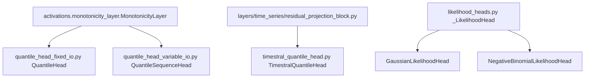

# heads/time_series

Path: `src/dl_techniques/layers/heads/time_series`
Purpose: Keras 3 forecasting heads that map backbone hidden states to non-crossing quantiles or to the parameters of a Gaussian or negative-binomial distribution.

## Scope

In: five registered head layers (`QuantileHead`, `QuantileSequenceHead`, `GaussianLikelihoodHead`, `NegativeBinomialLikelihoodHead`, `TimestralQuantileHead`), the private `_LikelihoodHead` base, the private `_floored_softplus` and `MIN_LIKELIHOOD_PARAM`, and the function `monotone_quantiles`.

Out: encoders and backbones (`layers/time_series`, `models/time_series`), the pinball and likelihood losses, `ConformalQuantileHead` (`layers/statistics/conformal/quantile_head.py`), `MDNLayer` (`layers/statistics/mdn_layer.py`), the `Forecast` / `ForecastMixin` contract (`models/time_series/forecast.py`). Unlike `heads/nlp`, `heads/vision` and `heads/vlm`, this domain has no task enum, no task config, no dispatch table, no factory and no multi-task wrapper, and `heads/factory.py` `create_head` does not accept `'time_series'`. The heads are re-exported from `heads/__init__.py`.

Callers are the forecasting models, which construct a head directly:

| Head | Built by |
| --- | --- |
| `QuantileHead` | `models/time_series/tirex/model.py`, `prism/model.py`, `xlstm/forecaster.py` |
| `QuantileSequenceHead` | `models/time_series/adaptive_ema/model.py`, `tirex/model_extended.py` |
| `GaussianLikelihoodHead`, `NegativeBinomialLikelihoodHead` | `models/time_series/deepar/model.py` |
| `TimestralQuantileHead` | `models/time_series/timestral/model.py` (attribute `head`, layer name `quantile_head`) |

## Architecture

No file in this directory imports another file in it. Each module depends only on outside packages, so there is no import order to respect.

All five derive from `keras.layers.Layer`. The two likelihood heads derive from `_LikelihoodHead`, which is deliberately unregistered because it is never serialized on its own.

Forward paths:

- `QuantileHead`: optional flatten (`ops.reshape(x, (-1, seq * features))`) -> optional `Dropout` -> `Dense(output_length * num_quantiles)` -> reshape to `(B, output_length, num_quantiles)` -> optional `MonotonicityLayer(method="cumulative_softplus", axis=-1)`.
- `QuantileSequenceHead`: optional `Dropout` -> `Dense(num_quantiles)` applied per step -> optional `MonotonicityLayer`. `activity_regularizer` is charged by `Layer.__call__` on the returned tensor.
- Likelihood heads: `mu_projection` Dense and `<SECOND_PARAMETER>_projection` Dense read the same input. `_floored_softplus` is applied to the second parameter, and to `mu` when `POSITIVE_MEAN` is true. Gaussian: `SECOND_PARAMETER='sigma'`, `POSITIVE_MEAN=False`. Negative binomial: `'alpha'`, `True`.
- `TimestralQuantileHead`: `projection` (`ResidualProjectionBlock(d_model, 4 * d_model, patch_size * Q, use_bias=False)`) -> reshape `(..., n_patches, patch_size, Q)` -> cast to at least float32 -> `monotone_quantiles` -> reshape `(..., n_patches * patch_size, Q)`.

## Key files

| File | Role | Notes |
| --- | --- | --- |
| `quantile_head_fixed_io.py` | `QuantileHead` | fixed horizon; still carries `from keras import ops`, pinned by `tests/test_the_keras_submodule_import_population_cannot_grow.py` |
| `quantile_head_variable_io.py` | `QuantileSequenceHead` | per position; takes kernel and bias regularizers and constraints and an activity regularizer |
| `likelihood_heads.py` | `_LikelihoodHead`, `GaussianLikelihoodHead`, `NegativeBinomialLikelihoodHead` | `MIN_LIKELIHOOD_PARAM = 1e-6`, `_floored_softplus` (decision D-037) |
| `timestral_quantile_head.py` | `TimestralQuantileHead`, `monotone_quantiles` | moved out of `models/time_series/timestral/model.py`; takes plain arguments instead of `TimestralConfig` |
| `__init__.py` | 5-name `__all__` plus package docstring | |

## Public interface

Exported from `dl_techniques.layers.heads.time_series` (`__all__`, 5 names) and from `dl_techniques.layers.heads`. `monotone_quantiles`, `MIN_LIKELIHOOD_PARAM` and the private names are importable from their own modules only.

| Class | Signature (besides `**kwargs`) | Output |
| --- | --- | --- |
| `QuantileHead` | `num_quantiles, output_length, dropout_rate=0.1, use_bias=True, flatten_input=False, enforce_monotonicity=False, kernel_initializer="glorot_uniform", bias_initializer="zeros"` | `(B, output_length, num_quantiles)` |
| `QuantileSequenceHead` | `num_quantiles, dropout_rate=0.1, use_bias=True, enforce_monotonicity=False, kernel_initializer, bias_initializer, kernel_regularizer, bias_regularizer, activity_regularizer, kernel_constraint, bias_constraint` | `(B, S, num_quantiles)` |
| `GaussianLikelihoodHead` | `units=1` | `(mu, sigma)`, each `(..., units)` |
| `NegativeBinomialLikelihoodHead` | `units=1` | `(mu, alpha)`, each `(..., units)` |
| `TimestralQuantileHead` | `d_model, patch_size, quantile_levels, width_factor` | `(R, N * patch_size, len(quantile_levels))` |

`monotone_quantiles(raw, levels: Tuple[float, ...], width_factor: float)` needs `levels` as a tuple or list containing `0.5` and strictly increasing; it returns the same shape as `raw`.

## Data shapes

- `QuantileHead` with `flatten_input=False`: input rank 2. With `flatten_input=True`: input rank 3 with static sequence and feature dimensions.
- `QuantileSequenceHead`: input rank 3 with a static feature dimension.
- Likelihood heads: any rank at least 2; the last axis is the hidden width, and `compute_output_shape` returns two equal shapes with `units` last.
- `TimestralQuantileHead`: input `(..., n_patches, d_model)`. Its `quantile_levels` are stored as a tuple of floats and written to `get_config` as a list.

## Invariants and constraints

- Registration strings follow the defining module path: `register_dl_technique("dl_techniques.layers.heads.time_series.<module>")`. Never a bare `register_keras_serializable()`. `tests/test_layers/test_heads/test_the_head_classes_register_under_their_own_module.py` pins all 29 registered head classes across the four domains, including the five here.
- Class names are the registry aliases (`Custom>ClassName`). `TimestralQuantileHead` is not named `QuantileHead` because `QuantileHead` already owns that alias.
- Outputs are raw regression values or distribution parameters. There is no softmax or sigmoid on any output.
- Do not respell the softplus in `_floored_softplus` as `log(1 + exp(x))`: a float32 logit above about 88 makes `exp` infinite and the loss NaN. Keep both `keras.ops.softplus` and the `maximum` floor (D-037).
- A head owns only the sub-layers its `call` runs. Sub-layers are created in `__init__`, built in `build`, and every constructor argument round-trips through `get_config`.
- `TimestralQuantileHead` weight layout is a contract with `models/time_series/timestral/loading.py`: the model attribute is `head`, the head's sub-layer is `projection`, and its three Dense sub-layers are `hidden_layer`, `output_layer`, `residual_layer`, with no bias. The reference names `head.projection.{hidden,output,residual}_layer.weight` depend on this. `tests/test_models/test_timestral/test_checkpoints.py` pins it.
- The projection of `TimestralQuantileHead` is constructed in `__init__` and built in `build`. `TimestralModel.build` builds the head first so a freshly built model draws its initializer seeds in the same order as before the move (decision D-162). Do not reorder.
- Initializers: a head that hands one initializer to several Dense layers must wrap it in `dl_techniques.initializers.clone.clone_initializer`. The likelihood heads and `TimestralQuantileHead` use each Dense layer's own default.
- `import keras` with qualified call sites (`keras.ops.*`, `keras.layers.*`); `dl_techniques.utils.logger` for logging; Sphinx/reST docstrings. The two quantile head modules predate this rule and keep their existing imports.

## Dependencies

Internal:

- `layers/activations/monotonicity_layer.py`: `MonotonicityLayer` (both quantile heads).
- `layers/time_series/residual_projection_block.py`: `ResidualProjectionBlock` (`TimestralQuantileHead`). The head imports `layers.time_series`, never `models.time_series`; do not add a `dl_techniques.models` import here.
- `utils/keras_registration.py`: `register_dl_technique`.

External: `keras` 3, `numpy` (dtype promotion in `TimestralQuantileHead`).

## Failure modes

- `QuantileHead`: `ValueError` at construction for `num_quantiles <= 0`, `output_length <= 0` or `dropout_rate` outside `[0, 1]`; `ValueError` in `build()` for the wrong input rank, or for `flatten_input=True` with an unknown sequence or feature dimension.
- `QuantileSequenceHead`: `ValueError` for `num_quantiles <= 0` or `dropout_rate` outside `[0, 1]`; `ValueError` in `build()` for a non-3D input or an unknown feature dimension.
- `TimestralQuantileHead` / `monotone_quantiles`: `ValueError` from `tuple.index` if `0.5` is not among `quantile_levels`. The levels are not otherwise validated here; `TimestralConfig` checks that they are strictly increasing before the model builds the head.
- Likelihood heads: no argument validation beyond what `keras.layers.Dense` does with `units`.

## Working here

- To add a head: write the class in its own module with `register_dl_technique("dl_techniques.layers.heads.time_series.<module>")`, export it from this `__init__.py` and from `heads/__init__.py`, add a row to `_HOMES` in `test_the_head_classes_register_under_their_own_module.py` and update its count, and add a test file under `tests/test_layers/test_heads/`. Do not import from `dl_techniques.models`.
- A new two-parameter likelihood head subclasses `_LikelihoodHead` and sets `SECOND_PARAMETER` and `POSITIVE_MEAN`.
- Tests live in `tests/test_layers/test_heads/`: `test_quantile_head_fixed_io.py`, `test_quantile_head_variable_io.py`, `test_likelihood_heads.py`, `test_timestral_quantile_head.py`, plus the shared `test_the_head_classes_register_under_their_own_module.py`. Model-level coverage is in `tests/test_models/test_{timestral,tirex,prism,xlstm,deepar,adaptive_ema}/`, and `tests/test_layers/test_time_series/test_the_six_time_series_defects.py` still exercises `QuantileHead`. Run scoped, for example `CUDA_VISIBLE_DEVICES="" .venv/bin/python -m pytest tests/test_layers/test_heads/ -q`. Do not run the full suite.
- To check that nothing still imports the old locations: `grep -rn "layers.time_series.quantile_head\|layers.time_series.deepar_blocks import.*Likelihood" src tests` (empty at time of writing).
