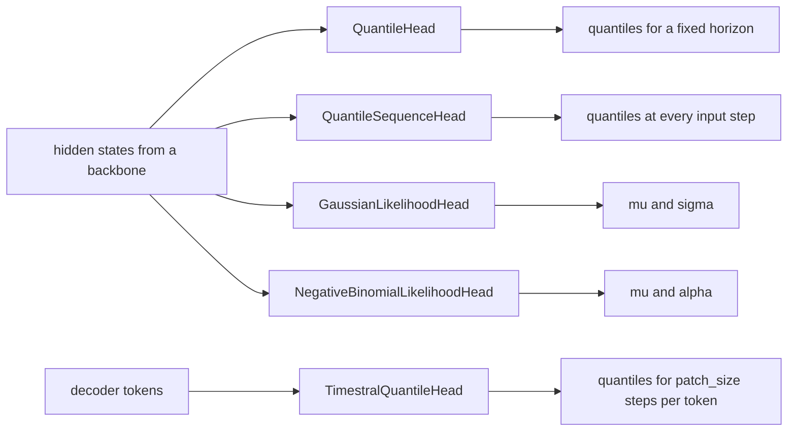

# heads/time_series

Keras 3 layers that turn the hidden states of a forecasting backbone into a forecast: non-crossing quantiles, or the parameters of a Gaussian or negative-binomial distribution. Package path: `dl_techniques.layers.heads.time_series` (source in `src/dl_techniques/layers/heads/time_series/`).

## What it is for

A forecaster that returns one number cannot say how sure it is. These heads put an uncertainty estimate on top of whatever encoder you use: a set of quantiles (for example the 10th, 50th and 90th percentile of the future value), or the mean and spread of a distribution that you train with a likelihood loss.

A head takes a hidden-state tensor, not a raw series. It does not know which backbone produced it, so the same head works behind a TCN, an xLSTM, a transformer or an LSTM. Every input width is read from the shape handed to `build`. The one exception is `TimestralQuantileHead`, which takes `d_model` because it owns a residual projection of that width.

Five heads are here. Six models under `dl_techniques.models.time_series` build one of them directly: `tirex`, `prism`, `xlstm`, `adaptive_ema`, `deepar` and `timestral`.

## How it works

There is no factory and no task enum. You import the class you want and build it with its own arguments. Every head returns plain tensors, not a dict.



What each head does:

- `QuantileHead`: dropout, then one `Dense` that projects to `output_length * num_quantiles` values, then a reshape to `(output_length, num_quantiles)`. With `flatten_input=True` a `(batch, seq, features)` input is flattened first. With `enforce_monotonicity=True` the first quantile is kept and each later one adds a softplus step, so the quantiles never cross.
- `QuantileSequenceHead`: the same idea applied at every position of a sequence. One `Dense` runs on each time step on its own, so the output length equals the input length and the head mixes nothing across time.
- `GaussianLikelihoodHead`: two `Dense` layers read the same hidden state. One gives `mu` with no activation. The other gives `sigma` through softplus and a `1e-6` floor. `sigma` is a standard deviation.
- `NegativeBinomialLikelihoodHead`: the same two projections, but both outputs go through softplus and the floor. `mu` is the mean and `alpha` is the dispersion, so `Var = mu + mu^2 * alpha`. Use it for overdispersed counts.
- `TimestralQuantileHead`: a `ResidualProjectionBlock` maps each decoder token to `patch_size * num_quantiles` raw values. The median channel is used as is. Every other level fans out from it by a cumulative sum of `width_factor * (probability gap) * softplus(raw)`, so the quantiles are ordered by construction. The result is at least float32.

| Head | Input | Output |
| --- | --- | --- |
| `QuantileHead` | `(batch, features)`, or `(batch, seq, features)` with `flatten_input=True` | `(batch, output_length, num_quantiles)` |
| `QuantileSequenceHead` | `(batch, seq, features)` | `(batch, seq, num_quantiles)` |
| `GaussianLikelihoodHead` | `(batch, [steps,] hidden)` | tuple `(mu, sigma)`, each `(batch, [steps,] units)` |
| `NegativeBinomialLikelihoodHead` | `(batch, [steps,] hidden)` | tuple `(mu, alpha)`, each `(batch, [steps,] units)` |
| `TimestralQuantileHead` | `(rows, n_patches, d_model)` | `(rows, n_patches * patch_size, num_quantiles)` |

Train the quantile heads with the pinball loss and the likelihood heads with the matching negative log-likelihood. The losses are not in this package.

## Files

- `__init__.py` - the public surface (5 names) and a package docstring.
- `quantile_head_fixed_io.py` - `QuantileHead`.
- `quantile_head_variable_io.py` - `QuantileSequenceHead`.
- `likelihood_heads.py` - `GaussianLikelihoodHead`, `NegativeBinomialLikelihoodHead`, the private base `_LikelihoodHead`, the private `_floored_softplus` and the constant `MIN_LIKELIHOOD_PARAM`.
- `timestral_quantile_head.py` - `TimestralQuantileHead` and the function `monotone_quantiles`.

## How to use it

```python
import keras
from dl_techniques.layers.heads.time_series import (
    QuantileHead, QuantileSequenceHead,
    GaussianLikelihoodHead, NegativeBinomialLikelihoodHead)

encoded = keras.Input(shape=(168, 32))
pooled = keras.layers.GlobalAveragePooling1D()(encoded)

fixed_q = QuantileHead(num_quantiles=3, output_length=24, enforce_monotonicity=True)(pooled)  # (None, 24, 3)
seq_q = QuantileSequenceHead(num_quantiles=3, enforce_monotonicity=True)(encoded)             # (None, 168, 3)
mu, sigma = GaussianLikelihoodHead(units=1)(encoded)                                          # each (None, 168, 1)
nb_mu, alpha = NegativeBinomialLikelihoodHead(units=1)(encoded)                               # each (None, 168, 1)
```

The Timestral head, as the Timestral model builds it:

```python
from dl_techniques.layers.heads.time_series import TimestralQuantileHead

head = TimestralQuantileHead(
    d_model=64, patch_size=8,
    quantile_levels=(0.1, 0.25, 0.5, 0.75, 0.9), width_factor=2.0, name="quantile_head")
quantiles = head(tokens)   # tokens: (rows, n_patches, 64) -> (rows, n_patches * 8, 5)
```

## Things to know

- **`enforce_monotonicity` is off by default** on both quantile heads. Without it the 90th percentile can come out below the 10th. It only does anything when `num_quantiles > 1`. `TimestralQuantileHead` is always ordered.
- **`QuantileHead` input rank.** With `flatten_input=False` it needs a 2D input and raises `ValueError` in `build()` on anything else. With `flatten_input=True` it needs a 3D input whose sequence and feature dimensions are both known.
- **`QuantileSequenceHead` and `activity_regularizer`.** Keras charges the regularizer once, on the returned tensor. The inner `Dense` does not carry a copy.
- **The likelihood floor.** Every positive parameter is floored at `MIN_LIKELIHOOD_PARAM = 1e-6`, because softplus underflows to exactly 0.0 in float32 below a logit of about -103, and `log(sigma)`, `1/sigma` and `lgamma(1/alpha)` are then infinite or NaN.
- **Registry keys.** Each head registers as `dl_techniques.layers.heads.time_series.<module>>ClassName`. They used to be `dl_techniques.layers.time_series.<module>>ClassName` (and Timestral's head was private and unregistered). A `.keras` archive saved under an old key loads only through the `Custom>ClassName` alias.
- **`TimestralQuantileHead` weight names.** The projection is a `ResidualProjectionBlock` named `projection` with sublayers `hidden_layer`, `output_layer` and `residual_layer`, all without bias. The Timestral checkpoint loader maps the reference names `head.projection.*` onto these, so do not rename them.
- **Location.** The `ResidualProjectionBlock` the Timestral head uses lives in `layers/time_series/residual_projection_block.py`.
