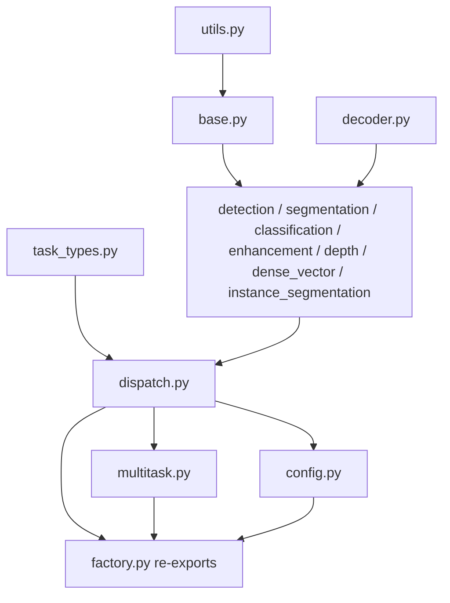

# heads/vision

Path: `src/dl_techniques/layers/heads/vision`
Purpose: Keras 3 vision task heads (detection, segmentation, classification, instance segmentation, depth, surface normals, optical flow, enhancement, multi-task), their task vocabulary, dispatch table, presets and the one-call builder vision models use.

## Scope

Lives here: the head layer classes, `VISION_HEAD_DISPATCH`, the factory functions, `HeadConfiguration` presets, `VisionTaskType` / `TaskConfiguration` / `CommonTaskConfigurations`, and the helpers they share.

Does not live here: the NLP and VLM heads (sibling packages `heads/nlp`, `heads/vlm`), the `create_head(domain, ...)` facade (`heads/factory.py`, which calls `create_vision_head` for `'vision'`), and the shared checks in `heads/validation.py` (`positive_int`, `resolve_stage_knobs`, `lookup_head`, `key_by_name`, `static_rank`). The backbones that consume these heads are in `models/`.

`heads/vision` imports only from sibling packages `conv_blocks`, `dense_block`, `norms`, `ffn`, `attention`, `activations`, `heads/validation`, plus `dl_techniques.utils` and `dl_techniques.initializers`.

## Architecture

Dispatch: `create_vision_head(task_type, **kwargs)` calls `validation.lookup_head(task_type, VISION_HEAD_DISPATCH, VisionTaskType, 'vision')` and returns `head_class(**{**defaults, **kwargs})`. The caller's value wins over a table default. A task type with no row raises `ValueError` naming the 10 that have one.

Base head: `BaseVisionHead.__init__` stores config, resolves the stage knobs, refuses unrunnable attention, then `_create_common_layers` builds `attention` and `ffn` only when their flags are on. There is no common norm and no common Dropout (creating a Dropout draws a default seed and shifts later initializers). `BaseVisionHead` has no `call`.

Attention layout (`BaseVisionHead._apply_attention`): the attention layer is called in the layout its type takes. Types in `_SPATIAL_ATTENTION_TYPES` (`area`, `cbam`, `mobile_mqa`, `spatial`, `tripse1` to `tripse4`) take `(B, H, W, C)`; every other buildable type takes `(B, N, C)`. A rank-4 map meeting a sequence type is flattened to `H*W` tokens and restored. A rank-3 sequence meeting a spatial type is reshaped onto `patch_grid_size` and flattened back; with no grid (`patch_grid_size` is `None`, the class default) `_attention_takes_spatial` raises `ValueError`. Row-major reshapes both ways.

Progressive decoder (`decoder.py`): three stages of `ConvBlock(hidden_dim // 2**i)` then `Conv2DTranspose(hidden_dim // 2**(i+1), 3, strides=2)`, named `{prefix}_conv_{i}` / `{prefix}_upsample_{i}`. Output is 8x the input and `hidden_dim // 8` channels. Used by depth (prefix `depth`), normals (`normals`) and flow (`flow`). The two layer lists are flat and paired by index.

Output heads, per class:

| Head | Layers in `call` order |
|---|---|
| `DetectionHead` | [attention] [ffn] [reshape to grid if sequence] -> `cls_conv` ConvBlock 3x3 -> `cls_head` Conv2D 1x1; with `use_regression`: `reg_conv` -> `reg_head` |
| `SegmentationHead` | [attention] [ffn] -> 3 `refine_block_i` ConvBlocks (skip `i` concatenated after block `i`) -> `log2(upsampling_factor)` `upsample_i` Conv2DTranspose (stride 2, activation = `activation_type`) -> `seg_head` Conv2D 1x1 linear |
| `ClassificationHead` | [attention] -> pooling (`GlobalAveragePooling2D`, `GlobalMaxPooling2D`, token 0, or a `Flatten` made inside `call`) -> [`pooled_norm`] -> `dense_block`, `dense_block_1`, ... -> [`classifier_dropout`] -> `classifier` Dense linear; also `softmax(logits)` |
| `InstanceSegmentationHead` | [attention] [ffn] -> inner `detection_head` (built with attention and FFN off) and 3 `mask_conv_i` ConvBlocks -> `mask_head` Conv2D 1x1 linear |
| `DepthEstimationHead` | [attention] [ffn] -> progressive decoder -> `depth_head` Conv2D 3x3 sigmoid -> scale to `[min_depth, max_depth]` |
| `SurfaceNormalsHead` / `OpticalFlowHead` | [attention] [ffn] -> progressive decoder -> `{normals,flow}_head` Conv2D 3x3 linear -> (normals only) L2 normalize |
| `EnhancementHead` | `enhance_block_i` ConvBlocks -> `upsample` Conv2DTranspose (`scale_factor > 1`) or `output_conv` Conv2D 3x3 |
| `MultiTaskHead` | one head per `task_configs` entry, built by `create_vision_head`; not a `BaseVisionHead` subclass |

## Key files

| File | Role | Notes |
|---|---|---|
| `__init__.py` | Public API, 18 names in `__all__` | Imports heads and factories from `.factory`, task objects from `.task_types` |
| `factory.py` | Re-export facade | Also re-exports private helpers (`_drop_off_stage_knobs`, `_run_progressive_decoder`, ...) so old import paths work. Keep it logic-free |
| `base.py` | `BaseVisionHead` | Registered, but unusable alone |
| `utils.py` | Helpers and tables | `STAGE_KNOB_DEFAULTS`, `_drop_off_stage_knobs`, `_refuse_common_layers_call_never_runs`, `_validated_block_dims`, `_require_hidden_dim_at_least`, `_refuse_dropout_no_layer_applies`, `_UNRUNNABLE_ATTENTION_TYPES`, `_SPATIAL_ATTENTION_TYPES`, `_DEFAULT_BBOX_DIMS`. Imports no head class, so no cycles |
| `decoder.py` | Progressive decoder functions | `_PROGRESSIVE_DOUBLINGS = 3` |
| `detection.py`, `segmentation.py`, `classification.py`, `instance_segmentation.py`, `depth.py`, `enhancement.py` | One head each | Each registers under its own module path |
| `dense_vector.py` | `_DenseVectorHeadBase` (not registered), `SurfaceNormalsHead`, `OpticalFlowHead`, `_unit_normalize` | Subclasses set `_OUTPUT_KEY`, `_CHANNELS`, `_UNIT_NORM` |
| `multitask.py` | `MultiTaskHead`, `create_multi_task_head` | Separate from `dispatch.py` to avoid an import cycle |
| `dispatch.py` | `VISION_HEAD_DISPATCH`, `ENHANCEMENT_TASK_TYPES`, `create_vision_head`, `create_enhancement_head` | The one task-to-head table |
| `config.py` | `PRESET_FIXED_KEYS`, `HeadConfiguration`, `RESERVED_HEAD_OVERRIDE_KEYS`, `merge_head_config_overrides`, `build_model_vision_head` | |
| `task_types.py` | `VisionTaskType` (37 members), `TaskConfiguration`, `CommonTaskConfigurations` (22 presets), `parse_task_list`, `get_task_suggestions`, `validate_task_combination` | Imports nothing from the heads |

## Public interface

Exported from the package: `BaseVisionHead`, `DetectionHead`, `SegmentationHead`, `DepthEstimationHead`, `SurfaceNormalsHead`, `OpticalFlowHead`, `ClassificationHead`, `InstanceSegmentationHead`, `MultiTaskHead`, `EnhancementHead`, `create_vision_head`, `create_multi_task_head`, `create_enhancement_head`, `HeadConfiguration`, `VisionTaskType`, `TaskConfiguration`, `CommonTaskConfigurations`, `parse_task_list`.

Not in `__all__`, imported by submodule path: `VISION_HEAD_DISPATCH`, `ENHANCEMENT_TASK_TYPES`, `PRESET_FIXED_KEYS`, `RESERVED_HEAD_OVERRIDE_KEYS`, `merge_head_config_overrides`, `build_model_vision_head` (from `.factory`, `.dispatch` or `.config`); `get_task_suggestions`, `validate_task_combination` (from `.task_types`).

Functions:

- `create_vision_head(task_type: Union[VisionTaskType, str], **kwargs) -> BaseVisionHead`. Raises `ValueError` for the 27 task types with no head and for an unparseable string.
- `create_enhancement_head(task_type, **kwargs) -> EnhancementHead`. Only `denoising` and `super_resolution`; others raise `ValueError`.
- `create_multi_task_head(task_configuration, **kwargs) -> MultiTaskHead`. Accepts a `TaskConfiguration`, a list or tuple of tasks (members or strings), or a dict of task-config dicts used unchanged. For the first two, each task's options are popped from `kwargs[task.value]` (a dict) and the rest go to `MultiTaskHead`. A repeated task raises `ValueError`; any other input type raises `ValueError`.
- `build_model_vision_head(task_type, head_config, head_config_overrides=None) -> BaseVisionHead`. Order: `HeadConfiguration.get_default_config(task_type)`, `.update(head_config)`, `merge_head_config_overrides`, `_drop_off_stage_knobs(config, keep=(head_config, overrides))`, `create_vision_head`.
- `merge_head_config_overrides(head_config, overrides) -> dict`. Returns a new dict; `ValueError` listing every reserved key (`name`, `num_classes`, `task_type`) found in `overrides`.
- `HeadConfiguration.get_default_config(task_type)` and `.get_efficient_config(task_type)`. Static; return plain dicts; `ValueError` for a task with no head.
- `VisionTaskType`: `all_tasks`, `get_task_categories` (12 categories), `get_compatible_tasks` (11 members have entries), `get_output_types` (documentation strings, only the 10 dispatched tasks, else `ValueError`), `from_string` (lowercases and strips), `coerce`, `from_strings`, `to_strings`, `get_category`, `is_compatible_with`. `str(member)` is its value.
- `TaskConfiguration(tasks, validate_compatibility=True)`: rejects empty, duplicates, and the pairs (colorization, denoising) and (stereo matching, optical flow). Has `has_task`, nine `has_*` shorthands, `get_enabled_tasks` (declaration order), `get_task_names`, `get_tasks_by_category`, `get_output_specifications`, `to_dict` / `from_dict` (`enable_<value>` keys), `from_strings`, equality and hash by task set.

Constructor arguments by head (all also take the `BaseVisionHead` arguments):

| Head | Own arguments |
|---|---|
| `BaseVisionHead` | `hidden_dim=256`, `normalization_type='layer_norm'`, `activation_type='gelu'`, `dropout_rate=0.1`, `use_attention=False`, `attention_type=None`, `use_ffn=True`, `ffn_type=None`, `ffn_expansion_factor=None` |
| `DetectionHead` | `num_classes`, `num_anchors=9`, `bbox_dims=None`, `input_format='spatial'`, `patch_grid_size=None`, `use_regression=True` |
| `SegmentationHead` | `num_classes`, `upsampling_factor=4`, `use_skip_connections=True`, `skip_channel_mode='auto'`, `explicit_skip_channels=None`, `input_format='spatial'`, `patch_grid_size=None` |
| `ClassificationHead` | `num_classes`, `use_global_pooling=True`, `pooling_type='avg'`, `block_dims=None`, `pooled_normalization_type=None`, `normalization_kwargs=None`, `classifier_dropout_rate=0.0`, `classifier_use_bias=True`, `block_use_bias=True`, `kernel_initializer='glorot_uniform'`, `bias_initializer='zeros'`, `kernel_regularizer=None`, `bias_regularizer=None` |
| `InstanceSegmentationHead` | `num_classes`, `num_instances=100`, `mask_size=(28, 28)` (stored, read by no layer) |
| `DepthEstimationHead` | `output_channels=1`, `min_depth=0.1`, `max_depth=100.0`, `use_log_depth=True` |
| `SurfaceNormalsHead`, `OpticalFlowHead` | none; `output_channels` raises `ValueError` |
| `EnhancementHead` | `output_channels=3`, `scale_factor=1`, `block_dims=None`, `output_use_bias=True` |
| `MultiTaskHead` | `task_configs` (required, non-empty), `shared_backbone_dim=256`, `use_task_specific_attention=True` |

## Data shapes

Inputs: `(B, H, W, C)`; `(B, N, D)` for `input_format='sequence'` (detection, segmentation) and for `ClassificationHead` with `pooling_type='cls_token'` or `use_global_pooling=False`; a list `[*skips, features]` for `SegmentationHead` with skips; a dict keyed by task name (plus optional `'shared'`) for `MultiTaskHead`.

Outputs (A = `num_anchors`, C = `num_classes`): detection `{'classifications': (B,H,W,A*C), 'regressions': (B,H,W,A*bbox_dims)}` (no `'regressions'` when `use_regression=False`); segmentation a bare tensor `(B,H*s,W*s,num_classes)`; instance segmentation adds `'instance_masks': (B,H,W,num_instances)`; classification `{'logits','probabilities'}`; depth `{'depth','confidence'}` at `(B,8H,8W,output_channels)`; normals `{'normals': ...,3}`; flow `{'flow': ...,2}`; enhancement `{'enhanced': (B,H*s,W*s,output_channels)}` (s = `scale_factor`, 1 gives same size); multi-task a dict of those dicts.

Preset dicts (`HeadConfiguration`): 7 shared keys (`hidden_dim=256`, `normalization_type`, `activation_type`, `dropout_rate=0.1`, `use_ffn=True`, `ffn_type='mlp'`, `ffn_expansion_factor=4`) plus a task entry for 8 of the 10 task types (not denoising or super-resolution). Defaults: detection `num_classes=80`, segmentation `21` with `cbam` attention on, classification `1000`, instance segmentation `80` with `cbam` on, keypoint `num_classes=65, num_anchors=1, use_regression=False`. The efficient preset overrides 6 keys: `hidden_dim=128`, `dropout_rate=0.0`, `use_attention=False`, `use_ffn=True`, `ffn_type='glu'`, `ffn_expansion_factor=2`. Both then apply `PRESET_FIXED_KEYS` (classification `use_ffn=False`; denoising and super-resolution `use_attention=False, use_ffn=False, dropout_rate=0.0`) and drop the knobs of every stage left off.

`MultiTaskHead.get_config` stores each `task_type` as its string value (an Enum is not JSON). Each task head is named `<task name>_head` unless its config sets `name`.

## Invariants and constraints

- **Registration** is `@register_dl_technique("dl_techniques.layers.heads.vision.<module>")`, following the defining module: `base`, `detection`, `segmentation`, `classification`, `instance_segmentation`, `depth`, `dense_vector` (both normals and flow), `enhancement`, `multitask`. Moving a class changes its key. `EnhancementHead` documents that its key was `...vision.factory>EnhancementHead` until 2026-10-27. Never use a bare `@keras.saving.register_keras_serializable()`.
- **`EnhancementHead` stays module scope** and its class name stays exactly `EnhancementHead` (the legacy alias is keyed on the bare name).
- **A head owns what its `call` runs.** A flag whose layer `call` never runs is refused, not stored. `_refuse_common_layers_call_never_runs(kwargs, head_name, flags)` defaults each flag to `False` (`0.0` for `dropout_rate`) and raises on a truthy value; call it BEFORE `super().__init__`. `ClassificationHead` passes `('use_ffn',)`; `EnhancementHead` passes `('use_attention', 'use_ffn', 'dropout_rate')`. `DetectionHead(use_regression=False)` refuses `bbox_dims` and stores `None`. `SegmentationHead` in `'explicit'` mode refuses `hidden_dim` unless attention or FFN is on, then stores `None` (`_drop_unread_hidden_dim`; it pops a `None` `hidden_dim` from kwargs before `super().__init__`). `ClassificationHead` refuses a non-default `bias_initializer` / `bias_regularizer` when no Dense has a bias.
- **Stage knobs** (`attention_type`, `ffn_type`, `ffn_expansion_factor`) default to `None`; `resolve_stage_knobs(owner, STAGE_KNOB_DEFAULTS, flags, given)` fills defaults when the stage is on and raises when a value is given with the stage off. Presets and `build_model_vision_head` drop a preset knob whose stage ends up off, but keep one the model or caller set (the head then refuses it).
- **No dropout in the dense-regression decoders.** Depth, normals and flow call `_refuse_dropout_no_layer_applies`: `dropout_rate` defaults to 0.0 and a positive rate needs `use_attention` or `use_ffn` on. The instance-mask branch takes no dropout either (`dropout_rate` reaches the inner detection head).
- **Logits out.** No class-like output is activated: classification `'logits'`, segmentation map, detection `'classifications'`, `'instance_masks'`. Range maps are the only squashed outputs: depth sigmoid. `'probabilities'` is the softmax in compute dtype (float16 under `mixed_float16`). Do not put an activation back on these convs.
- **Normals** use `keras.ops.normalize(..., order=2, epsilon=1e-12)`, in float32 when the input is float16 or bfloat16, cast back after.
- **Flat layer lists.** Keras does not save layers held in nested lists. Keep `conv_blocks` / `upsamples` / `refine_blocks` / `dense_blocks` flat; name every sub-layer explicitly so weight paths survive a `.keras` round trip (unnamed layers take process-global suffixes).
- **`SegmentationHead.build` decides single shape vs list by `is_single_shape(input_shape)`**, not `isinstance(list)`: `load_model` rebuilds from a JSON build config where one shape arrives as a list of ints.
- **`upsampling_factor` must be a power of two** (`is_power_of_two`, not a bool); `_num_upsamples = upsampling_factor.bit_length() - 1`. Do not use `int(sqrt(factor))`.
- **Skip resolution**: `_check_skip_resolution` refuses a skip whose known height or width differs from the feature map's. Skips are concatenated after refine blocks, before upsampling.
- **`MultiTaskHead._create_task_heads` copies each task dict before `pop('task_type')`.** It sets `hidden_dim` default from `shared_backbone_dim`, overwrites `use_attention` with `use_task_specific_attention`, and `setdefault`s `name`.
- **Initializers**: `ClassificationHead` gives each Dense its own `clone_initializer(...)` copy so a seedless initializer draws afresh per kernel.
- **`VisionTaskType` has no alias** under any other name; `tests/test_layers/test_heads/test_the_vision_task_enum_has_no_alias.py` pins it.
- **Order in `build_model_vision_head`** (preset, model keys, overrides) is deliberate: an override beats the model's head shape, the model's `num_classes` / `name` beat the preset. Do not copy the sequence back into a model.

## Dependencies

Internal: `conv_blocks.conv_block.ConvBlock` (every conv stage), `dense_block.DenseBlock` (classification), `norms.create_normalization_layer` (pooled norm), `ffn.factory.create_ffn_layer`, `attention.factory.create_attention_layer` and `assemble_attention_config`, `heads.validation` (`positive_int`, `resolve_stage_knobs`, `lookup_head`, `key_by_name`), `initializers.clone_initializer`, `utils.keras_registration.register_dl_technique`, `utils.tensors.is_power_of_two` / `is_single_shape`.

External: `keras` (3.x, `keras.ops` only), no direct TensorFlow use.

Consumers: `models/` build heads with `build_model_vision_head` (23 call sites in 20 files, including FFTNet's three and FastVLM). DETR, MambaLCT and SuperPoint call `create_vision_head` with a full config. `heads/factory.create_head('vision', ...)` forwards to `create_vision_head`.

## Failure modes

- Task with no head: `ValueError("no vision head is implemented for task type '<NAME>'. The 10 task types with a head are: [...]")`.
- Attention input mismatch: attention is built at `hidden_dim`, so a different input channel count raises `ValueError` (cbam: "Expected input channels (64) to match layer channels (256)"; multi_head: "Input last dimension (64) must match dim (256)"). Pass `hidden_dim=<backbone channels>`.
- `attention_type='shared_weights_cross'` is refused at construction (`_UNRUNNABLE_ATTENTION_TYPES`): it needs `split_sizes` per call.
- A spatial attention type on a `(B, N, C)` input with no `patch_grid_size` (classification, depth, instance segmentation and the rest hold no grid) raises `ValueError`.
- `hidden_dim` too small: 8 for the progressive decoder and for `SegmentationHead` with upsampling, 4 for `SegmentationHead` at `upsampling_factor=1`, 2 for `ClassificationHead` with default `block_dims`; `ValueError` from `_require_hidden_dim_at_least`.
- `positive_int` rejects non-positive counts (`hidden_dim`, `num_classes`, `num_anchors`, `bbox_dims`, `num_instances`, `output_channels`, `scale_factor`); numpy integers are accepted.
- `decoder_style` / `dpt_*` keywords on `DepthEstimationHead`: Keras raises `ValueError` (unrecognized keyword). That mode was deleted.
- `SegmentationHead` explicit mode: `explicit_skip_channels` required; at build, the number of skips must equal its length and each skip's channels must match, else `ValueError`.
- `DetectionHead` / `SegmentationHead` with `input_format='sequence'` and no `patch_grid_size`: `ValueError`.
- `ClassificationHead`: bad `pooling_type` (not `avg`, `max`, `cls_token`), `classifier_dropout_rate` outside `[0, 1)`, `block_dims` entry not a positive int: `ValueError`. A missing `num_classes` for detection, segmentation, classification or instance segmentation is a Python `TypeError`.
- `MultiTaskHead` dict input with neither the task's key nor `'shared'`: `ValueError` from `build`, `call` and `compute_output_shape`. An empty `task_configs` raises at construction.
- Known stale text: `VisionTaskType.get_output_types` still describes depth `'confidence'` as "progressive: ...; DPT: the last decoder stage", although the DPT mode is gone. `config.py` text mentions 22 `build_model_vision_head` sites; a grep finds 23 (excluding this package).

## Working here

- Edit the module that defines a thing; `factory.py` only re-exports. When a name moves, keep the re-export in `factory.py` and `__init__.py`.
- New head: add the class in its own module, register under `dl_techniques.layers.heads.vision.<module>`, subclass `BaseVisionHead`, create sub-layers in `__init__` (never in `call`), build them in `build` on the shape `call` feeds them, implement `call`, `compute_output_shape`, `get_config` (JSON-safe; every constructor field). Call the refusal helpers before `super().__init__`. Add a row to `VISION_HEAD_DISPATCH`; add a `get_output_types` entry in `task_types.py` (the two files cannot import each other); add a `HeadConfiguration` task entry if it needs preset keys; export it from `factory.py` and `__init__.py`.
- Supporting a currently unsupported task type means implementing the head and adding it to `VISION_HEAD_DISPATCH`. Do not add a fallback head.
- Adding a `VisionTaskType` member: file it in `get_task_categories` (every member must appear once, or `get_category` returns `"Uncategorized"`), and update the counts in docstrings that say 37.
- A new attention type that takes only a rank-4 map goes into `_SPATIAL_ATTENTION_TYPES`; one the head cannot call with a single stream goes into `_UNRUNNABLE_ATTENTION_TYPES` with a reason.
- Keep `get_config` free of Enum members and keep sub-layers in flat lists or named attributes.
- Tests live in `tests/test_layers/test_heads/`: `test_vision.py`, `test_every_vision_head_survives_a_keras_round_trip.py` (compares every weight by path), `test_every_vision_head_reports_the_shapes_it_returns.py`, `test_the_head_classes_register_under_their_own_module.py`, `test_a_vision_head_runs_attention_in_its_own_layout.py`, `test_a_vision_head_refuses_a_stage_knob_its_flag_turns_off.py`, `test_the_vision_heads_emit_logits.py`, `test_the_normals_and_flow_heads_emit_their_geometry.py`, `test_the_one_call_vision_head_helper.py`, `test_the_multi_task_head_builds_every_dispatched_task.py`, `test_the_output_types_describe_what_each_head_returns.py`. `tests/test_the_head_factories_and_finetune_scripts_bind_no_dead_names.py` lists the vision submodules except `factory.py`.
- Run scoped tests only, from the repo root: `.venv/bin/python -m pytest tests/test_layers/test_heads/ -q`. Do not run the full suite. Use `CUDA_VISIBLE_DEVICES=` or a free GPU; do not run GPU jobs in parallel.
- Style: `import keras` and qualify (`keras.ops.reshape`), no `from keras import ops`; Sphinx/reST docstrings (`:param:`, `:type:`, `:raises:`) matching the surrounding files; log through `dl_techniques.utils.logger`, no `print`.
