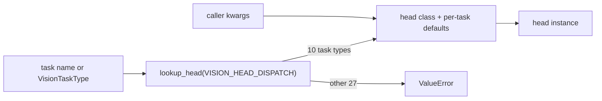

# dl_techniques.layers.heads.vision

Task heads for vision models, written as Keras 3 layers. A head sits on top of a backbone: it takes the backbone's feature map and turns it into detections, masks, depth, surface normals, optical flow, class scores or an enhanced image.

The package lives at `src/dl_techniques/layers/heads/vision/` in the `dl_techniques` library.

## What it is for

A backbone (ResNet, ViT, ConvNeXt and so on) produces features, not answers. Each vision task needs a small network on top that reshapes those features into the task's output. This package holds those networks, one class per task, plus the tools that choose and configure them:

- a task vocabulary (`VisionTaskType`, 37 names) and sets of tasks (`TaskConfiguration`);
- a factory (`create_vision_head`) that maps a task name to the right head class;
- ready-made keyword presets (`HeadConfiguration`);
- a one-call helper (`build_model_vision_head`) that vision models use to build their own head;
- a wrapper (`MultiTaskHead`) that runs several heads on the same features.

Only 10 of the 37 task names have a head. The other 27 raise `ValueError`. There is no fallback head, so a task without an implementation fails at once instead of returning something that looks right.

## How it works



`VISION_HEAD_DISPATCH` is one table: task type to `(head class, default kwargs)`. A default (keypoint detection uses `num_anchors=1, use_regression=False`; super-resolution uses `scale_factor=2`) loses to the caller's value for the same key. `create_vision_head`, `MultiTaskHead`, `create_enhancement_head` and `HeadConfiguration` all read this one table.

Every head except `MultiTaskHead` derives from `BaseVisionHead`. It owns two optional stages that run first:

1. attention (`use_attention`, `attention_type`), run in whatever layout the chosen attention type takes (a 4D map is flattened to tokens for a sequence type, and tokens are put back on a grid for a map-only type);
2. a feed-forward block (`use_ffn`, `ffn_type`, `ffn_expansion_factor`). Its output width is `hidden_dim`, so it also projects the input channels to `hidden_dim`.

Then the head's own layers run. A head only builds what its `call` actually runs: `ClassificationHead` refuses `use_ffn=True`, and `EnhancementHead` refuses attention, FFN and any dropout above 0.

## Heads and their outputs

Input is a feature map `(B, H, W, C)` unless noted. Class-like outputs are logits (no softmax or sigmoid applied).

| Task type | Head | Output |
|---|---|---|
| `detection` | `DetectionHead` | `{'classifications': (B, H, W, A*C), 'regressions': (B, H, W, A*4)}` |
| `keypoint_detection` | `DetectionHead(num_anchors=1, use_regression=False)` | `{'classifications': (B, H, W, C)}` |
| `segmentation` | `SegmentationHead` | one tensor `(B, H*s, W*s, num_classes)`, `s = upsampling_factor` |
| `instance_segmentation` | `InstanceSegmentationHead` | detection's two keys plus `'instance_masks': (B, H, W, num_instances)` (mask logits) |
| `classification` | `ClassificationHead` | `{'logits': (B, C), 'probabilities': (B, C)}` |
| `depth_estimation` | `DepthEstimationHead` | `{'depth': (B, 8H, 8W, 1), 'confidence': same shape}` |
| `surface_normals` | `SurfaceNormalsHead` | `{'normals': (B, 8H, 8W, 3)}`, unit length per pixel |
| `optical_flow` | `OpticalFlowHead` | `{'flow': (B, 8H, 8W, 2)}`, signed, unbounded |
| `denoising` | `EnhancementHead` | `{'enhanced': (B, H, W, 3)}` |
| `super_resolution` | `EnhancementHead(scale_factor=2)` | `{'enhanced': (B, 2H, 2W, 3)}` |

`A` is `num_anchors` and `C` is `num_classes`. `SegmentationHead` is the only head that returns a bare tensor. The depth `'confidence'` is just the sigmoid map the depth was scaled from, not an uncertainty. The only squashed outputs are that depth sigmoid and the unit-normalization of normals.

## Files

- `__init__.py` - exports 18 names: 10 head classes, `create_vision_head`, `create_multi_task_head`, `create_enhancement_head`, `HeadConfiguration`, `VisionTaskType`, `TaskConfiguration`, `CommonTaskConfigurations`, `parse_task_list`.
- `factory.py` - re-export layer only. It holds no logic; edit the module that defines a thing.
- `base.py` - `BaseVisionHead`: shared config, optional attention and FFN stages. It has no `call` and is not a usable head.
- `detection.py` - `DetectionHead`.
- `segmentation.py` - `SegmentationHead`, with optional skip connections.
- `classification.py` - `ClassificationHead`.
- `instance_segmentation.py` - `InstanceSegmentationHead`, which holds a `DetectionHead` plus a mask branch.
- `depth.py` - `DepthEstimationHead`.
- `dense_vector.py` - `SurfaceNormalsHead` and `OpticalFlowHead`, built on a private shared base.
- `decoder.py` - the progressive decoder (three ConvBlock plus stride-2 transposed-conv stages, 8x upsampling) shared by depth, normals and flow.
- `enhancement.py` - `EnhancementHead`.
- `multitask.py` - `MultiTaskHead` and `create_multi_task_head`.
- `dispatch.py` - `VISION_HEAD_DISPATCH`, `create_vision_head`, `create_enhancement_head`.
- `config.py` - `HeadConfiguration` presets, `merge_head_config_overrides`, `build_model_vision_head`.
- `task_types.py` - `VisionTaskType`, `TaskConfiguration`, `CommonTaskConfigurations` (22 presets), `parse_task_list`, `get_task_suggestions`, `validate_task_combination`.
- `utils.py` - shared validation helpers and the attention-layout tables.

## How to use it

```python
import keras
from dl_techniques.layers.heads.vision import (
    create_vision_head, create_multi_task_head, HeadConfiguration, VisionTaskType,
)

features = keras.random.normal((2, 16, 16, 64))   # any backbone's feature map

det = create_vision_head('detection', num_classes=80, num_anchors=9)
out = det(features)
# out['classifications'] -> (2, 16, 16, 720); out['regressions'] -> (2, 16, 16, 36)

seg = create_vision_head('segmentation', num_classes=21, use_skip_connections=False)
mask = seg(features)                               # (2, 64, 64, 21)

depth = create_vision_head('depth_estimation')(features)   # depth, confidence: (2, 128, 128, 1)

logits = create_vision_head('classification', num_classes=1000)(features)['logits']  # (2, 1000)

multi = create_multi_task_head(
    {
        'detection': {'task_type': VisionTaskType.DETECTION, 'num_classes': 80},
        'segmentation': {'task_type': VisionTaskType.SEGMENTATION, 'num_classes': 21,
                         'use_skip_connections': False},
    },
    use_task_specific_attention=False,
)
both = multi(features)    # {'detection': {...}, 'segmentation': tensor}

cfg = HeadConfiguration.get_efficient_config(VisionTaskType.DETECTION)
cheap_det = create_vision_head('detection', **cfg)
```

Names not in `__all__` are imported from the submodule: `from dl_techniques.layers.heads.vision.factory import VISION_HEAD_DISPATCH, merge_head_config_overrides, build_model_vision_head`, and `from dl_techniques.layers.heads.vision.task_types import get_task_suggestions, validate_task_combination`.

A model that owns a head builds it with `build_model_vision_head(task_type, head_config, head_config_overrides=None)`. The order is fixed: the `HeadConfiguration` default preset, then the model's own keys, then the caller's overrides. The overrides may not set `name`, `num_classes` or `task_type` (`ValueError`).

A multi-task head can also be built from a list of tasks, with each task's options in a keyword named after the task's value:

```python
create_multi_task_head(
    [VisionTaskType.DETECTION, 'classification'],
    detection={'num_classes': 80}, classification={'num_classes': 10},
    use_task_specific_attention=False)
```

## Things to know

- **Head-specific arguments**: `DetectionHead` takes `num_classes`, `num_anchors=9`, `bbox_dims`, `input_format` (`'spatial'` or `'sequence'`), `patch_grid_size`, `use_regression=True`. `SegmentationHead` takes `num_classes`, `upsampling_factor=4` (a power of two), `use_skip_connections`, `skip_channel_mode` (`'auto'` or `'explicit'`), `explicit_skip_channels`, `input_format`, `patch_grid_size`. `ClassificationHead` takes `num_classes`, `use_global_pooling`, `pooling_type` (`'avg'`, `'max'`, `'cls_token'`), `block_dims`, `pooled_normalization_type`, `normalization_kwargs`, `classifier_dropout_rate`, `classifier_use_bias`, `block_use_bias` and four initializer/regularizer arguments. `DepthEstimationHead` takes `output_channels`, `min_depth`, `max_depth`, `use_log_depth`. `EnhancementHead` takes `output_channels`, `scale_factor`, `block_dims`, `output_use_bias`. `InstanceSegmentationHead` takes `num_classes`, `num_instances`, `mask_size`.
- **Shared arguments** (every `BaseVisionHead` subclass): `hidden_dim=256`, `normalization_type='layer_norm'`, `activation_type='gelu'`, `dropout_rate=0.1`, `use_attention=False`, `attention_type`, `use_ffn=True`, `ffn_type`, `ffn_expansion_factor`. The three stage knobs default to `None`, become `'multi_head'` / `'mlp'` / `4` when their stage is on, and raise `ValueError` if given while their stage is off.
- **Depth, normals and flow upsample by 8x.** A `(2, 16, 16, 64)` input gives `(2, 128, 128, C)`. They need `hidden_dim >= 8`, default `use_attention` and `use_ffn` to `False`, and default `dropout_rate` to 0.0 (a positive rate is refused unless attention or FFN is on).
- **Attention is built at `hidden_dim`**, so with attention on, the input channel count must equal `hidden_dim`. Otherwise `ValueError` (`cbam`: "Expected input channels (64) to match layer channels (256)").
- **`MultiTaskHead` forces `use_attention` on every task head** to `use_task_specific_attention`, which defaults to `True`. Pass `False` when a task is denoising or super-resolution, since `EnhancementHead` refuses attention.
- **`MultiTaskHead` input** is one tensor (sent to every head) or a dict keyed by task name, with a `'shared'` entry as fallback. Its output is a dict of each head's output.
- **`SegmentationHead` skips**: with `use_skip_connections=True` it accepts a list `[*skips, features]`, highest-level map last. Skips are concatenated deepest-first, one after each of the three refine blocks. Every skip must have the feature map's own height and width, since upsampling happens after the refine blocks.
- **Sequence input** (ViT tokens `(B, N, D)`): `DetectionHead` and `SegmentationHead` take `input_format='sequence'` with `patch_grid_size=(h, w)`. `ClassificationHead` takes tokens with `pooling_type='cls_token'` (classifies token 0) or `use_global_pooling=False` (flattens).
- **`ClassificationHead` `'probabilities'`** is `softmax(logits)` in the compute dtype, so it is float16 under `mixed_float16`. Compile with `from_logits=True` on `'logits'`.
- **`create_enhancement_head`** accepts only `denoising` and `super_resolution`.
- **Removed**: `decoder_style='dpt'` and the `dpt_*` arguments of `DepthEstimationHead` are gone (Keras raises on the unknown keyword), and the third preset `get_high_performance_config` no longer exists.
- Tests: `tests/test_layers/test_heads/` (`test_vision.py` and the `test_*vision*`, normals/flow, enhancement and round-trip files).
