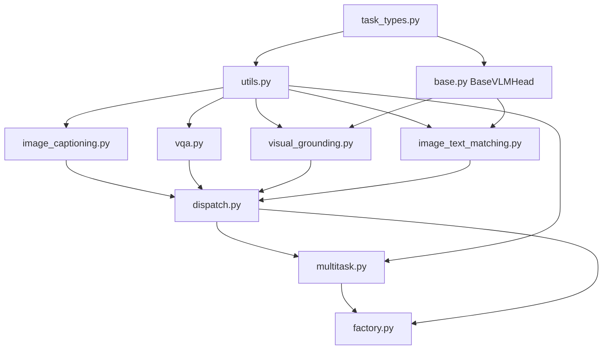

# heads/vlm

Path: `src/dl_techniques/layers/heads/vlm`
Purpose: Keras 3 task heads that map vision and text feature tensors to captions, answer logits, boxes and match scores, plus the task enum, config, dispatch table and factories.

## Scope

In: four task heads, one shared base, a multi-task wrapper, `VLMTaskType` / `VLMTaskConfig` / `VLMTaskConfiguration`, the dispatch table, two factory functions, private helpers.

Out: encoders (the heads take feature tensors, never pixels or token ids), embedding tables, losses, any domain other than VLM. Sibling packages `heads/nlp` and `heads/vision` are separate; shared checks come from `heads/validation.py` and `heads/masking.py` (one level up, outside this directory). The `heads/factory.py` facade `create_head('vlm', ...)` forwards to `create_vlm_head`.

No model, trainer or application outside `layers/heads` constructs a VLM head. Callers are the facade and tests under `tests/test_layers/test_heads/`.

## Architecture

Import order, downward only: `task_types` -> (`utils`, `base`) -> leaf heads -> `dispatch` -> `multitask` -> `factory`. `base.py` imports only `task_types` from this package (plus `fusion.multimodal_fusion`, `utils.tensors`, `keras_registration` from outside); it does not import `.utils`, and `utils.py` does not import `base`.

Class hierarchy:

- `ImageCaptioningHead`, `VQAHead`, `MultiTaskVLMHead` derive from `keras.layers.Layer` directly.
- `VisualGroundingHead`, `ImageTextMatchingHead` derive from `BaseVLMHead`, which derives from `keras.layers.Layer`.
- `BaseVLMHead` owns exactly one sub-layer, `fusion` (`MultiModalFusion`), and has no `call`.

Forward paths:

- Captioning: per layer `i`, `self_attention_layers[i]` (type `multi_head`, causal keep mask times optional `text_mask`) -> `norm_layers[3i]` (`rms_norm`) -> `cross_attention_layers[i]` (type `multi_head_cross`, `kv_input=vision_features`, `attention_mask=vision_mask`) -> `norm_layers[3i+1]` -> `ffn_layers[i]` -> `norm_layers[3i+2]`. Then `output_proj` Dense. Causal mask comes from `MaskFactory.create_causal_mask` (not `keras.ops.tril`, which breaks under tracing).
- VQA: `_pool_sequence` on each modality (strategies `mean`/`max`) or one `multi_head_cross` layer applied in both directions then mean-pooled (`attention`); `concatenate` on axis -1; `hidden_layers[i]` (Dense, activation `gelu`) and `dropout_layers[i]`; `output_layer`.
- Grounding: `text_pooling` (mean) -> expand and tile to `num_regions` -> `fusion([vision, text_tiled])` -> `confidence_scorer` Dense(1) squeezed -> `argmax` (after `fill_masked` when `vision_mask` given) -> `take_along_axis` -> `bbox_regressor` Dense(4) -> `sigmoid`.
- Matching: `_pool_sequence` both -> contrastive branch (`vision_proj`, `text_proj`, `keras.ops.normalize`, matmul, divide by `temperature`) and fine branch (expand to `(B,1,D)`, `fusion`, squeeze axis 1, `post_fusion_norm`, optional `post_fusion_ffn`, `similarity_head` Dense(1)).
- Multi-task: `call(inputs, training=None, *, task_name=None)` runs `task_heads[task_name]` or every head with the same `inputs` dict.

## Key files

| File | Role | Notes |
| --- | --- | --- |
| `task_types.py` | `VLMTaskType` (47 members, `from_string`, `all_tasks`, `get_task_categories` with 12 categories), `VLMTaskConfig`, `VLMTaskConfiguration` | `get_task_categories` is descriptive; no VLM module reads it. `VLMTaskConfiguration.requires_generation` uses a hardcoded 7-member set. |
| `utils.py` | `_accepted_constructor_kwargs`, `_ffn_width_kwargs`, `_check_task_config_fields`, `_pool_sequence`, `_MASK_KEYS`, `_PER_HEAD_CONFIG_FIELDS`, `_KERAS_BASE_LAYER_KWARGS`, `_WRAPPER_OWNED_HEAD_KWARGS` | All private. Imports `FFN_REGISTRY` and `pool_or_passthrough`. |
| `base.py` | `BaseVLMHead`, `_build_fusion_stack` | `__init__` raises `TypeError` when `type(self) is BaseVLMHead`. |
| `image_captioning.py` | `ImageCaptioningHead` | One of two FFN construction sites. |
| `vqa.py` | `VQAHead` | Reads `question_features`. |
| `visual_grounding.py` | `VisualGroundingHead` | Default `fusion_strategy='gated'`. |
| `image_text_matching.py` | `ImageTextMatchingHead` | Default `fusion_strategy='concatenation'`. Other FFN construction site (`_create_post_fusion_layers`). |
| `multitask.py` | `MultiTaskVLMHead` | Three-tier kwarg routing. |
| `dispatch.py` | `VLM_HEAD_DISPATCH`, `get_head_class` | Delegates to `heads/validation.lookup_head`. |
| `factory.py` | `create_vlm_head`, `create_multi_task_vlm_head` | |
| `__init__.py` | 11-name `__all__` plus package docstring | |

## Public interface

Exported from `dl_techniques.layers.heads.vlm` (`__all__`, 11 names): `VLMTaskType`, `VLMTaskConfig`, `VLMTaskConfiguration`, `create_vlm_head`, `create_multi_task_vlm_head`, `BaseVLMHead`, `ImageCaptioningHead`, `VQAHead`, `VisualGroundingHead`, `ImageTextMatchingHead`, `MultiTaskVLMHead`. `get_head_class` and `VLM_HEAD_DISPATCH` are importable from `.dispatch` only, not re-exported.

Factories:

- `create_vlm_head(task_config: Union[VLMTaskConfig, Dict], **kwargs) -> keras.layers.Layer`. A dict becomes `VLMTaskConfig(**dict)`; then `get_head_class(task_config.task_type)(task_config=..., **kwargs)`. Raises `ValueError` for a task type without a head; unaccepted kwargs raise from the head's constructor.
- `create_multi_task_vlm_head(task_configs, **kwargs) -> MultiTaskVLMHead`. A list or tuple is coerced with `VLMTaskConfig.coerce` and keyed by `config.name` through `key_by_name` (duplicate names refused). A dict is used as given. Empty or other container types raise `ValueError`.
- `get_head_class(task_type: Union[VLMTaskType, str]) -> type`. `ValueError` for no head or an unknown string.

Head constructors:

| Class | Signature (besides `**kwargs`) | Requires in `task_config` |
| --- | --- | --- |
| `ImageCaptioningHead` | `task_config, num_layers=6, num_heads=12, ffn_type="swiglu", ffn_expansion_factor=4` | `vocab_size` |
| `VQAHead` | `task_config, hidden_dims=(512, 256), pooling_strategy="attention", num_heads=None` | `num_classes` |
| `VisualGroundingHead` | `**kwargs` only: `task_config`, `fusion_strategy` (default `"gated"`), `fusion_config` | neither `vocab_size` nor `num_classes` |
| `ImageTextMatchingHead` | `task_config, projection_dim=256, temperature=0.07, normalization_type="layer_norm", use_post_fusion_ffn=True, ffn_type="mlp", ffn_expansion_factor=4`, plus `fusion_strategy` (default `"concatenation"`), `fusion_config` | neither |
| `BaseVLMHead` | `task_config, fusion_strategy, fusion_config=None` | not constructible directly |
| `MultiTaskVLMHead` | `task_configs: Dict, task_specific_kwargs=None, **shared` | per sub-head |

`MultiTaskVLMHead.call(inputs, training=None, *, task_name=None)`; `compute_output_shape(input_shape, *, task_name=None)`; `compute_output_spec(inputs, training=None, *, task_name=None)`. Heads are stored in `task_heads` and as attributes `head_<task_name>`.

The four task heads (not `MultiTaskVLMHead`) default the layer name to `f"{task_config.name}_head"` via `kwargs.setdefault("name", ...)`; a stored `name` survives `from_config`. `MultiTaskVLMHead` has a list of configs and no single `task_config`, so it sets no such default: its name is Keras's auto-generated `multi_task_vlm_head` unless a Keras `name` is passed (it goes to the wrapper's `Layer.__init__` only, and is saved and restored through `get_config`). Its sub-heads are still named `<task name>_head`. All six classes are registered with `@register_dl_technique("dl_techniques.layers.heads.vlm.<module>")` where `<module>` is `base`, `image_captioning`, `vqa`, `visual_grounding`, `image_text_matching`, `multitask`.

## Data shapes

`VLMTaskConfig` (dataclass, six fields): `name: str` (required, non-empty), `task_type: VLMTaskType` (required, string value parsed in `__post_init__`), `vocab_size: Optional[int] = None`, `hidden_size: int = 768`, `dropout_rate: float = 0.1` (in [0, 1)), `num_classes: Optional[int] = None`. Counts go through `positive_int`. `__post_init__` fills in nothing. `to_dict()` writes `task_type` as its string value. `coerce(value)` returns an instance unchanged (no copy), builds from a dict, raises `TypeError` otherwise.

Input dict keys: `vision_features`, `text_features`, `question_features`; masks `vision_mask`, `text_mask`, `question_mask` (`_MASK_KEYS` maps feature key to mask key). Masks are `(batch, length)`, 1 = real.

Output dict keys: captioning `logits`, `hidden_states`; VQA `answer_logits`; grounding `bbox`, `confidence`, `grounded_features`; matching `similarity_matrix`, `logits`, `match_score`, `vision_embeddings`, `text_embeddings`.

Shape requirements:

- Captioning: both inputs rank 3 (checked in `build`); `text_features` last dim must equal `hidden_size` (checked in `build`); vision width free; `hidden_size % num_heads == 0`.
- VQA `attention`: both inputs rank 3 and `hidden_size` wide; `hidden_size % num_heads == 0` (default 8). Pooled width is `2 * embed_dim`. `mean`/`max`: pooled width is `D_vis + D_txt`; rank-2 inputs pass through.
- Grounding: `vision_features` rank 3 (checked in `call`); both inputs `hidden_size` wide for the fusion.
- Matching: rank 2 or 3 each; both must be `hidden_size` wide for the fusion; the post-fusion FFN output width must equal `hidden_size` or `build` raises.

## Invariants and constraints

- Only four task types are in `VLM_HEAD_DISPATCH`. No placeholder row, no default. `BaseVLMHead` must never be mapped.
- A head owns only what its `call` runs. A head refuses a `VLMTaskConfig` field it does not read through `_check_task_config_fields`: `vocab_size` belongs to `ImageCaptioningHead`, `num_classes` to `VQAHead` (table `_PER_HEAD_CONFIG_FIELDS`). `BaseVLMHead` owns only `fusion`; the post-fusion norm, FFN and their four arguments live on `ImageTextMatchingHead`.
- Class-like outputs are pre-activation logits. Only grounding `bbox` is sigmoid-squashed in `call`. Do not put `activation='sigmoid'` on `confidence_scorer` or `similarity_head`.
- Fusion strategies: `_build_fusion_stack` rejects a strategy whose `compute_output_shape` is not a single shape (`cross_attention`) and one that changes rank (`attention_pooling`). Six pass: `concatenation`, `addition`, `multiplication`, `gated`, `bilinear`, `tensor_fusion`. It re-raises the fusion layer's own `ValueError` with the head name and shapes; it does not pre-check widths itself.
- Pooling goes through `_pool_sequence` -> `heads/validation.pool_or_passthrough`. Mean and max use a weightless `SequencePooling` built directly (draws no random seed). A mask for a rank-2 input raises `ValueError`. Do not write a second masked-mean.
- Masked grounding region scores use `heads/masking.fill_masked`; `confidence` still returns a logit for every region, padded included.
- Both FFN construction sites (`ImageCaptioningHead.__init__` loop, `ImageTextMatchingHead._create_post_fusion_layers`) must stay identical in three rules: pass `hidden_dim` (as `hidden_size * ffn_expansion_factor`) only when the registry entry lists it in `required_params`; forward `ffn_expansion_factor` only to a type that lists it; take the output-width kwarg name from `_ffn_width_kwargs` (registry `output_dim_param`), never the literal `"output_dim"`. Both run `assemble_ffn_config` before creating the layer.
- `_ffn_width_kwargs` is imported by name into `image_captioning.py` and `image_text_matching.py`. A test that patches it must patch it in those modules, not in `utils.py`.
- `ImageTextMatchingHead`: `temperature` must be a positive finite real (bool refused); config stores `initial_temperature` under the key `temperature`; the trained value is the weight `<name>_temperature`.
- `VQAHead`: `num_heads` is accepted only with `pooling_strategy="attention"` (resolved to 8 when `None`); other strategies refuse a value. `hidden_dims` is stored as a list.
- Sub-layers are created in `__init__` and built explicitly in `build` in computational order; `build` returns early if `self.built`. Keep sub-layers in flat lists or named attributes so Keras serializes them.
- `get_config` must stay JSON-safe: `task_config` is stored via `to_dict()`; `from_config` restores it with `VLMTaskConfig.coerce`. `ImageTextMatchingHead` has no `from_config` of its own; it inherits `BaseVLMHead.from_config`. `MultiTaskVLMHead` stores `task_configs` as a dict of `to_dict()` results plus `task_specific_kwargs`, writes the shared head kwargs back out flat, and has no `from_config`: Keras's default calls the constructor, which coerces each config dict.
- `task_name` in `MultiTaskVLMHead.call` is keyword-only; `training` keeps the second positional slot.
- Multi-task kwarg routing: (1) wrapper-owned (`task_config`; passing it raises); (2) `task_specific_kwargs`, strict per task (unknown task name or unaccepted key raises `ValueError`); (3) shared kwargs, routed best-effort to heads whose `_accepted_constructor_kwargs` contain the key, with a `logger.info` on partial application; a key no head accepts raises. Keras base kwargs (`_KERAS_BASE_LAYER_KWARGS`: `name`, `trainable`, `dtype`, `dynamic`, `autocast`, `activity_regularizer`) go only to the wrapper's `Layer.__init__`.
- `VQAHead` reads `question_features`, the other heads read `text_features`. A multi-task wrapper mixing VQA with another task needs both keys in the input dict, else `KeyError`.
- Registration strings follow the defining module path. Never use a bare `register_keras_serializable()`.

## Dependencies

Internal:

- `heads/validation.py`: `positive_int`, `static_rank`, `lookup_head`, `key_by_name`, `pool_or_passthrough`.
- `heads/masking.py`: `fill_masked`.
- `layers/fusion/multimodal_fusion.py`: `MultiModalFusion`, `FusionStrategy` (used by `base.py`).
- `layers/attention/factory.py`: `create_attention_layer` (types `multi_head`, `multi_head_cross`).
- `layers/ffn/factory.py`: `FFN_REGISTRY`, `assemble_ffn_config`, `create_ffn_from_config`, `create_ffn_layer`, `FFNType`.
- `layers/norms`: `create_normalization_layer`, `NormalizationType`.
- `layers/sequence_pooling`: `SequencePooling`.
- `utils/masking`: `MaskFactory`; `utils/tensors`: `is_single_shape`; `utils/keras_registration`: `register_dl_technique`; `utils/logger`: `logger`.

External: `keras` (Keras 3, `keras.ops` only), standard library `dataclasses`, `enum`, `inspect`, `math`, `numbers`.

## Failure modes

- Unsupported task type: `ValueError` from `get_head_class` at head creation (not at call). Message lists the types that have a head.
- `BaseVLMHead(...)` direct: `TypeError`.
- Config field mismatch (missing `vocab_size` on captioning, missing `num_classes` on VQA, set field the head does not read): `ValueError` naming the field.
- Width mismatch: captioning text width, VQA attention widths, fusion widths: `ValueError` at `build` naming the head.
- Unusable fusion strategy: `ValueError` at `build`.
- Post-fusion FFN output width other than `hidden_size`: `ValueError` at `build` of `ImageTextMatchingHead`.
- FFN types that need hyperparameters the config does not carry (`counting`, `logic`, `mixer`, `tversky`) or rank-4 input (`gated_mlp`) fail in construction or build on the captioning and matching sites.
- Keyword not accepted by a head (for example `normalization_type` on `VisualGroundingHead`): rejected as an unrecognized keyword by `Layer.__init__`.
- Wrong rank: grounding `vision_features` not rank 3 raises in `call`; `_pool_sequence` raises on a rank other than 2 or 3 and on a mask for rank 2.
- Multi-task: empty or non-dict `task_configs` in the class, unknown `task_name`, unknown task in `task_specific_kwargs`, wrapper-owned or unaccepted kwargs: `ValueError`. Missing input key: `KeyError`.

## Working here

- To add a head for a new task type: write the class in its own module with its own `register_dl_technique("dl_techniques.layers.heads.vlm.<module>")` string, add a row to `VLM_HEAD_DISPATCH`, export it in `__init__.py` `__all__`, and update the pinned lists in tests (`test_the_vlm_dispatch_names_exactly_four_heads.py`, `test_the_head_classes_register_under_their_own_module.py`).
- Read config through `_check_task_config_fields` in the head `__init__`; do not add `VLMTaskConfig` fields no head reads.
- Do not restore a default in `get_head_class` and do not add a placeholder row.
- Use `import keras` and `keras.ops`; log through `dl_techniques.utils.logger`; docstrings in this package are Sphinx/reST.
- Tests live in `tests/test_layers/test_heads/`: `test_vlm.py`, `test_the_vlm_*` files, `test_every_vlm_head_reports_the_shapes_it_returns.py`, `test_head_dispatch_no_silent_fallback.py`, `test_the_head_classes_register_under_their_own_module.py`. Run only that directory, for example `.venv/bin/python -m pytest tests/test_layers/test_heads/ -q`. Do not run the full suite.
- Docstring inaccuracy to be aware of: the `MultiTaskVLMHead` and `create_multi_task_vlm_head` docstrings say "the other four heads" read `text_features`; only three do (captioning, grounding, matching).
- To confirm nothing outside `layers/heads` builds a VLM head: `grep -rln --include=*.py "create_vlm_head(\|create_multi_task_vlm_head(\|VQAHead(\|ImageTextMatchingHead(\|VisualGroundingHead(\|ImageCaptioningHead(" src/ | grep -v "layers/heads/"` (empty at time of writing).
