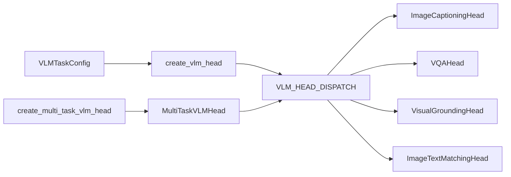

# heads/vlm

Keras 3 layers that turn image features and text features into a task answer: a caption, an answer class, a bounding box, or an image-text match score. Package path: `dl_techniques.layers.heads.vlm` (source in `src/dl_techniques/layers/heads/vlm/`).

## What it is for

A vision-language model usually has two encoders (for example CLIP or BLIP) that already turn pixels and tokens into feature tensors. What is left is a small task-specific piece on top. This package holds those pieces, called heads.

A head takes feature tensors, not images or token ids. It does not know which encoder produced them, so the same head works on features from any encoder. Every feature width is read from the input shapes when the layer is built. No head takes a declared `vision_dim` or `text_dim`.

Four tasks have a head: image captioning, visual question answering (VQA), visual grounding, and image-text matching. The task enum `VLMTaskType` lists 47 task names, and the other 43 raise `ValueError` when you ask for their head. No model, trainer or application in the repository builds a VLM head today. The only callers are the `layers/heads` facade and the tests.

## How it works

You describe a task with a `VLMTaskConfig` (a name, a task type, and a few sizes). A factory function looks up the head class for that task type in one table and builds it. Every head takes a dict of tensors and returns a dict of tensors. The multi-task wrapper returns a dict of such dicts, one per task, unless you pick a task.



What each head does:

- `ImageCaptioningHead`: a post-norm transformer decoder. Each layer runs causal self-attention over the text, cross-attention onto the vision features, then an FFN, each followed by RMS norm after the residual add. A final `Dense` projects to the vocabulary. Output: `logits` and `hidden_states`.
- `VQAHead`: pools the vision features and the question features to one vector each (`mean`, `max`, or `attention`), concatenates them, runs an MLP, and returns `answer_logits`.
- `VisualGroundingHead`: mean-pools the text to a query, tiles it across the image regions, fuses each region with it, scores each region with a linear layer, and regresses a box from the top-scoring region. Output: `bbox`, `confidence`, `grounded_features`.
- `ImageTextMatchingHead`: mean-pools both modalities, then runs two branches. The contrastive branch projects both to a shared space, L2-normalizes, and returns a similarity matrix divided by a learnable temperature. The fine-grained branch fuses the pooled vectors, applies a norm and an optional FFN, and returns one match logit per pair.
- `MultiTaskVLMHead`: builds one head per task and passes the same input dict to each. Call it with `task_name=` to run only one. Each sub-head is named `<task name>_head`; the wrapper itself is named `multi_task_vlm_head` unless you pass `name=`.

Input and output dicts:

| Task | Output dict | Head, inputs and shapes |
| --- | --- | --- |
| **Image Captioning** | `{'logits', 'hidden_states'}` | `ImageCaptioningHead` reads `vision_features` (B, N, any width) and `text_features` (B, S, hidden_size). `logits` is (B, S, vocab_size), `hidden_states` is (B, S, hidden_size). |
| **VQA** | `{'answer_logits'}` | `VQAHead` reads `vision_features` and `question_features`. `answer_logits` is (B, num_classes). |
| **Visual Grounding** | `{'bbox', 'confidence', 'grounded_features'}` | `VisualGroundingHead` reads `vision_features` (B, regions, hidden_size) and `text_features`. `bbox` is (B, 4), `confidence` is (B, regions), `grounded_features` is (B, hidden_size). |
| **Matching** | `{'similarity_matrix', 'logits', 'match_score', 'vision_embeddings', 'text_embeddings'}` | `ImageTextMatchingHead` reads `vision_features` and `text_features`. `similarity_matrix` and `logits` are (B, B), `match_score` is (B,), `vision_embeddings` and `text_embeddings` are (B, projection_dim). |

Note the key difference: `VQAHead` reads `question_features`, and the other three read `text_features`.

Optional padding masks go in the same dict: `vision_mask`, `text_mask`, `question_mask`. Each is `(batch, length)` with 1 for a real token and 0 for padding. A head given no mask treats every position as real.

## Files

- `__init__.py` - the public surface (11 names) and a package docstring.
- `task_types.py` - `VLMTaskType` (47-member enum), `VLMTaskConfig` (dataclass with six fields), `VLMTaskConfiguration` (a validated set of task types).
- `base.py` - `BaseVLMHead`, the shared base that owns only the `MultiModalFusion` layer. It is not a usable head.
- `image_captioning.py` - `ImageCaptioningHead`.
- `vqa.py` - `VQAHead`.
- `visual_grounding.py` - `VisualGroundingHead`.
- `image_text_matching.py` - `ImageTextMatchingHead`.
- `multitask.py` - `MultiTaskVLMHead`.
- `dispatch.py` - `VLM_HEAD_DISPATCH` (task type to head class, 4 rows) and `get_head_class`.
- `factory.py` - `create_vlm_head` and `create_multi_task_vlm_head`.
- `utils.py` - private helpers shared by the heads (constructor-kwarg introspection, FFN width routing, per-head config checks, masked pooling).

## How to use it

One head:

```python
from dl_techniques.layers.heads.vlm import create_vlm_head, VLMTaskConfig, VLMTaskType

config = VLMTaskConfig(
    name="vqa_v2",
    task_type=VLMTaskType.VISUAL_QUESTION_ANSWERING,
    num_classes=3129,
    hidden_size=768,
)
head = create_vlm_head(config, pooling_strategy="attention", num_heads=8)
out = head({"vision_features": v, "question_features": q})  # {'answer_logits': (B, 3129)}
```

Captioning needs `vocab_size`; the text features must already be embedded and `hidden_size` wide:

```python
config = VLMTaskConfig(name="coco_caption", task_type="image_captioning", vocab_size=50257)
head = create_vlm_head(config, num_layers=6, num_heads=12)
```

Several tasks behind one layer:

```python
from dl_techniques.layers.heads.vlm import create_multi_task_vlm_head

multi = create_multi_task_vlm_head(
    [
        VLMTaskConfig(name="caption", task_type="image_captioning", vocab_size=50000),
        VLMTaskConfig(name="match", task_type="image_text_matching"),
    ],
    task_specific_kwargs={"caption": {"num_layers": 4, "num_heads": 8}},
)
all_outputs = multi(inputs)                    # {'caption': {...}, 'match': {...}}
caption_only = multi(inputs, task_name="caption")
```

Tests: `pytest tests/test_layers/test_heads/` (run only that directory, not the full suite).

## Things to know

- Only 4 of 47 task types have a head. `VLMTaskConfig` accepts the other 43 without complaint; the error comes from `get_head_class` when you create the head. There is no fallback.
- `BaseVLMHead` is exported but constructing it directly raises `TypeError`.
- A head refuses a config field it does not read: `vocab_size` belongs to captioning only and `num_classes` to VQA only. Captioning requires `vocab_size`, and VQA requires `num_classes`.
- Class-like scores are logits, not probabilities: `confidence` (grounding), `match_score` (matching), `answer_logits` and caption `logits`. Use `from_logits=True` in the loss. The one squashed output is grounding `bbox`, which goes through a sigmoid and lies in (0, 1).
- Captioning residual adds have no projection, so `text_features` must be exactly `hidden_size` wide. The vision width is free.
- `VQAHead(pooling_strategy="attention")` (the default) runs one cross-attention in both directions, so both inputs must be `hidden_size` wide and `hidden_size` must divide by `num_heads` (default 8). `mean` and `max` take any widths and also accept already-pooled rank-2 inputs; they refuse `num_heads`.
- `VisualGroundingHead` and `ImageTextMatchingHead` need both inputs `hidden_size` wide for the fusion. Only six fusion strategies work: `concatenation`, `addition`, `multiplication`, `gated`, `bilinear`, `tensor_fusion`. `cross_attention` and `attention_pooling` raise `ValueError` at build.
- Only `ImageTextMatchingHead` has a post-fusion norm and FFN (`normalization_type`, `use_post_fusion_ffn`, `ffn_type`, `ffn_expansion_factor`). Passing those to the grounding head is an error.
- The matching `similarity_matrix` and `logits` are computed across the batch, so they are `(batch, batch)`.
- `ImageTextMatchingHead(temperature=...)` is the starting value of a learnable weight. `get_config` stores the starting value; the trained value travels with the weights.
- In a `MultiTaskVLMHead`, a shared keyword is routed to each head that accepts it, and a keyword no head accepts raises. Use `task_specific_kwargs` (keyed by task name, strictly checked) to target one head. A wrapper that mixes VQA with another task needs both `question_features` and `text_features` in the input dict, or it raises `KeyError`.
- A mask for an input that is already pooled (rank 2) raises `ValueError`.
- Not every FFN type from the FFN registry works inside the captioning decoder or the matching post-fusion stack. Types that need extra hyperparameters the config does not carry (for example `counting`, `logic`, `mixer`, `tversky`) or rank-4 input (`gated_mlp`) fail at construction or build.
