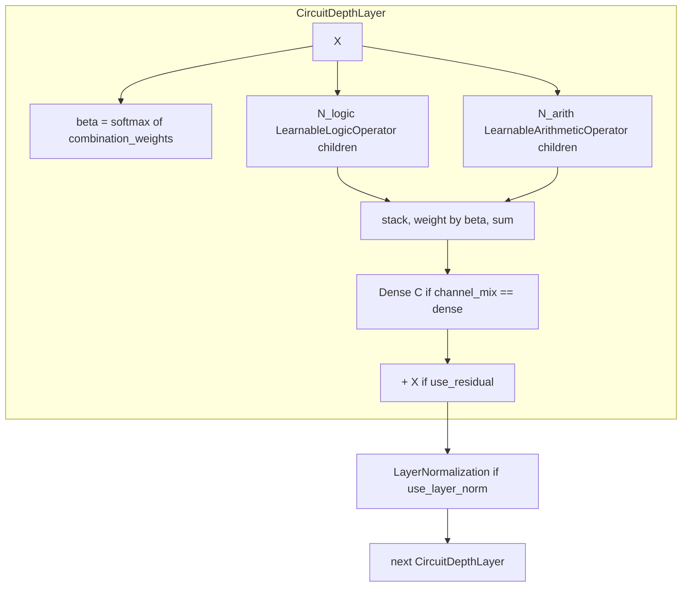

# logic

Path: `src/dl_techniques/layers/logic`
Purpose: learnable fuzzy-logic and arithmetic operator layers, two shape-preserving circuit layers built from them, and a registry factory (Keras 3).

## Scope

Lives here: four registered `keras.layers.Layer` classes and one factory module.

- `LearnableLogicOperator` in `logic_operators.py`
- `LearnableArithmeticOperator` in `arithmetic_operators.py`
- `CircuitDepthLayer` and `LearnableNeuralCircuit` in `neural_circuit.py`
- `factory.py`: `LOGIC_REGISTRY` and four functions

Does not live here:

- `canonical_binary_input_shape`, the shared two-operand shape check. It is in `dl_techniques/utils/tensors.py`.
- `clone_initializer`. It is in `dl_techniques/initializers/clone.py`.
- `LogicFFN`, the FFN-shaped logic block. It is in `dl_techniques/layers/ffn/logic_ffn.py`.
- `TemperatureAnnealingCallback`. It is in `dl_techniques/callbacks/temperature_annealing.py`.
- The trainers. They are in `src/train/logic/`. Four of them (`train_boolean_circuit.py`, `train_e1_image.py`, `train_e5_clevr_hans.py`, `train_benchmark.py`) import `LearnableNeuralCircuit` from here. `train_benchmark.py` also imports both operators from their modules.

## Architecture

- `LearnableNeuralCircuit` holds `circuit_layers` (a list of `circuit_depth` `CircuitDepthLayer`, named `circuit_depth_<i>`) and `layer_norms` (one `LayerNormalization` per depth, named `layer_norm_<i>`, empty unless `use_layer_norm`). It owns no weights.
- Operators select among candidates with `softmax(w / T)`. `w` is `operation_weights`, shape `(N,)` in `global` mode and `(C, N)` in `per_channel`. `T` is `softplus(raw)` by default, floored at 1e-7. The result stacks the candidate outputs (axis 0 for global, axis -1 for per_channel) and sums them weighted by the probabilities.
- `CircuitDepthLayer` fuses the same way with `beta = softmax(combination_weights, axis=-1)`.
- `circuit_routing='output_only'` (default): `Y = sum_i(beta_i * f_i(X)) [+ X]`. `'classic'`: expert `i` reads `X * softmax(routing_weights)[i]`. Logic experts come first in expert order, then arithmetic.
- Children are built in `__init__` (so `logic_operators`, `arithmetic_operators`, `circuit_layers` can be inspected before running) and explicitly `build`-ed in the parent's `build()`.
- Factory flow: `create_logic_from_config(dict)` copies the dict and pops `'type'`, then `create_logic_layer(type, name=None, **kwargs)` runs `validate_logic_config`, merges `optional_params` defaults with kwargs, adds `name` when given, and calls the class. A `TypeError` or `ValueError` anywhere in that block is re-raised as one `ValueError` chained with `from e`.

## Key files

| File | Role | Notes |
| --- | --- | --- |
| `__init__.py` | Re-exports; registers nothing | `__all__` has 10 names: the 4 classes, `create_logic_layer`, `create_logic_from_config`, `get_logic_info`, `validate_logic_config`, `LogicLayerType`, `LOGIC_REGISTRY`. `STRICT_UNSUPPORTED_KEY_MARKER` is NOT exported; import it from `.factory` |
| `logic_operators.py` | `LearnableLogicOperator` | 18 gates in `VALID_OPS`; default set is the first six; sigmoid on inputs by default |
| `arithmetic_operators.py` | `LearnableArithmeticOperator` | 7 ops in `DEFAULT_OPS`, all selected by default; `_safe_divide`, `_safe_power`, learnable scale |
| `neural_circuit.py` | `CircuitDepthLayer`, `LearnableNeuralCircuit`, `_resolve_gate_entropy_coefficient` | Both classes register under the same module path |
| `factory.py` | `LOGIC_REGISTRY` and the four functions | Strict: undeclared keywords raise |

## Public interface

Operators (`logic_operators.py`, `arithmetic_operators.py`):

- `call(inputs, training=None)`: one tensor, or a list of one or two same-shape tensors. More than two raises `ValueError`. Output has the shape of the first input.
- `to_symbolic(top_k=1, deterministic=True) -> str`, e.g. `"xor(0.812), and(0.101)"`. Raises `RuntimeError` before build. In `per_channel` mode probabilities are averaged over channels first.
- `compute_output_shape` delegates to `canonical_binary_input_shape`.
- Class constants: `LearnableLogicOperator.VALID_OPS` (18), `UNARY_OPS` (`{'not'}`), `BINARY_OPS`; `LearnableArithmeticOperator.DEFAULT_OPS` (tuple, weight-vector order: add, multiply, subtract, divide, power, max, min) and `VALID_OPS`.
- Logic gate keys: `and or xor not nand nor lukasiewicz_and lukasiewicz_or godel_and godel_or implies lukasiewicz_implies reichenbach_implies goguen_implies hamacher_and hamacher_or yager_and yager_or`. Default `operation_types` is `['and','or','xor','not','nand','nor']`.
- Constructor parameters (defaults): see `get_logic_info()[type]["optional_params"]`, which mirrors them.

Circuit layers (`neural_circuit.py`):

- `CircuitDepthLayer(num_logic_ops=2, num_arithmetic_ops=2, use_residual=True, logic_op_types=None, arithmetic_op_types=None, routing_initializer="zeros", combination_initializer="zeros", circuit_routing="output_only", apply_sigmoid=True, gate_entropy_coefficient=None, load_balance_coefficient=None, channel_mix=None, force_logic_input_clip=False, selection_mode="global", diversity_coefficient=0.0, inner_logic_kwargs=None, inner_arithmetic_kwargs=None, **kwargs)`
- `LearnableNeuralCircuit(circuit_depth=3, num_logic_ops_per_depth=2, num_arithmetic_ops_per_depth=2, use_residual=True, use_layer_norm=False, ..., apply_sigmoid_per_depth="first_only", ...)`. The `...` items match `CircuitDepthLayer` minus `num_*_ops`, `apply_sigmoid` and `force_logic_input_clip`.
- Both: rank >= 2 input, output shape equals input shape. `to_symbolic(top_k=1)` is multi-line and raises `RuntimeError` if not built.

Factory (`factory.py`):

- `create_logic_layer(layer_type: LogicLayerType, name: Optional[str] = None, **kwargs) -> keras.layers.Layer`. Returns a fresh unbuilt layer. Raises `ValueError` only.
- `create_logic_from_config(config: dict) -> keras.layers.Layer`. Raises `ValueError` if `config` is not a dict or has no `'type'`.
- `validate_logic_config(layer_type: str, **kwargs) -> None`. Raises `ValueError`.
- `get_logic_info() -> dict`: deep copy of `LOGIC_REGISTRY`, including the `class` entries.
- `STRICT_UNSUPPORTED_KEY_MARKER = "unsupported parameter(s)"`, carried by every undeclared-key message. Tests should match on the constant.

## Data shapes

Registry (`LOGIC_REGISTRY[key]`): fields `class`, `description`, `required_params`, `optional_params` (name to default), `enum_params` (name to allowed set), `use_case`.

| Key | Class | `optional_params` | `enum_params` | Enum names |
| --- | --- | ---: | ---: | --- |
| `arithmetic` | `LearnableArithmeticOperator` | 18 | 3 | `safe_divide_mode`, `selection_mode`, `exponent_clip_mode` |
| `logic` | `LearnableLogicOperator` | 14 | 1 | `selection_mode` |
| `circuit_depth` | `CircuitDepthLayer` | 17 | 3 | `circuit_routing`, `selection_mode`, `channel_mix` |
| `neural_circuit` | `LearnableNeuralCircuit` | 18 | 4 | `circuit_routing`, `apply_sigmoid_per_depth`, `selection_mode`, `channel_mix` |

Every `required_params` is empty, so every key builds with no arguments. Allowed enum values: `safe_divide_mode` {hard_clamp, smooth}; `selection_mode` {global, per_channel}; `exponent_clip_mode` {hard, smooth}; `circuit_routing` {output_only, classic}; `apply_sigmoid_per_depth` {first_only, all, none}; `channel_mix` {None, dense}.

Factory-specific defaults: the registry fills `gate_entropy_coefficient=None` and `load_balance_coefficient=None`, the same as the classes. (It used to fill `gate_entropy_coefficient=0.0`, which sat under the caller's kwargs and silently outranked the deprecated alias.)

Weights:

| Layer | Variable | Shape |
| --- | --- | --- |
| both operators | `operation_weights` | `(N,)` or `(C, N)` |
| both operators | `temperature` | `()`, only if `use_temperature` |
| arithmetic | `scaling_factor` | `()`, only if `use_scaling` |
| `CircuitDepthLayer` | `routing_weights` | `(N,)` always, read only by `'classic'` |
| `CircuitDepthLayer` | `combination_weights` | `(N,)` or `(C, N)`, `N = num_logic_ops + num_arithmetic_ops` |

Registration keys (verified with `keras.saving.get_registered_name`):

- `dl_techniques.layers.logic.arithmetic_operators>LearnableArithmeticOperator`
- `dl_techniques.layers.logic.logic_operators>LearnableLogicOperator`
- `dl_techniques.layers.logic.neural_circuit>CircuitDepthLayer`
- `dl_techniques.layers.logic.neural_circuit>LearnableNeuralCircuit`

Each also binds the `Custom>ClassName` alias via `register_dl_technique`.

## Invariants and constraints

- Rename or move of any of the four classes breaks saved `.keras` archives. The key includes the module path.
- Registry key set, `LogicLayerType` literal, and each entry's `required_params` / `optional_params` / `enum_params` are public API. Changing them is a breaking change.
- The factory never filters keywords. `validate_logic_config` subtracts the caller's kwargs (not the merged dict) from the declared set, so a typo cannot hide behind a default. Do not move this check into a layer constructor, which takes `**kwargs`.
- Range checks in the factory are by NAME: positive int for `num_logic_ops`, `num_arithmetic_ops`, `circuit_depth`, `num_logic_ops_per_depth`, `num_arithmetic_ops_per_depth` (bool rejected); positive for `temperature_init`, `scaling_init`, `epsilon`.
- Initializers are cloned at each `add_weight` site with `clone_initializer`, so one shared Initializer instance still gives independent draws. A seeded instance keeps its seed and replays. Never pass `self.*_initializer` straight to `add_weight`.
- Gumbel noise is added only when `training is True` and `deterministic` is False. Form is `softmax((w + g) / T)`, not `softmax(w/T) + g`.
- `gumbel_hard` uses the straight-through form: `soft + stop_gradient(hard - soft)`.
- Hamacher gates return the limit at the 0/0 corner via `keras.ops.where` (AND at (0,0) gives 0, OR at (1,1) gives 1). Do not replace with per-gate epsilon clamps.
- `_safe_power` is the real part of the complex power: `cos(pi*y) * |x|^y` on negative bases. Do not drop the sign.
- `call()` raises on unknown op names (only reachable by mutating `operation_types`). Do not log in `call()`.
- Each `call()` re-checks the shape contract `build` established (`_assert_call_shape_contract`): last axis must match when `per_channel` or `channel_mix='dense'` fixed it; circuit layers also require rank >= 2.
- `CircuitDepthLayer` builds its logic children with `allow_unary_degenerate=True` because it feeds each child a single tensor. Keys it owns (`operation_types`, `apply_sigmoid`, `allow_unary_degenerate`, `force_clip_when_no_sigmoid`, `selection_mode`, `name` for logic; `operation_types`, `selection_mode`, `name` for arithmetic) are dropped from `inner_*_kwargs` with a `UserWarning`.
- Children get `dtype=self.dtype_policy`, not `self.dtype`. Under `mixed_float16`, `self.dtype` is the variable dtype and would build float32 children.
- Parent `build()` must build every child explicitly (Keras 3 otherwise reloads child weights fresh).
- `get_config` of both circuit layers always emits `load_balance_coefficient: None`; the value travels in `gate_entropy_coefficient`.
- Deprecated alias resolution (`_resolve_gate_entropy_coefficient`): old name alone and non-zero warns and is used; if `gate_entropy_coefficient` is not `None` it wins.
- `_maybe_load_balance_loss` computes `coef * N * mean(sum_i(beta_i^2))` (squared L2 of the gate, not an entropy, despite the name). L2 is taken per channel and then averaged.
- `entropy_coefficient` loss on operators is `coef * H(probs)`, so it sharpens.
- `LearnableNeuralCircuit` risky-stack rule: `apply_sigmoid_per_depth == 'first_only'`, `circuit_depth >= 2`, and (`num_arithmetic_ops_per_depth > 0` or `use_residual`) sets `force_logic_input_clip=True` on depths >= 1 and logs a warning. `num_arithmetic_ops_per_depth` must be > 0, so that part is always true.
- Softplus temperature raw init is `log(expm1(temperature_init))`; `TemperatureAnnealingCallback` uses the same inverse.
- Both circuit classes' `compute_output_shape` return the input shape unchanged.

## Dependencies

Internal:

- `dl_techniques.utils.keras_registration.register_dl_technique` (class registration).
- `dl_techniques.initializers.clone.clone_initializer`.
- `dl_techniques.utils.tensors.canonical_binary_input_shape` (shape pair validation in `build`, `call` and `compute_output_shape` of both operators).
- `dl_techniques.utils.logger.logger` (debug logs in constructors and factory; a warning in `LearnableNeuralCircuit.__init__`).
- `neural_circuit.py` imports both operators from the sibling modules; `factory.py` imports all four classes.

External: `keras` (only `keras.ops`, `keras.random`, `keras.layers.Dense`, `keras.layers.LayerNormalization`), stdlib `math`, `copy`, `warnings`, `typing`.

## Failure modes

- Unknown type: `ValueError` whose message starts "Failed to create logic layer" and names the unknown type; the original error lists the available types.
- Undeclared keyword: `ValueError` containing `STRICT_UNSUPPORTED_KEY_MARKER`, the count, the names and the accepted set.
- Bad enum value: `ValueError` naming the value and the allowed list. A non-hashable value would raise `TypeError` in the `in` test and come out wrapped as `ValueError`.
- Factory passing `load_balance_coefficient` works: `create_logic_layer('circuit_depth', load_balance_coefficient=0.5)` warns with `DeprecationWarning` and resolves `gate_entropy_coefficient == 0.5` (`TestCreate.test_the_deprecated_load_balance_coefficient_is_honoured_with_a_warning`).
- Logic operator, one tensor, any binary gate, `allow_unary_degenerate=False`: `ValueError` from `call`.
- Rank < 2 into a circuit layer: `ValueError` from `build` or `call`.
- `per_channel` with unknown last axis: `ValueError` from `build`.
- Layer used with a different last axis than it was built for: `ValueError` from `call`.
- Numerical: deep default stacks (depth 3, 32 channels, residual on, `power` and `divide` in the arithmetic set) can reach NaN. Mitigate with `arithmetic_op_types=['add','max','min']`, or `exponent_clip_mode='smooth'` plus `safe_divide_mode='smooth'`. In `hard_clamp` mode divide has an unbounded gradient near zero.
- Stacked sigmoids (`apply_sigmoid_per_depth='all'`) narrow the range toward a constant.

## Working here

- Docstrings are Sphinx/reST (`:param:`, `:type:`, `:raises:`). Match the file you edit; do not convert.
- Use `import keras` and `keras.ops.*` qualified at the call site.
- Adding a parameter to a layer: add it to `__init__`, `get_config`, the class docstring, and the matching `optional_params` of `LOGIC_REGISTRY` (plus `enum_params` if it is an enum). Without the registry entry the factory rejects it as undeclared.
- Adding a gate or arithmetic op: update `VALID_OPS` (and the `call()` branch plus a `_helper`). For arithmetic, `DEFAULT_OPS` order defines the weight-vector index and the default set. Changing it changes saved weights.
- Adding a new layer type to the factory: new registry entry with all of `class`, `description`, `required_params`, `optional_params`, `enum_params`, `use_case`; extend `LogicLayerType`; re-export from `__init__.py`; register with `@register_dl_technique("dl_techniques.layers.logic.<module>")`.
- Keep the `__all__` count and the registry counts (18/14/17/18 optional, 3/1/3/4 enums) in sync with any docs you edit.
- Tests: `tests/test_layers/test_logic/`. Files: `test_arithmetic_operators.py`, `test_logic_operators.py`, `test_neural_circuit.py`, `test_factory.py`, `test_initializer_instances_are_cloned_per_weight.py`, `test_every_weight_is_reached_through_a_parent.py`, `test_no_unbound_names.py`, `test_the_nine_source_fixes_stay_fixed.py`, `test_the_precision_and_xla_arms_agree.py`, `test_the_saved_model_restores_values_and_weights.py`. `conftest.py` installs an autouse finiteness observer for every forward pass of the four classes and an opt-in `dtype_policy` fixture; `logic_subject_oracle.py` is a shared instrument, not collected.
- Run only this directory: `.venv/bin/python -m pytest tests/test_layers/test_logic/ -q`. Do not run the full suite.
- A change to `canonical_binary_input_shape` in `utils/tensors.py` affects both operators; its tests are in `tests/test_utils/test_tensors.py`.
