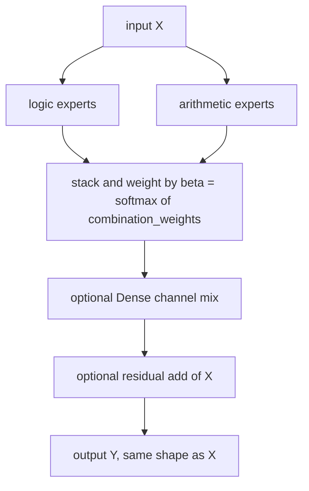

# logic

Four Keras 3 layers that learn which logic gate or arithmetic operation to apply, plus a string-keyed factory that builds them. Lives at `src/dl_techniques/layers/logic/` in the `dl_techniques` library.

## What it is for

Normally you pick how to combine two feature tensors by hand: add, multiply, concatenate. These layers let the network learn that choice. Every candidate operation runs on the inputs, and a softmax over learnable weights decides how much each result counts. This is the relaxation used in DARTS (a neural architecture search method): a discrete choice becomes a weighted average that gradients can tune.

The logic gates are fuzzy: inputs are squashed into [0, 1] and read as degrees of truth, so AND is `p * q`, OR is `p + q - p*q`, and so on. The output is real-valued, never Boolean.

Two of the layers are building blocks (one operator each). The other two combine many operators into a block that keeps the input shape, so it can sit in the middle of a network like a residual block.

## How it works



- `LearnableLogicOperator` runs fuzzy gates (18 are available, 6 by default) and returns their weighted sum.
- `LearnableArithmeticOperator` runs add, multiply, subtract, divide, power, max and min (all seven by default) and returns their weighted sum times a learnable scale. Divide and power are guarded so they stay finite.
- Both operators weight their candidates with `softmax(w / T)`: `w` is one learnable weight per candidate and `T` is a learnable temperature. Small `T` sharpens toward one candidate.
- `CircuitDepthLayer` is one stage. It builds `num_logic_ops` logic operators and `num_arithmetic_ops` arithmetic operators, runs them all on the same input, and fuses the outputs with learnable weights.
- `LearnableNeuralCircuit` stacks `circuit_depth` such stages, each with its own weights, with an optional `LayerNormalization` after each.

`circuit_routing` has two modes. `'output_only'` (default): every expert reads the full input and only the fusion is gated. `'classic'`: each expert's input is first scaled by its own routing weight, so each sees about `X / N` and the signal shrinks as experts are added. Keep `'classic'` only for models trained before `'output_only'` became the default.

## Files

- `__init__.py` - re-exports the four classes, the factory functions, `LogicLayerType` and `LOGIC_REGISTRY` (10 names in `__all__`).
- `logic_operators.py` - `LearnableLogicOperator`, the 18 fuzzy gates.
- `arithmetic_operators.py` - `LearnableArithmeticOperator`, the 7 arithmetic operations.
- `neural_circuit.py` - `CircuitDepthLayer` and `LearnableNeuralCircuit`.
- `factory.py` - `LOGIC_REGISTRY`, `create_logic_layer`, `create_logic_from_config`, `get_logic_info`, `validate_logic_config`.

## How to use it

Direct class use:

```python
import keras
from dl_techniques.layers.logic import LearnableNeuralCircuit

inputs = keras.Input(shape=(32, 32, 64))
x = LearnableNeuralCircuit(circuit_depth=4, use_layer_norm=True)(inputs)
x = keras.layers.GlobalAveragePooling2D()(x)
outputs = keras.layers.Dense(10, activation="softmax")(x)
model = keras.Model(inputs, outputs)
```

Two inputs into an operator:

```python
from dl_techniques.layers.logic import LearnableArithmeticOperator

a = keras.Input(shape=(128,))
b = keras.Input(shape=(128,))
fused = LearnableArithmeticOperator(operation_types=["add", "multiply", "max"])([a, b])
```

Through the factory (keys: `arithmetic`, `logic`, `circuit_depth`, `neural_circuit`):

```python
from dl_techniques.layers.logic import create_logic_layer, create_logic_from_config, get_logic_info

layer = create_logic_layer("neural_circuit", circuit_depth=2, name="circuit")
layer = create_logic_from_config({"type": "circuit_depth", "num_logic_ops": 3})
print(get_logic_info()["logic"]["optional_params"])   # accepted keywords and defaults
```

After training, `to_symbolic(top_k=2)` on any of the four layers reports which operators won, for example `"multiply(0.812), add(0.101)"`. The layer must be built first (call it once on data).

## Things to know

- Shapes: the two operators accept any rank >= 1. `CircuitDepthLayer` and `LearnableNeuralCircuit` need rank >= 2, shaped `(batch, ..., channels)`. All four return the input shape. There is no projection, so channel count never changes.
- Operators take one tensor or a list of one or two tensors of equal shape. One tensor is used for both operands.
- `LearnableLogicOperator` raises `ValueError` on a single tensor if any selected gate is binary (17 of the 18; only `not` is unary). `allow_unary_degenerate=True` turns the old behavior back on, where `x2 = x1`. `LearnableArithmeticOperator` always rebinds `x2 = x1`, so `subtract` gives 0 and `divide` gives about 1.
- `LearnableLogicOperator` applies a sigmoid to its inputs by default. When stacking, use `apply_sigmoid=False` and add `force_clip_when_no_sigmoid=True` if the upstream layer can leave [0, 1]. `LearnableNeuralCircuit` handles this through `apply_sigmoid_per_depth`: `'first_only'` (default), `'all'` or `'none'`. With `'first_only'`, depth >= 2, and arithmetic experts or a residual, it turns on input clipping for depths 1 and up and logs a warning.
- Deep stacks can go to NaN with the default arithmetic set. `power` and `divide` amplify values and the residual compounds across depths. For `circuit_depth` >= 3, restrict `arithmetic_op_types` (for example `['add', 'max', 'min']`) or use `exponent_clip_mode='smooth'` with `safe_divide_mode='smooth'`. A working depth-2 recipe is in `src/train/logic/train_boolean_circuit.py`.
- `divide` has unbounded gradient near a zero denominator in `hard_clamp` mode. `'smooth'` bounds the gradient and returns 0 at `x2 = 0`.
- `power` keeps the sign of the base via `cos(pi*y) * |x|^y`. With the default `exponent_clip_range=(-2.0, 2.0)` the exponent is clipped, so `power(-2, 3)` gives 4.0, not -8.
- `entropy_coefficient` on an operator adds `coef * H(probs)` to the loss. Because loss is minimized, this sharpens the selection. `gate_entropy_coefficient` on the circuit layers adds a loss that pushes expert use toward uniform.
- `load_balance_coefficient` is a deprecated alias of `gate_entropy_coefficient` on the circuit layers. Passed directly it warns. Passed through the factory it is silently ignored, because the factory fills `gate_entropy_coefficient=0.0` by default and the new name wins. Use the new name with the factory.
- `selection_mode='per_channel'` stores per-channel selection weights and needs a known last axis at build time. A layer built for one channel width raises `ValueError` on another.
- Saved models: each class registers under its module path, for example `dl_techniques.layers.logic.neural_circuit>CircuitDepthLayer`, plus the legacy `Custom>ClassName` alias. Renaming a class, or moving it to another module, breaks `.keras` archives saved earlier.
- The factory raises `ValueError` on any keyword the chosen type does not declare, naming the key and the accepted set. It never drops keywords silently. All errors from construction come back as one `ValueError`.
- `TemperatureAnnealingCallback` in `dl_techniques.callbacks.temperature_annealing` can anneal the temperature of these operators during training.
- For a feed-forward block over `(B, T, D)` features, `dl_techniques.layers.ffn.LogicFFN` is the better fit.
- The code uses only `keras.ops`, so it is backend-agnostic. The repo targets Keras 3 on TensorFlow 2.18.

## References

- Liu, Simonyan, Yang (2018). DARTS: Differentiable Architecture Search.
- Zadeh (1965). Fuzzy sets.
- Jang et al. (2017). Categorical Reparameterization with Gumbel-Softmax (the Gumbel option).
- Shazeer et al. (2017). Outrageously Large Neural Networks (the load-balance style loss).
