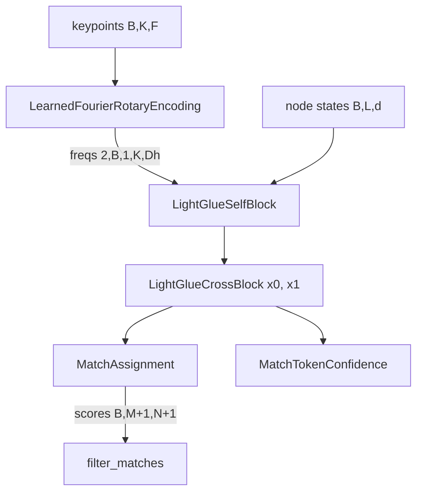

# matching

Path: `src/dl_techniques/layers/matching/`
Purpose: LightGlue keypoint-matching layers (rotary positional table, self and cross attention blocks, soft assignment with dustbin, token confidence), written to be weight-compatible with the official PyTorch model.

## Scope

In: four modules of Keras 3 layers and pure functions used by LightGlue. Consumers: `src/dl_techniques/models/vision/keypoints/lightglue/model.py` imports all four modules; `src/dl_techniques/metrics/keypoint_matching.py` imports `filter_matches`.

Not here: the full LightGlue model (stacking, pruning, early exit), keypoint detectors, a factory, trainers. `__init__.py` is empty (zero bytes): there is no curated export and no `__all__`. Import from the module files.

## Architecture

One LightGlue layer = `LightGlueSelfBlock` per image, then one `LightGlueCrossBlock` for both. The rotation table is computed once per image and passed to every self block. Both blocks end in the same FFN residual: `x + ffn(concat([x, message]))` with `ffn_0 Dense(2d) -> ffn_1 LayerNormalization -> exact erf GELU -> ffn_3 Dense(d)`. The FFN is the module-level helpers `_make_ffn_sublayers`, `_build_ffn_sublayers`, `_ffn_residual` in `lightglue_blocks.py`, not a layer, so the weights stay attributes of each block under torch-style names.

## Key files

| File | Role | Notes |
| --- | --- | --- |
| `learned_fourier_rotary.py` | `LearnedFourierRotaryEncoding`, `rotate_half_interleaved`, `apply_rotary_interleaved` | Registered as `dl_techniques.layers.matching.learned_fourier_rotary`. `apply_rotary` is a staticmethod alias of `apply_rotary_interleaved` |
| `lightglue_blocks.py` | `LightGlueSelfBlock`, `LightGlueCrossBlock`, private helpers | Registered as `dl_techniques.layers.matching.lightglue_blocks` (both classes). Imports `apply_rotary_interleaved` from the sibling module |
| `match_assignment.py` | `MatchAssignment`, `filter_matches` | Registered as `dl_techniques.layers.matching.match_assignment`. `filter_matches` is a pure function |
| `token_confidence.py` | `MatchTokenConfidence` | Registered as `dl_techniques.layers.matching.token_confidence` |
| `__init__.py` | empty | |

## Public interface

All layers use `@register_dl_technique("dl_techniques.layers.matching.<module>")` and implement `build`, `call`, `compute_output_shape`, `get_config`.

`LearnedFourierRotaryEncoding(head_dim: int, num_input_features: int = 2, gamma: float = 1.0, **kwargs)`
- Input `(B, K, num_input_features)`; output `(2, B, 1, K, head_dim)` (slot 0 cos, slot 1 sin, each `repeat(2, axis=-1)`, i.e. repeat_interleave).
- One weight: `kernel (num_input_features, head_dim // 2)`, no bias, init `RandomNormal(stddev=gamma ** -2)`.
- Raises `ValueError` for `head_dim` not positive and even, `num_input_features <= 0`, `gamma <= 0`; at build for non-rank-3 input or last dim not equal to `num_input_features` (a `None` last dim fails too).
- Output dtype: float32, or float64 under a float64 policy. Never the half-precision compute dtype.

`rotate_half_interleaved(x)`: maps each adjacent pair `(a, b)` to `(-b, a)`. `apply_rotary_interleaved(freqs, t)`: `t * cos + rotate_half_interleaved(t) * sin`, casting the table to `t.dtype`. `freqs[0]` must broadcast against `t`.

`LightGlueSelfBlock(dim, num_heads=4, layer_norm_epsilon=1e-5, **kwargs)`
- `call(x (B,L,dim), freqs (2,B,1,L,head_dim), mask=None) -> (B,L,dim)`. `freqs` is required. `mask` is `(B,L)`, 1 = real; a pair is kept only if query and key are both real.
- Sublayers: `Wqkv Dense(3*dim)`, `out_proj Dense(dim)`, `ffn_0`, `ffn_1`, `ffn_3`. Scale `compute_attention_scale(head_dim)`.

`LightGlueCrossBlock(dim, num_heads=4, layer_norm_epsilon=1e-5, **kwargs)`
- `call(x0 (B,M,dim), x1 (B,N,dim), mask0=None, mask1=None) -> (y0, y1)`.
- Sublayers: `to_qk`, `to_v`, `to_out` (all `Dense(dim)`, shared by both images and both directions), plus the FFN. `side_scale = compute_attention_scale(head_dim) ** 0.5` is applied to the projected `qk` of each image, so the product `sim` carries the full `head_dim ** -0.5` scale. `sim` is computed once; image 0 attends with a softmax over its last axis and image 1 with a softmax of its transpose.
- `compute_output_shape` requires `x1_shape`.
- Raises (both blocks) `ValueError` for non-positive `dim`/`num_heads`/`layer_norm_epsilon`, `dim` not divisible by `num_heads`, or odd `dim // num_heads`. At build, `ValueError` for non-rank-3 or a last dim other than `dim` (`None` accepted).

`MatchAssignment(dim: int, **kwargs)`
- `call(desc0 (B,M,dim), desc1 (B,N,dim), mask0=None, mask1=None) -> (scores (B,M+1,N+1), sim (B,M,N))`. `sim` is the scaled similarity before masking.
- Sublayers: `final_proj Dense(dim)` (shared), `matchability Dense(1)` (shared).
- `get_matchability(desc) -> (B,K)`: sigmoid of the matchability logit, no mask.
- Raises `ValueError` if `dim <= 0`.

`filter_matches(log_scores, threshold, mask0=None, mask1=None) -> (matches0 int32 (B,M), matches1 int32 (B,N), matching_scores0 (B,M), matching_scores1 (B,N))`
- Ignores the dustbin row and column. Takes row and column argmax on the interior, keeps mutual pairs with `exp(score) > threshold` (strict). `-1` marks no match. Scores are `exp(score)` for every mutual pair, including below threshold, and 0 elsewhere.

`MatchTokenConfidence(dim: int, **kwargs)`
- `call(desc0, desc1, return_logits=False) -> (conf0 (B,M), conf1 (B,N))`, or with `return_logits=True` `(conf0, conf1, logit0, logit1)`.
- Sublayer: `token_0 Dense(1)`, shared. Input goes through `stop_gradient`. `compute_output_shape` covers only the two-tensor default.
- Raises `ValueError` if `dim <= 0`.

## Data shapes

| Name | Shape | Meaning |
| --- | --- | --- |
| keypoints | `(B, K, F)` | normalised xy (`F` = 2), or with scale and orientation (`F` = 4) |
| freqs | `(2, B, 1, K, head_dim)` | rotation table, axis 2 is the head axis |
| node states / descriptors | `(B, K, dim)` | |
| mask | `(B, K)` | bool or 0/1, 1 = real keypoint |
| scores | `(B, M+1, N+1)` | log scores; row `M` and column `N` are dustbins; corner is 0 |

Symbols, one meaning each everywhere in this file: `B` batch, `K` keypoint count of one image when only one image is involved, `M` keypoint count of image 0, `N` keypoint count of image 1, `L` node count in a self block (one image), `F` coordinate width (`num_input_features`), `H` heads, `Dh` = `head_dim`, `d` / `D` / `dim` node or descriptor width.

Score matrix interior: `log_softmax over N + log_softmax over M + logsigmoid(z0_i) + logsigmoid(z1_j)`. Dustbin column `logsigmoid(-z0_i)`, dustbin row `logsigmoid(-z1_j)`.

Torch-to-Keras weight map (Linear weights transpose into kernels, biases copy):

| Torch | Keras |
| --- | --- |
| `transformers.i.self_attn.Wqkv`, `out_proj` | `Wqkv`, `out_proj` |
| `transformers.i.self_attn.ffn.{0,1,3}` / `cross_attn.ffn.{0,1,3}` | `ffn_0` (kernel,bias), `ffn_1` (gamma,beta), `ffn_3` (kernel,bias) |
| `transformers.i.cross_attn.{to_qk,to_v,to_out}` | same names |
| `log_assignment.i.{matchability,final_proj}` | same names |
| `token_confidence.i.token.0` | `token_0` |
| posenc `Wr.weight (head_dim//2, F)` | `kernel (F, head_dim//2)`, transpose only |

## Invariants and constraints

- Interleaved rotation only: adjacent channels `(2j, 2j+1)` share a phase, cos/sin are `repeat`ed, not `tile`d. A split-half layout keeps shapes and breaks pretrained weights. Do not reuse the repo's Llama-style RoPE here.
- `Wqkv` columns are `(H, Dh, 3)`; `_split_qkv` reads column `h*Dh*3 + c*3 + s`. Decision D-009 of plan-2026-10-02T084508-dd2c07ac, noted in a comment in the file. A `(3, H, Dh)` reading has identical shapes and wrong values.
- Sublayer names (`Wqkv`, `out_proj`, `to_qk`, `to_v`, `to_out`, `ffn_0`, `ffn_1`, `ffn_3`, `final_proj`, `matchability`, `token_0`) mirror torch. Do not rename them.
- FFN LayerNorm epsilon default is `1e-5` (reference), not `1e-3`. The FFN GELU is `0.5 x (1 + erf(x/sqrt 2))` written out by hand, because the TF backend's `keras.activations.gelu` uses a single-precision `sqrt(2)` under float64 (about 4.5e-9 off).
- `head_dim` must be even in both blocks, enforced by `_validate_dims`.
- Masked softmax uses `apply_attention_mask` and `mask_dtype` from `layers/attention/common.py`. The blocks use the default rescue (a row with no kept key spreads over all keys, so outputs are finite). `MatchAssignment` passes `rescue_axis=None`.
- Padded keypoints: blocks return finite but meaningless rows (the reference zeroes them). `MatchAssignment` sets every entry in a padded row or column, dustbins included, to exactly `0.0`. `filter_matches` must receive the same masks, otherwise those 0.0 entries win the argmax. With one mask given, the other image counts as all real.
- In `CrossBlock`, with both masks, a pair is kept only if both keypoints are real; with one mask, only that image's padded keys are hidden from the other image and no rows are masked.
- Softmax, similarity and score math run in `mask_dtype(self.compute_dtype)`, which is at least float32. Outputs of `MatchAssignment` and `MatchTokenConfidence` are in that dtype; the blocks cast context back to the compute dtype.
- `MatchTokenConfidence` uses `keras.ops.stop_gradient` on descriptors: gradient w.r.t. `desc0`/`desc1` is exactly zero, `token_0` still trains.
- `filter_matches` is a pure, graph-safe function using `take_along_axis` on flat `(B, M)` and `(B, N)` rows; keep it variable-free.
- `build` is explicit in every layer and returns at once if `self.built`. All other Dense sublayers (`Wqkv`, `out_proj`, `to_qk`, `to_v`, `to_out`, `final_proj`, `matchability`, `token_0`) are built with `(None, None, dim)`. The FFN sublayers `ffn_0`, `ffn_1`, `ffn_3` are all built by `_build_ffn_sublayers` with `(None, None, 2 * dim)`, because each of them receives a last axis of `2 * dim`: `ffn_0` takes `concat([x, message])`, `ffn_1` takes the `2 * dim` output of `ffn_0`, and `ffn_3` takes the `2 * dim` output of the LayerNorm and GELU. Only `ffn_3` produces `dim`.

## Dependencies

Internal:
- `dl_techniques.layers.attention.common`: `apply_attention_mask`, `compute_attention_scale`, `mask_dtype`, `validate_head_divisibility`.
- `dl_techniques.utils.dtype_policy.mask_sentinel` (used in `filter_matches`).
- `dl_techniques.utils.keras_registration.register_dl_technique`.

External: `keras` only (all math through `keras.ops`), plus stdlib `math`.

## Failure modes

- Wrong constructor arguments raise `ValueError` at `__init__` (messages name the offending value).
- Wrong input rank or feature width raises `ValueError` at `build`.
- `LightGlueSelfBlock.call` without `freqs` fails with a missing-argument `TypeError` (it is a required positional argument).
- Converted weights with the wrong layout (split-half rotation, `(3,H,Dh)` qkv, epsilon `1e-3`) do not raise: shapes match and outputs are wrong. Check against the numpy oracle.
- Forgetting masks downstream gives matches against padded entries, not an error.
- Under a mixed policy Keras autocasts keypoints and the `kernel` to half precision before `call`, and `LearnedFourierRotaryEncoding` cannot undo that rounding (stated in its docstring).

## Working here

- Tests: `tests/test_layers/test_matching/` has `test_learned_fourier_rotary.py`, `test_lightglue_blocks.py`, `test_match_assignment.py`, `test_token_confidence.py`. The numpy reference is `tests/lightglue_reference_numpy.py`. Run scoped: `.venv/bin/python -m pytest tests/test_layers/test_matching/`. If you change signatures also run the LightGlue model tests in `tests/test_models/test_lightglue/` (flat layout) and `tests/test_metrics/test_keypoint_matching.py`. Do not run the full suite.
- New layer here: one concern per module, register with `register_dl_technique("dl_techniques.layers.matching.<module>")`, prefix the class name `LightGlue*` or `Match*` as the existing four classes do, implement `get_config`, add a test file in the mirrored test directory.
- No factory exists for this package. Do not add one unless a second consumer appears.
- Docstrings are Sphinx/reST (`:param:`, `:type:`, `:raises:`); match them.
- Import style: `import keras`, then `keras.ops.*` at the call site. No raw TensorFlow ops, no print (use `dl_techniques.utils.logger` if logging is ever needed).
- Keep the weight-compatibility contract: any change to sublayer names, kernel shapes, rotation layout or epsilon is a breaking change for converted checkpoints.
