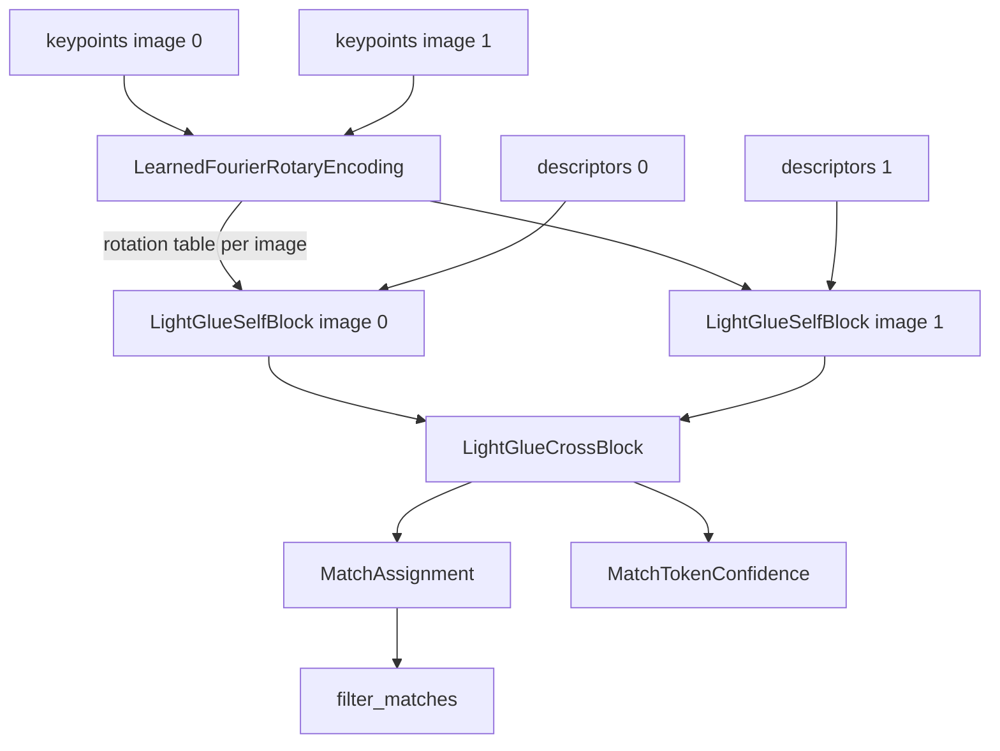

# matching

Keras 3 layers for LightGlue, a learned keypoint matcher. They take the keypoints and descriptors of two images and produce a score for every possible pairing, plus a few helpers to turn scores into hard matches.

Location: `src/dl_techniques/layers/matching/`, a subpackage of the `dl_techniques` layers library.

## What it is for

Local feature matching finds which keypoints in image A show the same real-world point as keypoints in image B. A detector (SuperPoint, for example) gives keypoints and descriptor vectors for each image. LightGlue refines those descriptors with a stack of attention layers, then scores every pair. This package holds the reusable pieces of that matcher, not the whole model; the model that stacks them lives in `models/vision/keypoints/lightglue/model.py`, and the metric `src/dl_techniques/metrics/keypoint_matching.py` imports `filter_matches` from here. The layers follow the official PyTorch implementation closely, so official pretrained weights can be converted one tensor at a time.

## How it works

One LightGlue layer, as the model uses it, works like this:



1. `LearnedFourierRotaryEncoding` turns keypoint coordinates into a cosine/sine table. Self-attention uses it to rotate its queries and keys, which injects position. The table is built once per image and reused by every self-attention layer.
2. `LightGlueSelfBlock` lets the keypoints of one image attend to each other, with that rotation applied.
3. `LightGlueCrossBlock` lets the keypoints of image 0 attend to image 1 and the reverse, from one shared similarity matrix.
4. `MatchAssignment` scores all pairs. It returns an `(M + 1, N + 1)` log-score matrix, where M and N are the keypoint counts of image 0 and image 1, with an extra row and column that are a "dustbin" meaning "no match". The scores are a row log-softmax plus a column log-softmax plus per-keypoint matchability terms. It is not Sinkhorn.
5. `filter_matches` keeps only mutual best matches whose probability exceeds a threshold.
6. `MatchTokenConfidence` predicts, per keypoint, whether the match found at this layer is already final. LightGlue uses this for early stopping and pruning.

Both attention blocks end with the same step: the node state is concatenated with the attention message, passed through `Dense(2d) -> LayerNorm -> GELU -> Dense(d)`, and added back to the state.

## Files

- `learned_fourier_rotary.py` - `LearnedFourierRotaryEncoding` layer, plus the functions `rotate_half_interleaved` and `apply_rotary_interleaved`.
- `lightglue_blocks.py` - `LightGlueSelfBlock` (rotary self-attention) and `LightGlueCrossBlock` (bidirectional cross-attention), with the shared concat-FFN helpers.
- `match_assignment.py` - `MatchAssignment` layer (log scores with dustbin) and the `filter_matches` function.
- `token_confidence.py` - `MatchTokenConfidence` layer.
- `__init__.py` - empty. Import from the module files.

## How to use it

```python
import keras
from dl_techniques.layers.matching.learned_fourier_rotary import LearnedFourierRotaryEncoding
from dl_techniques.layers.matching.lightglue_blocks import LightGlueSelfBlock, LightGlueCrossBlock
from dl_techniques.layers.matching.match_assignment import MatchAssignment, filter_matches
from dl_techniques.layers.matching.token_confidence import MatchTokenConfidence

enc = LearnedFourierRotaryEncoding(head_dim=16)           # dim 64 / 4 heads
self_block = LightGlueSelfBlock(dim=64, num_heads=4)
cross_block = LightGlueCrossBlock(dim=64, num_heads=4)
assign = MatchAssignment(dim=64)
conf = MatchTokenConfidence(dim=64)

kp0 = keras.random.uniform((2, 50, 2))                    # normalised xy
kp1 = keras.random.uniform((2, 40, 2))
d0 = keras.random.normal((2, 50, 64))
d1 = keras.random.normal((2, 40, 64))

f0, f1 = enc(kp0), enc(kp1)                               # (2, 2, 1, N, 16)
d0, d1 = self_block(d0, f0), self_block(d1, f1)
d0, d1 = cross_block(d0, d1)
scores, sim = assign(d0, d1)                              # scores (2, 51, 41)
m0, m1, s0, s1 = filter_matches(scores, threshold=0.1)    # m0 (2, 50), m1 (2, 40)
conf0, conf1 = conf(d0, d1)                               # (2, 50), (2, 40)
```

Padding: pass `mask` of shape `(B, L)` (1 for a real keypoint) to `LightGlueSelfBlock`, and `mask0` / `mask1` of shape `(B, M)` / `(B, N)` to `LightGlueCrossBlock` and `MatchAssignment`. Pass the same `mask0` / `mask1` to `filter_matches`.

## Things to know

- Rotation layout: channels rotate in adjacent pairs (interleaved), as the reference code does. The split-half layout used by Llama-style RoPE layers elsewhere in the repo is a different map. Using it keeps every shape and silently breaks pretrained weights.
- The fused `Wqkv` columns in `LightGlueSelfBlock` are laid out `(heads, head_dim, 3)`. Reading them as `(3, heads, head_dim)` also keeps every shape and silently permutes pretrained weights.
- `head_dim` (`dim // num_heads`) must be even in both blocks, even in the cross block, which uses no rotary.
- The FFN LayerNorm epsilon defaults to `1e-5` (reference value), not the Keras default `1e-3`. The FFN uses an exact erf GELU.
- Padded keypoints give finite but meaningless values. In the blocks, padded rows are not zeroed. In `MatchAssignment`, every entry in a padded row or column, dustbins included, is exactly `0.0`. Always carry the masks through to `filter_matches`, otherwise those zeros win the argmax.
- `MatchAssignment` output is not a normalised distribution. A real row sums, in probability space, to between its dustbin mass and one.
- Softmaxes and scores run in at least float32, even under a half-precision policy. The rotation table is returned in float32 (float64 under a float64 policy), never in a narrower compute dtype.
- `MatchTokenConfidence` stops gradient into the descriptors, so its auxiliary loss trains only its own `Dense(1)`. `return_logits=True` also returns the logits for a stable BCE-with-logits loss.
- `LearnedFourierRotaryEncoding` has one weight, `kernel`, of shape `(num_input_features, head_dim // 2)`, with no bias. A torch `Wr.weight` converts by transpose.
- Class names carry `LightGlue*` or `Match*` prefixes, so they stay distinct from generic names like `Attention` or `TokenConfidence`.
- Tests: `tests/test_layers/test_matching/`. A numpy oracle for the reference lives in `tests/lightglue_reference_numpy.py`.
