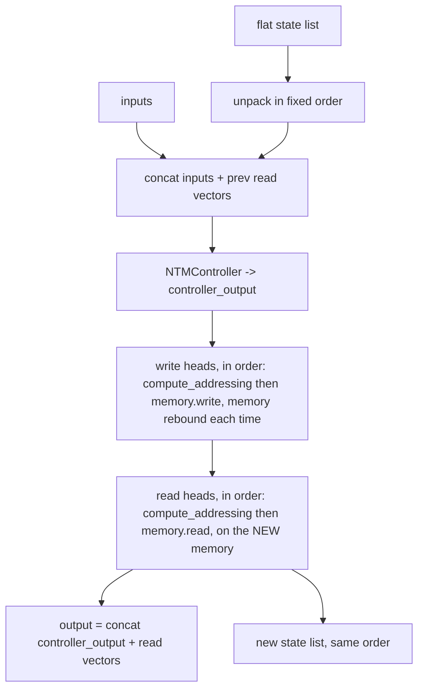

# memory

Path: `src/dl_techniques/layers/memory`
Purpose: Keras 3 layers with explicit addressable memory: the NTM family (plus MANN as a configuration), three SOM layers, and NeuroGrid. Import path `dl_techniques.layers.memory`.

## Scope

Lives here:
- NTM: interfaces and utilities (`ntm_interface.py`), implementation and `create_ntm` (`baseline_ntm.py`).
- SOM: `SOMLayer` (N-D, hard winner), `SOM2dLayer` (2D subclass), `SoftSOMLayer` (differentiable).
- `NeuroGrid` (factorized-address memory grid).
- `factory.py`: `create_mann`, `create_som_2d`.

Does not live here:
- No standalone MANN class. `create_mann` returns a `NeuralTuringMachine`. Do not add one (a deleted `MannLayer` had no consumers and kept a drifted copy of the shift math).
- No models or trainers. Consumers are elsewhere: `src/dl_techniques/models/neural_computer/ntm/{model.py,model_multitask.py}`, `models/neural_computer/nam/cell.py`, `models/memory/som/model.py` (uses `SOM2dLayer`), `src/train/ntm/`, `src/train/som_nd_soft/`.
- The old `layers/ntm/` package no longer exists; everything was merged here.

## Architecture

Import graph inside the package: `ntm_interface` <- `baseline_ntm` <- `factory`; `som_nd_layer` <- `som_2d_layer` <- `factory`; `som_nd_soft_layer` and `neuro_grid` are standalone. `__init__.py` imports `factory` last.

NTM data flow, one timestep inside `NTMCell.call`:



Head addressing (`compute_addressing`) is `key_dense`, `beta_dense`, then:
- CONTENT: `w = softmax(beta * cosine_similarity(key, memory))`. Returned directly. `prev_weights` unused.
- HYBRID: `w_c`, then `g * w_c + (1 - g) * w_prev`, then `circular_convolution(w, shift)`, then `sharpen_weights(w, gamma)` with `gamma = softplus(...) + 1.0`.

`NeuralTuringMachine` = `keras.layers.RNN(NTMCell)` followed by `Dense(output_dim)`. It does not use `BaseNTM.call`.

SOM:
- `SOMLayer.call`: `_find_bmu` (squared distances to all neurons, argmin, `unravel_index`), then if `training`: `_update_weights` and `iterations.assign_add(batch)`, then optional `add_loss(regularizer(weights_map))`.
- `SoftSOMLayer.call`: distances, per-axis softmax product (default) or one global softmax, reconstruction `sum a_i w_i`, then up to three `add_loss` terms under `training`.

NeuroGrid: per-axis `Dense` -> `softmax(logits / (T + epsilon))` -> outer product + epsilon, renormalized -> `einsum` lookup (flat `matmul` when `n_dims > 6`). Rank-3 input is flattened to `(batch * seq_len, dim)` and reshaped back.

## Key files

| File | Role | Notes |
| --- | --- | --- |
| `__init__.py` | Public surface, `__all__` of 25 names, `__version__ = "1.0.0"` | Pinned by a test; see Working here |
| `ntm_interface.py` | `AddressingMode`, 4 dataclasses, 4 ABCs, 3 helper functions | 1482 lines, mostly docstrings. No weights |
| `baseline_ntm.py` | 6 layers and `create_ntm` | 2453 lines. All six layers register under the same module string |
| `som_nd_layer.py` | `SOMLayer` | Non-trainable `weights_map`, self-updating |
| `som_2d_layer.py` | `SOM2dLayer` | No `build`/`call` of its own. Renames `grid_shape` to `map_size` in config |
| `som_nd_soft_layer.py` | `SoftSOMLayer` | Trainable `weights_map`, never assigned in `call` |
| `neuro_grid.py` | `NeuroGrid` and analysis helpers | Constant `GRID_EINSUM_SUBSCRIPTS = 'ijklmnopqrstuvwxy'` |
| `factory.py` | `create_mann`, `create_som_2d`; `__all__` also lists `create_ntm` | `create_ntm` is defined in `baseline_ntm.py` |

## Public interface

`__all__` (25): `AddressingMode`; `MemoryState`, `HeadState`, `NTMOutput`, `NTMConfig`; `BaseMemory`, `BaseHead`, `BaseController`, `BaseNTM`; `cosine_similarity`, `circular_convolution`, `sharpen_weights`; `NTMMemory`, `NTMReadHead`, `NTMWriteHead`, `NTMController`, `NTMCell`, `NeuralTuringMachine`, `create_ntm`; `SOMLayer`, `SOM2dLayer`, `SoftSOMLayer`; `NeuroGrid`; `create_mann`, `create_som_2d`.

Builders:
```python
create_ntm(memory_size=128, memory_dim=64, output_dim=10, controller_dim=256,
           controller_type="lstm", num_read_heads=1, num_write_heads=1,
           shift_range=3, return_sequences=True, return_state=False,
           addressing_mode=AddressingMode.HYBRID, use_memory_init=True,
           memory_init_seed=42, epsilon=1e-6) -> NeuralTuringMachine
create_mann(memory_locations, memory_dim, controller_units, num_read_heads=1,
            num_write_heads=1, controller_type="lstm", shift_range=3,
            return_sequences=True, return_state=False, **kwargs) -> NeuralTuringMachine
create_som_2d(map_size: tuple[int, int], input_dim: int, **kwargs) -> SOM2dLayer
```
- `create_ntm`: the last four parameters are appended last on purpose so the first ten stay positional-compatible. Do not reorder.
- `create_mann`: builds `NTMConfig(memory_size=memory_locations, controller_dim=controller_units, ...)` and `output_dim = controller_units + num_read_heads * memory_dim`. Other config fields keep `NTMConfig` defaults (HYBRID). `**kwargs` go to `NeuralTuringMachine.__init__`.
- Both NTM builders return an unbuilt layer.

Layer constructors:
- `SOMLayer(grid_shape, input_dim, initial_learning_rate=0.1, decay_function=None, sigma=1.0, neighborhood_function='gaussian'|'bubble', weights_initializer='random_uniform', regularizer=None, name=None)`. Call: `(batch, input_dim)` -> `(bmu_indices (batch, grid_dim) int32, quantization_errors (batch,))`. Other: `get_weights_map()`.
- `SOM2dLayer(map_size, input_dim, ...same...)`. Adds `get_weights_as_grid()` (alias of `get_weights_map()`).
- `SoftSOMLayer(grid_shape, input_dim, temperature=1.0, use_per_dimension_softmax=True, use_reconstruction_loss=True, reconstruction_weight=1.0, topological_weight=0.1, topological_sigma=1.0, sharpness_weight=0.0, kernel_initializer='glorot_uniform', kernel_regularizer=<omitted: L2(1e-5)>)`. Call: `(batch, input_dim)` -> `(batch, input_dim)`. Other: `get_weights_map()` (raises `RuntimeError` if unbuilt), `get_soft_assignments(x)`.
- `NeuroGrid(grid_shape, latent_dim, use_bias=False, temperature=1.0, learnable_temperature=False, entropy_regularizer_strength=0.0, kernel_initializer='glorot_uniform', bias_initializer='zeros', grid_initializer=None, kernel_regularizer=None, bias_regularizer=None, grid_regularizer=<omitted>, epsilon=1e-7)`. Call: rank 2 or 3, last axis becomes `latent_dim`. Helpers: `get_grid_weights`, `get_addressing_probabilities` (dict `individual`, `joint`, `entropy`), `get_grid_utilization` (`activation_counts`, `total_activation`, `utilization_rate`), `find_best_matching_units` (`bmu_indices`, `bmu_probabilities`, `bmu_coordinates`), `set_temperature`, `get_current_temperature`, `compute_input_quality` (6 measures), `get_quality_statistics` (30 floats, NumPy, not for compiled steps), `filter_by_quality_threshold`.
- `NeuralTuringMachine(config: NTMConfig | dict, output_dim, return_sequences=True, return_state=False, kernel_initializer, bias_initializer, kernel_regularizer)`. `call(inputs, initial_state=None, training=None)`.
- `NTMCell(config, kernel_initializer, bias_initializer, kernel_regularizer)`; `get_initial_state(inputs=None, batch_size=None, dtype=None)`, `state_size`, `output_size`.
- `NTMReadHead` / `NTMWriteHead(memory_size, memory_dim, addressing_mode=HYBRID, shift_range=3, kernel_initializer, bias_initializer, kernel_regularizer, epsilon=1e-6)`. `NTMController(controller_dim, controller_type='lstm', ...)`. `NTMMemory(memory_size, memory_dim, memory_init_seed=42)`.

## Data shapes

`N` = `memory_size`, `M` = `memory_dim`, `S` = `shift_range`.

NTM state, flat list in this exact order (`NTMCell._calculate_state_size`, `call`, `get_initial_state` must agree):
1. controller: 2 x `(batch, controller_dim)` for lstm, 1 x for gru, none for feedforward
2. memory `(batch, N, M)`
3. `num_read_heads` x read vector `(batch, M)`
4. `num_read_heads` x read weights `(batch, N)`
5. `num_write_heads` x write weights `(batch, N)`

Cell output: `(batch, controller_dim + num_read_heads * M)`. Controller input width: `input_dim + num_read_heads * M`. Verified: `create_ntm(memory_size=16, memory_dim=8, output_dim=3, return_state=True)` on `(2, 6, 16)` returns output `(2, 6, 3)` and 6 states with shapes `(2,256) (2,256) (2,16,8) (2,8) (2,16) (2,16)`.

`NTMConfig` defaults: `memory_size=128, memory_dim=64, num_read_heads=1, num_write_heads=1, controller_dim=256, controller_type='lstm', addressing_mode=HYBRID, shift_range=3, use_memory_init=True, memory_init_seed=42, epsilon=1e-6`. `to_dict()` stores `addressing_mode` as its `.name`; `from_dict()` converts back and drops a legacy `clip_value` key with a warning.

Dataclass fields: `MemoryState(memory, usage, write_weights, read_weights, metadata)`; `HeadState(weights, key, beta, gate, shift, gamma, erase_vector, add_vector, metadata)`; `NTMOutput(output, memory_state, head_states, read_vectors, controller_state, attention_weights, auxiliary_losses, metadata)`.

Head projections: `key (M)`, `beta (1, softplus)`; HYBRID adds `gate (1, sigmoid)`, `shift (S, softmax)`, `gamma (1, softplus, +1.0)`; write head adds `erase (M, sigmoid)`, `add (M, tanh)`.

SOM weights: `weights_map (*grid_shape, input_dim)`; `SOMLayer` also has non-trainable scalars `iterations` (starts 0) and `max_iterations` (constant 1000.0); `grid_positions` is a plain tensor, not a variable.

## Invariants and constraints

- Registration: every class uses `@register_dl_technique("dl_techniques.layers.memory.<module>")` with its defining module name (`baseline_ntm`, `som_nd_layer`, `som_2d_layer`, `som_nd_soft_layer`, `neuro_grid`). A new layer follows the same string.
- `SOMLayer.weights_map` is `trainable=False` and updated with `assign_add` in `call` only when `training` is truthy. `SoftSOMLayer.weights_map` is `trainable=True` and must never be assigned in `call`. Do not copy one update rule into the other.
- SOM update runs in float32 (cast inputs, rate, sigma, weights). Without the casts `training=True` under `mixed_float16` raises a dtype `TypeError`. Do not cast the grid positions to float16: distant neurons underflow to 0.
- SOM update averages `h * (x - w)` over the batch before applying the learning rate. Summing would give a coefficient above 1 and oscillate. Learning rate is `max(decay_function(iterations, max_iterations), 0)`; sigma is `max(sigma * (1 - iterations / max_iterations), 1e-4)` and ignores `decay_function`.
- `SOMLayer` rejects `weights_initializer == 'sample'` with `NotImplementedError` (it was advertised, never implemented).
- `SOM2dLayer.get_config` replaces `grid_shape` with `map_size` so old `.keras` files load. Keep that.
- `SoftSOMLayer.__init__` raises `ValueError` for `sharpness_weight > 0` with `use_per_dimension_softmax=False`. Do not soften to a warning or wire the loss into the global path.
- Sentinel defaults: `SoftSOMLayer.kernel_regularizer` and `NeuroGrid.grid_regularizer` use a module-level `object()` sentinel because `None` is a legal value meaning "none". Resolve the sentinel BEFORE calling `keras.regularizers.get(...)`. `NeuroGrid.grid_initializer=None` resolves to a fresh `OrthogonalHypersphereInitializer()`. Never put a live object (initializer, regularizer, list, dict, lambda) in a `def` default; a package-wide AST test enforces it. Each omission must build a fresh object.
- Independent initializers: every Dense or cell inside a head, controller, cell, NTM and NeuroGrid gets `clone_initializer(...)` of the shared initializer. One instance handed to several consumers makes them bit-identical.
- Under `AddressingMode.CONTENT` the heads must not create `gate_dense`, `shift_dense`, `gamma_dense` (set to `None`); `build` builds them only under HYBRID. A CONTENT checkpoint has fewer weights than a HYBRID one.
- `circular_convolution` uses `roll(weights, shift=+offset)` with offsets `-S//2 .. +S//2`. Negating the roll mirrors the shift. `sharpen_weights` clamps `gamma` to at least 1.0 and keeps both epsilons, so the result sums to slightly under 1.
- `NTMConfig.shift_range` must be a positive odd integer, enforced in `__post_init__`.
- `NTMCell` write-before-read ordering and state order are load-bearing for `keras.layers.RNN`. `state_size` and `output_size` are computed in `__init__` because `RNN` reads them before `build`. The learnable `initial_memory` weight is created in `build` only when `use_memory_init`.
- With `use_memory_init=False` the initial memory is `keras.random.normal(..., stddev=1e-3, seed=memory_init_seed)`. The seed must stay fixed, else `predict` twice gives different values.
- `BaseMemory.from_config` drops only a legacy `epsilon` key and `NTMConfig.from_dict` drops only `clip_value`, each with a warning. Do not generalize to a blanket unknown-key filter (typos would pass silently).
- `NeuroGrid._soft_lookup` einsum letters: `b` batch, `z` latent, grid axes from `GRID_EINSUM_SUBSCRIPTS` (`'i'..'y'`). Do not extend the alphabet to `z`.
- `NeuroGrid.get_grid_utilization` divides by the flattened item count (`batch * seq_len` at rank 3), not `shape(inputs)[0]`.
- `filter_by_quality_threshold` flattens inputs to the scored item axis first and indexes `keras.ops.where(mask)[0]`. A one-argument `where` returns a list of index tensors, so `[:, 0]` raises.
- `BaseNTM.call` is a Python `for t in range(seq_len)` loop and needs a static sequence length. The shipped NTM overrides `call`, so this only matters for a new `BaseNTM` subclass.
- Style in this package: Sphinx/reST docstrings, `import keras` then `keras.ops.*`, logging through `dl_techniques.utils.logger` (no prints), no raw TensorFlow ops.

## Dependencies

Internal:
- `dl_techniques.utils.keras_registration.register_dl_technique` (all layers).
- `dl_techniques.utils.logger.logger` (`ntm_interface`, `som_nd_layer`, `som_nd_soft_layer`).
- `dl_techniques.initializers`: `clone_initializer` (`baseline_ntm`, `neuro_grid`); `OrthogonalHypersphereInitializer` from `dl_techniques.initializers.hypersphere_orthogonal_initializer` (`neuro_grid`).
- `dl_techniques.regularizers.soft_orthogonal.SoftOrthonormalConstraintRegularizer` (`neuro_grid`, default grid regularizer `SoftOrthonormalConstraintRegularizer(0.1, 0.0, 0.001)`).

External: `keras` (>=3.8, TensorFlow 2.18 backend), `numpy` (`prod`, statistics in `neuro_grid`, `som_nd_layer`).

## Failure modes

- `NTMReadHead` / `NTMWriteHead` accept `addressing_mode` as the enum or its name string (`BaseHead.__init__` converts), so `from_config(get_config())` keeps the mode; covered by `TestHeadConfigRoundTrip`.
- `NeuralTuringMachine.step`, `initialize_state`, `get_memory_state` raise `NotImplementedError`; `reset_memory` is a no-op.
- `SOMLayer.build` raises `ValueError` unless input is rank 2 with last axis `input_dim`. `SoftSOMLayer.build` raises `ValueError` for rank other than 2, a `None` last axis, or a mismatch. `NeuroGrid.build` raises `ValueError` for rank outside 2..3 or a `None` last axis.
- `SOM2dLayer.__init__` raises `ValueError` unless `map_size` is a list/tuple of exactly 2 positive `int`s.
- `SOMLayer` and `SoftSOMLayer` validate `grid_shape` entries with `isinstance(d, int)`, so NumPy integer types are rejected with `ValueError`.
- `cosine_similarity` squeezes the slot axis when `N == 1`, returning `(batch,)` whatever the query rank.
- `NeuroGrid` analysis methods raise `ValueError` if the layer is unbuilt; `set_temperature` accepts any positive value even when `learnable_temperature=False`.
- Memory cost: SOM distance and update steps materialize `(batch, num_neurons, input_dim)`; `SoftSOMLayer` topological loss materializes `num_neurons x num_neurons`.
- `SOMLayer.get_config` stores the raw `decay_function` callable, so a custom schedule does not survive JSON serialization.

## Working here

Tests live in `tests/test_layers/test_memory/`: `test_neuro_grid.py`, `test_som_2d_layer.py`, `test_som_nd_layer.py`, `test_som_nd_soft_layer.py`, `test_no_instance_default_arguments.py` (AST guard against live-object defaults, with an anti-vacuity floor), `test_the_memory_public_surface_is_pinned.py` (literal `__all__` tuple and dataclass field sets), and `test_ntm/` (`test_baseline_ntm.py`, `test_the_legacy_epsilon_key_is_dropped.py`).

Commands (repo root, `.venv`):
```bash
.venv/bin/python -m pytest tests/test_layers/test_memory -q
.venv/bin/python -m pytest tests/test_models/test_ntm tests/test_models/test_som tests/test_models/test_nam -q   # consumers
```
Do not run the whole suite. Do not run pytest jobs in parallel. Set `MPLBACKEND=Agg` for anything that plots.

Changing the public surface:
1. Edit `__init__.py` `__all__` and its docstring group list (it states the name count).
2. Update the literal tuple and length in `test_the_memory_public_surface_is_pinned.py`.
3. If `create_*` signatures change, check `src/train/ntm/` and the model consumers listed under Scope.

Adding a new NTM variant: subclass the ABCs in `ntm_interface.py`, keep the state order contract if using `keras.layers.RNN`, add a `DECISION`-style comment for any non-obvious rule, and register under a module-path string.

Changing SOM or NeuroGrid config keys: keep old keys loadable (the repo has `.keras` archives). Add the new argument to `get_config` and the constructor together.
