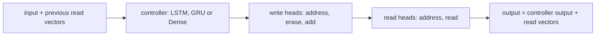

# memory

Keras 3 layers whose main feature is an explicit, addressable memory: a Neural Turing Machine (NTM), Self-Organizing Maps (SOM), and a differentiable memory grid called NeuroGrid. The package is `dl_techniques.layers.memory`, in `src/dl_techniques/layers/memory/`.

## What it is for

An ordinary layer keeps what it learned inside its weights. These layers keep something you can point at: a matrix of memory slots that a network reads and writes, or a grid of prototype vectors that inputs are matched against.

- The NTM (Graves et al., 2014) couples a small recurrent controller to a memory matrix. Read and write heads pick slots by content ("find the slot that looks like this key") and by location ("move one slot to the right"). Every step is differentiable, so ordinary backpropagation trains it. It suits tasks that need a scratchpad, such as copying or sorting sequences.
- A SOM (Kohonen, 1982) is a grid of prototype vectors. Each input finds its closest prototype, and that prototype and its grid neighbours move toward the input. Nearby grid cells end up holding similar prototypes. It is used for clustering, quantization and visualization.
- NeuroGrid is a grid of learned vectors read through a soft, factorized address. It is a differentiable alternative to the SOM winner search and works inside a network trained by gradient descent.

## How it works

Three families share the package.

**NTM.** One timestep, run by `NTMCell`, goes in this order:



Write heads run before read heads, so a read in the same timestep sees the memory that was just written. A head finds slots in up to four stages: content (cosine similarity to a key, then softmax), interpolation with the previous weights, circular shift, and sharpening. `AddressingMode.CONTENT` stops after the first stage. `AddressingMode.HYBRID` (the default) runs all four. `NeuralTuringMachine` wraps `NTMCell` in `keras.layers.RNN` and adds a `Dense` output projection.

MANN (memory-augmented neural network) has no class of its own. `create_mann(...)` returns a `NeuralTuringMachine` configured with MANN-style argument names.

**SOM.** There are two different learning styles:

- `SOMLayer` (and its 2D subclass `SOM2dLayer`) picks one hard winner per input. Its weight map is not trainable. The update runs inside `call()` when `training=True`, with no optimizer and no gradients. It returns the winner's grid coordinates and the distance to it.
- `SoftSOMLayer` uses a softmax over the whole grid instead of a single winner. Its weight map is trainable and moves only through gradients. It returns a soft reconstruction of the input and adds its own losses during training.

**NeuroGrid.** One `Dense` plus a temperature softmax per grid axis gives one distribution per axis. Their outer product is the joint address over all cells. The output is the probability-weighted sum of the grid vectors. A grid of `d1 * ... * dn` cells needs only `d1 + ... + dn` logits.

## Files

- `__init__.py` - re-exports 25 names. Import from the package, not the modules.
- `ntm_interface.py` - the NTM vocabulary: `AddressingMode`, the state dataclasses (`MemoryState`, `HeadState`, `NTMOutput`, `NTMConfig`), the abstract bases (`BaseMemory`, `BaseHead`, `BaseController`, `BaseNTM`), and the addressing helpers (`cosine_similarity`, `circular_convolution`, `sharpen_weights`).
- `baseline_ntm.py` - the working NTM: `NTMMemory`, `NTMReadHead`, `NTMWriteHead`, `NTMController`, `NTMCell`, `NeuralTuringMachine`, and the `create_ntm` builder.
- `som_nd_layer.py` - `SOMLayer`, the N-dimensional hard-winner SOM.
- `som_2d_layer.py` - `SOM2dLayer`, a thin 2D subclass of `SOMLayer` (the grid argument is called `map_size`).
- `som_nd_soft_layer.py` - `SoftSOMLayer`, the differentiable SOM.
- `neuro_grid.py` - `NeuroGrid`, the factorized-address memory grid, with analysis helpers (utilization, best matching units, input quality scores).
- `factory.py` - `create_mann` and `create_som_2d`. It also lists `create_ntm` in its `__all__`.

## How to use it

```python
import numpy as np
from dl_techniques.layers.memory import (
    create_ntm, create_mann, create_som_2d, SoftSOMLayer, NeuroGrid,
)

seq = np.random.rand(2, 6, 16).astype("float32")   # (batch, time, features)
vec = np.random.rand(4, 16).astype("float32")      # (batch, features)

# NTM: (batch, time, features) -> (batch, time, output_dim)
ntm = create_ntm(memory_size=16, memory_dim=8, output_dim=3)
y = ntm(seq)                                        # (2, 6, 3)

# MANN: output width = controller_units + num_read_heads * memory_dim
mann = create_mann(memory_locations=16, memory_dim=8, controller_units=12,
                   return_sequences=False)
y = mann(seq)                                       # (2, 20)

# Hard-winner SOM: coordinates and quantization error, updates itself
som = create_som_2d(map_size=(5, 5), input_dim=16)
bmu_coords, quant_err = som(vec, training=True)     # (4, 2) int32, (4,)
grid = som.get_weights_as_grid()                    # (5, 5, 16)

# Soft SOM: reconstruction, same shape as the input
soft = SoftSOMLayer(grid_shape=(5, 5), input_dim=16, temperature=0.5)
recon = soft(vec)                                   # (4, 16)
assign = soft.get_soft_assignments(vec)             # (4, 5, 5)

# NeuroGrid: rank 2 or rank 3 input
grid_layer = NeuroGrid(grid_shape=[5, 4], latent_dim=8)
out = grid_layer(vec)                               # (4, 8)
joint = grid_layer.get_addressing_probabilities(vec)["joint"]   # (4, 5, 4)
```

To keep the NTM state, build with `return_state=True`. The call then returns `(output, final_states)`.

## Things to know

- `SOMLayer` only learns when called with `training=True`. `predict` and plain calls do not update it. Its weights are non-trainable, so `model.fit` with an optimizer never changes them. `SoftSOMLayer` is the opposite.
- The SOM update averages over the batch, and by default its learning rate and neighbourhood radius shrink linearly with the number of inputs seen, against a fixed horizon of 1000 (the `max_iterations` weight). Once that horizon is passed the learning rate is held at 0 and the radius at 1e-4. A custom `decay_function` changes only the learning rate, not the radius.
- The SOM distance step builds a tensor of shape `(batch, num_neurons, input_dim)`. Large grids with large batches use a lot of memory. `SoftSOMLayer`'s topological loss also builds `num_neurons x num_neurons` tensors.
- `SoftSOMLayer` refuses `sharpness_weight > 0` together with `use_per_dimension_softmax=False`, because that loss needs the per-axis softmaxes.
- `NeuralTuringMachine.step()`, `initialize_state()` and `get_memory_state()` raise `NotImplementedError`, and `reset_memory()` does nothing. The RNN owns the state. Use `NTMCell.get_initial_state(...)` or `return_state=True`.
- `NTMConfig.shift_range` must be a positive odd integer.
- `NeuroGrid` defaults to an orthogonal-hypersphere grid initializer and a soft-orthonormal grid regularizer. Pass `grid_regularizer=None` to turn the regularizer off.
- `NeuroGrid.get_addressing_probabilities`, `find_best_matching_units` and the quality helpers flatten rank-3 input, so their leading axis is `batch * seq_len`.
- `get_quality_statistics` converts to NumPy, so keep it out of compiled training steps.
- Layers need the repo's Python environment (Keras 3 on TensorFlow 2.18). Each layer registers itself for `.keras` save and load through `register_dl_technique`.
