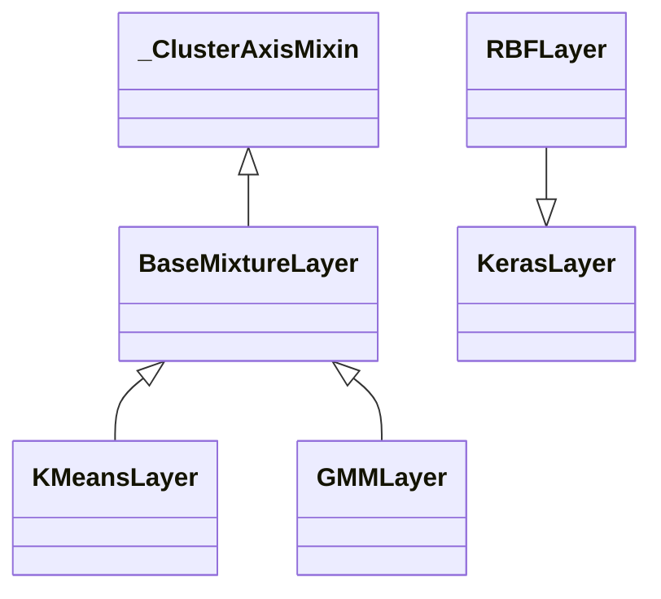

# mixtures

Path: `src/dl_techniques/layers/mixtures/`
Purpose: differentiable prototype layers (`RBFLayer`, `KMeansLayer`, `GMMLayer`), a shared cluster-axis base for two of them, and a registry factory.

## Scope

Lives here: the three layers, `base.py` (shared cluster-axis and initializer machinery), `factory.py`, and the curated `__init__.py`.
Does not live here: the MoE framework (`layers/moe/`), the memory/SOM layers (`layers/memory/`), or the GMM-based `LocalSupportGate` (`layers/statistics/local_support_gate.py`, which only refers to `GMMLayer` in its docstring).

Known external consumers: `models/vision/rbf_protonet/model.py` imports `create_mixture_layer` from `mixtures.factory`.

Tests: `tests/test_layers/test_mixtures/` (`test_factory.py`, `test_gmm.py`, `test_kmeans.py`, `test_radial_basis_function.py`, `cluster_axis_oracle.py`, `mean_shift_oracle.py`, `test_mean_shift_ops.py`, `test_the_dead_centroid_keeps_its_distinctiveness.py`, `test_the_dynamic_non_batch_axis_survives_a_concrete_call.py`) and the repo-wide `tests/test_layers/test_factory_registry_drift.py`.

## Architecture



`BaseMixtureLayer(_ClusterAxisMixin, keras.layers.Layer, ABC)`. The mixin comes first in the MRO so its `compute_output_shape` wins over `Layer`'s. `RBFLayer` subclasses `keras.layers.Layer` directly and is deliberately outside the hierarchy: it has no `cluster_axis` (always uses the last axis) and no `mixture` reconstruction mode, and its constructor shares no kwarg by name with the other two. A unified base was considered and rejected; do not re-open without new evidence.

Forward flow for K-means and GMM (`call`):

1. Cast inputs to `self.variable_dtype`.
2. `_reshape_for_clustering(inputs)` returns `(flat, leading)`: transpose by `non_feature_dims + cluster_axis` (skipped when `cluster_axis == [rank-1]`), then reshape to `(-1, feature_dims)`. `leading` is a 1-D int32 tensor of the concrete non-feature axis lengths, read off the live tensor after the transpose.
3. Score rows (K-means: `pairwise_squared_distance` then `softmax(-d / temperature)`; GMM: Gaussian log-density, add `log_softmax(mixture_logits)`, `softmax(. / temperature)`).
4. Training side effect gated by `resolve_training_factor(training, variable_dtype)` (returns `None`, python `1.0`, or a 0/1 scalar tensor).
5. Output is `assignments` (rows x K) or `mixture` (`assignments @ prototypes`), computed from the pre-update centroids in K-means.
6. `_reshape_output(output, leading)` inverts the transpose, then cast to `self.compute_dtype`.

RBF flow: `pairwise_squared_distance(inputs, centers)`, times `softplus(gamma_raw)`, then `basis`: `exp(-min(x, 50.0))` or `normalized`: `softmax(-x)`. Repulsion loss added via `add_loss` when `units > 1 and repulsion_strength > 0` and training.

## Key files

| File | Role | Notes |
| --- | --- | --- |
| `__init__.py` | Public surface | `__all__` has 9 names: `RBFLayer`, `KMeansLayer`, `GMMLayer`, `MixtureType`, `MIXTURE_REGISTRY`, `create_mixture_layer`, `create_mixture_from_config`, `get_mixture_info`, `validate_mixture_config`. Base classes are not exported. |
| `base.py` | `_ClusterAxisMixin`, `BaseMixtureLayer`, `resolve_initializer_arg`, `resolve_prototype_initializer`, `OutputMode`, `Axis` | Holds the mixed-precision contract text. |
| `kmeans.py` | `KMeansLayer` | EMA codebook, `trainable=False` centroids and momentum buffer. |
| `gmm.py` | `GMMLayer` | Trainable means, log-variances, mixing logits, optional `covariance_factors`. |
| `radial_basis_function.py` | `RBFLayer` | Trainable centers and `gamma_raw`. |
| `mean_shift_ops.py` | Stateless mean-shift functions | Not exported from `__init__`, not registered; float64 oracle in `tests/test_layers/test_mixtures/mean_shift_oracle.py`. |
| `factory.py` | `MIXTURE_REGISTRY`, validation, creation | Non-strict on unknown kwargs (warns, drops). |

## Public interface

Registration: `@register_dl_technique("dl_techniques.layers.mixtures.<module>")` on each concrete layer (`gmm`, `kmeans`, `radial_basis_function`). `BaseMixtureLayer` is not registered on purpose.

`RBFLayer(units, gamma_init=None, repulsion_strength=0.1, min_distance=1.0, center_initializer='uniform', center_constraint=None, trainable_gamma=True, safety_margin=0.2, center_regularizer=None, gamma_regularizer=None, output_mode='basis', **kwargs)`. Output `(batch, ..., units)`. `VALID_OUTPUT_MODES = {'basis','normalized'}`. Properties `gamma`, `center_positions`, `width_values`.

`KMeansLayer(n_clusters, temperature=0.1, momentum=0.9, centroid_lr=0.1, repulsion_strength=0.1, min_distance=1.0, output_mode='assignments', cluster_axis=-1, centroid_initializer='orthonormal', centroid_regularizer=None, random_seed=None, **kwargs)`. `VALID_OUTPUT_MODES = {'assignments','mixture'}`. Property `cluster_centers`. Method `reset_centroids(new_centroids=None)` (also zeroes the momentum buffer).

`GMMLayer(n_components, temperature=1.0, isometric_regularizer_strength=0.01, variance_floor=1e-3, output_mode='assignments', cluster_axis=-1, mean_initializer='orthonormal', log_variance_initializer='zeros', mean_regularizer=None, random_seed=None, covariance_type='diagonal', covariance_rank=1, factor_initializer='glorot_uniform', **kwargs)`. `VALID_OUTPUT_MODES = {'assignments','mixture'}`. Properties `component_means`, `component_variances`, `mixture_weights`. Method `reset_parameters(new_means=None)`.

Constructor validation (raises `ValueError`): positive int for `units` / `n_clusters` / `n_components` (bool rejected; RBF only rejects bool and non-positive, so numpy ints pass); `temperature > 0`; K-means `momentum in [0,1)`, `centroid_lr in (0,1]`, `min_distance > 0`; GMM `variance_floor > 0`, `isometric_regularizer_strength >= 0`, `covariance_type in {'diagonal','low_rank'}`, `covariance_rank` positive int; RBF `gamma_init` (if given) `> 0`, `safety_margin >= 0`.

Factory (`factory.py`):

- `MixtureType = Literal['rbf','kmeans','gmm']`.
- `MIXTURE_REGISTRY: Dict[str, Dict]` with keys `class`, `description`, `required_params`, `optional_params` (constructor defaults), `use_case`. Required: `rbf` -> `['units']`, `kmeans` -> `['n_clusters']`, `gmm` -> `['n_components']`.
- `create_mixture_layer(mixture_type, name=None, **kwargs) -> keras.layers.Layer`. Calls `validate_mixture_config`, merges registry defaults then kwargs, filters to `required | optional | _KERAS_BASE_PARAMS`, builds the class. Any `TypeError`/`ValueError` is re-raised as a `ValueError` with the type, required params, provided params and original message.
- `create_mixture_from_config(config)` pops `'type'` from a copy and calls `create_mixture_layer`. Raises `ValueError` if not a dict or no `type`.
- `get_mixture_info()` returns `copy.deepcopy(MIXTURE_REGISTRY)`.
- `validate_mixture_config(mixture_type, **kwargs)` checks: known type; required present; count params (`units`, `n_clusters`, `n_components`) positive non-bool int; `temperature`, `gamma_init`, `min_distance`, `variance_floor` positive; `repulsion_strength`, `isometric_regularizer_strength`, `safety_margin` non-negative; `output_mode` in `mixture_info['class'].VALID_OUTPUT_MODES`.
- `_KERAS_BASE_PARAMS = {'name','dtype','trainable','activity_regularizer','autocast'}` are always forwarded.

## Data shapes

| Layer | Weight | Shape | Trainable |
| --- | --- | --- | --- |
| `RBFLayer` | `centers` | `(units, D)` | yes (`center_constraint` / `center_regularizer` apply) |
| | `gamma_raw` | `(units,)` | `trainable_gamma` |
| `KMeansLayer` | `centroids` | `(n_clusters, D)` | no |
| | `centroid_momentum` | `(n_clusters, D)` | no |
| `GMMLayer` | `means` | `(n_components, D)` | yes |
| | `log_variances` | `(n_components, D)` | yes |
| | `mixture_logits` | `(n_components,)` | yes |
| | `covariance_factors` | `(n_components, D, covariance_rank)` | yes; exists only for `covariance_type='low_rank'` |

`D` is the product of the sizes of the cluster axes (K-means, GMM) or the last input dim (RBF; must be statically known).

Output shapes (`compute_output_shape` in the mixin): `assignments` replaces the cluster axes by one axis of size K at the position of the first cluster axis; `mixture` returns the input shape.

`get_config()` keys: RBF adds `units, gamma_init, repulsion_strength, min_distance, center_initializer, center_constraint, trainable_gamma, safety_margin, center_regularizer, gamma_regularizer, output_mode`. K-means adds `n_clusters, temperature, momentum, centroid_lr, repulsion_strength, min_distance, output_mode, cluster_axis, centroid_initializer, centroid_regularizer, random_seed`. GMM adds `n_components, temperature, isometric_regularizer_strength, variance_floor, output_mode, cluster_axis, mean_initializer, log_variance_initializer, mean_regularizer, random_seed, covariance_type, covariance_rank, factor_initializer`. Each layer has a `from_config` that deserializes initializers, regularizers (and the RBF constraint); the string `'orthonormal'` is kept as a string.

## Invariants and constraints

- Two forms of the cluster axis. `_cluster_axis_arg` is the constructor value (negatives kept, never mutated); `get_config()` and `compute_output_shape()` use it, because `compute_output_shape` can run before `build()`. `cluster_axis` is rewritten by `_setup_cluster_axes()` in `build()` to positive and sorted, always re-derived from `_cluster_axis_arg` so a second `build()` is idempotent. `_init_cluster_axis` must `list()`-copy so the two do not alias. Do not conflate them.
- Axis 0 as a cluster axis raises `ValueError` in `_setup_cluster_axes`. The check runs after negative-to-positive normalization and before the range check. Without it, clustering over the batch leaks values across samples.
- `_reshape_output` inverts the forward layout with a `transpose`, never a bare `reshape`. The `assignments` and `mixture` branches compute different permutations; do not merge them. Both are identity on the last-axis fast path.
- The non-feature axis lengths come from the live tensor (`leading`), not from `original_shape`, because `original_shape` can hold `None` for a variable-length model.
- Subclasses of `BaseMixtureLayer` must set `output_mode`, call `_init_cluster_axis(cluster_axis)` in `__init__`, call `_setup_cluster_axes()` in `build()`, set `feature_dims` and `non_feature_dims` there, and implement `call` and the `_n_prototypes` property. `_n_prototypes` is only a naming seam over `n_components` / `n_clusters`; do not rename the public attributes (they are config keys and registry params).
- Mixed precision: every prototype weight is created with `autocast=False` and `dtype=self.dtype`; every `call` casts inputs to `variable_dtype` first and the result to `compute_dtype` last. RBF follows this too even though it is outside the base class.
- `resolve_initializer_arg` keeps the string `'orthonormal'` (it is not a Keras alias). `resolve_prototype_initializer` (at `build()`) turns it into `OrthonormalInitializer(seed)` when `count <= feature_dims`, else logs a warning and uses `GlorotNormal(seed)`. Detection uses `isinstance`, not a class-name check.
- K-means `call` computes `output` before `_update_centroids`, so `assignments` and the `mixture` reconstruction use the same pre-update centroids. Do not reorder.
- K-means update (`_update_centroids`): `alive = cluster_mass > _MIN_CLUSTER_MASS (1e-6)`; `update = alive * (target - c) + repulsion`; `m = momentum*m + (1-momentum)*update`; `c += centroid_lr * m`. Repulsion is not gated by `alive`. Do not raise `_MIN_CLUSTER_MASS` toward 1e-3 (it freezes large codebooks at small batch). Centroids must stay `trainable=False` or an optimizer double-updates them.
- Training gating uses `resolve_training_factor`; the python-float path is the exact unmasked path, a tensor path multiplies the loss or masks both assigns. Never coerce a symbolic `training` to a bool.
- GMM variances: `clip(exp(log_variances), variance_floor, 1e6)`; the `1e6` ceiling (`_VARIANCE_CEILING`) is not configurable on purpose. The low-rank density uses one Cholesky of `I + U^T diag(1/d) U` for both log-det and the quadratic form via `keras.ops.linalg.solve_triangular`; do not swap to `slogdet`. The guard is `test_low_rank_matches_dense_reference` in `test_gmm.py`; do not loosen its tolerance if it fails.
- GMM isometric loss reads `log_variances` only, in both covariance modes. Under `low_rank` it regularizes the residual diagonal, not the total covariance. Do not add a term over the factors. Only an `info` log is emitted for `low_rank` with strength > 0.
- GMM `reset_parameters()` re-runs `factor_initializer` for `covariance_factors` (not zeros, which is an untrainable point). No-arg resets in GMM and K-means must stay unseeded (`keras.random.normal` with an int seed is stateless and would repeat).
- RBF: `gamma_init` default is resolved in `build()` into `_gamma_init_resolved` (build-time state, never serialized): explicit float, else `1.0` for `normalized`, else `1/D`. Do not use `1/sqrt(D)`, do not move it to `__init__`. The `50.0` clip (`_EXP_CLIP_MAX`) applies to `basis` only; do not feed a clipped value to the `normalized` softmax and do not normalize by division or after the dtype cast (float16 NaN). Inverse-softplus init is `log(expm1(g))`, or `g` itself above `_SOFTPLUS_LINEAR_THRESHOLD = 20.0`.
- RBF repulsion loss: `repulsion_strength * sum(offdiag penalty) / (units*(units-1))`, threshold `min_distance * (1 + safety_margin)`, sqrt epsilon `_REPULSION_SQRT_EPSILON = 1e-7` (not the Keras global). No per-dimension multiplier.
- `output_mode` sets are per class (`VALID_OUTPUT_MODES`) and must stay separate. Never form a union or move them to a shared base: the factory would reject RBF's `basis` / `normalized`.
- The `MixtureType` Literal and `MIXTURE_REGISTRY` keys must name the same set. `_check_registry_literal_consistency` runs at import and raises `RuntimeError` otherwise (a real raise, not `assert`).
- `optional_params` in the registry must mirror constructor defaults exactly, including `output_mode` for RBF and `gamma_init: None`. Omitting a parameter makes the factory filter silently drop it, and `test_factory_registry_drift.py` goes red.
- `get_mixture_info()` must stay a deep copy; a shallow copy lets callers mutate defaults process-wide.

## Dependencies

Internal:

- `dl_techniques.utils.logger.logger` (warnings and info).
- `dl_techniques.utils.keras_registration.register_dl_technique`.
- `dl_techniques.utils.tensors`: `resolve_training_factor` (all three layers), `pairwise_squared_distance` (K-means, RBF).
- `dl_techniques.initializers.orthonormal_initializer.OrthonormalInitializer` (`base.py`).

External: `keras` (all math through `keras.ops`), `numpy` (`np.prod` in `base.py`; `np.log` / `np.expm1` / `np.pi` in `gmm.py` and `radial_basis_function.py`).

## Failure modes

- Reading build-derived attributes (`feature_dims`, `non_feature_dims`, `original_shape`, `input_rank`) before `build()` fails with a `TypeError` on the `None` placeholders. Only `compute_output_shape` is safe pre-build.
- `build()` with fewer than 2 input dims raises `ValueError` (all three). RBF also raises if the last dim is `None`. K-means and GMM raise `ValueError` for a cluster axis equal to 0 or out of range, or for an input shape where the cluster axes have `None` size (`_compute_feature_dims`).
- Orthonormal init with `count > feature_dims` falls back to Glorot normal with a logged warning, not an error.
- GMM `low_rank` with `covariance_rank >= feature_dims` logs a warning and still builds.
- `reset_parameters` / `reset_centroids` raise `ValueError` if unbuilt or if the supplied tensor has the wrong shape.
- `centroid_regularizer` set on K-means: warning only; `layer.losses` stays empty.
- RBF `basis` with non-standardized input or large `D`: gradients go to exactly zero or below useful size, no error. RBF `normalized` can produce NaN only on float32 overflow of the unclipped exponent (`D * gamma * max|x|^2 > 3.4e38`).
- Factory: unknown type, missing required param, bad range or bad `output_mode` raise `ValueError` (wrapped with context). Unknown extra kwargs are only logged as a warning and dropped.
- K-means under multi-replica `tf.distribute`: centroids diverge per replica (no all-reduce).
- Masks are ignored by all three layers.

## Working here

- Style: Sphinx/reST docstrings (`:param:` / `:type:` / `:raises:`), `import keras` and qualify (`keras.ops.*`), no raw TensorFlow, logging through `dl_techniques.utils.logger`. Match the file you edit.
- Adding a mixture layer: put it in its own module, decorate with `@register_dl_technique("dl_techniques.layers.mixtures.<module>")`, give it `VALID_OUTPUT_MODES`, `get_config` / `from_config`; subclass `BaseMixtureLayer` only if it truly uses `cluster_axis`. Then add the type to `MixtureType`, to `MIXTURE_REGISTRY` (class, description, `required_params`, `optional_params` mirroring the constructor, `use_case`), to the imports in `factory.py`, and to `__init__.py` imports and `__all__`. Add tests under `tests/test_layers/test_mixtures/`. The registry and Literal are public API; renaming or removing a key is breaking.
- Adding a constructor parameter: update `get_config`, `from_config` if it needs deserialization, the factory `optional_params`, and the docstring together.
- A K-means or GMM change that touches axis handling: run the tests in `test_kmeans.py`, `test_gmm.py` and the two `test_the_*` files, which use `cluster_axis_oracle.py`.
- Run only this package's tests (the full suite takes about 1.5 hours):

```bash
.venv/bin/python -m pytest tests/test_layers/test_mixtures/ tests/test_layers/test_factory_registry_drift.py -q
```

- A `rbf_protonet` change that touches the RBF layer should also run `tests/test_models/test_rbf_protonet/`.
