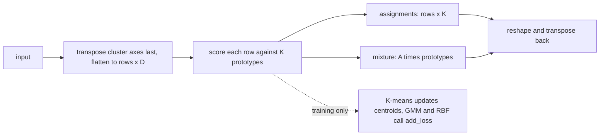

# mixtures

Three Keras 3 layers that compare inputs to a set of learned prototypes (`RBFLayer`, `KMeansLayer` and `GMMLayer`), and a fourth layer, `MeanShiftLayer`, that moves a set of points toward its density modes. A small factory builds any of them from a string and a config dict. The package lives at `src/dl_techniques/layers/mixtures/` in the `dl_techniques` library.

## What it is for

A prototype is a learned point in feature space (a center, a centroid or a mean). Each layer scores how close an input is to every prototype and returns one number per prototype. The three prototype layers differ in what the score means and how the prototypes move.

- K-means answers "which centroid is this input nearest to?" with a soft, temperature-controlled assignment.
- RBF answers "how strongly does this input activate each kernel?". It is a feature map that is usually followed by a linear layer.
- GMM answers "what is the probability that each Gaussian component produced this input?". It also learns each component's spread and weight.

The three prototype layers accept inputs of any rank of 2 or more and work inside normal `fit` / `predict` loops. `MeanShiftLayer` takes a point set `(batch, N, D)`.

## How it works

| | `KMeansLayer` | `RBFLayer` | `GMMLayer` |
|---|---|---|---|
| Prototype | centroid | center plus a width `gamma` | mean, variance (diagonal or low-rank) and a mixing weight |
| Score | softmax of `-||x - c||^2 / temperature` | `exp(-gamma * ||x - c||^2)` | softmax of `(log pi + log N(x)) / temperature` |
| How prototypes move | a momentum update inside `call` during training (not by the optimizer; centroids are `trainable=False`) | normal gradient descent | normal gradient descent |
| Extra training loss | none (repulsion is part of the centroid update) | repulsion loss between centers via `add_loss` | isometric loss on the log-variances via `add_loss` |
| `cluster_axis` | yes | no, always the last axis | yes |
| `output_mode` values | `assignments`, `mixture` | `basis`, `normalized` | `assignments`, `mixture` |
| Base class | `BaseMixtureLayer` | `keras.layers.Layer` | `BaseMixtureLayer` |

Shared cluster-axis handling (K-means and GMM only): `cluster_axis` names one or more input axes. Their sizes are multiplied into one feature vector `D`. The layer transposes those axes to the end, flattens to `(rows, D)`, scores against `K` prototypes, then restores the original axis order. In `assignments` mode the cluster axes collapse into one axis of size `K`. In `mixture` mode the output has the input's shape, rebuilt as a responsibility-weighted sum of the prototypes. Axis 0 (the batch) is refused.



Details per layer:

- K-means: during training, each centroid is pulled toward the assignment-weighted mean of the batch. A centroid with almost no mass in the batch gets no data pull (so it does not drift to the origin). A repulsion term pushes centroids apart when they are closer than `min_distance`. The combined delta goes through a momentum buffer, then `centroids += centroid_lr * momentum`.
- GMM: variances are stored as log-variances and clipped between `variance_floor` and `1e6`. With `covariance_type='low_rank'` the covariance is `diag(d) + U U^T` (factor analysis), evaluated with the determinant lemma and Woodbury identity so no `D x D` matrix is built. The isometric loss penalizes how much each component's log-variances differ across dimensions.
- RBF: `gamma` is stored as a raw value and passed through softplus so it stays positive. `normalized` mode is a softmax over `-gamma * dist^2`.

## Files

- `__init__.py` - re-exports `RBFLayer`, `KMeansLayer`, `GMMLayer`, `MeanShiftLayer`, `assign_clusters` and the factory names.
- `base.py` - `BaseMixtureLayer` (abstract), `_ClusterAxisMixin` (shared axis and reshape logic), `resolve_initializer_arg`, `resolve_prototype_initializer`, and the `OutputMode` / `Axis` type aliases.
- `kmeans.py` - `KMeansLayer`.
- `gmm.py` - `GMMLayer`.
- `radial_basis_function.py` - `RBFLayer`.
- `mean_shift_ops.py` - stateless mean-shift functions (squared distance, kernel logits, one step, density, iteration, median bandwidth); not exported from the package. A masked key gets weight exactly 0 at any bandwidth (the row maximum runs over the kept logits only, no fixed mask constant), and squared distances and Gaussian logits are formed on points centred by a key mean, so a constant offset of the data costs no float32 digits.
- `mean_shift.py` - `MeanShiftLayer` and the eval-only `assign_clusters`.
- `factory.py` - `MIXTURE_REGISTRY`, `MixtureType`, `create_mixture_layer`, `create_mixture_from_config`, `get_mixture_info`, `validate_mixture_config`.

## MeanShiftLayer and assign_clusters

Mean shift moves every point to the kernel-weighted mean of the point set, so repeated steps carry the points toward the modes of their kernel density estimate. `MeanShiftLayer(num_steps=5, bandwidth=1.0, ...)` runs `num_steps` damped steps on `(batch, N, D)` points and returns the shifted points `(batch, N, D')`, optionally with the last-step affinity `(batch, N, N)`. Every step is a softmax computed in at least float32, so the map is differentiable: a loss on the shifted points reaches the inputs, an optional bias-free projection (`use_projection=True`, `projection_dim=P`) and the bandwidth, which is one learnable scalar stored as `log h`, clipped to `[1e-2, 1e2]`. The constructor accepts `bandwidth` in `[0.01001, 99.9]` only (the clip range less a relative margin of 1e-3): at an end of the range the clip is active from the start and the learnable bandwidth gets exactly zero gradient. A large bandwidth against the spacing of the data collapses a blurring output (every point merges), so start near the spacing of the instances. With `blurring=True` the keys move with the points (the set contracts as a whole); with `blurring=False` they stay at the inputs. The `vmf` kernel works on unit-sphere points.

A `(batch, N)` keep mask passed as `mask=` removes masked points as keys at every step; the shifted values of masked points are still computed, so ignore them. The layer holds no cluster count and no labels. `assign_clusters(shifted, merge_radius, mask=None)` reads labels off converged points in NumPy: points are visited in index order and join the first existing cluster center within `merge_radius`, else open a new cluster, so labels depend on the order of the points. Pass the same `(N,)` or `(batch, N)` keep mask: masked points get label `-1` and never open or join a cluster. It is eval-only, not differentiable and not for use inside a training graph.

## How to use it

```python
import keras
from dl_techniques.layers.mixtures import (
    GMMLayer, KMeansLayer, RBFLayer, create_mixture_layer,
)

# Soft responsibilities over 8 Gaussian components, per token.
inputs = keras.Input(shape=(32, 64))
resp = GMMLayer(n_components=8)(inputs)             # (batch, 32, 8)

# Same thing through the factory.
layer = create_mixture_layer('gmm', n_components=8, covariance_type='low_rank', covariance_rank=4)

# K-means over the last axis; centroids move only when training=True.
km = KMeansLayer(n_clusters=16, output_mode='mixture')

# RBF features; 'normalized' is the mode that trains well.
rbf = RBFLayer(units=32, output_mode='normalized')

# Pull a point set toward its modes, then read labels out once, outside the graph.
from dl_techniques.layers.mixtures import MeanShiftLayer, assign_clusters
shifted = MeanShiftLayer(num_steps=5, bandwidth=1.0)(points)    # points: (batch, N, D)
labels = assign_clusters(keras.ops.convert_to_numpy(shifted), merge_radius=0.5)  # NumPy, eval-only
```

Config-driven: `create_mixture_from_config({'type': 'kmeans', 'n_clusters': 16})`. `get_mixture_info()` returns a deep copy of the registry with each type's required and optional parameters and defaults.

## Things to know

- `RBFLayer` with the default `output_mode='basis'` is slow to train and its gradient falls below a useful size past roughly 400 input features. It also needs roughly standardized inputs (scale and mean well below 7). Use `output_mode='normalized'` if the layer must learn. The numbers are in the `RBFLayer` docstring.
- `gamma_init=None` resolves at build time: `1/D` in `basis` mode, `1.0` in `normalized` mode. An explicit float always wins.
- The `output_mode` vocabularies are separate on purpose: `assignments` / `mixture` for K-means and GMM, `basis` / `normalized` for RBF, and none for `mean_shift` (its legal set is empty, so the factory rejects any `output_mode` for it). The factory checks the value against the target class's own `VALID_OUTPUT_MODES`.
- `KMeansLayer.centroid_regularizer` has no effect (centroids are not trainable, so Keras never collects the penalty) and logs a warning if set. `GMMLayer.mean_regularizer` is live.
- `KMeansLayer` updates centroids only when `training` is true. Calling with `training=None` or `False` never changes them. The update is replica-local, so it is not valid under `tf.distribute` with several replicas.
- `RBFLayer`, `KMeansLayer` and `GMMLayer` do not support masks. Padded positions are treated as real data. Remove padding first. `MeanShiftLayer` does honour a `(batch, N)` keep mask passed as `mask=`.
- `GMMLayer` with `covariance_type='low_rank'` and `factor_initializer='zeros'` gives a factor that never trains (zero gradient at zero).
- `reset_parameters()` (GMM) and `reset_centroids()` (K-means) with no argument draw fresh, unseeded random values on every call.
- The factory is non-strict: an unknown keyword is dropped with a logged warning rather than raising. Required parameters and value ranges still raise `ValueError`.
- `cluster_axis` is saved as given (negative values kept), so a saved layer reloads correctly for a different input rank.
- Under mixed precision the prototype weights and the math stay in float32; only the output is cast to the compute dtype. `MeanShiftLayer` follows the same rule.
- `BaseMixtureLayer` and `_ClusterAxisMixin` are not exported from the package and are not meant for outside subclassing.
